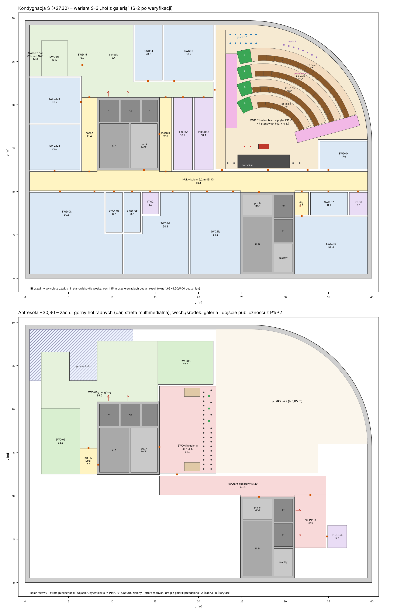
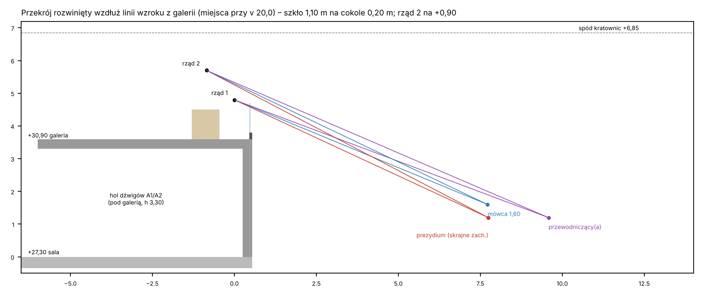

# Kondygnacja Sejmiku S-2 (+27,30) z antresolą (+30,90) – wariant „hol z galerią”

**Opracowanie do scalenia z `koncepcja_wybrana.md` (rozdz. 7) i `model/koncepcja.json["kondygnacja_sejmiku"]`** · 17.11.2026
Przedmiot: usunięcie błędów K1, K2, K3, I1, I4 (oraz D1, D6, D9, D13, D14 i części I3, I5) z `weryfikacja_program.md`.
Poprawkę weryfikatora „S-2” potraktowano jako hipotezę, sprawdzono ją i porównano z wariantami (rozdz. 2). Przyjęto wariant **S-3 „hol z galerią”**: zachowuje szkielet S-2, ale inaczej rozwiązuje galerię, górny hol i rozdzielenie publiczności od radnych.
Nie korzystano z żadnych informacji o rzeczywistych pracach ani wynikach konkursu. Źródła: wyłącznie materiały repozytorium.

**Pliki**
* `kondygnacja_S2.json` – dane do scalenia w strukturze `kondygnacja_sejmiku` (poligony uv i en, rzędy, galeria, drzwi, układ trzonów, bilans).
* `img/s2_plan.png` – rzuty S i antresoli.
* `img/s2_przekroj.png` – przekrój linii wzroku z galerii.

**Dowody (uruchomienie z katalogu `umwd/`):**

| Skrypt | Zakres | Sekcje wydruku |
|---|---|---|
| `python3 docs/20_koncepcja/_s2_model.py` | geometria (jedno źródło) | – |
| `python3 docs/20_koncepcja/_s2_geometria.py` | poprawność, kolizje, drzwi, bilans, eksport JSON | [G1]–[G8] |
| `python3 docs/20_koncepcja/_s2_sala.py` | rzędy, pochylnie, linie wzroku, poufność, olśnienie, warianty | [S1]–[S7] |
| `python3 docs/20_koncepcja/_s2_ewakuacja.py` | ewakuacja, dźwigi, holy windowe | [E1]–[E6] |
| `python3 docs/20_koncepcja/_s2_rzut.py` | PNG | – |

Wszystkie liczby w tekście pochodzą z tych wydruków (shapely 2.2, układ uv wieży z `koncepcja.json`).

---

## 1. Decyzja projektowa w skrócie

1. **Sala obrad** pozostaje w narożu NE pod łukiem („Latarnia”). Ma 4 łukowe rzędy wokół mównicy w F = (27,50; 15,20), na podestach +0,00 / +0,09 / +0,18 / +0,27.
   * Przewyższenie 0,09 m na rozstaw 1,80 m daje dokładnie 5,0 %. Dzięki temu oba przejścia (wsch. promieniowe i zach. wzdłuż ściany sali) są pochylniami ≤ 5 % bez spoczników i bez traconych łuków na rampy styczne.
   * **47 stałych stanowisk:** 43 standardowe + 4 dla wózków, po jednym w każdym rzędzie przy pochylni.
   * Prezydium i mównica stoją na posadzce, przy pełnej ścianie pd.
2. **Galeria publiczności** (31 miejsc + 3 dla wózków) leży na antresoli **nad holem dźwigów A1/A2**, w pasie między trzonem A a salą (u 15,5–22,0 × v 12,6–22,65).
   * Do sali otwiera się balustradą szklaną 1,10 m. Ma 2 strome rzędy: +0,00 i +0,90.
   * Publiczność wchodzi z Wejścia Obywatelskiego dźwigami P1/P2: przystanek +30,90 → hol P1/P2 → chroniony korytarz nad kuluarem → galeria. Strefy radnych nie przecina.
   * Drogi ewakuacyjne z galerii prowadzą do przedsionka A (klatka A przedłużona do +30,90) i do przedsionka B (klatka B przedłużona do +30,90).
3. **Hol reprezentacyjny ma dwa poziomy.**
   * Dolny: pustka 2-kond. w narożu NW (okna pn. 1,65 × 5,0 na Ostrów Tumski i zach. na pl. Społeczny), hol dźwigów A1/A2 i szatnia.
   * Górny: antresola radnych z barem SWD.05 i strefą multimedialną SWD.03.
   * Poziomy łączą otwarte schody reprezentacyjne w pustce holu i dźwigi A1/A2 (drzwi pn. także na +30,90).
   * Wolna podłoga holu wynosi **74,8 + 89,6 = 164,4 m²**. Szatnia (12,5 m²) i bar (32,0 m²) są liczone osobno.
4. **Wszystkie pomieszczenia zamknięte programu leżą na poziomie głównym** i mają drzwi na komunikację:
   * 4 kluby;
   * 2 sale komisji z zapleczami;
   * wspólna sala radnych;
   * pokój socjalny;
   * reżyserka;
   * pokój matki z dzieckiem;
   * magazyn;
   * WC K i M (każde z kabiną dostępną);
   * pomieszczenie porządkowe;
   * PD.

   Na antresoli są tylko strefy otwarte, galeria i dojścia. Wyjątki to toaleta publiczności oraz przedsionek A' (rozdz. 7).
5. **Elewacje bez zmian.** Antresola jest wszędzie odsunięta ≥ 1,35 m od lica elewacji; w pasie przyelewacyjnym jest jej 0,00 m² [G6]. Okna 1,65 × 4,20 m (pd., zach.) i 1,65 × 5,00 m (pn.) zachowują pełną wysokość.
   * Jedyna zmiana jest niewidoczna z zewnątrz: pierwsze 2,4 m łuku przy reżyserce (φ 0–10°) dostaje szkło nieprzezierne za lamelami [S5].
6. **Trzony bez zmiany obrysów.** Plan zakłada układ wewnętrzny zgodny z I5:
   * trzon A: dźwigi A1/A2 (1 600 kg, kabina 1,5 × 2,1) w pasie pn. z drzwiami na pn.; dźwig R z drzwiami do przedsionka A;
   * trzon B: dźwig T przeniesiony do segmentu, P1/P2 (1 600 kg) z drzwiami wsch., szachty w miejscu T.

   Uwagi do scalenia – rozdz. 9.

---

## 2. Weryfikacja hipotezy S-2 i porównanie wariantów

| Kryterium | v1.0 (spec.) | S-2 (weryfikator) | **S-3 (przyjęty)** | Dowód |
|---|---|---|---|---|
| Galeria – położenie | pd., nad prezydium | zach. nad reżyserką/WC | zach. nad holem dźwigów A1/A2 | [S3], [S6] |
| Kąt patrzenia na prezydium (0° = na wprost) | ~180° (nad głową) | 56°–90° (mediana 77°) | **34°–91° (mediana 60°)**; miejsca skupione w pn. części | [S3] |
| Linia wzroku galerii (C ≥ 60 mm) | nie | nie sprawdzano (płaskie rzędy co 1,0 m) | **C ≥ 77 mm** do wszystkich 4 członków prezydium i mówcy; zapas nad cokołem ≥ 289 mm | [S3] |
| Galeria w łuku NE (za radnymi, widok frontalny) | – | – | odrzucona: przy głęb. 2,5 / 3,3 m mieści się tylko 38 / 31 stanowisk; 1-rzędowa ma front 18,0 m < 21,2 m | [S6] |
| Stanowiska radnych | 44 deklarowane (40 możliwe) | 48 (bez geometrii pochylni) | **47 = 43 + 4 dla wózków** z geometrią przejść 5 % | [S1] |
| Antresola | 69,7 m² | 179,8 m² | **297,9 m²** (radni 161,4 + publiczność 136,5) | [G6] |
| Rozdział publiczność / radni na antresoli | – | wspólna płyta (galeria + bar + hol górny) | dwie oddzielne antresole przedzielone ścianą i pustką sali | [G6], rys. |
| Dostęp do baru/hol górny | – | tylko dźwig lub klatka ppoż. | schody reprezentacyjne w pustce holu + A1/A2 | rys. |
| Płyta nad klubami zach. a okna 4,20 m | – | płyta do elewacji (kolizja z oknami) | wycofanie 1,35 m, okna bez zmian | [G6] |
| Hol (bez szatni i baru) | 5,8 m² realnie | 139,6 m² (70,3 + 69,3) | **164,4 m²** (74,8 + 89,6) | [G4] |
| WC na S | 25,3 m² + PHS.05c bez wyjścia | 40 m² | **42,5 m²**: K 18,4 + M 18,4 (kabiny dostępne 2,2 m) + publiczna 5,7 | [G4] |
| Ściany wewn. – średnio | 0,151 m | 47 m² (szac.) | **0,219 m** (100 % ≥ 0,18 m; ściany sali 0,30 m) | [G5] |
| M.13: 3,6 m przed dźwigami | nie | „nie da się” | **A1/A2 5,95 m; P1/P2 na +30,90 3,60 m** | [E5] |

**Wnioski z weryfikacji S-2.** Kierunek S-2 jest słuszny: antresola ~ 2–3 × większa, klatka A do +30,90, 4 rzędy, galeria zach. Rozwiązanie S-2 ma jednak cztery słabości:
* mieszanie publiczności z barem i holem radnych na jednej płycie;
* bar osiągalny tylko dźwigiem lub klatką ewakuacyjną;
* płytę antresoli wchodzącą w okna 4,20 m klubów zach.;
* płaskie rzędy galerii bez sprawdzenia linii wzroku.

S-3 usuwa te słabości. Kosztem jest większa antresola (rozdz. 9, pkt 3).

---

## 3. Pomieszczenia i bilans powierzchni (netto z poligonów, PN-ISO 9836) [G4]

| Kod | Pomieszczenie | Poziom | Pow. [m²] | Program [m²] | Zakres | Δ [m²] |
|---|---|---|---:|---:|---|---:|
| SWD.01 | Sala obrad – płyta (47 stanowisk, prezydium, mównica, goście 12, media 8, obsługa 4, PJM 2) | S | 232,0 | | | |
| SWD.01g | Galeria publiczności (część SWD.01): 31 miejsc + 3 dla wózków | ANT | 65,3 | | | |
| **SWD.01** | **razem** | | **297,3** | 320 | 280–380 ✔ | −22,7 |
| SWD.02 | Hol reprezentacyjny – poziom dolny (pustka 2-kond. NW, hol dźwigów, pas pn.) | S | 74,8 | | | |
| SWD.02g | Hol reprezentacyjny – poziom górny (antresola radnych) | ANT | 89,6 | | | |
| **SWD.02** | **razem (wolna podłoga, bez szatni i baru)** | | **164,4** | 150 | 120–220 ✔ | +14,4 |
| SWD.03 | Sala multimedialna / poczekalnia gości – strefa otwarta na antresoli holu, 20 miejsc, ekran, głośniki kierunkowe, pętla | ANT | 33,8 | 40 | 30–60 ✔ | −6,2 |
| SWD.04 | Reżyserka (przeszklenie zach. na prezydium, pn. na rzędy) | S | 17,6 | 20 | 15–30 ✔ | −2,4 |
| SWD.05 | Przestrzeń socjalno-gastronomiczna (bar z przyłączami) | ANT | 32,0 | 40 | 30–60 ✔ | −8,0 |
| SWD.06 | Szatnia – lada 4,1 m + wieszaki (otwarta na hol, 1,35 m od okna) | S | 12,5 | 15 | 12–20 ✔ | −2,5 |
| SWD.07 | Pokój matki z dzieckiem | S | 11,2 | 10 | 8–12 ✔ | +1,2 |
| SWD.08 | Sala komisji 50 os. | S | 90,5 | 100 | 90–120 ✔ | −9,5 |
| SWD.09 | Sala komisji 30 os. | S | 54,3 | 60 | 54–72 ✔ | −5,7 |
| SWD.10a | Zaplecze nagrań komisji 50 os. (okno do SWD.08, drzwi do kuluaru) | S | 8,7 | 10 | 8–12 ✔ | −1,3 |
| SWD.10b | Zaplecze nagrań komisji 30 os. (okno do SWD.09, drzwi do kuluaru) | S | 8,7 | 10 | 8–12 ✔ | −1,3 |
| SWD.11a | Klub radnych 30 os. (1) | S | 54,5 | 60 | 54–72 ✔ | −5,5 |
| SWD.11b | Klub radnych 30 os. (2), naroże SE (okna pd. i wsch.) | S | 55,4 | 60 | 54–72 ✔ | −4,6 |
| SWD.12a | Klub radnych 15 os. (1) (okno zach.) | S | 30,2 | 36 | 30–40 ✔ | −5,8 |
| SWD.12b | Klub radnych 15 os. (2) (okno zach.) | S | 30,2 | 36 | 30–40 ✔ | −5,8 |
| SWD.13 | Wspólna sala radnych (okno pn. – Ostrów Tumski) | S | 36,2 | 48 | 36–60 ✔ | −11,8 |
| SWD.14 | Pokój socjalny radnych (aneks kuchenny, okno pn.) | S | 20,0 | 24 | 20–30 ✔ | −4,0 |
| SWD.15 | Magazyn podręczny (pod wyższą częścią biegu schodów, h 1,8–3,3 m) | S | 6,0 | 10 | 6–15 ✔ | −4,0 |
| PHS.05a | WC damskie: kabina dostępna 2,2 × 2,5 + 2 kabiny + umywalki | S | 18,4 | | | |
| PHS.05b | WC męskie: kabina dostępna 2,2 × 2,5 + kabina + 2 pisuary + umywalki | S | 18,4 | | | |
| PHS.05c | Toaleta dostępna publiczności (przy holu P1/P2) | ANT | 5,7 | | | |
| **PHS.05** | **razem** | | **42,5** | 45 | 35–60 ✔ | −2,5 |
| PP.06 | Pomieszczenie porządkowe | S | 5,5 | 6 | 4–8 ✔ | −0,5 |
| IT.02 | Punkt dystrybucyjny IT (przy zapleczach nagrań) | S | 4,8 | 6 | 4–10 ✔ | −1,2 |
| | **Suma programu (SWD + PHS.05 + PP.06 + IT.02)** | | **1 016,2** | 1 106 | min 928 | **+88,2 nad minimum** |

Wszystkie pozycje mieszczą się w zakresach programu (SWD.01 i SWD.02 liczone łącznie z częścią na antresoli). Średnio projekt jest o 8 % poniżej wartości środkowych, a o 88 m² nad sumą dolnych granic. S-2 miało przy wszystkich minimach zapas 0,6 m².

**Bilans poziomu S [G5]:**

| Składnik | m² |
|---|---:|
| Pomieszczenia (z salą, holem i szatnią) | 789,8 |
| Komunikacja: kuluar 88,1 + pasaż 15,4 + łącznik 12,0 + dojście 4,2 + schody 8,4 | 128,1 |
| Trzony | 119,2 |
| Ściany wewnętrzne | 43,1 |
| **Wnętrze od lica wewnętrznego** | **1 080,2** |
| Ściany zewnętrzne | 65,6 |
| **PC poziomu S** | **1 145,8** |

Ściany zewn. i wewn. stanowią 9,5 % PC.

**Antresola +30,90 [G6]: 297,9 m², czyli 26,0 % rzutu wieży.**

| Część | Składniki | m² |
|---|---|---:|
| Radni | hol górny 89,6 + bar 32,0 + strefa multimedialna 33,8 + przedsionek A' 6,0 | 161,4 |
| Publiczność | galeria 65,3 + hol P1/P2 22,0 + korytarz 43,5 + WC 5,7 | 136,5 |

Pod antresolą jest 3,30 m w świetle (kluby, WC, pasaż, sala wspólna, pokój socjalny – ≥ 3,0 m wg WT § 72). Nad nią do spodu kratownic jest 3,25 m.

---

## 4. Opis kondygnacji

**Poziom S (+27,30).**
* **Pas pd. (okna 1,65 × 4,20 m):**
  * SWD.08 i SWD.09 z zapleczami nagrań SWD.10a/b (okna do sal, drzwi do kuluaru) oraz PD przy zapleczach;
  * klub SWD.11a przy trzonie B;
  * w narożu SE klub SWD.11b z dojściem 1,6 m z kuluaru (na nie otwiera się też służbowy przystanek P2), obok pokój matki z dzieckiem i pomieszczenie porządkowe.
* **Kuluar 2,20 m** łączy klatki A i B i jest drogą chronioną (EI 30, drzwi S, oddymianie). Jego końce zach. i wsch. mają pełną wysokość z oknami; środkowa część ma 3,30 m pod korytarzem publicznym.
* **Pas zach.:** kluby 15 os. z oknami zach. oraz pasaż 1,8 m wzdłuż trzonu A (kuluar ↔ hol).
* **Między trzonem A a salą:** łącznik 1,4 m (kuluar ↔ hol, drzwi przedsionka A) oraz WC K i WC M, oba z drzwiami do holu.
* **Pas pn.:** pokój socjalny i wspólna sala radnych z oknami 1,65 × 5,0 m. Dalej na zachód hol: w narożu NW pustka 2-kond. z oknami pn. i zach., szatnia, a pod biegiem schodów magazyn.
* **Hol dźwigów A1/A2:** drzwi pn. dźwigów otwierają się wprost do holu (kadr W7), wolna głębokość 5,95 m.
* **Sala:** wejście główne radnych i gości z holu (NW, 1,6 m); wyjścia SW (1,2 m) i SE (1,6 m) do kuluaru; drzwi prezydium (1,0 m) za stołem. Reżyserka zajmuje naroże SE sali i ma przeszklenie na prezydium i na twarze radnych.

**Antresola +30,90.**
* **Część radnych** (górny hol, otwarty na pustkę holu krawędzią 21,8 m):
  * bar nad salą wspólną, z widokiem przez okna pn.;
  * strefa multimedialna nad klubami (z dala od sali obrad, za ścianą 0,30 m i pustką holu; głośniki kierunkowe, pętla, napisy);
  * przedsionek A' – drugie wejście do klatki A.
* **Część publiczna:**
  * hol P1/P2 (3,6 × 5,9 m) z toaletą dostępną;
  * korytarz EI 30 nad kuluarem z dojściem do przedsionka B;
  * galeria z foyer (przedsionek A otwiera się na foyer).

Galeria jest przedzielona od baru ścianą (v 22,65–22,85) i jest otwarta tylko na salę (krawędź 10,2 m).

---

## 5. Sala obrad – stanowiska, pochylnie, linie wzroku [S1]–[S7]

| Rząd | Krawędź pulpitu R | Podest | Sektor | Stanowiska | Wózek |
|---|---:|---:|---|---:|---|
| 1 | 4,50 m | +0,00 | 23,8°–121,3° | 7 + 1 | koniec zach., na posadzce |
| 2 | 6,30 m | +0,09 | 21,4°–113,5° | 10 + 1 | koniec zach., przy pochylni |
| 3 | 8,10 m | +0,18 | 20,1°–108,9° | 12 + 1 | jw. |
| 4 | 9,90 m | +0,27 | 19,2°–105,8° | 14 + 1 | jw. |
| **Razem** | | | | **43 + 4 = 47** (44 + 3 rezerwy) | pole 0,9 × 1,4 w każdym module ✔ |

* **Moduł stanowiska:** 1,00 m na linii siedzisk. Pulpit 0,60 m, za oparciami 0,85 m, rozstaw rzędów 1,80 m.
* **Prezydium** (4 os., stół 6,0 m) i **obsługa kancelaryjna** (2 + 2 przy końcach stołu) są na +0,00. **Mównica** stoi w F, ma blat regulowany 0,75–1,20 m (D6) i pętlę. **PJM** jest przy mównicy, w kadrze kamery. Odległość mównica – 1. rząd: 5,40 m (płyta na kamery).
* **Goście** (12, dwa rzędy w strefie NW za rzędem 4, przy drzwiach z holu) i **media** (8, łuk R 11,95 m za rzędem 4).
* **Płyta:** 47 + 4 + 4 + 2 + 12 + 8 = 77 miejsc (wymagane 70). Galeria: 31 + 3 dla wózków. Razem ≥ 100.
* **Pochylnie [S1]:**
  * przejście wsch. promieniowe 1,30 m – nachylenie 0,09/1,80 = **5,00 %**;
  * przejście zach. wzdłuż ściany sali – odcinki 3,90 / 4,39 / **4,61 %**, długość 8,61 m (< 9 m, podesty rzędów pełnią rolę spoczników);
  * poręcze 0,75 i 0,90 m, krawężnik 0,07 m;
  * równolegle przejście płaskie 1,10 m (drzwi z holu ↔ drzwi SW).
* **Linie wzroku radnych [S2]:**
  * do mówcy stojącego (1,60): C ≥ 111 mm (39/39 ✔);
  * do mówcy na wózku: 31/39 linii z C ≥ 60 mm lub linią między głowami;
  * do siedzącego prezydium: 125/156, min C nad rzędem przed 39 mm.

  Rzędy leżą na różnych promieniach, więc stanowiska są przestawione względem siebie, a linie na prezydium przechodzą przez wolną płytę. Pozostałe przypadki (C 39–60 mm) to linie skośne przy skrajnym stanowisku sąsiada. Uzupełnieniem są ekrany na pulpitach (standard systemu obrad).
* **Galeria [S3], przekrój:** oczy 1,20 m; rząd 1 na +0,00 (kolano przy balustradzie, oko 0,55 m od lica), rząd 2 na +0,90 (głębokość 0,85 m, prześwit do spodu kratownic 2,35 m ≥ 2,2 m).
  * Do 4 członków prezydium: C rzędu 2 nad rzędem 1 ≥ **77 mm** (36/36); do przewodniczącego ≥ 278 mm.
  * Do mówcy siedzącego/stojącego: ≥ 346 / 395 mm.
  * Zapas nad cokołem 0,20 m ≥ 289 mm. Wyżej linia przechodzi przez szkło antyrefleksyjne balustrady 1,10 m (prześwit ≤ 0,12 m, WT § 298 ust. 2).
  * Głowy radnych nie leżą na liniach wzroku.
  * Kąt na prezydium: 34°–91° (mediana 60°), odległość 6,1–11,1 m. Miejsca dla wózków są w pn. części rzędu 1.
* **Poufność głosowania [S4]:** ekrany pulpitów odchylone ≤ 15° od pionu, z filtrem 4-kierunkowym ±30°. Najmniejszy kąt normalna ekranu – oko na galerii (siedzący i stojący przy balustradzie) wynosi **38,7°** – poza stożkiem filtra ✔. Do tego tryb głosowania tajnego w systemie.
* **Światło z przodu [S5]:** radni patrzą na prezydium przy pełnej ścianie pd.; szkło łuku i okna pn. są za nimi.
  * Najmniejszy kąt kierunek patrzenia – szkło: **51,1°** (pole centralne ±45° wolne ✔).
  * W polu 45°–60° jest tylko wsch. odcinek łuku, przez lamele promieniowe 0,25 × 0,60 co 0,90 m widać ≤ 29 % szkła.
  * Okno wsch. sali leży za reżyserką. Odcinek łuku φ 0–10° – szkło nieprzezierne za lamelami.
  * Prezydium patrzy na pn. (okna w polu ±71°, ≥ 10,7 m): lamele, rolety screen 5 %, światło TV. Galeria jest z boku, poza tłem radnych.

---

## 6. Ewakuacja, strefy, dźwigi [E1]–[E6]

* **Osoby i szerokości:** maks. 354 os. → biegi 0,6 × 3,54 = 2,12 m ≤ 2 × 1,60 m ✔; kuluar 2,12 m ≤ 2,20 m ✔.
* **Sala:** 3 wyjścia + drzwi prezydium, odstęp ≥ 5 m, drzwi otwierane na zewnątrz.
* **Strefa ZL I:** S + antresola = 1 145,8 + 297,9 = **1 443,7 m² ≤ 2 500 m²** ✔.
* **Strefy dymowe:**
  1. sala + galeria;
  2. hol + antresola radnych (schody reprezentacyjne wewnątrz);
  3. kuluar i korytarz publiczny – drogi chronione.
* **Przedsionki:** A, A' i B z nadciśnieniem; MOE 1,5 × 1,5 m (D9). Przedsionek A ma 3,10 × 5,15 m, przedsionek B 3,40 × 2,35 m, przedsionek A' 2,0 × 3,0 m.
* **Bez schodów z antresoli do kuluaru (I4).** Kuluar jest obudowany EI 30. Hol z antresolą radnych oddzielają od niego drzwi EI 30 S w pasażu i łączniku.

**Długości dróg [E2]** (limity ZL I, budynek W):
* przejście 40 m; w pomieszczeniach > 5 m (sala, hol) +25 %, przy tryskaczach +50 % → 70 m;
* dojście: 1 kierunek 10 m (tryskacze 15 m), 2 kierunki 40 m (60 m);
* budynek jest w całości tryskaczowy.

| Droga | Przejście [m] | Dojście [m] | Klatka |
|---|---:|---:|---|
| Sala: media NE → przejście wsch. → drzwi SE → kuluar | 17,1 | 8,2 | B |
| Sala: media NE → za rzędem 4 → przejście zach. → drzwi SW → kuluar | 25,5 | 11,5 | A |
| Galeria: koniec pn. rzędu 2 → foyer → przedsionek A (+30,90) | 9,0 | 0 | A |
| Galeria: koniec pn. rzędu 2 → korytarz publiczny → przedsionek B (+30,90) | 11,2 | 12,0 | B |
| Toaleta publiczności → hol P1/P2 → korytarz → przedsionek B | 2,2 | 14,1 | B |
| Antresola radnych: bar → hol górny → przedsionek A' | 21,1 | 0 | A |
| Antresola radnych: bar → schody → hol → łącznik → kuluar | 39,7 | 13,2 | B |
| Hol NW → pasaż → kuluar / → łącznik → przedsionek A | 10,7 / 17,6 | 17,2 / 4,9 | A |
| SWD.08 (naroże SW) → kuluar | 9,6 | 12,1 (A) / 21,5 (B) | A, B |
| SWD.11b (naroże SE) → dojście → kuluar | 9,7 | 10,2 (B) / 23,4 (A) | B, A |
| PP.06 – ślepy koniec kuluaru wsch. | 0,9 | 13,9 (odcinek ślepy 11,4 m ≤ 15 m z tryskaczami) | B |

Sala, galeria, antresola radnych i hol mają po **dwie niezależne drogi do różnych klatek**. Galeria (osoby na wózkach) ma MOE w przedsionku A z dźwigiem ewakuacyjnym R (przystanek +30,90) oraz MOE w przedsionku B.

**Dźwigi [E4]** (PN-EN 81-20, tabl. 6 – maks. pole kabiny):

| Dźwig | Udźwig | Kabina | Pole kabiny / maks. | Szyb |
|---|---:|---|---|---|
| A1, A2 | 1 600 kg | 1,5 × 2,1 | 3,15 / 3,56 m² ✔ | 2,25 × 2,55 |
| P1, P2 | 1 600 kg | 1,5 × 2,1 (drzwi na boku 2,1 m) | 3,15 / 3,56 m² ✔ | 2,15 × 2,65 |
| R | 1 000 kg | 1,1 × 2,1 (PN-EN 81-72/76) | 2,31 / 2,40 m² ✔ | 1,80 × 2,55 |

Kabina P1/P2 z v1.0 (1 275 kg, 1,4 × 2,4 = 3,36 m² > 2,95 m²) była niezgodna.

**Holy windowe [E5]:**

| Dźwig | Przystanek | Wolna głębokość przed drzwiami | Wymóg |
|---|---|---:|---|
| A1/A2 | S i +30,90 | 5,95 m | M.13 3,6 m ✔ |
| P1/P2 | +30,90 | 3,60 m | M.13 3,6 m ✔ |
| P2 | S (służbowy, na klucz: zaplecze baru i dostawy po przeniesieniu T) | 1,60 m | WT § 195 ✔ |

P1 nie zatrzymuje się na S. Publiczność nie może wysiąść w strefie radnych.

---

## 7. Dostępność (wyróżniki S-3)

* **Galeria** ma 3 miejsca dla wózków 0,9 × 1,4 m z miejscami dla opiekunów w rzędzie 1, osiągalne bez stopni z P1/P2. Toaleta dostępna (5,7 m²) ma drzwi z holu P1/P2, ≈ 4 m od drzwi dźwigów. Dźwig P1/P2 ma kabinę 1,5 × 2,1 m.
* **Sala:** 4 stanowiska dla wózków (po jednym w każdym rzędzie) przy pochylniach ≤ 5 %. Prezydium i mównica są bez stopni, mównica regulowana 0,75–1,20 m.
* **WC K i M** mają kabiny dostępne 2,2 m szerokości (D14) z przewijakami w przedsionkach. Pokój matki z dzieckiem nie jest w toalecie.
* **Antresola radnych** jest dostępna dźwigami A1/A2 (drzwi pn. na +30,90). MOE w przedsionku A'.
* **Szatnia:** lada z częścią niską 0,75–0,80 m.

**Zamknięte przegrody na +30,90:**
* toaleta publiczności – jedyne zamknięte pomieszczenie użytkowe;
* przedsionek A' – element klatki;
* korytarz publiczny EI 30 – droga ewakuacyjna i dojście do galerii.

Wszystkie pomieszczenia zamknięte programu (rozdz. 1 pkt 4) leżą na poziomie głównym S. Zasada Wyj. 21 odp. 85 jest więc spełniona także przy wykładni ostrożnej. Antresola w rozumieniu WT § 3 pkt 19 to galeria i hol górny, otwarte na salę i pustkę holu.

---

## 8. Uwagi weryfikatora – sposób rozwiązania

| # | Uwaga (skrót) | Rozwiązanie w S-3 | Dowód |
|---|---|---|---|
| **K1** | Pomieszczenia bez drzwi na komunikację | SWD.11b: dojście 1,6 m z kuluaru. WC K i M: oba z drzwiami do holu. PHS.05c przeniesiona na antresolę przy holu P1/P2, z drogą do przedsionka B (dojście 14,1 m). SWD.10a/b: oba z drzwiami do kuluaru. Kontrola: brak pomieszczeń bez drzwi. | [G3], [E2] |
| **K2** | Bilans się nie zamyka; hol to 5,8 m²; SWD.03 to korytarz; brak PD i porządkowego | Hol 164,4 m² wolnej podłogi + szatnia 12,5 + bar 32,0 (osobne poligony). SWD.03 to strefa 33,8 m² na 20 os., poza ciągiem komunikacyjnym i oddzielona od sali. PP.06 i IT.02 na S. Wszystkie pozycje w zakresach, +88 m² nad sumą minimów. Ściany 0,22 m (D1). | [G4], [G5] |
| **K3** | 44 stanowisk się nie mieści | 4 rzędy, 47 stanowisk (43 + 4 dla wózków). Przejścia 5,0 % / ≤ 4,61 %. Media i goście mają miejsca. | [S1] |
| **I1** | Galeria nad prezydium – brak widoku; radni pod światło | Galeria zach. nad holem dźwigów, 2 strome rzędy: C ≥ 77 mm do całego prezydium i mówcy, kąt mediana 60°. Prezydium na tle pełnej ściany, radni z oknami za plecami (min. 51°). Galeria w łuku sprawdzona i odrzucona. | [S3], [S5], [S6] |
| **I4** | Otwarte schody w kuluarze; antresola otwarta na kuluar | Schody usunięte z kuluaru. Kuluar EI 30, korytarz publiczny nad nim zamknięty. Schody reprezentacyjne tylko w holu (osobna strefa dymowa). Klatki A i B przedłużone do +30,90 (przedsionki A, A', B). | [E2], [E3], [E6] |
| I3 (część S) | WC na S za małe | 42,5 m² (K 18,4 + M 18,4 + publiczna 5,7), kabiny dostępne w K i M | [G4] |
| I5 (część S) | Kabiny i holy windowe | 1 600 kg / 1,5 × 2,1 m (A1, A2, P1, P2). Holy 5,95 / 3,60 m. Dźwig T poza trzonem B (założenie). | [E4], [E5] |
| D1 | Ściany za cienkie | Ściany sali 0,30 m (pd. i zach., pod kratownice), przegrody 0,20 m; średnio 0,219 m | [G5] |
| D6 | Jedna mównica 0,75–0,80 | Mównica regulowana 0,75–1,20 m, pod blatem 0,90 × 0,67 × 0,60 m | [S7] |
| D7 | Wentylacja wyporowa bez plenum | Nawiew z cokołów pulpitów, kanały w podestach rzędów (+0,09…+0,27) i w warstwie posadzki 0,15 m. Płyty nie obniżamy. Do weryfikacji branżowej. | – |
| D8 | Szachty wyrzutni/czerpni | Szachty w komórce trzonu B po dźwigu T (2,15 × 3,20 m) | JSON `trzony_uklad` |
| D9 | MOE 0,9 × 1,4 | Pola 1,5 × 1,5 m w przedsionkach A, A', B | [E6] |
| D13 | SWD.15 < 6 m²; SWD.10a tylko przez salę | SWD.15 6,0 m² pod schodami; SWD.10a z drzwiami do kuluaru | [G3], [G4] |
| D14 | WC 2,0 m szerokości | WC K i M po 2,20 m (kabina dostępna z transferem obustronnym) | [G4] |

---

## 9. Pozycje nierozwiązane, ryzyka i uwagi do scalenia

1. **Układ trzonu A (I5)** – w obrysie 7,2 × 8,4 m przyjęto:
   * pas pn.: A1, A2, R (drzwi A1/A2 na pn. na wszystkich kondygnacjach – zmiana względem `budynek.json`, gdzie dźwigi otwierają się na pd.);
   * pas pd.: klatka A + przedsionek z drzwiami pd. (kuluar) i wsch. (łącznik; na +30,90 galeria).

   Bieg klatki A ma w obrysie 3,40 × 5,15 m (jak w v1.0). Przy 22 stopniach 0,170 × 0,28 m i spocznikach 1,5 m potrzeba ≈ 5,8–5,9 m. **Do rozwiązania w I5** (powiększenie trzonu o ≈ 0,8 m albo inny układ biegów). Na parterze hol A1/A2 trafia do łącznika pn. (u 0,5–13,35 × v 21–29,2).
2. **Trzon B (I5):** przyjęto przeniesienie dźwigu T do segmentu i drzwi wsch. P1/P2 na P i +30,90. Bez tego hol P1/P2 i szachty nie mają miejsca.
3. **Wielkość antresoli: 297,9 m² (26 % rzutu)**, z czego 66 m² to dojścia publiczne.
   * Skutki: PC kondygnacji Sejmiku rośnie o ≈ 228 m² wobec v1.0 (69,7 m²). Trzeba poprawić bilans w rozdz. 12 i koszt (szacunek +0,4–0,5 mln zł netto za płyty, balustrady i obudowy EI 30; w rezerwie 3,8 mln).
   * Zakres wykładni WT § 3 pkt 19 ograniczono tak, że zamknięte są tylko dojścia, toaleta i przedsionek. Mimo to warto przedstawić to jako uzgodnienie z rzeczoznawcą ppoż.
4. **Płyta sali ma 232,0 m²** (z galerią 297,3 m²), czyli 3,3 m² na osobę płyty. Jest wystarczająca, ale ciasna. Trzecie przejście czy dodatkowe miejsca dla mediów nie są możliwe bez utraty stanowisk.
5. **Linie wzroku radnych do siedzącego prezydium:** 31 ze 156 linii ma C 39–60 mm (linie skośne przy sąsiednim stanowisku). Akceptowalne przy ekranach na pulpitach; lepszy wynik dałoby przewyższenie 0,10 m przy rozstawie 2,0 m, ale kosztem ≈ 3–5 stanowisk.
6. **Szerokości wg M.13 (1,8 m)** nie są spełnione w trzech miejscach (WT spełnione):
   * łącznik wsch. 1,40 m – druga droga z holu;
   * dojście do SWD.11b 1,60 m;
   * przystanek służbowy P2 1,60 m.
7. **Szczegóły branżowe:**
   * strefa multimedialna otwarta – głośniki kierunkowe, ustroje na suficie antresoli;
   * plenum nawiewu (D7);
   * podciąg stalowy 10 m nad otworem galerii w ścianie zach. sali (kratownice 17,5 m oparte na nim i na łuku);
   * kontrola dostępu na drzwiach przedsionków A i A' (strefa publiczna i radnych), zwalniana przez SSP.
8. **I7** (wykładnia „Kancelaria Sejmiku”) pozostaje otwarte. S-3 ma 88 m² zapasu nad minimum, co nie wystarcza na ≈ 250 m² gabinetów KS i sal 20 os. Uzasadnienie pozostaje w opisie (bez zmian w tym opracowaniu).
9. **Scalenie JSON:**
   * zastąpić `kondygnacja_sejmiku` treścią `kondygnacja_S2.json` (klucze `posadzka`, `antresola`, `sala`, `pomieszczenia` – z `C-A`, `C-B` – oraz nowe: `antresola_pomieszczenia`, `pustka_holu`, `trzony_uklad`, `drzwi`, `bilans`);
   * dotychczasowy klucz `antresola_strefy` zastępuje `antresola_pomieszczenia`;
   * w rozdz. 7 MD przenieść tabele z rozdz. 3 i 5;
   * kadr W7 – z holu dźwigów A1/A2 na pn. ku pustce, schodom i oknom na Ostrów Tumski;
   * kadr W8 przeliczyć dla rzędów R 4,5–9,9 m.
