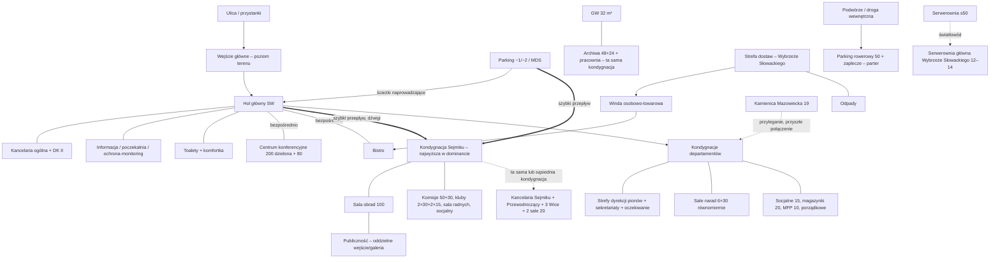

# Program użytkowy UMWD (Załącznik M.01) – ekstrakcja, kontrola i wnioski projektowe

Data opracowania: 2026-11-16. Pliki w katalogu `docs/20_program/`:

| plik | zawartość |
|---|---|
| `program.yaml` | pełna hierarchia: bloki F.15.A → pomieszczenia, kadra wg zał. 1, reguły, relacje, Sejmik, parking, strefy, technologia, instalacje, sumy (z polem `zrodlo` przy każdej pozycji) |
| `program_tabela.csv` | płaska tabela 193 pozycji (`blok;id;nazwa;liczba;pow_jedn;pow_laczna;osoby;uwagi;zrodlo`), separator `;`, kropka dziesiętna |
| `_build_program.py` | generator obu plików (`python3 -I _build_program.py <katalog>`). Dane z zał. 1 wpisano ręcznie i sprawdzono z obrazem strony. Skrypt sprawdza sumy kontrolne asercjami |

**Konwencja źródeł.** PU = *Program użytkowy budynku administracyjnego UWMD zatwierdzony 11_2025.pdf*. „s.” oznacza numer strony wydrukowany w stopce (numer strony PDF = s.+1). Reg = Regulamin, tekst jednolity z 13.02.2026 (rozdział.ustęp.punkt, strona drukowana). WyjN odp.M = Wyjaśnienia treści Regulaminu nr N, odpowiedź nr M. MPZP = M.03 (uchwała XLV/1366/10, teren 2MW‑U/5, §26). M.12, M.13 = załączniki merytoryczne. **wniosek** = moje ustalenie, którego nie ma w dokumentach Organizatora. Pozycja oznaczona `szacunek: true` ma powierzchnię dobraną przeze mnie (wartość docelowa z zakresem), bo M.01 jej nie podaje.

---

## 1. Wersje dokumentu i hierarchia ustaleń

1. **Obowiązuje** plik *Program użytkowy … zatwierdzony 11_2025* (20 stron, listopad 2025). Jest identyczny w katalogach `_oryginal` i `pop.13.02.2026` (ta sama suma MD5). Plik `M.01. PROGRAM UŻYTKOWY.pdf` to tylko 1‑stronicowa okładka z uwagą „rozpatrywać łącznie z wymaganiami ogólnymi Regulaminu”. Okładka w wersji pop. nosi daty 2025.11.04 i 2025.10.29.
2. **Nieaktualny** jest katalog `M.01. PROGRAM UŻYTKOWY STARTY` (29.10.2025). Organizator wycofał go w Wyj.3 odp.11 i w Sprostowaniu nr 1 pkt 2. Różnice merytoryczne względem wersji obowiązującej porównałem słowo po słowie:
   - w starej wersji była „dodatkowa powierzchnia biurowa dla 450 stałych pracowników”. Wyj.3 odp.12 rozstrzyga: **403 osoby**;
   - w starej wersji tabela zał. 1 rozdzielała 36 kierowników i 304 pracowników. W obowiązującej jest jedna kolumna „kierowników/pracowników” = 340. Kierownicy działów **nie mają** więc własnych pokoi (wniosek);
   - w nowej wersji doszły: przyleganie do Mazowieckiej 19 i brak połączenia z Wybrzeże Słowackiego 5, woda szara także w założeniach ogólnych, PV z magazynami, ogródek do zachowania, jednoosobowe pokoje dyrekcji, tyflomapy i pętle indukcyjne. W strefie dostaw winda towarowa zmieniła się na osobowo‑towarową. Usunięto odwołanie do Księgi SIW UMWD.
3. Wyjaśnienia, które **zmieniają lub doprecyzowują program**. Mają pierwszeństwo przed literalnym brzmieniem PU:

| Wyj./odp. | ustalenie |
|---|---|
| 3/10 | wysokość skrzydeł wyznacza MPZP (≤25 m). Wartość 22 m z PU s.2 sygnalizuje tylko styk z zabudową sąsiednią. Liczba kondygnacji skrzydeł jest swobodna |
| 3/12 | biura dla **403** osób |
| 3/13; 8/37 | okna w szczycie Mazowieckiej 19 zostaną zlikwidowane, a okien w szczycie Wybrzeża Słowackiego 5 zamurować nie wolno (lok. 6 to pokój). Zalecany potencjał przyszłego połączenia z Mazowiecką 19; sama kamienica nie jest przedmiotem konkursu |
| 3/16; 16/69; 17/70 | w jednym pokoju nie wolno łączyć pracowników różnych wydziałów ani działów. Wydziały jednego departamentu mogą zajmować 2 sąsiednie kondygnacje przy komunikacji pionowej |
| 3/17 | **24 m² na pokój biurowy to wartość obligatoryjna** |
| 4/18 | galeria lub antresola dla publiczności w sali obrad jest dopuszczalna |
| 4/19 | miejsca oczekiwania gości tylko przy CZ, dyrektorach departamentów, Przewodniczącym i KS |
| 4/20; 6/25 | główne dostawy od Wybrzeża Słowackiego. Dz. 10/2 to dojazd do podwórka i łącznik z drogą wewnętrzną. Miejsce postojowe dostaw na działce drogowej nie jest potrzebne |
| 6/23; 7/31 | **2 sale spotkań po 20 os.** (Przewodniczący, Wiceprzewodniczący, KS) |
| 6/24 | **3 stanowiska techników** |
| 6/26 | archiwa GW na tej samej kondygnacji co GW |
| 7/32 | parking rowerowy **nie** na poz. −1 |
| 8/33, 34, 45 | Organizator **nie poda** zestawienia pomieszczeń ani oczekiwanej PU – „rozwiązania mają dążyć do optymalizacji” |
| 8/35 | użytkowników okresowych wylicza się z pojemności sali obrad i sal konferencyjnych |
| 8/36 | wysokość sali obrad jest dowolna |
| 8/46; 20/73 | numeracja pomieszczeń wg zał. 1 i skrótów bloków (SW, SK, SWD, KS, DOS, DSS, DST, DRA, DGP, DI, CZ, DKD, DZ, GW, DK, DW, SN, PS, PP, **PHS**, PPT, IT, PR, PPM, **KW**). Powierzchnie wg PN‑ISO 9836:2022‑07. Cała powierzchnia ruchu trafia do KW (wyjątek: SW i ruch funkcjonalnie związany z salą) |
| 8/48–50 | wiersz „Wydział X – Dyrekcja” z pracownikami = 1 gabinet + pokoje pracowników. „Dyrekcja działu” nie istnieje |
| 8/54 | **6 sal narad po 30 os.** |
| 8/53 | obie sale komisji mają zaplecze do nagrywania |
| 8/59 | do obliczeń i bilansów przyjmuje się *Obszar inwestycji* z M.04, a nie granice działek (3 729 m²) |
| 10/62 | gabinety pionu obok siebie: pion 8 = CZ + dyrektorzy departamentów 8.1 i 8.2 + dyrektorzy wydziałów; piony 2–7 i 9 = dyrektor departamentu + dyrektorzy wydziałów, w pobliżu swoich komórek |
| 18/71 | dedykowana winda Sejmiku nie jest wymagana |
| 20/74 | **budżet 150 mln zł netto jest nieprzekraczalny**. Zaniżanie kosztorysu jest niedopuszczalne |
| 20/77 | teren ogródka ma być nieogrodzony, dostępny dla pracowników i mieszkańców, z maksymalną liczbą zachowanych drzew i z małą architekturą |
| 20/78 | ewakuacja klatki przez hol jest dopuszczalna z warunkami WT (m.in. §256 ust. 6) |
| 21/83 | minimalna liczba miejsc postojowych wg MPZP |
| 21/84–85 | **wszystkie pomieszczenia Sejmiku z PU s.5–7 muszą być na tej samej kondygnacji co sala obrad**. Tylko Kancelarię Sejmiku (strefa z PU s.7) można umieścić na kondygnacji sąsiedniej |

---

## 2. Założenia ogólne (PU s.2–4; Reg. III.1)

- **Forma**: trzy części. Dwa skrzydła – przy Mazowieckiej i przy Wybrzeżu Słowackiego – oraz dominanta w narożniku. Skrzydło przy Mazowieckiej przylega do kamienicy nr 19 i tworzy zwartą pierzeję. Z Wybrzeżem Słowackiego 5 budynek się nie łączy, bo oddziela go dz. 10/2 (PU s.2–3).
- **Wysokości**: skrzydła wg PU 5 kondygnacji i ≤22 m, wg MPZP §6 pkt 3 wymiar pionowy 18–25 m (najniższy i najwyższy punkt pokrycia dachu). Dominanta w obszarze A wg MPZP §26 ust. 2 pkt 3: dach 35–45 m (M.03 s.24).
- **Podziemie**: 2 kondygnacje (parking i technika). Parking pełni funkcję MDS dla okolicznej ludności i pracowników (PU s.3, s.13).
- **Standard**: budynek zeroemisyjny (OZE, brak spalania), woda szara i opadowa (PU s.3; M.12). Projektowanie uniwersalne zgodne z ustawą o dostępności i standardami MSWiA (PU s.3–4; Reg. III.1.8).
- **Elastyczność**: jednolite pokoje 24 m², trwałe technologie, rezerwy w szachtach i na tarasach technicznych (PU s.3–4; Reg. III.1.9).
- **Budżet**: 150 mln zł netto (Reg. III.3 s.21). Racjonalne dysponowanie przestrzenią względem budżetu jest wprost zadaniem konkursowym (Reg. II.4 s.16).
- Główne kryterium oceny to jakość rozwiązań funkcjonalnych i przestrzennych (Reg. III.1.11 s.21). Odstępstwa od wytycznych są dopuszczalne, jeśli zostaną racjonalnie uzasadnione (Reg. II.2 s.16).

---

## 3. Kadra i pokoje biurowe

### 3.1 Reguły (źródła w `program.yaml → reguly_pokoi_biurowych`)

- Pokój biurowy ma zawsze **24 m²** i 3 stanowiska z punktami elektrycznymi i teletechnicznymi dla 3 osób (PU s.4; Wyj.3 odp.17).
- GW: pokoje pracowników **32 m²** dla 4 osób (PU s.5).
- Pokoje jednoosobowe (24 m², z możliwością pracy 3 osób) dostają CZ, dyrektorzy, zastępcy i samodzielne stanowiska (PU s.5).
- Sekretariat to pokój obok gabinetów, łączony drzwiami (PU s.5). Przyjąłem 1 pokój na komórkę (wniosek).
- Pokoje pracowników liczę jako ⌈n/3⌉ (dla GW ⌈n/4⌉) **osobno dla każdej komórki z zał. 1** (wynika z Wyj.16 i 17). Ta sama metoda daje 38 pokoi dla DOS, czyli wynik zgodny z przykładem w pyt. 69.

### 3.2 Wynik (suma kontrolna zgodna z zał. 1: dyr 29 / zast 16 / samodz. 6 / sekr. 12 / prac. 340 = **403**)

| blok | osoby | pokoje 1‑os. | os. sekr. | pracownicy | pokoje razem | w tym 32 m² | pow. pokoi [m²] | stanowiska max |
|---|---:|---:|---:|---:|---:|---:|---:|---:|
| KS | 16 | 3 | 2 | 11 | 8 | – | 192 | 24 |
| DOS | 97 | 5 | 1 | 91 | 38 | – | 912 | 114 |
| DSS | 39 | 6 | 0 | 33 | 19 | – | 456 | 57 |
| DST | 24 | 4 | 1 | 19 | 13 | – | 312 | 39 |
| DRA | 18 | 6 | 0 | 12 | 11 | – | 264 | 33 |
| DGP | 51 | 6 | 2 | 43 | 24 | – | 576 | 72 |
| DI | 54 | 7 | 1 | 46 | 25 | – | 600 | 75 |
| CZ | 3 | 2 | 1 | 0 | 3 | – | 72 | 9 |
| DKD | 23 | 4 | 1 | 18 | 12 | – | 288 | 36 |
| DZ | 37 | 6 | 2 | 29 | 19 | – | 456 | 57 |
| GW | 33 | 2 | 1 | 30 | 11 | 8 | 328 | 41 |
| DK | 4 | 0 | 0 | 4 | 2 | – | 48 | 6 |
| DW | 4 | 0 | 0 | 4 | 2 | – | 48 | 6 |
| **Σ** | **403** | **51** | **12** | **340** | **187** (179×24 + 8×32) | **8** | **4 552** | **569** |

- Wychodzi 11,3 m² pokoju na osobę. Średnio 2,16 os./pokój.
- Pojemność do obliczeń ewakuacyjnych to **569 stanowisk**. Do tego dochodzi 60 stanowisk w 20 magazynkach przystosowanych do zamiany na biura (3 punkty w każdym, PU s.9) – łącznie 629.
- Poza liczbą 403 są: Przewodniczący i 3 Wiceprzewodniczących (radni), asystent Przewodniczącego (nie wiadomo, czy wliczony w 16 os. KS), 36 radnych, Zarząd, Skarbnik, Sekretarz, przedstawiciel Wojewody, ochrona, sprzątanie oraz 3 techników.

---

## 4. Program pomieszczeń wg bloków F.15.A (wartości docelowe; zakresy w YAML)

Bloki odpowiadają F.15.A (23 bloki) i blokom PHS i KW dodanym w Wyj.20 odp.73. M.01 podaje **liczby** dla większości funkcji, ale powierzchnie tylko dla pokoi biurowych (24/32), pokoi socjalnych (~24), magazynków (24), archiwów GW (48 i 24), pracowni GW (24) i serwerowni (≤50). Pozostałe powierzchnie są **szacunkami (wniosek)**.

| blok | co wymaga M.01 (liczby) | pow. docelowa [m²] | zakres [m²] |
|---|---|---:|---|
| SW | hol, kancelaria 3 st., informacja 1 st., ochrona i monitoring z miejscem socjalnym, poczekalnia, bistro „kilkanaście stolików” bez kuchni (PU s.8–9) | 533 (w tym hol 300 RU) | 397–766 |
| SK | sala 200 os. dzielona na 2, sala 80 os., zaplecza techniczne (PU s.8) | 517 (w tym foyer 100 RU) | 428–653 |
| SWD | sala obrad do 100 os., hol, sala multimedialna, reżyserka, przestrzeń socjalno‑gastronomiczna, szatnia, pokój matki, komisje 50 i 30 os. z nagrywaniem, 2 kluby po 30 i 2 po 15 os., wspólna sala radnych, pokój socjalny radnych (PU s.6–7) | 1 049 (w tym hol 150 RU) | 885–1 327 |
| KS | 8 pokoi z zał. 1, gabinet Przewodniczącego z zapleczem, asystent, 3 gabinety Wiceprzewodniczących, 2 sale po 20 os., miejsce oczekiwania (PU s.7; Wyj.6/23, 7/31, 4/19) | 488 | 406–521 |
| departamenty i działy (DOS…DW bez KS) | pokoje wg zał. 1 i 9 miejsc oczekiwania (Wyj.4/19) | 4 414 | 4 396–4 450 |
| SN | 6 sal po 30 os. (PU s.8; Wyj.8/54) | 360 | 324–432 |
| PS | 15 pokoi ~24 m² dla grup do 30 os. (PU s.9) | 360 | 360 |
| PP | 20 magazynków × 24, archiwa 48 i 24, pracownia GW 24, 10 wnęk MFP, pomieszczenie porządkowe na każdej kondygnacji (w tym pralnia i suszarnia) (PU s.9–10) | 707 | 660–764 |
| PHS | toalety równomiernie, ≥1 dostępna na każdej kondygnacji i w każdej strefie, komfortka przy wejściu (PU s.10; M.13 s.202) | 417 | 331–585 |
| PPT | 3 stanowiska techników, magazyn, strefa serwisowa, 2 pomieszczenia socjalne z szatniami, sanitariat z prysznicami (PU s.15; Wyj.6/24) | 127 | 92–160 |
| IT | serwerownia ≤50 m² TIER II, PD na każdej kondygnacji, SN/nn, agregat, UPS, magazyn energii, pompy ciepła, bufory, węzeł, woda, woda szara, piętro techniczne, odpady, przyjęcie dostaw (PU s.13–17; M.12) | 1 262 (US 1 217) | 913–1 775 |
| PR | 50 stanowisk rowerowych z zapleczem sanitarnym (PU s.12) | 115 | 90–145 |
| **Σ pomieszczenia (bez KW i garażu)** | | **10 349** | **9 282–11 938** |
| KW | 30% PU (wniosek; 25–35%) | 2 570 | 2 150–3 000 |
| PPM | garaż: minimum MPZP 103 msc (98 + 5 OzN), drogi i rampa (27 m²/msc brutto – wniosek), zaplecze MDS | 2 815 | zależnie od liczby msc |

Wymagania AV i dostępności sal (SK, sala obrad, komisje, kluby, sale narad) są w polach `wymagania` w YAML i w kolumnie `uwagi` w CSV.

---

## 5. Sejmik – sala obrad i kondygnacja Sejmiku

- **Uczestnicy standardowi** (PU s.6): 36 radnych (w tym 4‑osobowe prezydium), 5 członków Zarządu, Skarbnik, Sekretarz i przedstawiciel Wojewody, czyli **44 stałe stanowiska** z systemem głosowania, tabletami i mikrofonami. Do tego obsługa techniczna i kancelaryjna, tłumacze PJM, media, goście i publiczność. Pojemność maksymalna to **100 os.**
- **Proponowany podział 100 miejsc** (wniosek): 36 radnych, 8 miejsc Zarząd i urzędnicy, 4 obsługa kancelaryjna, 2 tłumacze PJM, 10 media, 15 goście, 25 publiczność. W części publicznej trzeba zapewnić ≥3 miejsca dla wózków (M.13 s.218), a do tego dostępne stanowisko radnego, prezydium i mównicę (PU s.6; M.13 s.219 – mównica 0,75–0,80 m).
- **Publiczność** ma mieć oddzielne wejście i może być wizualnie odseparowana. Wymagane są porządek obrad i poufność głosowania (PU s.6). Galeria (antresola) jest dopuszczalna (Wyj.4/18).
- **Kabiny tłumaczy symultanicznych: M.01 ich NIE wymaga.** Wymagane jest miejsce dla tłumaczy PJM – w kadrze transmisji (wniosek). M.13 s.219 zaleca napisy lub tłumaczenie PJM tam, gdzie jest nagłośnienie.
- **Kondygnacja Sejmiku** (Wyj.21/85): sala obrad, hol, sala multimedialna, reżyserka, przestrzeń socjalno‑gastronomiczna, szatnia, toalety, pokój matki, 2 sale komisji z zapleczami, 4 sale klubów, sala radnych i pokój socjalny radnych – **razem około 1 094 m² netto**. Doliczając rdzenie, ściany i konstrukcję, **kondygnacja Sejmiku potrzebuje ok. 1 400 m² powierzchni całkowitej (zakres 1 200–1 750 m²)** (wniosek). Kancelaria Sejmiku (ok. 490 m² netto, ok. 850 m² PC) może zająć kondygnację niższą.

---

## 6. Sumy kontrolne i rozbieżności

### 6.1 Sumy

- M.01 podaje sumy **tylko dla kadry** (zał. 1). Moja suma kontrolna wierszy: **29/16/6/12/340/403 – zgodna**. W każdym wierszu dyr+zast+samodz+sekr+prac = razem; skrypt to sprawdza asercją.
- M.01 **nie podaje** powierzchni sumarycznych. Organizator odmówił ich podania (Wyj.8/33, 34, 45), więc powierzchnie nie mają z czym zostać porównane. Wszystkie sumy powierzchni poniżej są wnioskiem.
- Kontrole spójności:
  - 15 pokoi socjalnych × 30 os. = 450 ≥ 403 ✓;
  - 6 sal narad × 30 = 180 miejsc, czyli 1 miejsce na 2,2 pracownika ✓;
  - 20 magazynków na 13 komórek najwyższego rzędu ✓;
  - 10 urządzeń wielofunkcyjnych to ok. 1 na 40 os. ✓.

### 6.2 Rozbieżności, luki i niejasności

1. **Wysokość skrzydeł**: PU s.2 podaje 22 m, MPZP §6 pkt 3 do 25 m (i minimum 18 m). Rozstrzyga Wyj.3/10 na korzyść MPZP. Uwaga: MPZP wymaga też **minimum** 18 m dla najniższego punktu dachu, czyli skrzydła muszą mieć co najmniej P+4.
2. **450 czy 403 osoby** (wersja STARTY wobec obowiązującej) – rozstrzygnięte: 403 (Wyj.3/12).
3. **„Salę spotkań dla 20 osób dedykowaną”** (PU s.7, l. poj.) – rozstrzygnięte: 2 sale (Wyj.6/23, 7/31).
4. **„6 sal narad na 30 osób”** – rozstrzygnięte: 6 × 30 (Wyj.8/54).
5. **F.15.A nie ma bloków PHS i KW** wprowadzonych w Wyj.20/73. Trzeba je dopisać, podobnie jak ewentualne bloki dodatkowe (np. GA – bistro). W tej ekstrakcji bistro jest w SW.
6. **F.15.B przewiduje tylko jedną kondygnację podziemną (−1)** i piętra do 6. PU zakłada 2 kondygnacje podziemne, a dominanta 35–45 m oznacza 9–10 kondygnacji nadziemnych. Szablon trzeba rozszerzyć o −2 i piętra 7–9.
7. **F.15.A ma kolumny nr/opis/kond./pow.** – bez liczby osób i stanowisk. Dane do uzupełnienia są w YAML.
8. **Kondygnacja Sejmiku a obszar dominanty**: Wyj.21/85 wymaga ok. 1 400 m² PC na jednej kondygnacji (rozdz. 5) na najwyższym piętrze w obszarze A (35–45 m). Jeżeli część wspólna obszaru A i Obszaru inwestycji jest mniejsza, wymogu nie da się spełnić bez odstępstwa (Reg. II.2). **Krytyczne do sprawdzenia na geometrii M.03/M.04 (moduł lokalizacja).**
9. **Piętro techniczne** (PU s.13) a „sala obrad na najwyższym piętrze” (PU s.5) i zakaz urządzeń na dachu. Program nie mówi, gdzie ma być piętro techniczne. Rekomendacja (wniosek): ostatnia kondygnacja skrzydła (≤25 m), antresola techniczna lub kondygnacja −2, a nie nad salą obrad.
10. **Kancelaria ogólna 3 st.** (PU s.8) a **Dział Kancelaryjny II** (4 os., zał. 1) – relacja nieokreślona. Przyjąłem kancelarię w holu i 2 pokoje DK II bezpośrednio za nią (wniosek).
11. **Asystent Przewodniczącego** – nie wiadomo, czy jest w 16 os. KS. Przyjąłem dodatkowo (wniosek).
12. **Brak godzin pracy, częstotliwości sesji i liczby gości konferencji** poza pojemnościami sal. PU podaje tylko „średnio 8‑godzinny dzień pracy” (s.9).
13. **MDS bez pojemności i parametrów** (PU s.3 „okoliczna ludność i pracownicy”; s.13 „mieszkańcy i pracownicy”). Parametry wymaga rozp. MSWiA z 9.07.2025 – do analizy w module prawnym.
14. **Hulajnogi/UTO** – brak wymogu (luka). Zalecam 10 miejsc z ładowaniem w PR.01 (wniosek).
15. **Garaż w PU**: MPZP liczy miejsca od „PU biur i obiektów konferencyjnych” (§13 pkt 1 lit. e), ale nie definiuje PU. Przyjąłem PU bez garażu, bez KW i bez technicznych. Jeśli hol i foyer liczyć do PU, wynik rośnie ze 103 do 110 msc. Sposób ujęcia garażu w F.15.C (I.12) trzeba ustalić.
16. **M.12**: nagłówek „Załącznik M.09” i dopisek o standardzie dostępności to błędy redakcyjne. **F.14.B** poz. 2.11 „Rezerwowe źródło wody” stoi w sprzeczności z M.12 pkt 2.A („nie przewiduje się własnego ujęcia wody”). **PU s.14** wymienia „kotłownię” w budynku bez spalania – terminologiczna niespójność, w praktyce chodzi o maszynownię pomp ciepła lub węzeł.
17. **Reg. III.1.1** wymienia Walońską, Dobrzyńską i Matejki, a **PU s.2** dodaje pl. Powstańców Warszawy. Drobne literówki w zał. 1 („Województwi Ośrodek”, „Department Zdrowia”). PU s.4 pisze „Departament Rozwoju i Aglomeracji”, zał. 1 „Departament Rozwoju Aglomeracji”. Stopka PU brzmi „Plan użytkowy”.
18. **Gabinety Wiceprzewodniczących** ze strefą spotkań dla 5 os.: obowiązek 24 m² (Wyj.3/17) dotyczy pokoi biurowych. Przyjąłem 36 m² (zakres 24–40). Przy ostrożnej interpretacji można zejść do 24 m².

---

## 7. Strefy bezpieczeństwa i dostępności (wniosek na podstawie PU s.6–8, s.14; Wyj.4/18–19, 20/77)

| strefa | zakres | kontrola |
|---|---|---|
| Z0 zewnętrzna publiczna | skwer dz. 9/2; dziedziniec i ogródek – nieogrodzone, dla pracowników i mieszkańców | brak; CCTV zewnętrzne |
| Z1 publiczna | hol, kancelaria ogólna, informacja, poczekalnia, bistro, toalety, komfortka, SK w czasie wydarzeń | ochrona przy holu; pętle indukcyjne; ścieżki naprowadzające |
| Z2 półpubliczna kontrolowana | galeria publiczności sali obrad (oddzielne wejście), hol Sejmiku w dni sesji, sale konferencyjne, poczekalnie przy gabinetach | identyfikatory gościa; dźwig i klatka dla publiczności bez wejścia do strefy radnych |
| Z3 biurowa | piętra departamentów, sale narad, pokoje socjalne | kontrola dostępu z centralą (PU s.14); goście w asyście |
| Z4 Sejmik i VIP | strefa radnych i prezydium, gabinety Przewodniczącego i Wiceprzewodniczących, komisje, kluby, sala multimedialna gości | osobne uprawnienia; poufność głosowania |
| Z5 techniczna i chroniona | serwerownia (TIER II), archiwa GW, centrum monitoringu, pomieszczenia techniczne, strefa dostaw, odpady | tylko personel; podwyższony poziom zabezpieczeń |
| Z6 parking / MDS | pracownicy; w dni sesji radni i goście; w sytuacji kryzysowej ludność | szlabany i KD; w trybie MDS dostęp publiczny |

**Dostępność (wymogi wprost)**:
- wejścia z poziomu chodnika (Reg. III.1.8);
- toaleta dostępna na każdej kondygnacji z pochwytem poziomym na drzwiach i kontrastem (Reg. III.1.8);
- komfortka ≥12 m², szer. ≥3 m, ≤20 m od wejścia (M.13 s.202);
- miejsca oczekiwania na ewakuację na podestach z interkomem do ochrony i stanowiska KDR oraz miejsce na krzesło ewakuacyjne (PU s.11; Reg. III.1.8);
- ścieżki naprowadzające z holu i z parkingu, tyflomapy (PU s.11–12);
- pętle indukcyjne w SK, strefie Sejmiku i kancelarii (PU s.12);
- kontrast ścian i posadzek (PU s.11);
- windy dostępne dla OzN (PU s.15);
- stanowiska OzN w garażu 3,6×5,0 m (M.13 s.80).

---

## 8. Relacje funkcjonalne

**Opis relacji** (źródła w YAML `relacje_funkcjonalne`):

1. Wejście główne prowadzi do holu z poziomu terenu. Wejście ma być widoczne w bryle i dostępne od ulicy, przystanków i parkingu (PU s.8).
2. Wokół holu: kancelaria, informacja, ochrona, poczekalnia, toalety. Bezpośrednio przy holu: SK i bistro (PU s.8–9).
3. Z holu i z parkingu prowadzi szybka droga dla większej liczby osób do kondygnacji Sejmiku w dominancie (PU s.6). W praktyce wymaga to dźwigów o dużej wydajności w rdzeniu dominanty (wniosek).
4. Na kondygnacji Sejmiku są wszystkie pomieszczenia z PU s.5–7. KS z gabinetami Przewodniczącego i Wiceprzewodniczących może być na kondygnacji sąsiedniej (Wyj.21/84–85).
5. Strefy dyrekcji pionów znajdują się w pobliżu swoich komórek, razem z sekretariatem, salą narad, aneksem socjalnym, toaletami i miejscem oczekiwania (PU s.5; Wyj.10/62; Wyj.4/19).
6. Archiwa i pracownia GW leżą na kondygnacji GW (Wyj.6/26).
7. Dostawy przyjmowane są od Wybrzeża Słowackiego, z poziomu terenu, i obsługuje je winda osobowo‑towarowa (PU s.15, s.17). Droga wewnętrzna z dz. 10/2 służy tylko do odbioru osób i drobnych dostaw (PU s.16–17; Wyj.4/20).
8. Parking rowerowy jest na parterze z wjazdem od podwórza (PU s.12; Wyj.7/32).

---

## 9. Wymagania ilościowe (do ewakuacji i bilansów)

### 9.1 Osoby

- **Pracownicy stali**: 403 (zał. 1). **Pojemność stanowisk**: 569 w pokojach plus 60 w magazynkach – razem **629**. Do projektowania ewakuacji przyjąć pojemność, a nie obsadę (wniosek – program wymaga, by każdy pokój mieścił 3 os.).
- **Użytkownicy okresowi** wynikają z pojemności sal (Wyj.8/35): SK 280 (200+80); sala obrad 100; kondygnacja Sejmiku łącznie 315; sale narad 180 (głównie pracownicy); kluby i komisje 170 (radni i goście); bistro ok. 60 miejsc (wniosek).
- **Oszacowanie ostrożne** (suma pojemności, bez podwójnego liczenia bistro) to ok. 1 330 os. w budynku. **Realny szczyt** (pełna obsada, sesja i pełna konferencja jednocześnie) to ok. 900 os. (wniosek).

### 9.2 Liczba osób na kondygnacjach (wniosek; do obliczeń w module ppoż.)

| kondygnacja / strefa | osoby (ostrożnie) | skład |
|---|---:|---|
| Parter | ≈ 390 | SK 280, hol i poczekalnia ~40, bistro 60, kancelaria 3 + DK II 4, informacja 1, ochrona 2 |
| Kondygnacja Sejmiku | ≈ 315 | sala 100, multimedialna 20, reżyserka 3, komisje 50+30 i ich zaplecza 2, kluby 60+30, sala radnych 12, socjalny 8 |
| Kondygnacja KS (jeśli osobna) | ≈ 85 | KS 16, Przewodniczący, asystent i 3 Wiceprzewodniczących, 2 sale po 20, spotkania w gabinetach 4×5, oczekujący 5 |
| Typowa kondygnacja biurowa | 3 × liczba pokoi (GW 4) + 30 (sala narad, jeśli jest) + ~5 gości | np. kondygnacja 1 800 m² PC: ok. 37 pokoi (wskaźnik: pokoje = 49% PC kondygnacji biurowej) → ≈ 110 + 30 + 5 ≈ 145 |

Wskaźnik 49% (powierzchnia pokoi biurowych do PC kondygnacji biurowej) wynika z bilansu: pokoje 4 552 m² wobec ok. 9 300 m² PC wszystkich kondygnacji biurowych (z socjalnymi, magazynkami, salami narad, toaletami, KW i konstrukcją). Kondygnacje biurowe mieszczą łącznie 187 pokoi.

- **ZL**: sale >50 os. niebędących stałymi użytkownikami (sala obrad, SK 200 i 80) kwalifikuje się jako ZL I, biura jako ZL III (WT §209 ust. 2).
- **Grupa wysokościowa**: dominanta 35–45 m oznacza **budynek wysoki (W, 25–55 m; WT §8)**. Stąd klatki obudowane z przedsionkami p.poż. (zgodnie z PU s.11) i dźwig dla ekip ratowniczych (do weryfikacji w module prawnym, W3).
- **Szerokości dróg ewakuacyjnych**: 0,6 m na 100 os., min. 1,4 m dla dróg poziomych i 1,2 m dla biegów schodów (WT §242 i §256 – do weryfikacji w W3). Dla kondygnacji Sejmiku (315 os.) daje to łącznie ≥1,9 m biegów, rozłożone na ≥2 klatki (wniosek).

### 9.3 Przybory sanitarne (orientacyjnie)

Przy podziale 60% K / 40% M (założenie) i normatywie 1 miska/20 K oraz 1 miska + 1 pisuar/30 M (rozp. MPiPS w sprawie ogólnych przepisów bhp, zał. 3 – do weryfikacji) wychodzi:
- **dla 403 pracowników**: ok. 13 misek K, 6 misek M i 6 pisuarów, czyli na kondygnację biurową (8 kondygnacji) ok. 2 K + 1 M + 1 pisuar + 1 toaleta dostępna (≈28 m²);
- strefy SK (280 os.) i Sejmiku (100–315 os.) dobrać wg pojemności (PU s.10).

---

## 10. Parking

| pozycja | wartość | źródło |
|---|---|---|
| wskaźnik MPZP (minimum) | 12 msc / 1000 m² PU biur i obiektów konferencyjnych | MPZP §13 pkt 1 lit. e (M.03 s.15); Wyj.21/83 |
| lokalizacja | na terenie obiektu; parking samodzielny wyłącznie podziemny; garaż pod budynkiem | MPZP §13 pkt 2–3 (M.03 s.16); PU s.12 |
| **minimum przy PU = 8 582 m²** | **103 msc** (110 przy PU z holem i foyer 9 132 m²) | wniosek |
| w tym OzN | ≥4% przy >100 → **≥5**, 3,6×5,0 m, najbliżej dźwigu | M.13 s.80–81 |
| EV | infrastruktura ładowania wymagana; liczba punktów wg przepisów (W3) | PU s.13 |
| MDS | garaż jako miejsce doraźnego schronienia (rozp. MSWiA 9.07.2025); pojemność nieokreślona | PU s.3, s.13 |
| użytkownicy | pracownicy codziennie; radni i goście w dni sesji i wydarzeń | PU s.12 |
| zjazd | z drogi publicznej w obrębie Inwestycji; dojazd do terenu tylko od 3KDL/1, 4KDPL/3, 6KDB/2 | Reg. III.1.2; MPZP §26 ust. 3 |
| rowery | **50** stanowisk na parterze, stojaki U, wjazd od podwórza, z zapleczem sanitarnym; nie na −1 | PU s.12; Wyj.7/32 |
| hulajnogi | brak wymogu; zalecenie: 10 miejsc z ładowaniem | wniosek |

**Wniosek**: dwie pełne kondygnacje podziemne mieszczą szacunkowo **150–200 msc**, czyli ponad minimum MPZP. Wielkość podziemia wynika więc z PU („zakłada się dwie kondygnacje”), techniki i MDS, a nie z MPZP. Przy budżecie nieprzekraczalnym warto rozważyć uzasadnione ograniczenie drugiej kondygnacji (Reg. II.2).

---

## 11. Technologia i instalacje (skrót; pełna lista w YAML `technologia`, `instalacje`)

- **Serwerownia**: ≤50 m², TIER II – dwutorowe zasilanie, SZR, UPS podtrzymujący do startu agregatu, klimatyzacja zasilana z obu źródeł, redundancja. Światłowód jednomodowy do Wybrzeże Słowackiego 12–14 (PU s.15–16). PD IT na każdej kondygnacji (PU s.14).
- **AV**:
  - sala obrad i komisje: system głosowania, tablety, mikrofony, kamery, głośniki, nagrywanie i transmisja;
  - SK: prezentacje i transmisja;
  - sale narad, kluby, sala radnych i sale spotkań: ekran i punkty dostępowe;
  - wszędzie tam pętle indukcyjne (PU s.6–8, s.12).
- **Bezpieczeństwo**: KD z centralą, SAP z sygnalizacją głosową i wizualną, CCTV wewnętrzne i zewnętrzne, centrum monitoringu przy holu, interkomy ewakuacyjne (PU s.8, s.11, s.14). F.14.B wymienia dodatkowo SSWiN, DSO, system przyzywowy, oddymianie i napowietrzanie klatek, BMS i SMS.
- **Energia i HVAC**:
  - gruntowe pompy ciepła (odwierty możliwe pod budynkiem), magazyny ciepła i chłodu;
  - sieć ciepłownicza tylko rezerwowo;
  - PV 0,4–1,0 MWp na dachu dominanty i elewacjach, magazyn energii;
  - wentylacja z rekuperacją i klimatyzacja we wszystkich strefach, centrale na piętrze technicznym;
  - BMS/EMS (PU s.13–14; M.12).
- **Woda**:
  - tylko z sieci;
  - rozdział ścieków czarnych i szarych, woda szara do spłukiwania WC;
  - retencja deszczówki w zbiornikach **na terenie zewnętrznym**, przelew awaryjny (M.12 pkt 2).
- **Windy**: liczba wg układu, dostępne; ≥1 osobowo‑towarowa w strefie dostaw (PU s.15). Szacunek (wniosek, do analizy ruchu): 4–5 osobowych w rdzeniu dominanty (w tym 1 dla ekip ratowniczych), 1 osobowo‑towarowa i 1–2 w skrzydłach, razem 6–8.

---

## 12. WNIOSKI projektowe (wszystkie to wnioski własne)

### 12.1 Powierzchnie

| wielkość | wartość docelowa | przedział |
|---|---:|---|
| pokoje biurowe (187 szt.) | 4 552 m² | stała (obligatoryjna) |
| pomieszczenia programu (PU + US + ruch w SW/SK/SWD) | 10 349 m² | 9 300–11 900 |
| w tym **PU programowa** (bez technicznych i ruchu) | **8 582 m²** | 8 000–9 400 |
| KW (30% PU) | 2 570 m² | 2 150–3 000 |
| netto bez garażu | 12 919 m² | – |
| **powierzchnia całkowita bez garażu** (ściany i konstrukcja 12%) | **≈ 14 700 m²** | 12 500–17 800 (skrajne kombinacje); realnie 13 900–15 500 |
| **współczynnik PC/PU** | **≈ 1,71** (PU/PC ≈ 0,58) | 1,60–1,85 |
| **PC nadziemna** (technika SN/nn, agregat, pompy, bufory, woda i PPT na −1/−2) | **≈ 14 000 m²** | 13 200–14 800 |
| **PC podziemna – minimum funkcjonalne** (103 msc × 27 m² + technika ~700 + MDS + rdzenie) | ≈ 3 800 m² (≈1,3 kondygnacji) | – |
| **PC podziemna – 2 pełne kondygnacje** wg PU | ≈ 5 200–6 400 m² (zależnie od obrysu) | 150–200 msc |
| PC łącznie (F.15.C I.2) | ≈ 19 200–20 400 m² | – |

### 12.2 Kondygnacje

**Wysokości kondygnacji** (wniosek):
- parter 4,8 m;
- kondygnacja biurowa 3,7 m (3,0 m w świetle + strop i instalacje);
- kondygnacja Sejmiku 7,0–7,5 m;
- warstwy dachu i attyka ok. 1,0–1,2 m.

**Liczba kondygnacji wynikająca z wysokości**:
- **Dominanta**: P+7+Sejmik ≈ 38 m, P+8+Sejmik ≈ 42 m (MPZP wymaga 35–45 m). Daje to **9–10 kondygnacji nadziemnych**; Sejmik jest najwyższy.
- **Skrzydła**: P+4 ≈ 20,6 m (≥18 i ≤22 m wg PU), P+5 ≈ 24,3 m (≤25 m wg MPZP; powyżej 22 m z PU, ale dopuszczalne wg Wyj.3/10). Daje to **5–6 kondygnacji**.

**Liczba kondygnacji przy PC nadziemnej ≈ 14 000 m² i jednolitej kondygnacji typowej**:

| typowa kondygnacja PC [m²] | 1 200 | 1 500 | 1 800 | 2 100 | 2 400 |
|---|---:|---:|---:|---:|---:|
| liczba kondygnacji nadziemnych (gdyby wszystkie były typowe) | 12 | 10 | 8 | 7 | 6 |
| pokoje biurowe na kondygnację biurową (49% PC / 24 m²) | ~25 | ~31 | ~37 | ~43 | ~49 |
| stanowiska max na kondygnację | ~74 | ~92 | ~110 | ~129 | ~147 |

**Układ złożony** (dominanta o rzucie A_dom × 9 kondygnacji + skrzydła):
- A_dom = 900 m² daje 8 100 m² w dominancie. Skrzydła muszą wtedy dać ~5 900 m², czyli przy P+4 ok. 1 180 m²/kondygnację, a przy P+5 ok. 980 m².
- A_dom = 1 200 m² daje 10 800 m². Skrzydła potrzebują ~3 200 m²: P+4 ok. 640 m², P+5 ok. 530 m².
- **A_dom = 1 400 m²** (pełna kondygnacja Sejmiku wg Wyj.21/85) daje 12 600 m². Na skrzydła zostaje ok. 1 400 m², co nie wystarcza na zwarte pierzeje do Mazowieckiej 19. Przy pełnych skrzydłach PC przekroczy potrzeby programu, a to grozi przekroczeniem budżetu.
- **Konflikt do rozstrzygnięcia w koncepcji**: pełne spełnienie Wyj.21/85, czyli całej kondygnacji Sejmiku na szczycie, stoi w napięciu z rozsądną wielkością PC i budżetem. Warianty:
  - (a) duży rzut szczytu dominanty i krótsze lub niższe skrzydła;
  - (b) smukła dominanta i galeria publiczności jako antresola. To zmniejsza rzut; komisje i kluby nadal muszą zostać na tej samej kondygnacji;
  - (c) odstępstwo z uzasadnieniem (Reg. II.2) – ryzyko w ocenie.
- **Najpierw trzeba zmierzyć część wspólną obszaru A (MPZP) i Obszaru inwestycji.**

### 12.3 Moduł i elastyczność

Moduł elewacyjny **1,35 m** z głębokością pokoju netto ok. 5,9 m daje dokładnie:
- **24 m²** z 3 modułów (4,05 m);
- **32 m²** z 4 modułów (5,40 m) przy **tej samej głębokości traktu**.

Pozwala to swobodnie przesuwać GW i zamieniać magazynki na biura. Trakt dwustronny ma ok. 15 m głębokości (2×5,9 m + korytarz 1,8–2,0 m + ściany). Sekretariaty i gabinety można łączyć drzwiami w obrębie modułu.

### 12.4 Budżet (orientacyjnie, do weryfikacji w module kosztowym F.14.B)

Założenia robocze bez źródła:
- część nadziemna 8 000–10 000 zł/m² PC;
- podziemie 4 500–6 000 zł/m²;
- teren i przyłącza 4–8 mln zł.

Przy PC nadziemnej 14 000 m² i podziemnej ok. 5 800 m² wychodzi **ok. 142–183 mln zł netto** wobec limitu 150 mln. **Ryzyko budżetowe jest wysokie.** Rekomendacje:
- PC nadziemna ≤ ~14 000 m²;
- KW ≤ 25–30%;
- zwarta kondygnacja Sejmiku;
- podziemie dopasowane do potrzeb (minimum MPZP ok. 103–110 msc + technika + MDS);
- uzasadnienie ewentualnej redukcji drugiej kondygnacji podziemnej.

### 12.5 Do tabel F.15

- F.15.A: numeracja wg Wyj.20/73 i zał. 1 (tak jak w CSV); dopisać PHS i KW.
- F.15.B: dodać −2 i piętra 7–9.
- F.15.C: PC 19–20,5 tys. m², nadziemna ok. 14 tys., podziemna 5,2–6,4 tys., 2 kondygnacje podziemne i 9–10 nadziemnych, wysokość 38–42 m, 6–8 dźwigów, PU ok. 8,6 tys. m² bez garażu (ujęcie garażu do rozstrzygnięcia).

---

## 13. Pytania otwarte (do innych modułów)

1. Geometria i pole części wspólnej obszaru A (MPZP §26) i Obszaru inwestycji (M.04) – warunek wykonalności kondygnacji Sejmiku (moduł lokalizacja).
2. Pojemność i parametry MDS (rozp. MSWiA z 9.07.2025), wymagana liczba punktów ładowania EV, dźwig dla ekip ratowniczych i szerokości ewakuacyjne (moduł prawny W3).
3. Lokalizacja piętra technicznego bez kolizji z wymogiem „sala obrad na najwyższym piętrze”.
4. Realne wskaźniki kosztowe 2026 dla budynku zeroemisyjnego (moduł kosztowy).
