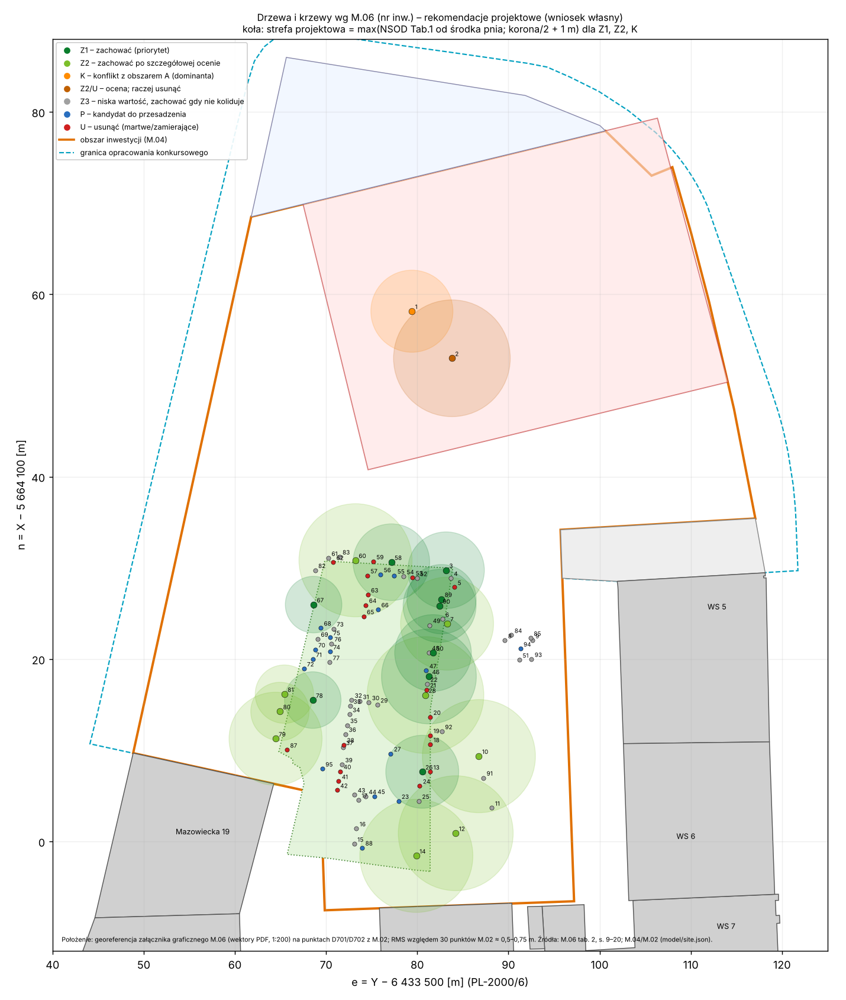

# Drzewostan – analiza operatu dendrologicznego M.06 z rekomendacjami projektowymi

**Stan:** 2026-11-16 · **Zakres:** pełna lektura 28 stron skanu operatu (render 100–250 dpi), w tym tabela 2 (s. 9–20 PDF, wszystkie 94 pozycje); załącznik graficzny PDF (wektorowy, A2, 1:200) zgeoreferencjonowany; porównanie z punktami drzew M.02 · **Zasada wyłączenia:** nie korzystano z informacji o pracach konkursowych.

Oznaczenia: **[Ź]** – treść operatu; **wniosek** – ocena własna (nie jest treścią operatu); **[K-nn]** – sprzeczność/niejasność.

## 0. Źródła

| Skrót | Plik | Uwagi |
|---|---|---|
| **M.06 s. N** | `00_materialy/_rozpak/5_Zalaczniki_Merytoryczne_M.01-M.14_pop.13.02.2026/M.06. OPERAT DENDROLOGICZNY/M.06. OPERAT DENDROLOGICZNY/M.06. Operat dendrologiczny do budowy budynku adminitracyjnego Urzędu Marszałkowskiego Województwa Dolnośląskiego we Wrocław.pdf` | skan (RICOH), 28 s.; N = strona PDF (druk = N−1); s. 1 – okładka Organizatora („Operat sporządzono w 08.2025”) |
| **M.06-rys** | `…/M.06. operat dendrologiczny - załącznik graficzny.pdf` (+ `.dwg`) | „Operat dendrologiczny”, rys. nr 1, 1:200, sierpień 2025; numery inw. drzew i grup krzewów; brak współrzędnych |
| **M.02-drz** | `…/M.02 MAPA DO CELÓW PROJEKTOWYCH/…/zieleń/mazowiecka_drzewa.txt` | 56 punktów drzew (inna numeracja D7xx/I7xx) |
| **Wyj. 13/65, 20/77** | `00_materialy/tekst/1089_Wyjasnienia_tresci_Regulaminu_nr_13-sig.txt`, `…_nr_20-sig.txt` | M.06 ma pierwszeństwo przed M.02 co do położenia drzew; ogródki – zachować jak najwięcej drzew, teren nieogrodzony |
| **Reg.** | `00_materialy/tekst/1089_Regulamin_Konkursu_tekst_jednolity_13.02.2026-sig.txt` R.III ust.1 pkt 5 (s. 19) | „ograniczając wycinkę (…) drzew do niezbędnego minimum” (Rejestr R-031) |
| **site.json** | `model/site.json` | granice: obszar inwestycji, wydzielenie A, ogródki (M.04) |

Metoda georeferencji (wniosek): pnie odczytano z wektorów PDF załącznika (symbol pnia + linia odnośnika do numeru). Rysunek dopasowano translacją do punktów D701 i D702 z M.02 (drzewa nr 1 i 2). Skala 1:200, bez obrotu. Kontrola: 30 drzew z odpowiednikiem w M.02 w promieniu ≤ 1,1 m daje RMS 0,75 m (0,53 m po dopasowaniu podobieństwa). **Położenia w tym dokumencie mają dokładność ok. ±0,5–1 m.** Zgodnie z Wyj. 13 odp. 65 obowiązuje M.06.

*Rys. 1. Drzewa i krzewy (nr inw. M.06) na tle obszaru inwestycji, wydzielenia A i ogródków (M.04). Koła pokazują strefę projektową (wniosek) dla drzew Z1/Z2/K.*

Załącznik graficzny operatu (podgląd): `img/dendro_M06_zalacznik_graficzny.png`.

---

## 1. Co zawiera operat [Ź]

| Element | Treść | M.06 s. |
|---|---|---|
| Strona tytułowa | „Operat dendrologiczny do projektu budowy nowej siedziby Urzędu Marszałkowskiego Województwa Dolnośląskiego we Wrocławiu”; inwestor/zleceniodawca Inwestycje Dolnośląskie sp. z o.o.; autor Dorota Żuk, inż. architektury krajobrazu, inspektor nadzoru terenów zieleni (upr. NOT-SITO Poznań/TZ/0214/22); Wrocław, sierpień 2025 (wpływ 14.08.2025) | 2 |
| Zakres i obszar | dz. 9/1, 10/3, 11/6, 19/11 (obręb Południe, AM-2), **3 729 m²**; „zagospodarowany (…) znaczny udział zieleni urządzonej”; drzewa i krzewy na terenie i w bezpośrednim sąsiedztwie | 4 |
| Materiały | mapa zasadnicza 1:200; badania terenowe 17.06, 20.06, 29.07, 08.08.2025; „prezentacja ogólnego planu zamierzenia i przebiegu kubatury”; Zarządzenie 1217/19 Prezydenta Wrocławia; Zarządzenie 45/2019 Dyr. ZZM; „Karty informacyjne do standardów ochrony drzew w Inwestycjach Wrocławia” (Suchocka 2019) | 4–5 |
| Metoda | obwody na 5 cm i 130 cm (±1 cm), średnica korony (±0,5 m), wysokość (Suunto, ±0,5 m), oględziny pnia i korony, sprawdzenie gatunków chronionych | 5 |
| Progi zezwoleń (u.o.p. art. 83f ust. 1 pkt 3, ust. 4) | obwód na 5 cm: 80 cm – topole, wierzby, klon jesionolistny i srebrzysty; 65 cm – kasztanowiec, robinia, platan; 50 cm – pozostałe | 5 |
| **Tab. 1 – minimalna strefa ochrony drzew (NSOD)**, promień od granicy pnia | młode (obwód ≤ 60 cm): 2,0 m żywotne / 3,0 m osłabione; średni wiek (≤ 120 cm): 3,0 / 5,0 m; dojrzałe (> 120 cm): 4,0 / 6,0 m | 6 |
| Tab. 2 – wyniki | nr inw., gatunek, obwód 130 i 5 cm, średnica korony „północ × południe”, wysokość, pow. krzewów, działka, opis | 9–20 |
| Ochrona na budowie (rozdz. 6) | wygrodzenie SOD przed budową (min. 1,3 m, tablice „NIENARUSZALNA STREFA OCHRONY DRZEWA…”); wskazane wygrodzenie **po obrysie korony + 1 m**; w SOD zakaz składowania, postoju, zmiany poziomu gruntu, zagęszczania, obiektów tymczasowych; cięcia ≤ 30% korony tylko przez arborystę; korzenie Ø > 4 cm nienaruszone; prace ziemne w rzucie korony ręcznie; nadzór dendrologiczno-arborystyczny (powiadomienie ≥ 7 dni) | 21–25 |
| Nasadzenia kompensacyjne (rozdz. 7) | *Tilia cordata* 'Greenspire', *Acer campestre* 'Elsrijk', *Acer pseudoplatanus*, *Aesculus × carnea*, *Corylus colurna*, *Quercus robur* | 25 |
| Dachy zielone (rozdz. 8) | ekstensywny: substrat 6–15 cm, 60–150 kg/m², rozchodniki, rojniki, *Festuca ovina*, *Thymus*, *Achillea*, *Armeria*; intensywny: ≥ 20 cm, 180–500 kg/m², byliny, trawy, krzewy, drzewa niskopienne (*Acer campestre*, *Amelanchier lamarckii*, *Betula pendula* 'Youngii') | 26–27 |
| **Wnioski (rozdz. 9)** | nasadzenia celowe, fragment zieleni osiedlowej z zamkniętą strefą ogródków działkowych; **„44 drzewa oraz 51 grup krzewów”**; stan „dobry/osłabiony”, nadmierne zagęszczenie i konkurencja świetlna, okazy martwe i zamierające; **brak gatunków chronionych i brak zasiedlenia przez gatunki chronione**; drzewa i krzewy przewidziane do zachowania – objąć zabiegami ochronnymi | 27–28 |

**Czego operat NIE zawiera (ważne):** brak klasy wartości drzew, brak oceny w skali stanu (np. 1–5), **brak rekomendacji dla poszczególnych drzew** (zachować, usunąć, przesadzić), brak wyznaczonych SOD dla konkretnych pozycji. Wnioski z rozdz. 9 nie wskazują, które okazy przewiduje się zachować. Kolumny „stan”, „zezwolenie”, „strefa” i „rekomendacja” w tabeli poniżej są więc **wnioskami własnymi**, wyprowadzonymi z opisów operatu i reguł z jego tab. 1 i rozdz. 6.

---

## 2. Tabela drzew i krzewów (94 pozycje, nr 1–95; brak nr 86)

Kolumny 1–8: wiernie z tab. 2 operatu (M.06 s. 9–20; opis skrócony; „[sic]” oznacza oczywisty błąd zapisu w operacie). Wszystkie pozycje leżą na dz. 10/3 (nr 1, 2) lub 11/6 (pozostałe).

Kolumny wnioskowane:
- **Stan:** żywotne / osłabione (posusz ≥ 15–20%, ubytki, uszkodzenia korzeni, owocniki grzybów, konkurencja zagłuszająca) / martwe lub zamierające.
- **Zezwol.?:** czy obwód na 5 cm przekracza próg z art. 83f u.o.p. Dla krzewów przyjęto zwolnienie skupisk do 25 m² (art. 83f ust. 1 pkt 2 – brzmienie z pamięci, do weryfikacji).
- **Strefa proj.:** max(NSOD z tab. 1 + promień pnia; korona/2 + 1 m) [m] od środka pnia. Dla pni wielokrotnych przyjęto obwód zastępczy √Σc².
- **Położenie:** względem poligonów M.04.
- **Rekomendacja:**
  - **Z1** – zachować (priorytet kompozycyjny i przyrodniczy);
  - **Z2** – zachować po szczegółowej ocenie statyki i zdrowotności;
  - **Z3** – niska wartość, zachować, gdy nie koliduje;
  - **P** – kandydat do przesadzenia;
  - **U** – usunąć ze względów sanitarnych;
  - **K** – konflikt z zabudową w obszarze A;
  - **Z2/U** – ocena, raczej usunąć.

| Nr | Gatunek | Obw. 130 [cm] | Obw. 5 [cm] | Korona [m] | Wys. [m] | Krzewy [m²] | Opis stanu wg operatu (skrót) | Stan (wniosek) | Zezwol.? (wniosek) | Strefa proj. [m] | Położenie | Rekomendacja (WNIOSEK) |
|---|---|---|---|---|---|---|---|---|---|---|---|---|
| 1 | klon zwyczajny (*Acer platanoides*) | 195 | 229 | 5x7 | 12,8 | - | Duża przestrzeń strefy korzeniowej; susz gałęziowy 10%; korona częściowo odroślowa, rozbudowana, krzyżujące się konary; konkurencja z sąsiednim drzewem | żywotne | tak | 4.5 | obszar A | **K** konflikt z obszarem A |
| 2 | klon zwyczajny (*Acer platanoides*) | 235 | 249 | 9x6 | 13,8 | - | Karpa lekko wyniesiona; zakorek z wykwitem grzybowym (1,8–3,0 m); owocnik hubiaka i pęknięcie kory na przewodniku; jemioła (typ B); posusz 20%; dziupla; lekkie odchylenie; ZALECANA SZCZEGÓŁOWA OCENA DRZEWA | osłabione | tak | 6.4 | obszar A | Z2/U ocena – raczej usunąć |
| 3 | klon zwyczajny (*Acer platanoides*) | 80, 114 | 120 | 5x4 | 14,4 | - | Pień porośnięty bluszczem; korona asymetryczna; posusz 10%; lekkie odchylenie; rośnie w skupisku | żywotne | tak | 4.2 | ogródki | **Z1** zachować (priorytet) |
| 4 | klon zwyczajny (*Acer platanoides*) | 32 | 50 | 5x2 | 6,4 | - | Bluszcz; korona rachityczna, wysoka, ograniczona; posusz 15% | osłabione | nie | 3.5 | ogródki | Z3 niska wartość – zachować, gdy nie koliduje |
| 5 | brzoza brodawkowata (*Betula pendula*) | 50 | 70 | 1x1 | 7,4 | - | Korona jednostronna, wysoka, szczątkowa; odrosty; ślady cięć; posusz 40% | osłabione | tak | 3.1 | obszar inwestycji (poza ogródkami i A) | **U** usunąć (sanitarnie) |
| 6 | brzoza brodawkowata (*Betula pendula*) | 27 | 39 | 1x2 | 6,4 | - | Liczne odrosty pniowe; korona asymetryczna; posusz 20% | osłabione | nie | 3.0 | ogródki | Z3 niska wartość – zachować, gdy nie koliduje |
| 7 | brzoza brodawkowata (*Betula pendula*) | 65 | 96 | 2x3 | 7,4 | - | Ubytek powierzchniowy z kalusem (0,3 m); uszkodzony nabieg korzeniowy; korona asymetryczna, wysoka; posusz 10% | osłabione | tak | 5.1 | obszar inwestycji (poza ogródkami i A) | **Z2** zachować po szczeg. ocenie |
| 8 | świerk pospolity (*Picea abies*) | 67 | 96 | 2x2,5 | 8,8 | - | Posusz fizjologiczny wewnątrz korony 30%; ślady wyłamanych gałęzi | osłabione | tak | 5.1 | obszar inwestycji (poza ogródkami i A) | Z3 niska wartość – zachować, gdy nie koliduje |
| 9 | śliwa tarnina (*Prunus spinosa*) | 33, 33, 12, 32 | 65 | 3x4 | 4,8 | - | Wielopniowe; korona asymetryczna; krzyżujące się gałęzie; wyłamane konary; posusz 20% | osłabione | tak | 3.1 | obszar inwestycji (poza ogródkami i A) | Z3 niska wartość – zachować, gdy nie koliduje |
| 10 | kasztanowiec biały (*Aesculus hippocastanum*) | 129 | 210 | 5x5,5 | 12 | - | Gleba wypłycona; uszkodzony korzeń mocujący; grunt zagęszczony; odkryte pozostałości betonowe w strefie korzeni; korona dwuprzewodnikowa – kontrola rozwidlenia (zakorek); szrotówek | osłabione | tak | 6.2 | obszar inwestycji (poza ogródkami i A) | **Z2** zachować po szczeg. ocenie |
| 11 | bez czarny (*Sambucus nigra*) | 18, 17, 22, 16 | 55 | 2x3 | 5,6 | - | Wielopniowe; pień odchylony ok. 10°; stan fitosanitarny średni – oznaki osłabienia | osłabione | tak | 3.1 | obszar inwestycji (poza ogródkami i A) | Z3 niska wartość – zachować, gdy nie koliduje |
| 12 | lipa drobnolistna (*Tilia cordata*) | 193 | 284 | 5x6 | 16 | - | Gleba wypłycona; uszkodzone nabiegi; korzeń duszący; odrosty; rozległy ubytek próchniejący z żerowaniem owadów (od 1,2 m) z kolumną kalusa; korona 3-przewodnikowa, rozwidlenia U; pień pochylony 10°; posusz 20%; huśtawka w koronie | osłabione | tak | 6.3 | obszar inwestycji (poza ogródkami i A) | **Z2** zachować po szczeg. ocenie |
| 13 | robinia akacjowa (*Robinia pseudoacacia*) | 7, 5, 5 | 13 | 1x1 | 2,5 | - | Samosiejka; zamieranie wierzchołkowe | martwe/zamierające | nie | 3.0 | ogródki | **U** usunąć (sanitarnie) |
| 14 | jesion wyniosły (*Fraxinus excelsior*) | 128 | 215 | 5x3,5 | 17,6 | - | Gleba wypłycona, uszkodzone nabiegi; bluszcz; korona asymetryczna z wygonionymi konarami; posusz 30%; od południa korona w kolizji z elewacją budynku | osłabione | tak | 6.2 | ogródki | **Z2** zachować po szczeg. ocenie |
| 15 | sosna zwyczajna (*Pinus sylvestris*) | 53 | 64 | 2x2 | 6 | - | Korona przerzedzona; posusz ok. 10% (suche gałęzie wewnętrzne) | żywotne | tak | 2.1 | ogródki | Z3 niska wartość – zachować, gdy nie koliduje |
| 16 | sosna zwyczajna (*Pinus sylvestris*) | 17 | 38 | 2x1 | 4 | - | Korona rachityczna, przerzedzona, ograniczona | osłabione | nie | 3.0 | ogródki | Z3 niska wartość – zachować, gdy nie koliduje |
| 17 | sosna czarna (*Pinus nigra*) | 45 | 57 | 2x3 | 7 | - | Korona rachityczna, asymetryczna, ograniczona | osłabione | tak | 3.1 | ogródki | Z3 niska wartość – zachować, gdy nie koliduje |
| 18 | robinia akacjowa (*Robinia pseudoacacia*) | 20, 17 | 46 | 0,5x0,5 | 4 | - | Odrost korzeniowy; korona szczątkowa, zagłuszona; posusz 60%; kolizja z ogrodzeniem | martwe/zamierające | nie | 3.0 | ogródki | **U** usunąć (sanitarnie) |
| 19 | robinia akacjowa (*Robinia pseudoacacia*) | 11, 10 | 18 | 0,3x0,3 | 2 | - | Odrost korzeniowy; zamieranie wierzchołkowe; posusz 70%; kolizja z ogrodzeniem | martwe/zamierające | nie | 3.0 | ogródki | **U** usunąć (sanitarnie) |
| 20 | robinia akacjowa (*Robinia pseudoacacia*) | 11 | 23 | 2x0,5 | 1,8 | - | Odrost korzeniowy; pochylona ok. 20° w kierunku drogi; kolizja z ogrodzeniem; brak posuszu | osłabione | nie | 3.0 | ogródki | **U** usunąć (sanitarnie) |
| 21 | bez czarny (*Sambucus nigra*) | 18, 16 | 33 | 1x15 [sic – prawdopodobnie 1x1,5] | 4 | - | Korona rachityczna, mocno ograniczona; duża konkurencja świetlna; roślina zamierająca | martwe/zamierające | nie | 8.5 | ogródki | **U** usunąć (sanitarnie) |
| 22 | bez czarny (*Sambucus nigra*) | 12 | 13 | 2,5x1 | 4,5 | - | Korona asymetryczna, odchylona do światła (konkurencja); koliduje z ogrodzeniem | osłabione | nie | 3.0 | ogródki | Z3 niska wartość – zachować, gdy nie koliduje |
| 23 | kalina sztywnolistna (*Viburnum rhytidophyllum*) | 17, 18, 17, 16, 13, 14 | 84 | 0,9x0,5 | 1,9 | - | Korona wysoka; duża konkurencja świetlna; krzew o rozmiarach młodego drzewa, wielopniowy | osłabione | tak | 3.1 | ogródki | P przesadzić |
| 24 | żywotnik zachodni (*Thuja occidentalis*) | 18 | 23 | 1x1 | 2,1 | - | Złamany wierzchołek; posusz 70%; krzew zamierający; konkurencja świetlna | martwe/zamierające | nie | 3.0 | ogródki | **U** usunąć (sanitarnie) |
| 25 | żywotnik zachodni (*Thuja occidentalis*) | 35 | 43 | 1x1 | 1,8 | - | Duża konkurencja świetlna | osłabione | nie | 3.1 | ogródki | Z3 niska wartość – zachować, gdy nie koliduje |
| 26 | lipa szerokolistna (*Tilia platyphyllos*) | 93 | 107 | 6x3,5 | 11 | - | Kolizja z ogrodzeniem; strefa korzeniowa przysłonięta sztuczną trawą; odrosty korzeniowe; bluszcz; budka lęgowa (bez oznak zamieszkania) | żywotne | tak | 4.0 | ogródki | **Z1** zachować (priorytet) |
| 27 | magnolia pośrednia (*Magnolia x soulangeana*) | 5, 5, 10, 8, 1, 3 | 16 | 1,5 | 2,1 | - | Wielopienna, przy altanie; korona zagłuszona, rzadka; brak przestrzeni do rozwoju | osłabione | nie | 3.0 | ogródki | P przesadzić |
| 28 | robinia akacjowa (*Robinia pseudoacacia*) | 224, 17, 25, 24 | 258 | 7x5 | 16 | - | Kolizja z ogrodzeniem; liczne odrosty korzeniowe; bluszcz; strefa korzeniowa zabetonowana płytami; rozwidlenie V-kształtne | osłabione | tak | 6.4 | ogródki | **Z2** zachować po szczeg. ocenie |
| 29 | żywotnik zachodni (*Thuja occidentalis*) | 23 | 26 | 0,5x0,5 | 2 | - | Nasadzenie żywopłotowe, nieformowane, bez wierzchołka, podkrzesane do 1,1 m | osłabione | nie | 3.0 | ogródki | Z3 niska wartość – zachować, gdy nie koliduje |
| 30 | żywotnik zachodni (*Thuja occidentalis*) | 30 | 29 | 0,5x0,5 | 1,8 | - | Nasadzenie żywopłotowe, nieformowane, bez wierzchołka, podkrzesane do 1,1 m | osłabione | nie | 3.0 | ogródki | Z3 niska wartość – zachować, gdy nie koliduje |
| 31 | żywotnik zachodni (*Thuja occidentalis*) | 29 | 38 | 0,5x0,5 | 1,8 | - | Nasadzenie żywopłotowe, nieformowane, bez wierzchołka, podkrzesane do 1,1 m | osłabione | nie | 3.0 | ogródki | Z3 niska wartość – zachować, gdy nie koliduje |
| 32 | żywotnik zachodni (*Thuja occidentalis*) | 24 | 28 | 0,5x0,5 | 2 | - | Nasadzenie żywopłotowe, nieformowane, bez wierzchołka, podkrzesane do 1,1 m | osłabione | nie | 3.0 | ogródki | Z3 niska wartość – zachować, gdy nie koliduje |
| 33 | żywotnik zachodni (*Thuja occidentalis*) | 16 | 23 | 0,5x0,5 | 2 | - | Nasadzenie żywopłotowe, nieformowane, bez wierzchołka, podkrzesane do 1,1 m | osłabione | nie | 3.0 | ogródki | Z3 niska wartość – zachować, gdy nie koliduje |
| 34 | żywotnik zachodni (*Thuja occidentalis*) | 33, 19 | 51 | 0,5x0,5 | 1,9 | - | Nasadzenie żywopłotowe, nieformowane, bez wierzchołka, podkrzesane do 1,1 m; dwupniowy, rozwidlenie U; budka dla ptaków (bez oznak zamieszkania) | osłabione | tak | 3.1 | ogródki | Z3 niska wartość – zachować, gdy nie koliduje |
| 35 | żywotnik zachodni (*Thuja occidentalis*) | 37 | 63 | 0,5x0,5 | 2 | - | Nasadzenie żywopłotowe, nieformowane, bez wierzchołka, podkrzesane do 1,1 m; bluszcz | osłabione | tak | 3.1 | ogródki | Z3 niska wartość – zachować, gdy nie koliduje |
| 36 | żywotnik zachodni (*Thuja occidentalis*) | 34 | 47 | 0,6x0,6 | 2 | - | Nasadzenie żywopłotowe, nieformowane, bez wierzchołka, podkrzesane do 1,1 m | osłabione | nie | 3.1 | ogródki | Z3 niska wartość – zachować, gdy nie koliduje |
| 37 | żywotnik zachodni (*Thuja occidentalis*) | 20 | 29 | 0,5x0,5 | 2 | - | Nasadzenie żywopłotowe, nieformowane, bez wierzchołka, podkrzesane do 1,1 m; jeden przewodnik usunięty w odziomku | osłabione | nie | 3.0 | ogródki | Z3 niska wartość – zachować, gdy nie koliduje |
| 38 | sosna czarna (*Pinus nigra*) | 13 | 13 | 0,2x0,2 | 2,2 | - | DRZEWO MARTWE | martwe/zamierające | nie | 3.0 | ogródki | **U** usunąć (sanitarnie) |
| 39 | żywotnik zachodni (*Thuja occidentalis*) | 28 | 42 | 0,5x0,5 | 2 | - | Nasadzenie żywopłotowe, nieformowane, bez wierzchołka, podkrzesane do 1,1 m | osłabione | nie | 3.0 | ogródki | Z3 niska wartość – zachować, gdy nie koliduje |
| 40 | żywotnik zachodni (*Thuja occidentalis*) | 12 | 20 | 0,5x0,5 | 1,8 | - | Nasadzenie żywopłotowe, nieformowane, bez wierzchołka, podkrzesane do 1,1 m; DRZEWO MARTWE | martwe/zamierające | nie | 3.0 | ogródki | **U** usunąć (sanitarnie) |
| 41 | żywotnik zachodni (*Thuja occidentalis*) | 14,2 [sic] | 32 | 0,5x0,5 | 2 | - | Nasadzenie żywopłotowe, nieformowane, bez wierzchołka, podkrzesane do 1,1 m; DRZEWO MARTWE | martwe/zamierające | nie | 3.0 | ogródki | **U** usunąć (sanitarnie) |
| 42 | żywotnik zachodni (*Thuja occidentalis*) | 32 | 36 | 0,5x0,5 | 2 | - | Nasadzenie żywopłotowe, nieformowane, bez wierzchołka, podkrzesane do 1,1 m; posusz 60%; zamierające | martwe/zamierające | nie | 3.1 | ogródki | **U** usunąć (sanitarnie) |
| 43 | żywotnik zachodni (*Thuja occidentalis*) | 44 | 70 | 0,8x0,8 | 1,8 | - | Nasadzenie żywopłotowe, nieformowane, podkrzesane do 1,1 m; korona mocno asymetryczna | osłabione | tak | 3.1 | ogródki | Z3 niska wartość – zachować, gdy nie koliduje |
| 44 | żywotnik zachodni (*Thuja occidentalis*) | 37 | 53 | 0,5x0,5 | 2 | - | Nasadzenie żywopłotowe, nieformowane, podkrzesane do 1,1 m; korona szeroka, asymetryczna | osłabione | tak | 3.1 | ogródki | Z3 niska wartość – zachować, gdy nie koliduje |
| 45 | berberys Thunberga (*Berberis thunbergii*) | - | - | - | 1,8 | 1 | Krzew przy ogrodzeniu; duża konkurencja świetlna | osłabione | nie (krzew < 25 m²) | – | ogródki | P przesadzić |
| 46 | klon zwyczajny (*Acer platanoides*) | 104 | 123 | 4x5 | 13,5 | - | Kolizja z ogrodzeniem; odchylony od pionu; dwie budki lęgowe (prawdopodobnie niezasiedlone); korona ograniczona; posusz 25% | osłabione | tak | 5.2 | ogródki | **Z1** zachować (priorytet) |
| 47 | leszczyna pospolita (*Corylus avellana*) | - | - | - | 1,8 | 0,9 | Młody krzew przy ogrodzeniu, w dobrej kondycji; duża konkurencja świetlna | żywotne | nie (krzew < 25 m²) | – | ogródki | P przesadzić |
| 48 | leszczyna pospolita (*Corylus avellana*) | - | - | - | 3,5 | 1,2 | Krzew przy ogrodzeniu; duża konkurencja świetlna | osłabione | nie (krzew < 25 m²) | – | ogródki | Z3 niska wartość – zachować, gdy nie koliduje |
| 49 | bez czarny (*Sambucus nigra*) | 24, 12, 27, 12, 33, 13, 12 | 64 | 2 | 3 | - | Krzew wielopniowy; posusz 20%; duża konkurencja świetlna | osłabione | tak | 3.1 | ogródki | Z3 niska wartość – zachować, gdy nie koliduje |
| 50 | jesion wyniosły (*Fraxinus excelsior*) | 124 | 163 | 5x5,5 | 13,5 | - | Przy ogrodzeniu; bluszcz; lekko odchylony; widoczne nabiegi; korona ograniczona; budka lęgowa (prawdopodobnie niezasiedlona) | żywotne | tak | 4.2 | ogródki | **Z1** zachować (priorytet) |
| 51 | róża (*Rosa sp.*) | - | - | - | 1,6 | 0,5 | Grupa krzewów | żywotne | nie (krzew < 25 m²) | – | obszar inwestycji (poza ogródkami i A) | Z3 niska wartość – zachować, gdy nie koliduje |
| 52 | świerk pospolity (*Picea abies*) | 11 | 14 | 0,3x0,3 | 1,5 | - | Młode drzewo bez wierzchołka | osłabione | nie | 3.0 | ogródki | Z3 niska wartość – zachować, gdy nie koliduje |
| 53 | świerk pospolity (*Picea abies*) | 15 | 17 | 0,4x0,4 | 1,7 | - | Młode drzewo bez wierzchołka; zamiera | martwe/zamierające | nie | 3.0 | ogródki | **U** usunąć (sanitarnie) |
| 54 | świerk pospolity (*Picea abies*) | 15 | 20 | 0,4x0,4 | 2,2 | - | Młode drzewo bez wierzchołka | osłabione | nie | 3.0 | ogródki | Z3 niska wartość – zachować, gdy nie koliduje |
| 55 | świerk pospolity (*Picea abies*) | 14 | 21 | 0,4x0,4 | 3 | - | Młode drzewo; duża konkurencja świetlna | osłabione | nie | 3.0 | ogródki | P przesadzić |
| 56 | świerk pospolity (*Picea abies*) | 22 | 37 | 0,4x0,4 | 2,5 | - | Młode drzewo; duża konkurencja świetlna | osłabione | nie | 3.0 | ogródki | P przesadzić |
| 57 | świerk pospolity (*Picea abies*) | 24 | 38 | 0,1x0,1 | 2 | - | DRZEWO MARTWE, bez korony | martwe/zamierające | nie | 3.0 | ogródki | **U** usunąć (sanitarnie) |
| 58 | klon zwyczajny (*Acer platanoides*) | 75 | 98 | 6,5x4 | 14 | - | Kolizja z ogrodzeniem, siatka wrośnięta w pień; rozwidlenie U na 1,6 m; korona asymetryczna | żywotne | tak | 4.2 | obszar inwestycji (poza ogródkami i A) | **Z1** zachować (priorytet) |
| 59 | sosna zwyczajna (*Pinus sylvestris*) | 17 | 23 | 1x1 | 2,3 | - | Kolizja z ogrodzeniem; bez wierzchołka; zamiera; posusz 90% | martwe/zamierające | nie | 3.0 | obszar inwestycji (poza ogródkami i A) | **U** usunąć (sanitarnie) |
| 60 | wierzba mandżurska (*Salix matsudana*) | 128, 37 | 147 | 2x2 | 11 | - | Dwupniowa; przy ogrodzeniu; korona wysoka, mocno ograniczona; posusz 20% | osłabione | tak | 6.2 | obszar inwestycji (poza ogródkami i A) | **Z2** zachować po szczeg. ocenie |
| 61 | jesion wyniosły (*Fraxinus excelsior*) | 38 | 42 | 1,5x1x5 [sic] | 10 | - | Przy ogrodzeniu i altanie; przedmioty składowane przy pniu | osłabione | nie | 3.5 | obszar inwestycji (poza ogródkami i A) | Z3 niska wartość – zachować, gdy nie koliduje |
| 62 | jesion wyniosły (*Fraxinus excelsior*) | 38 | 40 | 0 | 2 | - | Przy ogrodzeniu i altanie; przedmioty przy pniu; DRZEWO BEZ KORONY, ZAMIERA | martwe/zamierające | nie | 3.1 | ogródki | **U** usunąć (sanitarnie) |
| 63 | żywotnik zachodni (*Thuja occidentalis*) | 16, 13, 20 | 32 | 0,5x0,5 | 1,5 | - | Mały udział części zielonych, faza zamierania; brak wierzchołka | martwe/zamierające | nie | 3.0 | ogródki | **U** usunąć (sanitarnie) |
| 64 | żywotnik zachodni (*Thuja occidentalis*) | 12 | 20 | 0,5x0,5 | 1,5 | - | Mały udział części zielonych, faza zamierania; brak wierzchołka | martwe/zamierające | nie | 3.0 | ogródki | **U** usunąć (sanitarnie) |
| 65 | żywotnik zachodni (*Thuja occidentalis*) | 18 | 20 | 0,5x0,5 | 1,5 | - | Mały udział części zielonych, faza zamierania; brak wierzchołka | martwe/zamierające | nie | 3.0 | ogródki | **U** usunąć (sanitarnie) |
| 66 | trzmielina Fortune'a (*Euonymus fortunei*) | - | - | - | 0,5 | 3 | Skupina krzewów płożących | żywotne | nie (krzew < 25 m²) | – | ogródki | P przesadzić |
| 67 | klon zwyczajny (*Acer platanoides*) | 90 | 107 | 3x3 | 12 | - | Przy ogrodzeniu w skupinie krzewów; rozwidlenie V; korona regularna | żywotne | tak | 3.1 | obszar inwestycji (poza ogródkami i A) | **Z1** zachować (priorytet) |
| 68 | bukszpan wieczniezielony (*Buxus sempervirens*) | - | - | - | 1,1 | 0,4 | Młode nasadzenie | żywotne | nie (krzew < 25 m²) | – | ogródki | P przesadzić |
| 69 | bez czarny (*Sambucus nigra*) | 16 pni 10–23 | 148 | 0,7x0,7 | 4,5 | - | Krzew o pokroju wielopiennego drzewa; posusz 10% | żywotne | tak | 1.4 | ogródki | Z3 niska wartość – zachować, gdy nie koliduje |
| 70 | bukszpan wieczniezielony (*Buxus sempervirens*) | - | - | - | 1,1 | 0,6 | Krzew formowany | żywotne | nie (krzew < 25 m²) | – | ogródki | P przesadzić |
| 71 | bukszpan wieczniezielony (*Buxus sempervirens*) | 14 | 27 | 0,5 | 1,2 | - | Posusz aparatu asymilacyjnego 30% | osłabione | nie | 3.0 | ogródki | P przesadzić |
| 72 | jodła pospolita (*Abies alba*) | - | 15 | 0,3 | 1,2 | - | Młode drzewo, podkrzesane | żywotne | nie | 1.1 | ogródki | P przesadzić |
| 73 | żywotnik zachodni (*Thuja occidentalis*) | - | 16, 28, 18 [w kol. obw. 5 cm] | 0,7 | 1,9 | - | Aparat asymilacyjny osłabiony; podkrzesany do 1,1 m | osłabione | nie | 1.4 | ogródki | Z3 niska wartość – zachować, gdy nie koliduje |
| 74 | jałowiec pospolity (*Juniperus communis*) | - | - | - | 1,5 | 0,9 | W wyniesionej donicy ograniczającej korzenie | żywotne | nie (krzew < 25 m²) | – | ogródki | P przesadzić |
| 75 | jałowiec pospolity (*Juniperus communis*) | - | - | - | 1,4 | 0,5 [w druku „05”] | W wyniesionej donicy ograniczającej korzenie | żywotne | nie (krzew < 25 m²) | – | ogródki | P przesadzić |
| 76 | żywotnik zachodni (*Thuja occidentalis*) | - | 64 | 0,8 | 4 | - | Aparat asymilacyjny osłabiony; podkrzesany do 1,1 m | osłabione | tak | 1.4 | ogródki | Z3 niska wartość – zachować, gdy nie koliduje |
| 77 | żywotnik zachodni (*Thuja occidentalis*) | - | 16, 22, 26, 3 [w kol. obw. 5 cm] | 1,1 | 3 | - | Wielopniowy, bez wierzchołka | osłabione | nie | 1.6 | ogródki | Z3 niska wartość – zachować, gdy nie koliduje |
| 78 | świerk pospolity (*Picea abies*) | 90 | 145 | 2,5x2,5 | 12 | - | Przy ścieżce betonowej, obrzeże wrasta w odziomek; dwie budki lęgowe (prawdopodobnie niezasiedlone); podkrzesany; korona regularna; drobny susz fizjologiczny | żywotne | tak | 3.1 | ogródki | **Z1** zachować (priorytet) |
| 79 | śliwa wiśniowa 'Pissardii' (*Prunus cerasifera 'Pissardii'*) | 32, 37, 14, 63, 30 | 110 | 2,5x2,5 | 8 | - | W skupinie żywopłotowej; korona asymetryczna, ograniczona; liczne odrosty; wykwity grzybowe (poinfekcyjne po cięciach) | osłabione | tak | 5.1 | obszar inwestycji (poza ogródkami i A) | **Z2** zachować po szczeg. ocenie |
| 80 | śliwa wiśniowa 'Pissardii' (*Prunus cerasifera 'Pissardii'*) | 34, 34 | 96 | 1,5x4,5 | 8,5 | - | W skupinie żywopłotowej; korona asymetryczna, ograniczona; bluszcz | żywotne | tak | 3.2 | obszar inwestycji (poza ogródkami i A) | **Z2** zachować po szczeg. ocenie |
| 81 | śliwa wiśniowa 'Pissardii' (*Prunus cerasifera 'Pissardii'*) | 35, 35 | 86 | 4,5x1,5 | 8,5 | - | Bluszcz; liczne odrosty pniowe | żywotne | tak | 3.2 | obszar inwestycji (poza ogródkami i A) | **Z2** zachować po szczeg. ocenie |
| 82 | ligustr pospolity (*Ligustrum vulgare*) | - | - | - | 3 | 16,4 | Skupina żywopłotowa, miejscami przerzedzona, luki w obsadzeniu | osłabione | nie (krzew < 25 m²) | – | obszar inwestycji (poza ogródkami i A) | Z3 niska wartość – zachować, gdy nie koliduje |
| 83 | bez czarny (*Sambucus nigra*) | 40,3 [sic] | 80 | 1,2x1,2 | 4 | - | Krzew o rozmiarach drzewa; przy ogrodzeniu, w skupinie żywopłotowej | żywotne | tak | 2.1 | obszar inwestycji (poza ogródkami i A) | Z3 niska wartość – zachować, gdy nie koliduje |
| 84 | bez czarny (*Sambucus nigra*) | - | - | - | 1,8 | 1,5 | Asymetryczny, zagłuszony przez świerk; brak przestrzeni do rozwoju | osłabione | nie (krzew < 25 m²) | – | obszar inwestycji (poza ogródkami i A) | Z3 niska wartość – zachować, gdy nie koliduje |
| 85 | trzmielina oskrzydlona (*Euonymus alatus*) | - | - | - | 1,4 | 0,65 | Skupina krzewów, miejscami przerzedzona; kondycja mocno osłabiona; żerowanie owadów | osłabione | nie (krzew < 25 m²) | – | obszar inwestycji (poza ogródkami i A) | Z3 niska wartość – zachować, gdy nie koliduje |
| 87 | róża (*Rosa sp.*) | - | 24 | 2,5x0,5 | 3 | - | Pnie się po trejażu; kondycja mocno osłabiona; brak światła | osłabione | nie | 2.2 | ogródki | **U** usunąć (sanitarnie) |
| 88 | lilak pospolity (*Syringa vulgaris*) | - | 23 | 0,6x0,6 | 2 | - | Młody krzew przy ogrodzeniu, dobra kondycja; konkurencja świetlna | żywotne | nie | 1.3 | ogródki | P przesadzić |
| 89 | klon zwyczajny (*Acer platanoides*) | 77 | 95 | 5x5,5 | 13,5 | - | Przy ogrodzeniu; korona nieregularna, ograniczona | żywotne | tak | 3.8 | ogródki | **Z1** zachować (priorytet) |
| 90 | klon zwyczajny (*Acer platanoides*) | 107 | 132 | 6x4 | 14 | - | Przy ogrodzeniu; korona nieregularna, ograniczona | żywotne | tak | 4.0 | ogródki | **Z1** zachować (priorytet) |
| 91 | śnieguliczka biała (*Symphoricarpos albus*) | - | - | - | 1,7 | 11,8 | Skupina przy ogrodzeniu; konkurencja świetlna; kondycja osłabiona | osłabione | nie (krzew < 25 m²) | – | obszar inwestycji (poza ogródkami i A) | Z3 niska wartość – zachować, gdy nie koliduje |
| 92 | śnieguliczka biała + bez czarny (*Symphoricarpos albus + Sambucus nigra*) | - | - | - | 3,5 | 2,7 | Grupa krzewów w skupinie; konkurencja świetlna, ograniczony rozwój | osłabione | nie (krzew < 25 m²) | – | obszar inwestycji (poza ogródkami i A) | Z3 niska wartość – zachować, gdy nie koliduje |
| 93 | trzmielina oskrzydlona (*Euonymus alatus*) | - | - | - | 0,6 | 0,57 | Krzew zagłuszony przez sąsiednią roślinność | osłabione | nie (krzew < 25 m²) | – | obszar inwestycji (poza ogródkami i A) | Z3 niska wartość – zachować, gdy nie koliduje |
| 94 | różanecznik (*Rhododendron sp.*) | - | - | - | 0,5 | 0,4 | Duża konkurencja świetlna; zagłuszony | osłabione | nie (krzew < 25 m²) | – | obszar inwestycji (poza ogródkami i A) | P przesadzić |
| 95 | jałowiec płożący (*Juniperus horizontalis*) | - | - | - | 0,5 | 3,2 | Krzew w dobrej kondycji, bez widocznych uszkodzeń | żywotne | nie (krzew < 25 m²) | – | ogródki | P przesadzić |

---

## 3. Podsumowanie liczbowe (wniosek)

| Kategoria | Liczba | Numery |
|---|---|---|
| Pozycje w tabeli | 94 | 1–95 bez 86 |
| Gatunki drzewiaste (w tym magnolia, tarnina, jodła) | **44** – zgodnie z operatem | 1–10, 12–20, 26–28, 38, 46, 50, 52–62, 67, 72, 78–81, 89, 90 |
| Krzewy i grupy krzewów (żywotniki, bez czarny, bukszpany, ligustr…) | 50 (operat: 51) [K-01] | pozostałe |
| W poligonie ogródków (M.04) | 68 | – |
| W obszarze inwestycji poza ogródkami i poza A (pas podwórza przy WS 5–6, krawędzie ogródków) | 24 | m.in. 5, 7–12, 51, 58–61, 67, 79–85, 91–94 |
| W wydzieleniu A (obszar dominanty) | **2** | **1, 2** (duże klony) |
| Z1 – zachować (priorytet) | 9 | 3, 26, 46, 50, 58, 67, 78, 89, 90 |
| Z2 – zachować po szczegółowej ocenie | 9 | 7, 10, 12, 14, 28, 60, 79, 80, 81 |
| K / Z2-U – obszar A | 2 | 1 (K), 2 (Z2/U – hubiak, zakorek; operat: „zalecana szczegółowa ocena”) |
| Z3 – niska wartość | 39 | 4, 6, 8, 9, 11, 15–17, 22, 25, 29–37, 39, 43, 44, 48, 49, 51, 52, 54, 61, 69, 73, 76, 77, 82–85, 91–93 |
| P – kandydaci do przesadzenia | 16 | 23, 27, 45, 47, 55, 56, 66, 68, 70–72, 74, 75 (w donicach), 88, 94, 95 |
| U – martwe/zamierające, usunąć sanitarnie | 19 | 5, 13, 18–21, 24, 38, 40–42, 53, 57, 59, 62–65, 87 |
| Pozycje z obwodem powyżej progu zezwolenia | 35 | kolumna „Zezwol.?” |

**Najcenniejsze okazy (wniosek):**
- lipa drobnolistna nr 12 (obwód 193/284 cm, 16 m) – największa, ale z rozległym ubytkiem próchniejącym i korzeniem duszącym, wymaga oceny ryzyka;
- robinia nr 28 (224 cm, 16 m; rozwidlenie V, korzenie pod płytami);
- jesion nr 14 (128 cm, 17,6 m; posusz 30%, korona w kolizji z elewacją od południa);
- klony nr 1 (195 cm) i 2 (235 cm, hubiak) w obszarze A;
- grupa klonów 3, 89, 90, 46 i jesion 50 w środku ogródków (13–14,4 m);
- świerk 78 (12 m, korona regularna);
- lipa szerokolistna 26 (11 m).

---

## 4. Wnioski projektowe (wniosek)

### 4.1 Gdzie jest konflikt z zabudową
1. **Pierzeje (Mazowiecka, przyczółek mostu, Wybrzeże) są praktycznie wolne od drzew.** Na trawniku północnym rosną tylko klony nr 1 i 2. Oba leżą **wewnątrz wydzielenia A**, 8,8 m i 9,7 m od jego krawędzi. Ich zachowanie wyłączyłoby z zabudowy pole ok. 9–13 m × 9–13 m w środku obszaru dominanty i z podziemia. **Rekomendacja:** usunięcie nr 2 (hubiak, zakorek z wykwitem grzybowym, pęknięcie kory – ryzyko statyczne, operat zaleca szczegółową ocenę). Nr 1 – zachować tylko wtedy, gdy koncepcja przewiduje w zach. części A plac lub dziedziniec wejściowy bez podziemia. W przeciwnym razie usunąć i dać nasadzenie kompensacyjne na skwerze (dz. 9/2) lub w pierzei.
2. **Wnętrze kwartału (ogródki i pas podwórza) mieści 92 z 94 pozycji.** Strefy projektowe drzew Z1+Z2 zajmują razem ok. **767 m²** w prostokącie e 59–93 / n −8…37 (Rys. 1). Same Z1 zajmują **323 m²** w prostokącie e 65–87 / n 4–35. Wniosek: **dziedziniec–ogród w miejscu ogródków, bez kondygnacji podziemnych pod strefami Z1/Z2**, ze ścianą szczelinową podziemia (patrz `geotechnika.md` rozdz. 4) na zewnątrz tych stref. Dla zapasu przyjąć ≥ 1 m od strefy, bo ściana szczelinowa i jej ściana prowadząca wymagają pasa roboczego.
3. **Skrzydło wzdłuż Mazowieckiej przy Mazowieckiej 19** (e ≈ 49–64, n ≈ 10–40): śliwy 'Pissardii' nr 79–81 (strefy 3,2–5,1 m) leżą 5–10 m od frontu ulicy, a klon 67 i wierzba 60 na skraju ogródków. Głębokość skrzydła wynosi ok. 12–14 m od linii ulicy, więc tylną elewację trzeba poprowadzić tak, by nie wchodziła w strefy 67/58/60. Śliwy 79–81 to drzewa niskie i ozdobne – dopuszczalne do usunięcia lub przesadzenia, jeśli kolidują (79 ma wykwity grzybowe).
4. **Pas przy WS 5–6** (e 84–97): kasztanowiec 10 i lipa 12 (Z2) leżą 8–10 m od granicy z podwórzem WS 5–6. Kondygnacje podziemne nie powinny tu sięgać – wniosek spójny z ochroną szczytu WS 5 (`sasiedzi.md`).

### 4.2 Strefy ochrony korzeni – reguły do planu zagospodarowania (z operatu, rozdz. 6; wniosek co do zastosowania)
- Promień minimalny z tab. 1, liczony od granicy pnia. Dla drzew zachowywanych w ogrodzie: dojrzałe 4 m (żywotne) i 6 m (osłabione), średnie 3/5 m.
- Wygrodzenie na czas budowy: korona + 1 m. Ogród powstanie po stanie surowym, więc ogrodzenie SOD musi pozostać przez cały czas budowy podziemia.
- W SOD **nie zmieniać poziomu terenu** (M.06 s. 22). Spadki ogrodu i rzędne nawierzchni dowiązać do istniejących. Teren ogródków ma średnio 118,71 (zakres 118,16–119,49; `geometria.md` rozdz. 6). Ścieżki prowadzić na nawierzchniach przepuszczalnych, bez korytowania, np. na geokracie.
- **Brak regionalnego odwodnienia** (szczelna obudowa wykopu) – inaczej lej depresji obniży wodę gruntową o kilka metrów pod korzeniami (`geotechnika.md` 4).
- Zieleń na stropie garażu (poza SOD) – wg rozdz. 8 operatu: dach intensywny ≥ 20 cm substratu (byliny, krzewy). Drzewa niskopienne wymagają ≥ 60–100 cm substratu i nośności stropu 500 kg/m² lub więcej – to wniosek wykraczający poza operat.

### 4.3 Bilans i komunikacja w pracy konkursowej (wniosek)
- **Wariant bazowy rekomendowany:** zachować wszystkie Z1 i Z2 (18 drzew) oraz możliwie dużo Z3 w ogrodzie. Usunąć 19 pozycji U (sanitarnie – argument niezależny od inwestycji) oraz nr 2 i ewentualnie nr 1 z obszaru A. Przesadzić 16 pozycji P w obrębie nowego ogrodu.
- Na planszy podać tabelę: „zachowane / przesadzone / usunięte sanitarnie / usunięte z powodu kolizji” oraz liczbę nasadzeń nowych, z gatunkami z rozdz. 7 operatu. **Wycinka kolizyjna ograniczona do 1–2 drzew** jest mocnym argumentem wobec wymogu Regulaminu (R-031, R-215) i oceny sądu.
- Żywopłot z żywotników (nr 29–37, 39, 43, 44, 73, 76, 77) dzieli dawne działki ogródków. Jest nieformowany, podkrzesany i częściowo martwy. Ogród ma być nieogrodzony i wspólny (Wyj. 20 odp. 77), więc przekształcenie ogrodu oznacza najpewniej jego usunięcie. **Uwaga:** każde usunięcie formalnie zmniejsza liczbę zachowanych pozycji. Rekomendujemy liczyć bilans osobno dla drzew i dla krzewów oraz zastąpić żywopłot nasadzeniem krzewów rodzimych o wyższej wartości.
- **Procedura (wniosek):** teren leży w obszarze wpisanym do rejestru zabytków (538/A/05 – `konserwator.md`). Zezwolenie na usunięcie drzew może wtedy wydawać wojewódzki konserwator zabytków (u.o.p. art. 83a ust. 1 – brzmienie przytoczone z pamięci, do weryfikacji). W harmonogramie uwzględnić okres lęgowy ptaków (budki lęgowe na nr 26, 34, 46, 50, 78 – w operacie opisane jako niezasiedlone).

---

## 5. Sprzeczności i niejasności

| Nr | Opis | Źródło |
|---|---|---|
| K-01 | Wnioski: „44 drzewa oraz 51 grup krzewów” (= 95), a tabela ma 94 pozycje (brak nr 86). Liczba 44 zgadza się z liczbą gatunków drzewiastych w tabeli (wniosek), więc krzewów jest 50. | M.06 s. 9–20, 27 |
| K-02 | Operat nie podaje decyzji co do zachowania lub usunięcia ani wartości drzew. Wnioski mówią tylko o drzewach „przewidzianych do zachowania”, nie wskazując których. | M.06 s. 27 |
| K-03 | Data Zarządzenia 1217/19 podana jako „28 czerwca 2027 r.” (s. 4), a w innych miejscach 2019 r. – oczywista pomyłka. | M.06 s. 4, 6, 28 |
| K-04 | Kolumna „średnica korony północ × południe” jest niejednoznaczna (dwie wartości). W kilku pozycjach są błędy zapisu: nr 21 „1x15”, nr 61 „1,5x1x5”, nr 41 obwód „14,2”, nr 83 obwód „40,3”, nr 75 pow. „05”. Nr 73 i 77 mają obwody wielopniowe wpisane w kolumnie obwodu na 5 cm. | M.06 s. 11, 14, 16–18 |
| K-05 | Położenia drzew w M.02 różnią się od M.06 o 0,1–5,7 m, zwłaszcza w szpalerze żywotników 29–37. Wiąże M.06 (Wyj. 13 odp. 65). Załącznik graficzny nie ma jednak współrzędnych, więc georeferencję wykonano własną metodą (±0,5–1 m). | Wyj. 13; M.06-rys; M.02 |
| K-06 | Operat jako materiał wyjściowy wymienia „prezentację ogólnego planu zamierzenia i przebiegu kubatury” Inwestora. Nie jest ona częścią materiałów konkursowych i nie ma na nią odwołań w tabeli. | M.06 s. 4 |
