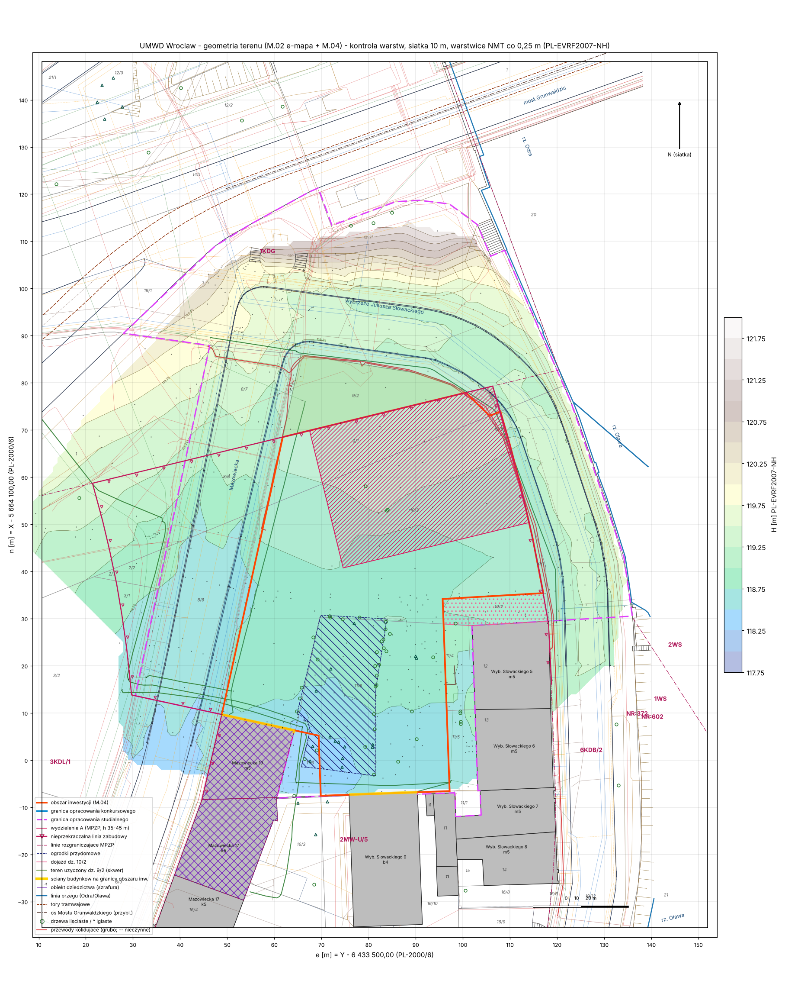

# Geometria terenu i otoczenia – dane do modelu 3D i rysunków 1:500 / 1:200

**Stan:** 2026-11-16 · **Generator:** `tools/site_extract.py` (deterministyczny; plik generowany – nie edytować ręcznie) · **Wynik:** `model/site.json`, `docs/30_lokalizacja/img/site_kontrola.png`  
**Zasada wyłączenia:** opracowanie oparte wyłącznie na załącznikach Organizatora (M.02, M.04, M.07, M.08) – nie korzystano z żadnych informacji o pracach konkursowych.

## 1. Źródła

| Skrót | Plik (względem `umwd/`) | Zawartość / uwagi |
|---|---|---|
| emapa_dwg | `00_materialy/_rozpak/5_Zalaczniki_Merytoryczne_M.01-M.14_pop.13.02.2026/M.02 MAPA DO CELÓW PROJEKTOWYCH/M.02 MAPA DO CELÓW PROJEKTOWYCH/mapa w formacie dgn dwg/mazowiecka_e-mapa.dwg` (sha256 7388854c20479ad6…) | mapa do celów projektowych 1:500 (AutoCAD 2000, 9 753 encje, ~150 warstw: EGiB, BDOT500, GESUT, nakładka MPZP); nr ZGKIKM.TM.6640.4638.2025 z 01.10.2025, protokół weryfikacji z 08.10.2025 |
| nmt_dwg | `00_materialy/_rozpak/5_Zalaczniki_Merytoryczne_M.01-M.14_pop.13.02.2026/M.02 MAPA DO CELÓW PROJEKTOWYCH/M.02 MAPA DO CELÓW PROJEKTOWYCH/model terenu/mazowiecka_model terenu.dwg` (sha256 0e3ec6723fe09958…) | model terenu: 765 punktów + 3D polilinie (krawężniki, chodniki, jezdnie, ogrodzenia, słupki) z rzędnymi |
| zielen_dwg | `00_materialy/_rozpak/5_Zalaczniki_Merytoryczne_M.01-M.14_pop.13.02.2026/M.02 MAPA DO CELÓW PROJEKTOWYCH/M.02 MAPA DO CELÓW PROJEKTOWYCH/zieleń/mazowiecka_zieleń.dwg` (sha256 3564b881d4fbae59…) | drzewa (41 liściastych, 15 iglastych) + zakrzaczenia (3D polilinie) |
| pikiety_txt | `00_materialy/_rozpak/5_Zalaczniki_Merytoryczne_M.01-M.14_pop.13.02.2026/M.02 MAPA DO CELÓW PROJEKTOWYCH/M.02 MAPA DO CELÓW PROJEKTOWYCH/model terenu/mazowiecka_pikiety do nmt.txt` (sha256 a29e04edcd4a512e…) | 800 pikiet: nr X Y H (X=północ, Y=wschód) – podstawa NMT |
| drzewa_txt | `00_materialy/_rozpak/5_Zalaczniki_Merytoryczne_M.01-M.14_pop.13.02.2026/M.02 MAPA DO CELÓW PROJEKTOWYCH/M.02 MAPA DO CELÓW PROJEKTOWYCH/zieleń/mazowiecka_drzewa.txt` (sha256 436bb2d73b3717bc…) | 56 punktów drzew: nr (D=liściaste, I=iglaste) X Y |
| m02_pdf | `00_materialy/_rozpak/5_Zalaczniki_Merytoryczne_M.01-M.14_pop.13.02.2026/M.02 MAPA DO CELÓW PROJEKTOWYCH/M.02 MAPA DO CELÓW PROJEKTOWYCH/e-mapa- pdf-A3/mazowiecka_e-mapa.pdf` (sha256 1ed2d270c64a5ab7…) | e-mapa PDF A3 – odczyt opisów (układy, legenda, oświadczenie) |
| m04_dwg | `00_materialy/_rozpak/5_Zalaczniki_Merytoryczne_M.01-M.14_pop.13.02.2026/M.04. MAPA SCHEMATYCZNA/M.04. MAPA SCHEMATYCZNA/Mapa schematyczna WRO UMWD - M.04.dwg` (sha256 09a7b504f96aa789…) | mapa schematyczna: granice opracowania studialnego/konkursowego, obszar inwestycji, ogródki, dojazd 10/2, teren użyczony 9/2 (DWG przesunięty względem PL-2000 – patrz 2.2) |
| m04_pdf | `00_materialy/_rozpak/5_Zalaczniki_Merytoryczne_M.01-M.14_pop.13.02.2026/M.04. MAPA SCHEMATYCZNA/M.04. MAPA SCHEMATYCZNA/Mapa schematyczna WRO UMWD - M.04.pdf` (sha256 d60b4c025ce67e1a…) | mapa schematyczna PDF (wektorowa) – niezależna kontrola georeferencji |
| M.07 | `00_materialy/_rozpak/…/M.07. INWENTARYZACJA MAZOWIECKA 19.pdf` s. 9–10 | Mazowiecka 19: opis „Budynek w liczbach”, przekrój A-A (rzędne) – odczyt wizualny |
| M.08 | `00_materialy/tekst/M.08._INWENTARYZACJA_WYBRZEŻE_SŁOWACKIEGO_5.txt` | Wybrzeże Słowackiego 5: informacja o oknie w ścianie szczytowej |

Opisy z mapy M.02 (PDF, tabliczka i legenda; odczyt wizualny renderu 250 dpi): *„1. Układ współrzędnych: 2000/6”, „2. Układ wysokościowy: PL-EVRF2007-NH”, „3. Obszar aktualizacji oznaczono linią szrafurowaną”*, legenda: *„Linie MPZP wrysowano na podstawie podkładu rastrowego wyeksportowanego ze strony www – SIP m. Wrocławia – Plany miejscowe”*, *„Nie wyklucza się istnienia w terenie innych, niewykazanych na mapie urządzeń podziemnych…”*. M.04 PDF: „układ 2000/6”, „PL-EVRF2007-NH” (zgodnie z `docs/30_lokalizacja/mpzp.md`).

## 2. Metoda i dokładność

### 2.1 Odczyt formatów
- **DWG → JSON**: libredwg skompilowane do WebAssembly (`@mlightcad/libredwg-web@0.8.2`, Node.js; instalacja do katalogu cache z `--ignore-scripts`). Pakiet systemowy `libredwg-tools` nie jest dostępny w repozytoriach Ubuntu 24.04 (sprawdzono `apt-get`).
- **DGN** (`mazowiecka_e-mapa.dgn`) to MicroStation **V8** (kontener OLE) – GDAL/OGR czyta tylko DGN v7; treść DGN jest duplikatem DWG, więc pominięto (bez straty informacji – wniosek).
- **PDF** (M.04) – wektory odczytane PyMuPDF wyłącznie do kontroli georeferencji (2.3).

### 2.2 Georeferencja
- DWG e-mapy, modelu terenu i zieleni są zapisane **bezpośrednio w PL-2000/6** (x DWG = Y, y DWG = X); odczyt pliku txt pikiet i drzew (X, Y) daje identyczne położenia (tab. 2.3).
- **DWG M.04 jest przesunięty** w osi Y o **ΔY = +165.149 m** (ΔX = 0.000 m) względem PL-2000/6 – ustalone z 286 wierzchołków granic działek (warstwa GESDZI, ta sama treść co e-mapa), odchyłka maks. po przesunięciu **0.000 m**. Narzędzie przelicza M.04 automatycznie. Kontrola: ramka M.04 po przesunięciu = narożniki opisane na mapie (SW Y 6433510,66 / X 5664064,48; NE Y 6433651,96 / X 5664248,09).
- Układ lokalny: **e = Y − 6 433 500,00; n = X − 5 664 100,00** [m]; ramka mapy: e 10.66…151.96, n -35.52…148.09.
- Położenie (środek działki, WGS84): φ = 51.10915°, λ = 17.05158°; **zbieżność południków γ = -0.738°** (pyproj, EPSG:2177) – oś *n* jest obrócona względem północy geograficznej; do analiz nasłonecznienia azymut geograficzny Słońca należy przeliczyć na azymut siatki (wniosek: różnica ok. 0,75° – istotna tylko dla precyzyjnych analiz cienia). Skala odwzorowania m = 0.999977 (zniekształcenie długości ok. 2 mm/100 m – pomijalne).

### 2.3 Punkty kontrolne i błędy

| Test | Liczba | Wynik |
|---|---|---|
| Drzewa: `drzewa.txt` vs DWG zieleni (POINT) | 56 / 56 | odchyłka maks. 0.006 m |
| Drzewa: `drzewa.txt` vs symbole drzew e-mapy (GSPRD*), przykłady: D701, D702, D774, D775, I773 | 5 | odchyłki 0.04, 0.02, 0.06, 0.03, 0.01 m |
| Pikiety: DWG modelu terenu vs `pikiety do nmt.txt` | 765 | 748 zgodnych w XY < 2 cm, maks. ΔH 0.040 m; punkty DWG bez odpowiednika w txt: 17 (pomijane) |
| Rzędne pomiaru w e-mapie (warstwa `txt`) vs pikiety | 65 | odl. XY maks. 1.358 m, ΔH maks. 0.050 m |
| Urzędowe punkty wysokościowe e-mapy GSPWPS vs TIN z pikiet (niezależny pomiar) | 5 | śr. +0.052 m, σ 0.055 m, maks. |Δ| 0.159 m |
| Urzędowe punkty wysokościowe e-mapy GSPWPN vs TIN z pikiet (niezależny pomiar) | 11 | śr. +0.039 m, σ 0.358 m, maks. |Δ| 0.877 m |
| PDF M.04 (wektory przeliczone przez ramkę 1:500) vs DWG: obszar_inwestycji | 82 odc. | odl. ze znakiem: mediana -0.006 m (p05 -0.212, p95 +0.196); |odl.| mediana 0.011 m, maks. 0.907 m |
| PDF M.04 (wektory przeliczone przez ramkę 1:500) vs DWG: granica_opracowania_konkursowego | 350 odc. | odl. ze znakiem: mediana -0.006 m (p05 -0.258, p95 +0.246); |odl.| mediana 0.010 m, maks. 0.267 m |
| PDF M.04 (wektory przeliczone przez ramkę 1:500) vs DWG: teren_uzyczony_9_2 | 7 odc. | odl. ze znakiem: mediana -0.007 m (p05 -0.725, p95 +0.001); |odl.| mediana 0.007 m, maks. 0.730 m |
| Skala PDF M.04 (ramka) | – | 0.176370 / 0.176398 m/pt vs teoret. 1:500 = 0.176389 m/pt |
| Blok vs polilinia granicy konkursowej w DWG M.04 | – | różnica symetryczna 0.000 m² |

Uwaga do kontroli PDF: granice obszaru inwestycji i opracowania konkursowego są w PDF narysowane jako polilinie o szerokości (dwa kontury po obu stronach osi, ±0,2–0,25 m) – o zgodności świadczy mediana odległości ze znakiem ≈ 0; teren użyczony (linia cienka) zgadza się z DWG na poziomie 1 cm. Punkty kontrolne georeferencji: ramka (4 narożniki z opisami współrzędnych), drzewa (txt ↔ DWG zieleni ↔ e-mapa), pikiety (txt ↔ DWG modelu terenu ↔ rzędne w e-mapie), niezależne punkty wysokościowe e-mapy ↔ TIN.

**Ocena dokładności (wniosek):** treść EGiB/BDOT500/GESUT i pomiar uzupełniający – dokładność mapy zasadniczej 1:500 (rzędu ±0,1 m dla szczegółów I grupy); granice konkursowe M.04 – identyczne z DWG po przesunięciu (błąd < 1 cm); **linie MPZP (linie zabudowy, wydzielenie A, linie rozgraniczające) – wrysowane z rastra SIP 1:1000 – dokładność ok. ±0,3–0,5 m**; uzbrojenie – wg GESUT, bez gwarancji kompletności (zastrzeżenie na mapie). NMT – interpolacja liniowa TIN; w obrębie obszaru inwestycji gęstość ok. 1 pikieta / 10 m².

## 3. Warstwy i ich interpretacja

Kody warstw e-mapy (ZGKiKM Wrocław): `G` + grupa (`ES/EP/EL` – EGiB, `SS/SL/SP` – BDOT500 obiekty powierzchniowe/liniowe/punktowe, `UL/UP/US` – GESUT linie/punkty/obiekty) + kod obiektu; sufiks `_O` – opisy. Kolumna „pewność”: *pewna* – potwierdzona opisem/legendą/etykietami; *wniosek* – interpretacja własna.

| Warstwa | Grupa | Treść | Pewność | Liczba obiektów |
|---|---|---|---|---|
| `GELULI_O` | BDOT500 | nazwy ulic / obiektow | pewna | 3 |
| `GEPADR` | EGiB | punkty adresowe | pewna (GEPADR_O) | 10 |
| `GEPADR_O` | EGiB | numery porzadkowe | pewna | 11 |
| `GEPPGD` | EGiB | punkty graniczne | pewna | 89 |
| `GESBLO` | EGiB | obrys bryly/bloku budynku (czesc o innej liczbie kondygnacji) | wniosek | 2 |
| `GESBPB` | EGiB | linia przerywana w obrysie budynku - przejscie/przejazd bramowy lub nawis | wniosek | 2 |
| `GESBTO` | EGiB | drobny obiekt przy budynku (taras/podest/zejscie) | wniosek | 2 |
| `GESBZO` | EGiB | obrysy budynkow | pewna (etykiety funkcja+kondygnacje: m5, k5, b4, i1, t1) | 12 |
| `GESBZO_O` | EGiB | etykiety budynkow: funkcja + liczba kondygnacji nadziemnych | pewna | 11 |
| `GESDZI` | EGiB | granice dzialek ewidencyjnych | pewna (numery dzialek GESDZI_O) | 49 |
| `GESDZI_O` | EGiB | numery dzialek (+ odnosniki) | pewna | 46 |
| `GESIPP` | EGiB | drobne elementy przy narozach budynkow (przypory/pilastry?) | wniosek | 5 |
| `GESJAE` | EGiB | granica arkusza mapy ewidencyjnej | pewna (opisy 'Arkusz nr 2/28') | 2 |
| `GESJOB` | EGiB | granica obrebu ewidencyjnego | pewna (opisy 0022 Poludnie / 0001 Stare Miasto) | 2 |
| `GESSCH` | EGiB | schody przy budynkach | wniosek (szrafura schodow) | 14 |
| `GESUZY` | EGiB | kontury uzytkow gruntowych | pewna (oznaczenia B, Bi, Bp, Bz, dr, Tp, Wp) | 49 |
| `GESUZY_O` | EGiB | oznaczenia uzytkow | pewna | 46 |
| `GSLDSO` | BDOT500 | mury / budowle liniowe (linia) | wniosek | 13 |
| `GSLKOG` | BDOT500 | ogrodzenia (linie + slupki) | wniosek | 48 |
| `GSLKRW` | BDOT500 | krawezniki | wniosek (geometria, zgodnosc z warstwa 'kraweznik') | 101 |
| `GSLTTK` | BDOT500 | tory tramwajowe (osie) | wniosek (przebieg na Most Grunwaldzki) | 2 |
| `GSLTZI` | BDOT500 | linia zieleni ('it') | wniosek - niepewny | 1 |
| `GSPRDI` | BDOT500 | drzewa iglaste (e-mapa) | pewna (symbol) | 9 |
| `GSPRDL` | BDOT500 | drzewa lisciaste (e-mapa) | pewna (symbol) | 17 |
| `GSPSSH` | osnowa | punkty osnowy wysokosciowej (nr 5070, 5260) | wniosek | 2 |
| `GSPSSP` | osnowa | punkty osnowy sytuacyjnej (nr 174xx) | wniosek | 5 |
| `GSPWPN` | BDOT500 | punkty wysokosciowe (1 miejsce po przecinku - terenowe, mniej dokladne) | wniosek | 23 |
| `GSPWPS` | BDOT500 | punkty wysokosciowe sytuacyjne (2 miejsca po przecinku) | wniosek | 51 |
| `GSSBKP` | BDOT500 | drobna budowla (solid) | wniosek - niepewny | 1 |
| `GSSDSO` | BDOT500 | mury / budowle liniowe (obrys) | wniosek | 21 |
| `GSSIIN` | BDOT500 | inne obiekty (opis 'ib') | wniosek - niepewny | 13 |
| `GSSIPD` | BDOT500 | podesty/obiekty przy przyczolku mostu | wniosek - niepewny | 5 |
| `GSSKOA` | BDOT500 | krawedzie jezdni | wniosek (opisy j.kb., j.mb., j.i.) | 104 |
| `GSSKOA_O` | BDOT500 | nawierzchnia jezdni: j.kb.=kostka bet., j.mb.=masa bitum., j.i.=inna | wniosek | 13 |
| `GSSKOD` | BDOT500 | krawedzie chodnikow / ciagow pieszych | wniosek (opisy ch.bt., ch.kb., ch.mb., ch.zw., ch.i.) | 309 |
| `GSSKOD_O` | BDOT500 | nawierzchnia chodnika: bt.=beton, kb.=kostka bet., mb.=masa bitum., zw.=zwir, i.=inna | wniosek | 42 |
| `GSSKOG` | BDOT500 | elementy ogrodzen (bramy/furtki) | wniosek | 5 |
| `GSSOTW` | BDOT500 | inny obiekt liniowy (PRZER3-1) | wniosek - niepewny | 1 |
| `GSSROW` | BDOT500 | rowek/sciek | wniosek - niepewny | 2 |
| `GSSSCK` | BDOT500 | schody terenowe (szrafura) | wniosek | 42 |
| `GSSUTR` | BDOT500 | trawniki / tereny zieleni (obrys + symbole '||') | wniosek (symbol trawnika) | 28 |
| `GSSWWP` | BDOT500 | linia brzegu wod plynacych (Odra, Olawa) | pewna (opisy rz. Odra / rz. Olawa) | 3 |
| `GSSWWP_O` | BDOT500 | nazwy rzek | pewna | 3 |
| `GSSZAD` | BDOT500 | symbole zadrzewien/zakrzewien (?) | wniosek - niepewny | 28 |
| `GSSZMO` | BDOT500 | mury oporowe / sciany przyczolka | wniosek | 2 |
| `GSSZSN` | BDOT500 | skarpy (nieumocnione) - linia gorna + kreski | wniosek | 94 |
| `GSSZSU` | BDOT500 | skarpy umocnione (nabrzeze) | wniosek | 9 |
| `GULCPR` | GESUT | przewod cieplowniczy (c) | wniosek (kod C) | 1 |
| `GULEPR` | GESUT | przewody elektroenergetyczne (eN=nn, eS=SN) | pewna (etykiety) | 159 |
| `GULGPR` | GESUT | przewody gazowe (g) | pewna (etykiety) | 93 |
| `GULKPR` | GESUT | przewody kanalizacyjne (k, ks=sanitarna, kd=deszczowa, ko=ogolnosplawna) | pewna (etykiety) | 113 |
| `GULLOB` | GESUT | obudowa/oslona przewodow (kanal, rura oslonowa) | wniosek - niepewny | 14 |
| `GULTPR` | GESUT | przewody telekomunikacyjne (t) | pewna (etykiety) | 60 |
| `GULWPR` | GESUT | przewody wodociagowe (w, wo) | pewna (etykiety) | 53 |
| `GUPELA` | GESUT | latarnie / slupy oswietleniowe | wniosek | 59 |
| `GUPESE` | GESUT | szafy elektroenergetyczne | wniosek | 4 |
| `GUPEUT` | GESUT | urzadzenia elektroenergetyczne | wniosek | 15 |
| `GUPGZA` | GESUT | zasuwy gazowe | wniosek | 53 |
| `GUPIKP` | GESUT | komory/studnie (symbol) | wniosek | 18 |
| `GUPISN` | GESUT | studnie (symbol) | wniosek | 22 |
| `GUPIST` | GESUT | slupy (opis proj.e) | wniosek | 6 |
| `GUPIWZ` | GESUT | wlazy (t, e, k) | wniosek | 46 |
| `GUPKKS` | GESUT | kratki sciekowe (wpusty) | wniosek | 15 |
| `GUPPRZ` | GESUT | punkty z rzednymi uzbrojenia (opisy ulamkowe: gora/dol) | wniosek | 277 |
| `GUPSUT` | GESUT | urzadzenie (s/ib) | wniosek - niepewny | 2 |
| `GUPTSZ` | GESUT | szafy telekomunikacyjne | wniosek | 2 |
| `GUPWDT` | GESUT | hydranty | wniosek | 5 |
| `GUPWST` | GESUT | studnia wodociagowa | wniosek | 1 |
| `GUPWZA` | GESUT | zasuwy wodociagowe | wniosek | 20 |
| `GUPXUT` | GESUT | urzadzenie nieokreslone (x) | wniosek | 1 |
| `GUPZCP` | GESUT | punkty zalamania/pikiety przewodow | wniosek - niepewny | 96 |
| `GUSESE` | GESUT | obiekty elektroenergetyczne (szafy/zlacza, 'proj.e' = projektowane) | wniosek | 4 |
| `GUSIKP` | GESUT | obrysy studni / komor (kregi ok. 1 m, prostokaty) | wniosek | 41 |
| `GUSIWZ` | GESUT | wlaz/obiekt telekom. | wniosek | 1 |
| `UZPUNE` | GESUT | punkty X2M (?) | wniosek - niepewny | 23 |
| `Warstwa 61` | MPZP | nakladka MPZP nr 372/602 (linie rozgraniczajace kolor 204, linie zabudowy i wydzielenie A kolor 230, obiekty dziedzictwa - szrafura 204, granica planow kolor 7) | pewna (legenda mapy: 'Linie MPZP wrysowano na podstawie podkladu rastrowego ... SIP') | 178 |
| `Warstwa 62` | ramka | granica obszaru aktualizacji mapy (linia szrafurowana) | pewna (opis 3 mapy) | 1 |
| `chodnik` | pomiar NMT | chodniki | pewna | 16 |
| `drzewa_iglaste` | pomiar NMT | drzewa iglaste (nr I...) | pewna | 26 |
| `drzewa_lisciaste` | pomiar NMT | drzewa lisciaste (nr D...) | pewna | 68 |
| `furtka` | pomiar NMT | furtki | pewna | 4 |
| `hydranty` | pomiar NMT | hydranty | pewna | 8 |
| `jezdnia` | pomiar NMT | jezdnie | pewna | 5 |
| `kratki_sciekowe` | pomiar NMT | kratki sciekowe | pewna | 14 |
| `kraweznik` | pomiar NMT | krawezniki (pomiar uzupelniajacy wykonawcy mapy) | pewna (nazwa warstwy) | 69 |
| `latarnie` | pomiar NMT | latarnie | pewna | 6 |
| `obszar_utwardzony` | pomiar NMT | powierzchnie utwardzone | pewna | 17 |
| `ogrodzenie` | pomiar NMT | ogrodzenia | pewna | 18 |
| `plac_zabaw` | pomiar NMT | plac zabaw | pewna | 1 |
| `trawnik` | pomiar NMT | trawniki | pewna | 3 |
| `txt` | pomiar NMT | rzedne pikiet (MTEXT) + symbol punktu | pewna | 166 |
| `wlazy_duze_prostokatne` | pomiar NMT | wlazy prostokatne | pewna | 13 |
| `wlazy_okragle` | pomiar NMT | wlazy okragle | pewna | 12 |
| `zakrzaczenie` | pomiar NMT | zakrzaczenia ('it') | pewna | 17 |
| `zasuwy` | pomiar NMT | zasuwy | pewna | 25 |

M.04 (DWG, po przesunięciu): `__Obszar możliwej zabudowy` (blok `2505_MDCP_Granica możliwej zabudowy`) = **„Obszar inwestycji”** wg legendy PDF (rozbieżność nazwy warstwy i legendy – bez wpływu na geometrię); `__Obszar opracowania konkursowego`, `__Obszar opracowania studialnego`, `__Obszar istniejących ogródków przydomowych`, `__Dojazd do wnętrza podwórzowego`, `__Teren użyczony Województwu Dolnośląskiego`. „Wydzielenie wewn. A”, „Nieprzekraczalna linia zabudowy” i „Obiekt dziedzictwa kulturowego” z legendy M.04 pochodzą z warstwy `Warstwa 61` (nakładka MPZP wspólna z e-mapą). Bloki `2505_FS_linie zabudowy nr 2` i `2505_MPZP_funkcje nr 2` w DWG M.04 są zdefiniowane w innym układzie/skali i **nie są wstawione** w przestrzeń modelu – pominięto.

## 4. Granice i powierzchnie

| Poligon | Pole [m²] | Obwód [m] | Uwagi |
|---|---|---|---|
| Obszar inwestycji (dz. 10/3, 11/6, 19/11, 9/1) | **3728.7** | 272.6 | M.01: 3 729 m² (różnica -0.3 m² = -0.01%) |
| Granica opracowania konkursowego | 4870.9 | 303.4 | obejmuje obszar inwestycji + dz. 9/2 + 10/2 + pas wzdłuż Wybrzeża |
| Granica opracowania studialnego (w ramce M.04) | 9246.2 | 454.0 | przycięta ramką mapy |
| Wydzielenie A (MPZP) | 1208.1 | 140.6 | w obszarze inwestycji: **1184.1 m²** (32% obszaru) |
| Ogródki przydomowe | 490.6 | 97.7 | w całości w obszarze inwestycji: nie (21.0 m² poza) |
| Dojazd – dz. 10/2 | 128.9 | 55.0 | |
| Teren użyczony – dz. 9/2 (skwer) | 355.0 | 94.0 | |
| Obiekt dziedzictwa kulturowego 1 | 258.4 | 64.9 | obrys = budynek Mazowiecka 19 |
| Obiekt dziedzictwa kulturowego 2 | 315.4 | 72.5 | obrys = budynek Mazowiecka 17 |

Narożniki wydzielenia A (e, n): (114.09, 50.37); (106.34, 79.31); (67.47, 69.88); (74.61, 40.76); Y/X: 6433614.09 / 5664150.37; 6433606.34 / 5664179.31; 6433567.47 / 5664169.88; 6433574.61 / 5664140.76.
Boki A: 29.95, 39.99, 29.98, 40.64 m.

### 4.1 Działki (pola geometryczne z mapy; nie są polami ewidencyjnymi)

| Działka | Obręb | Użytki | Pole geom. [m²] | W obszarze inwestycji [m²] | Uwagi |
|---|---|---|---|---|---|
| 10/3 | 0022 Południe | Bz | 2231.0 | 2230.8 |  |
| 11/6 | 0022 Południe | B | 1050.8 | 1050.8 |  |
| 19/11 | 0022 Południe | dr | 12.4 | 12.4 |  |
| 9/1 | 0022 Południe | dr | 434.0 | 433.9 |  |
| 9/2 | 0022 Południe | dr | 355.0 | 0.0 |  |
| 10/2 | 0022 Południe | Bz | 128.9 | 0.0 |  |
| 8/6 | 0022 Południe | dr | 320.6 | 0.0 |  |
| 8/8 | 0022 Południe | dr | 729.2 | 0.0 |  |
| 8/7 | 0022 Południe | dr | 411.6 | 0.0 |  |
| 11/3 | 0022 Południe | B | 356.9 | 0.0 |  |
| 12 | 0022 Południe | B | 295.3 | 0.0 |  |
| 10/1 | 0022 Południe | Tp | 22.3 | 0.0 |  |
| 11/4 | 0022 Południe | B | 108.9 | 0.0 |  |
| 11/5 | 0022 Południe | B | 103.1 | 0.0 |  |
| 13 | 0022 Południe | B | 275.3 | 0.0 |  |
| 20+21 | 0022 Południe | Wp | 4885.2 | 0.0 | przycięta ramką |
| 19/1 | 0022 Południe | dr | 3949.5 | 0.0 | przycięta ramką |
| 19/12 | 0022 Południe | dr | 1943.8 | 0.0 | przycięta ramką |
| 1 | 0022 Południe | dr | 1535.5 | 0.0 | przycięta ramką |
| 14/1 | 0001 Stare Miasto | dr | 1186.1 | 0.0 | przycięta ramką |
| 8/9 | 0022 Południe | dr | 951.2 | 0.0 | przycięta ramką |
| 16/10 | 0022 Południe | Bi | 810.5 | 0.6 | przycięta ramką |
| 3/2 | 0022 Południe | Tp | 791.7 | 0.0 | przycięta ramką |
| 12/2 | 0001 Stare Miasto | dr | 711.9 | 0.0 | przycięta ramką |
| 16/4 | 0022 Południe | Bi | 456.6 | 0.0 | przycięta ramką |
| 12/3 | 0001 Stare Miasto | dr | 277.6 | 0.0 | przycięta ramką |
| 16/3 | 0022 Południe | Bi | 265.2 | 0.0 |  |
| 4 | 0022 Południe | Bz | 226.4 | 0.0 | przycięta ramką |
| 11/1 | 0022 Południe | B | 207.8 | 0.0 |  |
| 14 | 0022 Południe | B | 194.3 | 0.0 |  |
| 1 | 0001 Stare Miasto | Wp | 143.8 | 0.0 | przycięta ramką |
| ? | 0022 Południe |  | 120.7 | 0.0 | przycięta ramką |
| 3/1 | 0022 Południe | Bp | 111.2 | 0.0 |  |
| 16/8 | 0022 Południe | Bi | 94.0 | 0.0 |  |
| 16/9 | 0022 Południe | Bi | 81.5 | 0.0 | przycięta ramką |
| 2/2 | 0022 Południe | Bp | 57.8 | 0.0 |  |
| 21/1 | 0001 Stare Miasto | dr | 55.2 | 0.0 | przycięta ramką |
| 15 | 0022 Południe | B | 30.3 | 0.0 |  |
| 16/6 | 0022 Południe | Tp | 10.4 | 0.0 | przycięta ramką |
| 2/1 | 0022 Południe | Tp | 5.7 | 0.0 |  |
| ? | 0001 Stare Miasto |  | 3.6 | 0.0 | przycięta ramką |

Suma pól geometrycznych dz. 10/3 + 11/6 + 19/11 + 9/1 = **3728.2 m²** (obszar inwestycji M.04: 3728.7 m²; M.01: 3 729 m²). Etykiety nieprzypisane do zamkniętych poligonów (działki przecięte ramką bez pełnego obrysu lub numery z odnośnikami poza ramką): brak.

### 4.2 Krawędzie obszaru inwestycji i fronty

Kolejność CCW od wierzchołka 0; azymuty od północy siatki. Sąsiedztwo – działka/budynek 0,6 m na zewnątrz od środka krawędzi.

| # | od (e, n) | do (e, n) | długość [m] | azymut krawędzi [°] | normalna zewn. [°] | sąsiad: działka | sąsiad: budynek |
|---|---|---|---|---|---|---|---|
| 0 | 97.20, -6.56 | 95.72, 34.17 | 40.76 | 357.9 | 87.9 | 11/4 | – |
| 1 | 95.72, 34.17 | 117.08, 35.41 | 21.40 | 86.7 | 176.7 | 10/2 | – |
| 2 | 117.08, 35.41 | 114.74, 47.41 | 12.23 | 349.0 | 79.0 | 10/1 | – |
| 3 | 114.74, 47.41 | 112.01, 59.15 | 12.05 | 346.9 | 76.9 | 19/12 | – |
| 4 | 112.01, 59.15 | 110.00, 66.84 | 7.95 | 345.4 | 75.4 | 19/12 | – |
| 5 | 110.00, 66.84 | 107.98, 73.93 | 7.37 | 344.1 | 74.1 | 19/12 | – |
| 6 | 107.98, 73.93 | 105.70, 73.00 | 2.46 | 247.9 | 337.9 | 19/1 | – |
| 7 | 105.70, 73.00 | 100.63, 77.92 | 7.06 | 314.2 | 44.2 | 19/1 | – |
| 8 | 100.63, 77.92 | 61.79, 68.50 | 39.97 | 256.4 | 346.4 | 9/2 | – |
| 9 | 61.79, 68.50 | 48.84, 9.68 | 60.23 | 192.4 | 282.4 | 8/8 | – |
| 10 | 48.84, 9.68 | 69.40, 5.20 | 21.04 | 102.3 | 192.3 | 11/3 | Mazowiecka 19 |
| 11 | 69.40, 5.20 | 69.86, -7.55 | 12.76 | 178.0 | 268.0 | 11/3 | – |
| 12 | 69.86, -7.55 | 97.20, -6.56 | 27.36 | 87.9 | 177.9 | 16/10 | Wybrzeze J. Slowackiego 9 |

**Fronty (grupy krawędzi o tym samym sąsiedztwie):**

| Sąsiad (działka) | Sąsiad (budynek) | Długość [m] | od → do | Interpretacja (wniosek) |
|---|---|---|---|---|
| 11/4 | – | 40.76 | (97.2, -6.6) → (95.7, 34.2) | granica z dz. 11/4 (podwórze) |
| 10/2 | – | 21.40 | (95.7, 34.2) → (117.1, 35.4) | granica z dojazdem dz. 10/2 |
| 10/1 | – | 12.23 | (117.1, 35.4) → (114.7, 47.4) | granica z dz. 10/1 (pas wzdłuż Wybrzeża) |
| 19/12 | – | 27.37 | (114.7, 47.4) → (108.0, 73.9) | front Wybrzeża J. Słowackiego – odcinek wsch. (dz. drogowa 19/12, użytek dr) |
| 19/1 | – | 9.52 | (108.0, 73.9) → (100.6, 77.9) | naroże pn.-wsch. – Wybrzeże J. Słowackiego / przyczółek mostu (dz. drogowa 19/1, użytek dr) |
| 9/2 | – | 39.97 | (100.6, 77.9) → (61.8, 68.5) | granica ze skwerem dz. 9/2 → front Wybrzeża Słowackiego / przyczółek mostu |
| 8/8 | – | 60.23 | (61.8, 68.5) → (48.8, 9.7) | front ul. Mazowieckiej (dz. drogowa 8/8) |
| 11/3 | Mazowiecka 19 | 21.04 | (48.8, 9.7) → (69.4, 5.2) | granica z dz. Mazowiecka 19 |
| 11/3 | – | 12.76 | (69.4, 5.2) → (69.9, -7.5) | granica z dz. Mazowiecka 19 |
| 16/10 | Wybrzeze J. Slowackiego 9 | 27.36 | (69.9, -7.5) → (97.2, -6.6) | granica z dz. 16/10 – pn. ściana budynku b4 (Wybrzeże Słowackiego 9?) na granicy |

### 4.3 Ściany budynków sąsiednich na granicy obszaru inwestycji

| Budynek | Kondygn. | Ściana od → do (e, n) | Długość [m] | Normalna zewn. [°] | Uwagi |
|---|---|---|---|---|---|
| Mazowiecka 19 | 6 | (64.26, 6.32) → (48.84, 9.68) | 15.78 | 12.3 | pln. sciana szczytowa przy granicy z dz. 11/6 (obszar inwestycji); okna w scianie szczytowej przeznaczone do zamurowania w ramach inwestycji towarzyszacej (M.07, strona tytulowa) |
| Mazowiecka 19 | 6 | (64.09, 5.70) → (64.26, 6.32) | 0.64 | 105.3 | pln. sciana szczytowa przy granicy z dz. 11/6 (obszar inwestycji); okna w scianie szczytowej przeznaczone do zamurowania w ramach inwestycji towarzyszacej (M.07, strona tytulowa) |
| Wybrzeze J. Slowackiego 9 | 4 | (90.38, -6.78) → (75.85, -7.30) | 14.54 | 357.9 |  |

### 4.4 Ściany budynków zwrócone ku obszarowi inwestycji (do analiz przesłaniania i odległości)

Promienie z 5 punktów każdej ściany (długość ≥ 2 m) wzdłuż normalnej zewnętrznej, zasięg 25 m; odległość = od lica ściany do granicy obszaru inwestycji.

| Budynek | Kondygn. | Ściana od → do (e, n) | Dł. [m] | Normalna zewn. [°] | Odl. do obszaru inw. [m] (min–max) | Udział promieni |
|---|---|---|---|---|---|---|
| Wybrzeze J. Slowackiego 5 | 5 | (102.02, 27.60) → (102.07, 25.60) | 2.01 | 268.6 | 6.04–6.06 | 1.0 |
| Wybrzeze J. Slowackiego 5 | 5 | (102.07, 25.60) → (102.61, 10.72) | 14.89 | 267.9 | 6.03–6.04 | 1.0 |
| Wybrzeze J. Slowackiego 5 | 5 | (118.16, 29.46) → (101.93, 28.52) | 16.26 | 356.7 | 6.00–6.00 | 1.0 |
| Mazowiecka 19 | 6 | (64.26, 6.32) → (48.84, 9.68) | 15.78 | 12.3 | 0.05–0.05 | 1.0 |
| Mazowiecka 19 | 6 | (60.50, -7.93) → (64.09, 5.70) | 14.09 | 104.8 | 5.95–8.50 | 0.8 |
| i1 | 1 | (98.29, -6.93) → (93.69, -7.11) | 4.61 | 357.8 | 0.42–0.42 | 0.8 |
| Wybrzeze J. Slowackiego 9 | 4 | (90.38, -6.78) → (75.85, -7.30) | 14.54 | 357.9 | 0.05–0.05 | 1.0 |
| Wybrzeze J. Slowackiego 6 | 5 | (102.61, 10.72) → (103.20, -6.49) | 17.22 | 268.0 | 6.00–6.03 | 1.0 |

Wniosek: **pn. ściana szczytowa Wybrzeża Słowackiego 5** (normalna ok. 357°) nie leży na granicy obszaru inwestycji – oddziela ją dz. 10/2 (dojazd, szer. ok. 5,5–6 m); okno na 1. piętrze tej ściany (M.08) wymaga sprawdzenia przesłaniania/odległości od projektowanej zabudowy na pn. od dz. 10/2. **Pn. ściana szczytowa Mazowieckiej 19** leży na granicy (zabudowa przyległa możliwa). Pn. ściana budynku b4 (Wybrzeże Słowackiego 9 – adres niepewny) również leży na pd. granicy obszaru inwestycji.

## 5. Budynki istniejące (zasięg mapy)

| Budynek | Etykieta | Funkcja (kod EGiB) | Kondygn. | Pole zab. [m²] | Teren wokół H śr. | Wysokość [m] | Góra ≈ H | Metoda / uwagi |
|---|---|---|---|---|---|---|---|---|
| Mazowiecka 17 | k5 | oswiaty, nauki, kultury lub sportu | 5 | 315.4 | 118.54 | 21.0 | 139.5 | szacunek – do weryfikacji |
| Mazowiecka 17 *(przycięty ramką)* | k5 | oswiaty, nauki, kultury lub sportu | 5 | 141.3 | poza NMT | 21.0 |  | szacunek – do weryfikacji |
| Mazowiecka 19 | m5 | mieszkalny | 6 | 258.4 | 118.53 | 21.7 | 140.2 | inwentaryzacja M.07 |
| Wybrzeze J. Slowackiego 5 | m5 | mieszkalny | 5 | 293.6 | 118.99 | 21.0 | 140.0 | szacunek – do weryfikacji |
| Wybrzeze J. Slowackiego 6 | m5 | mieszkalny | 5 | 271.8 | 118.85 | 21.0 | 139.8 | szacunek – do weryfikacji |
| Wybrzeze J. Slowackiego 7 | m5 | mieszkalny | 5 | 177.3 | 118.62 | 21.0 | 139.6 | szacunek – do weryfikacji |
| Wybrzeze J. Slowackiego 8 | m5 | mieszkalny | 5 | 191.2 | poza NMT | 21.0 |  | szacunek – do weryfikacji |
| Wybrzeze J. Slowackiego 9 | b4 | biurowy | 4 | 408.6 | 118.53 | 17.2 | 135.7 | szacunek – do weryfikacji |
| – (brak adresu) | i1 | inny niemieszkalny | 1 | 68.9 | 118.63 | 6.0 | 124.6 | szacunek – do weryfikacji |
| – (brak adresu) | t1 | transportu i lacznosci | 1 | 27.8 | 118.53 | 6.0 | 124.5 | szacunek – do weryfikacji |
| – (brak adresu) | i1 | inny niemieszkalny | 1 | 7.5 | 118.63 | 6.0 | 124.6 | szacunek – do weryfikacji |

**Mazowiecka 19** (M.07, s. 9–10): kamienica z 1880 r. na dz. 11/3; 6 kondygnacji nadziemnych (w tym poddasze użytkowe), 1 podziemna; pow. zabudowy wg inwentaryzacji **259,00 m²** (z mapy: 258.4 m² – zgodność 99.7%); wysokość „ok. 20 m” (opis). **Sprzeczność:** etykieta EGiB „m5” (5 kondygnacji) vs inwentaryzacja – 6 kondygnacji nadziemnych (różnica = poddasze użytkowe; przyjąć 6 w modelu). Przekrój A-A: ±0,00 = parter (wejście od Mazowieckiej), ul. Mazowiecka −0,73, podwórze −1,15, spoczniki −0,85 / +1,78 / +5,51 / +9,28 / +13,05 / +16,79, poddasze +18,30; dach płaski kryty papą (spadek ok. 5%), murek attykowy, attyka ok. **+21,0 m** wzgl. ±0,00 (odczyt graficzny z rysunku, ±0,3 m – wniosek). Przyjęto: chodnik przed frontem H = 118.51 → ±0,00 ≈ 119.24 m n.p.m., attyka ≈ **140.24 m n.p.m.** (do weryfikacji pomiarem). Okna w północnej ścianie szczytowej – do zamurowania w ramach inwestycji towarzyszącej (M.07).

**Wybrzeże J. Słowackiego 5** (M.08): okno w ścianie szczytowej lokalu na kondygnacji 2 (1. piętro) **nie jest przeznaczone do zamurowania – należy uwzględnić jego istnienie w projekcie** (przesłanianie/nasłonecznienie, odległości wg WT). Wysokość budynku nie wynika z dostarczonych materiałów (rzuty – skany) – w `site.json` szacunek z liczby kondygnacji (5 → ok. 21.0 m), do weryfikacji na zdjęciach M.09/M.10.

## 6. Teren (NMT) – rzędne i spadki

NMT: 791 pikiet (z 800; 9 wykluczono jako punkty nie-terenowe) + 0 punktów dodatkowych z wierzchołków linii nieciągłości (3D polilinie modelu terenu są zbudowane z tych samych pikiet, więc nie wnoszą nowych punktów; TIN nie jest wymuszany liniami – wniosek: przy siatce 1 m bez znaczenia) → TIN → siatka 1.0 m (133 × 124 węzłów, `teren.siatka_NMT`). Zakres H pikiet terenowych 117.92…121.72 m.

**Pikiety wykluczone z NMT** (kryterium: H > mediana sąsiadów w promieniu 6 m o ponad 0,45 m **i** położenie ≤ 0,5 m od linii ogrodzenia/muru lub schodów budynku):

| Nr | e | n | H | ΔH od mediany sąsiadów | Powód (wniosek) |
|---|---|---|---|---|---|
| 213 | 64.82 | 9.85 | 119.50 | +0.93 | korona muru/ogrodzenia |
| 215 | 67.52 | 6.41 | 119.66 | +1.14 | korona muru/ogrodzenia |
| 533 | 66.36 | 8.55 | 119.53 | +1.01 | korona muru/ogrodzenia |
| 534 | 67.06 | 8.12 | 119.53 | +1.01 | korona muru/ogrodzenia |
| 535 | 75.87 | -7.33 | 120.65 | +2.24 | korona muru/ogrodzenia |
| 536 | 67.71 | -7.68 | 119.70 | +1.30 | korona muru/ogrodzenia |
| 537 | 60.50 | -8.05 | 120.08 | +1.78 | korona muru/ogrodzenia |
| 723 | 102.85 | 1.86 | 119.15 | +0.50 | stopien schodow/podest przy budynku |
| 724 | 102.79 | 3.00 | 119.15 | +0.50 | stopien schodow/podest przy budynku |

Pozostałe duże różnice lokalne (np. pikiety 721/722/221 przy schodach i skarpie na dz. 1KDG, n≈104–109, ok. +1,1 m) są rzeczywistą rzeźbą (skarpa przy dojeździe do mostu) i pozostały w NMT.

| Obszar | Pole [m²] | Pikiet | H min | H max | H śr. | H med. | Deniwelacja | Spadek płaszczyzny regresji | Kierunek spadku [°] | Spadki lokalne TIN: med./p90/max [%] |
|---|---|---|---|---|---|---|---|---|---|---|
| obszar inwestycji | 3728.7 | 174 | 118.33 | 119.44 | 118.98 | 118.94 | 1.11 | 1.07% | 185 | 2.6 / 7.5 / 89.1 |
| wydzielenie A ∩ obszar inwestycji | 1184.1 | 17 | 118.88 | 119.44 | 119.24 | 119.26 | 0.56 | 1.37% | 172 | 1.2 / 4.6 / 5.5 |
| granica opracowania konkursowego | 4870.9 | 305 | 118.33 | 119.49 | 119.02 | 119.02 | 1.16 | 1.00% | 193 | 3.5 / 45.2 / 485.5 |
| ogródki przydomowe | 490.6 | 26 | 118.16 | 119.00 | 118.70 | 118.74 | 0.84 | 1.67% | 208 | 3.4 / 22.0 / 184.2 |
| dz. 9/2 (skwer) | 355.0 | 7 | 119.30 | 119.49 | 119.38 | 119.37 | 0.19 | 0.34% | 61 | 1.6 / 10.3 / 34.3 |
| dz. 10/2 (dojazd) | 128.9 | 8 | 118.92 | 119.25 | 119.09 | 119.08 | 0.33 | 1.76% | 216 | 2.3 / 5.6 / 18.8 |

Obszar inwestycji: H min 118.33 m w punkcie (e, n) = (70.0, -3.0), H max 119.44 m w (82.5, 70.5). Lokalne maksima spadków TIN wynikają z krawężników, obrzeży i nasypów ogródków (skoki rzędu 0,1–0,3 m na krótkich odcinkach) – nie są spadkiem terenu (wniosek).

**Rzędne w narożnikach obszaru inwestycji** (TIN):

| Wierzchołek | e | n | H |
|---|---|---|---|
| 0 | 97.20 | -6.56 | 118.69 (IDW – poza TIN) |
| 1 | 95.72 | 34.17 | 118.98 |
| 2 | 117.08 | 35.41 | 119.16 |
| 3 | 114.74 | 47.41 | 119.13 |
| 4 | 112.01 | 59.15 | 119.20 |
| 5 | 110.00 | 66.84 | 119.26 |
| 6 | 107.98 | 73.93 | 119.25 |
| 7 | 105.70 | 73.00 | 119.26 |
| 8 | 100.63 | 77.92 | 119.31 |
| 9 | 61.79 | 68.50 | 119.28 |
| 10 | 48.84 | 9.68 | 118.65 |
| 11 | 69.40 | 5.20 | 118.48 |
| 12 | 69.86 | -7.55 | 118.56 |

Wniosek do projektu: teren praktycznie płaski (deniwelacja w obszarze inwestycji ok. 1.1 m); poziom ±0,00 parteru można przyjąć ok. 119.09–119.24 m n.p.m. (chodnik + 0,15…0,30 m) – do decyzji projektowej i weryfikacji z wymaganiami dostępności (wejścia bez schodów).

## 7. Zieleń

Drzewa z pomiaru (`drzewa.txt`): 56 punktów, 52 unikalnych numerów (numery z dwoma punktami – drzewa wielopniowe lub podwójny pomiar: D702, D774, D775, I773); dodatkowo 21 drzew z e-mapy bez numeru (poza zasięgiem pomiaru szczegółowego). W obszarze inwestycji: **46** drzew, w tym w ogródkach przydomowych: **33**. Gatunki, obwody, stan i korony – w operacie dendrologicznym M.06 (inna numeracja: do sparowania po położeniu – etap późniejszy).

## 8. Uzbrojenie terenu – kolizje z obszarem inwestycji

| Sieć | Etykiety | Długość w obszarze inwestycji [m] | w tym w wydzieleniu A [m] | Status |
|---|---|---|---|---|
| elektroenergetyka (`GULEPR`) | eNA, eNA, eNA | 22.6 | 20.0 | czynny/brak opisu |
| elektroenergetyka (`GULEPR`) | eNA | 14.2 | 10.7 | czynny/brak opisu |
| elektroenergetyka (`GULEPR`) | eS, eN | 0.7 | 0.0 | czynny/brak opisu |
| kanalizacja (`GULKPR`) | k100 | 0.2 | 0.0 | czynny/brak opisu |
| telekomunikacja (`GULTPR`) | t | 56.3 | 0.0 | czynny/brak opisu |
| telekomunikacja (`GULTPR`) | t2-2200/17, t, t | 45.9 | 0.0 | czynny/brak opisu |
| telekomunikacja (`GULTPR`) | – | 20.0 | 0.0 | czynny/brak opisu |
| telekomunikacja (`GULTPR`) | t, t, t, t | 10.3 | 7.5 | czynny/brak opisu |
| telekomunikacja (`GULTPR`) | – | 7.6 | 0.0 | czynny/brak opisu |
| telekomunikacja (`GULTPR`) | – | 5.4 | 0.0 | czynny/brak opisu |
| telekomunikacja (`GULTPR`) | t | 0.9 | 0.0 | czynny/brak opisu |

Podsumowanie (długość w obszarze inwestycji wg typu): kanalizacja 0.2 m, elektroenergetyka 37.5 m, telekomunikacja 146.5 m.

Uwaga: etykiety przypisano do najbliższej linii w promieniu 3 m (możliwe pojedyncze błędne przypisania przy liniach równoległych – wniosek). Przebiegi kolidujące wymagają warunków przebudowy od gestorów; dla parkingu podziemnego istotne są wszystkie przewody w obrysie (także nieczynne – do usunięcia).

## 9. Most Grunwaldzki i nabrzeże

Oś mostu (przybliżenie – kierunek osi torów tramwajowych w pn.-wsch. narożniku mapy): azymut siatki **70.4°**, punkt (e, n) = (106.2, 141.3); przecięcie z linią brzegu: (100.4, 139.2). Mury przyczółka (GSSZMO): 2 polilinie. Most leży w większości poza ramką mapy – geometria orientacyjna.

Linia brzegu (GSSWWP): Odra – od pn. ramki (e≈97) wzdłuż wsch. strony Wybrzeża; ujście Oławy na wsch. od kwartału. Odległość obszaru inwestycji od linii brzegu: **14.9 m** (minimum, wniosek z geometrii).

## 10. Sprzeczności, niejasności, ograniczenia

1. **Nazwa warstwy vs legenda M.04:** warstwa `__Obszar możliwej zabudowy` jest w legendzie PDF opisana jako „Obszar inwestycji”. Geometria = suma działek inwestycyjnych (pole 3728.7 m² vs M.01 3 729 m²) – przyjęto „obszar inwestycji”.
2. **Wydzielenie A – nazewnictwo:** legenda e-mapy M.02 opisuje różową szrafurę jako „strefa oddziaływania linii zabudowy”, M.04 – jako „Wydzielenie wewn. A zgodnie z MPZP”; plan: „obszar podwyższonej zabudowy oznaczony symbolem A” (patrz `mpzp.md`). Geometria identyczna.
3. **Dokładność linii MPZP**: wrysowane z rastra (opis na mapie) – nie należy ich traktować jako geodezyjnie wyznaczonych; zalecany zapas projektowy ≥0,3–0,5 m od linii zabudowy i granicy A (wniosek).
4. **DWG M.04 przesunięty** o ΔY = 165.149 m – użycie DWG M.04 „wprost” (bez przeliczenia) w modelu dałoby błąd 165 m w osi wschód–zachód.
5. **Pola działek** – pola geometryczne z mapy, nie z rejestru EGiB (różnice rzędu dziesiątych m² możliwe). Działki przy ramce są przycięte.
6. **Wysokości budynków** (poza Mazowiecką 19) – szacunkowe, z liczby kondygnacji; dla analiz przesłaniania należy je zweryfikować (zdjęcia 360° M.09, drona M.10, wizja lokalna).
7. **DGN V8** – nieodczytany (brak sterownika); treść zdublowana w DWG.
8. **Atrybuty A/B w etykietach przewodów** – znaczenie nieustalone (prawdopodobnie źródło/dokładność położenia wg instrukcji ZGKiKM) – do weryfikacji u gestorów/ZGKiKM.
9. **Most** – oś przybliżona (poza zasięgiem mapy); do wizualizacji należy uzupełnić geometrię mostu z innych źródeł (zdjęcia M.09/M.10, rysunki historyczne).

## 11. Struktura `model/site.json` (skrót)

`meta`, `crs` (definicja układu, zbieżność, przesunięcie M.04, ramka), `kontrola_georeferencji`, `granice` (obszar inwestycji + krawędzie + fronty, granice konkursowa/studialna, A, ogródki, dojazd 10/2, teren użyczony 9/2, obiekty dziedzictwa, obszar aktualizacji), `mpzp` (linie zabudowy, symbole, linie rozgraniczające, granica planów, oznaczenia), `dzialki`, `budynki`, `ulice_i_sytuacja`, `most_grunwaldzki`, `woda`, `zielen`, `teren` (pikiety, linie nieciągłości, siatka NMT 1 m, statystyki, kontrola), `uzbrojenie` (przewody z kolizjami, punkty, rzędne), `warstwy_emapy_surowe` (pełna treść e-mapy do rysunku 1:500). Poligony CCW w (e, n), bez powtórzenia 1. punktu.

Odtworzenie: `python3 -I tools/site_extract.py` (pierwsze uruchomienie instaluje `@mlightcad/libredwg-web@0.8.2` do cache i konwertuje DWG; kolejne korzystają z cache JSON).
