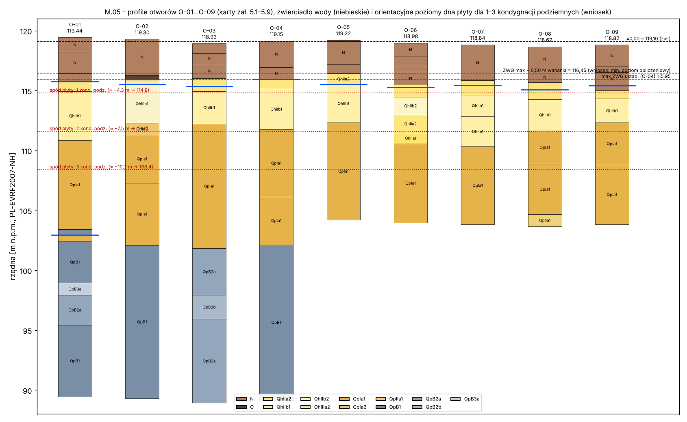
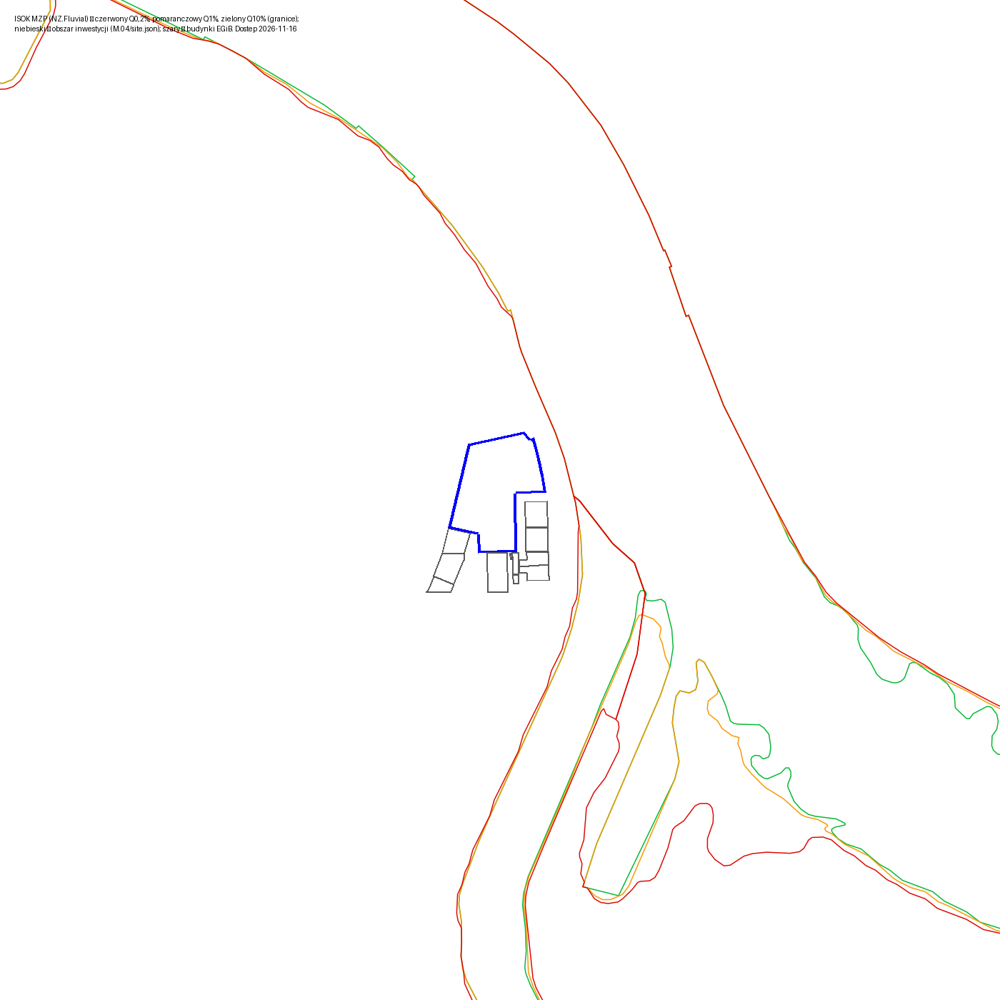

# Warunki gruntowo-wodne i posadowienie – analiza M.05 (opinia geotechniczna) z wnioskami projektowymi

**Stan:** 2026-11-16 · **Zakres:** pełna lektura opinii (13 s.) i wszystkich załączników M.05 (karty 9 otworów, 4 sondowania CPTu, 7 przekrojów, tabela parametrów), kontrola map zagrożenia powodziowego ISOK · **Zasada wyłączenia:** dokument nie korzysta z żadnych informacji o pracach konkursowych (nie wyszukiwano ich i nie napotkano).

Oznaczenia: **[Ź]** – treść źródła; **wniosek** – interpretacja własna, do weryfikacji przez geotechnika/konstruktora; **[K-nn]** – sprzeczność lub luka w danych.

---

## 0. Źródła

| Skrót | Plik | Uwagi |
|---|---|---|
| **Op. s. N** | `00_materialy/_rozpak/5_Zalaczniki_Merytoryczne_M.01-M.14_pop.13.02.2026/M.05. OPINIA GEOTECHNICZNA/M.05. OPINIA GEOTECHNICZNA/M.05. Opinia geotechniczna.pdf` (tekst: `00_materialy/tekst/M.05._Opinia_geotechniczna.txt`) | N = numer strony druku „Strona N z 13”; PDF ma dodatkową okładkę Organizatora (data 2025.10.29) |
| **Zał. 5.x** | `…/M.05. Opinia geotechniczna Zał.5.1-5.9 Karty otworów geotechnicznych.pdf` | 9 kart (GeoStar, skala 1:150); dane odczytano z warstwy tekstowej PDF (PyMuPDF, położenie słów), weryfikacja wizualna |
| **Zał. 6.x** | `…/Zał.6.1-6.4 Karty sondowań statycznych CPTu.pdf` | 4 karty CPTu (sonda Geotech-220, 25.08.2025) |
| **Zał. 7.x** | `…/Zał.7.1-7.7 Przekroje geotechniczne.pdf` | 7.1: O-01–O-02; 7.2: O-02–O-04–O-05; 7.3: O-07–O-03–O-06–O-05; 7.4: O-01–O-08–O-07; 7.5: O-08–O-09; 7.6: O-09–O-03–O-02; 7.7: O-09–O-06–O-04 |
| **Zał. 8** | `…/Zał.8 Tabela parametrów fizyko-mechanicznych gruntów.pdf` | parametry charakterystyczne (uśrednione) – render 130 dpi |
| **Zał. 2** | `…/Zał.2 Mapa dokumentacyjna.pdf` | lokalizacja otworów (podgląd: `img/geo_M05_zal2_mapa_dokumentacyjna.png`) |
| **ISOK** | usługa WMS INSPIRE MZP/MRP: `https://wody.isok.gov.pl/wss/INSPIRE/INSPIRE_NZ_HY_MZPMRP_WMS` (GetCapabilities, GetMap, GetFeatureInfo; warstwy NZ.Fluvial, NZ.RiskZone, NZ.ArtificialWaterBearingInfrastructure), dostęp 2026-11-16 | weryfikacja zapisu opinii o zagrożeniu powodziowym |
| **site.json** | `model/site.json` (opracowanie równoległe `docs/30_lokalizacja/geometria.md`) | granice, NMT, poziom terenu; lokalny układ e/n |

*Rys. 1. Profile O-01…O-09 w rzędnych bezwzględnych (dane z kart zał. 5.1–5.9), zwierciadło ustabilizowane (niebieskie), poziomy obliczeniowe (wniosek) i orientacyjne spody płyt dla 1–3 kondygnacji podziemnych (wniosek: ±0,00 = 119,10; kondygnacja 3,2–3,3 m; płyta z warstwami ok. 1,0 m).*

---

## 1. Dane podstawowe opinii

| Element | Ustalenie | Źródło |
|---|---|---|
| Wykonawca | INŻ-GEO Badania i Roboty Geotechniczne Sp. z o.o. Sp.k.; opr. inż. A. Mordal (upr. geol. XIII-399DOL), spr. mgr inż. J. Borowiec (VII-1462); Wrocław, wrzesień 2025; zleceniodawca Inwestycje Dolnośląskie Sp. z o.o. | Op. s. 1, 3 |
| Charakter | **wstępne** badania „na potrzeby ustalenia warunków technicznych posadowienia”; „ostatecznej kategoryzacji obiektu dokona projektant” | Op. s. 1, 4 |
| Teren | dz. 9/1, 10/3, 11/6, 19/11 (AR_2, obręb Południe); teren płaski, rzędne otworów **118,67–119,44 m n.p.m.** (różnica 0,77 m); Pradolina Wrocławska | Op. s. 4 |
| Zakres | 4 otwory do 30,0 m (O-01…O-04, 120 mb) i 5 otworów do 15,0 m (O-05…O-09, 75 mb), wiertnica WGB-B, 01–03.09.2025; 4 sondowania CPTu do 3,4–15,0 m (36,4 mb), 25.08.2025 | Op. s. 5 |
| Badania laboratoryjne | **brak** – parametry z sondowań CPTu i korelacji (wzory: ID = 0,709 log qc − 0,165; φ' = 23 + 13,5 log qc; M0 wg Lunne i in.) | Op. s. 7–9 |
| Kategoria geotechniczna | **wstępnie II kategoria w złożonych warunkach gruntowych** | Op. s. 4, 13 |
| Głębokość przemarzania | hz = 0,8 m | Op. s. 12 |

### 1.1 Otwory – położenie (z kart) i nawiercone granice

Współrzędne PL-2000 z kart otworów przeliczone na układ lokalny `e = Y − 6 433 500`, `n = X − 5 664 100` (jak `model/site.json`).

| Otwór | Dz. | e / n [m] | Rzędna [m] | Gł. [m] | Nasyp N (+gleba) do [m] | Strop plejstoceńskich pospółek/żwirów [m p.p.t. / m n.p.m.] | Strop glin zwałowych QpB [m p.p.t. / m n.p.m.] | ZWG ustab. [m p.p.t. / m n.p.m.] |
|---|---|---|---|---|---|---|---|---|
| O-01 | 9/1 | 63,25 / 68,75 | 119,44 | 30,0 | 3,70 | 8,60 / 110,84 | 16,00 (soczewka 0,5 m) i 17,00 / 102,44 | 3,70 / 115,74; **naporowe 16,50 / 102,94** |
| O-02 | 9/1 | 99,49 / 77,67 | 119,30 | 30,0 | 3,00 + gleba do 3,40 | 7,00 / 112,30 | 17,20 / 102,10 | 3,80 / 115,50 |
| O-03 | 10/3 | 74,51 / 40,75 | 118,93 | 30,0 | 2,90 | 6,70 / 112,23 | 17,10 / 101,83 | 3,60 / 115,33 |
| O-04 | 10/3 | 113,85 / 50,42 | 119,15 | 30,0 | 3,20 | 7,40 / 111,75 | 17,00 / 102,15 | 3,20 / 115,95 |
| O-05 | 10/3 | 117,11 / 35,39 | 119,22 | 15,0 | 2,80 | 6,90 / 112,32 | nie osiągnięto (dno 104,22) | 3,70 / 115,52 |
| O-06 | 10/3 | 94,85 / 34,70 | 118,98 | 15,0 | 3,50 | 8,40 / 110,58 | nie osiągnięto (dno 103,98) | 3,70 / 115,28 |
| O-07 | 10/3 | 55,82 / 40,86 | 118,84 | 15,0 | 3,00 | 8,50 / 110,34 | nie osiągnięto (dno 103,84) | 3,40 / 115,44 |
| O-08 | 10/3 | 52,48 / 13,31 | 118,67 | 15,0 | 3,00 | 7,00 / 111,67 | nie osiągnięto (dno 103,67) | 3,60 / 115,07 |
| O-09 | 10/3 | 63,64 / 11,01 | 118,82 | 15,0 | 3,80 | 6,50 / 112,32 | nie osiągnięto (dno 103,82) | 3,40 / 115,42 (w nasypie) |

Źródła: Zał. 5.1–5.9 (karty), Op. s. 7 tab. 1. Wniosek z położenia: otwory 30 m leżą w północnej i środkowej części (pas obszaru A i pierzei), otwory 15 m – w części południowej i przy Mazowieckiej 19; **dla południowej połowy terenu nie znamy stropu glin** (dno otworów ok. 103,7–104,2 m) – [K-01].

---

## 2. Budowa geologiczna [Ź: Op. s. 6, 9–11; Zał. 5, 7, 8]

1. **Nasypy niebudowlane (warstwa N)** – do 2,80–3,80 m p.p.t.: piaski średnie, drobne i gliniaste z gruzem ceglanym, humusem i namułami gliniastymi; parametrów nie wyznaczono, „nie nadają się do bezpośredniego posadowienia – zaleca się ich wymianę” (Op. s. 11). W O-02 pod nasypem gleba (warstwa O, 3,0–3,4 m).
2. **Holocen – piaski rzeczne tarasów zalewowych** (do 6,50–8,60 m): piaski średnie i drobne, średnio zagęszczone i zagęszczone (QhIIa1, QhIIa2, QhIIb1, QhIIb2, QhIIIa2, QhIIIb1). Lokalnie **soczewka piasku średnio zagęszczonego ID = 0,40 (QhIIb2)** w O-06 na 4,5–6,0 m (CPTu O-06: qc ≈ 7 MPa, ID 0,43).
3. **Plejstocen – piaski i żwiry tarasów nadzalewowych** (pospółki, żwiry, piaski średnie: QpIa1 ID 0,90; QpIa2 ID 0,75; QpIIa1 ID 0,90) – miąższość ok. 8,5–10 m, bardzo zagęszczone (CPTu: qc 19–43 MPa, odmowa wciskania w O-02 i O-08 ok. 9–9,5 m).
4. **Plejstocen – gliny zwałowe (symbol konsolidacji B)** od ok. 16–17,2 m (101,8–103,4 m n.p.m.) do dna otworów 30 m: gliny piaszczyste półzwarte (QpB1, IL ≤ 0,00), twardoplastyczne (QpB2a IL 0,10; QpB2b IL 0,20), lokalnie plastyczne (QpB3a IL 0,30 – O-01, 20,5–21,5 m). Czwartorzędu nie przewiercono do 30 m.

### 2.1 Parametry charakterystyczne (Zał. 8 – wartości uśrednione)

| Warstwa | Grunt | ID / IL | qc [MPa] | wn [%] | ρ [t/m³] | φu / φ' [°] | cu [kPa] | M0 / M [MPa] | E0 [MPa] | k (Wiłun) [kPa] |
|---|---|---|---|---|---|---|---|---|---|---|
| QhIIa1 | Ps | 0,90 | 27,0 | 18,0 | 2,05 | 35,5 / 42,3 | – | 178,7 / 74,0 | 149,1 | 459–550 |
| QhIIa2 | Ps | 0,70 | 15–17 | 12,0 / 18,0 | 1,90 / 2,05 | 34,2 / 38,9–39,6 | – | 132,2 / 50–54 | 111,1 | 414 |
| QhIIb1 | Ps | 0,60 | 12,5 | 22,0 | 2,00 | 33,6 / 37,8 | – | 112,3 / 45,0 | 94,6 | 375 |
| QhIIb2 | Ps | 0,40 | 7,0 | 22,0 | 2,00 | 32,4 / 34,4 | – | 79,3 / 28,0 | 66,9 | 305 |
| QhIIIa2 | Pd | 0,70 | 17,0 | 14,0 | 1,85 | 31,4 / 39,6 | – | 88,6 / 54,0 | 65,8 | 259 |
| QhIIIb1 | Pd | 0,60 | 12,0 | 24,0 | 1,90 | 30,9 / 37,6 | – | 74,4 / 44,0 | 55,4 | 236 |
| QpIa1 | Po, Ż | 0,90 | 22–43 | 14,0 | 2,10 | 41,4 / 41,1–45,1 | – | 244,6 / 64–106 | 219,5 | 750–900 |
| QpIa2 | Po | 0,75 | 19,0 | 14,0 | 2,10 | 40,3 / 40,3 | – | 207,7 / 58,0 | 186,4 | 714 |
| QpIIa1 | Ps | 0,90 | 38,0 | 18,0 | 2,05 | 35,5 / 44,3 | – | 178,7 / 96,0 | 149,1 | 459–550 |
| QpB1 | Gp | IL ≤ 0,00 | – | 12,0 | 2,20 | 22,0 | 40,0 | 65,8 | 50,0 | 370 |
| QpB2a | Gp | 0,10 | – | 12,0 | 2,20 | 20,1 | 35,5 | 48,1 | 36,6 | 302 |
| QpB2b | Gp | 0,20 | – | 12,0 | 2,20 | 18,3 | 31,5 | 36,9 | 28,1 | 234 |
| QpB3a | Gp | 0,30 | – | 17,0 | 2,10 | 16,4 | 28,0 | 29,3 | 22,2 | 182 |

Grupy nośności: G1 (niewysadzinowe) – wszystkie piaski i żwiry; G3/G4 (wysadzinowe) – gliny QpB. Urabialność: kat. 3 (piaski, żwiry), kat. 4 (gliny) (Op. s. 12). Grunty piaszczyste z wykopu nadają się do ponownego wbudowania po doprowadzeniu wilgotności i doziarnieniu (Op. s. 12).

### 2.2 CPTu – obserwacje istotne dla wykonawstwa [Ź: Zał. 6.1–6.4]

| Sondowanie | Rzędna | Zasięg | Obserwacja |
|---|---|---|---|
| CPTu przy O-01 (zał. 6.1) | 119,40 | **3,4 m – odmowa** | nasyp: qc 0,5–15 MPa (warstwy plastyczne, gruz), na 3,4 m qc = 39 MPa i „brak postępu” – **wniosek:** prawdopodobna przeszkoda (gruz, relikt fundamentu/piwnicy przedwojennej kamienicy) |
| CPTu przy O-02 (6.2) | 119,30 | ok. 9 m – odmowa | pospółka qc = 43 MPa (ID 0,99) |
| CPTu przy O-06 (6.3) | 119,00 | 15,0 m | piaski qc 7–27 MPa, soczewka luźniejsza 4,5–6,0 m; pospółki qc 22–43 MPa |
| CPTu przy O-08 (6.4) | 118,65 | ok. 9 m – odmowa | nasyp qc 0,7–7,5 MPa (w tym humus/namuł 2–3 m, qc 0,7), pospółka qc 38 MPa |

Karta 6.1 zastrzega: parametry w nasypie „należy traktować wyłącznie orientacyjnie”.

---

## 3. Woda gruntowa i zagrożenie powodziowe

### 3.1 Dane z opinii [Ź: Op. s. 6–7, 12]

- Zwierciadło **swobodne**, incydentalnie **naporowe** (O-01: nawiercone 16,50 m p.p.t. = 102,94 m n.p.m. w pospółce pod soczewką gliny).
- Ustabilizowane na **3,20–3,80 m p.p.t. = 115,07–115,95 m n.p.m.** (średnio ok. 115,47 – obliczenie własne z tab. 1); warstwa wodonośna: piaski średnie/drobne, w O-09 nasyp.
- „Poziom wody podziemnej pomierzony w dniu badań należy uznać za średni. Możliwe są jego wahania w amplitudzie około +/- 0,50 m.” (Op. s. 7).
- Wg PIG – teren w **strefie narażonej na podtopienia od wód gruntowych**; wg Hydroportalu – „na obszarze narażonym na niebezpieczeństwo powodzi (rzeczne)” (Op. s. 7).

**Wniosek (spadek zwierciadła):** najwyższe zwierciadło przy Wybrzeżu (O-04: 115,95), najniższe przy Mazowieckiej 19 (O-08: 115,07) – spadek ok. 0,9 m na ~70 m w kierunku pd.-zach., czyli od Odry/Oławy w głąb terenu. Sugeruje to bezpośrednią więź hydrauliczną z rzeką (piaski i żwiry o dużej przepuszczalności): **przy wysokich stanach Odry zwierciadło w terenie będzie się podnosić**, a pomiar z września 2025 r. nie obejmuje takich sytuacji.

### 3.2 Weryfikacja zagrożenia powodziowego (ISOK, dostęp 2026-11-16)

- Zapytania GetFeatureInfo w 8 punktach obszaru inwestycji (narożniki, obszar A, pas przy Wybrzeżu) dla warstw **NZ.Fluvial** (scenariusze Q10%, Q1%, Q0,2%), **NZ.RiskZone** i **NZ.ArtificialWaterBearingInfrastructure**: **„no features were found”** – teren **leży poza** obszarami zagrożenia powodziowego map MZP.
- Na mapie (GetMap NZ.Fluvial) granice Q10%/Q1%/Q0,2% biegną wzdłuż murów nabrzeży Odry i Oławy, ok. 10–20 m od wsch./pn.-wsch. krawędzi obszaru inwestycji: `img/geo_ISOK_MZP_nakladka_teren.png`.
- Dane obiektów warstwy NZ.Fluvial: `validityperiod_end = 2025-12-21` (II cykl planistyczny). **Wniosek:** aktualność map III cyklu wymaga sprawdzenia w Hydroportalu przed PB.

**[K-02] Sprzeczność:** opinia (Op. s. 7) stwierdza, że działki są na obszarze narażonym na niebezpieczeństwo powodzi rzecznej, natomiast usługa ISOK nie wykazuje terenu w żadnym scenariuszu Q10/Q1/Q0,2%. Możliwe wyjaśnienia (wniosek): opinia odnosi się do szerszej warstwy informacyjnej (np. obszary narażone w razie zniszczenia/przelania obwałowań lub mapy wstępnej oceny ryzyka) albo do starszej wersji map. Konsekwencja projektowa jest taka sama: **zjazdy do garażu i otwory podziemia zabezpieczyć przed wodą powierzchniową i zalaniem** (próg/garb zjazdu powyżej lokalnego terenu, możliwość montażu zapór mobilnych, odwodnienie liniowe z pompownią) – zwłaszcza że parking ma pełnić funkcję MDS (Rejestr R-226).

### 3.3 Poziomy do projektowania (wniosek)

| Poziom | Rzędna [m n.p.m.] | Głęb. wzgl. ±0,00 = 119,10 | Uzasadnienie |
|---|---|---|---|
| ZWG średni (pomiar 09.2025) | 115,1–116,0 (śr. 115,5) | −3,1…−4,0 | Op. tab. 1 |
| ZWG maks. wg opinii | **116,45** | −2,65 | 115,95 + 0,50 (Op. s. 7) |
| Zalecany poziom obliczeniowy (stan trwały, wypór, izolacje) – wniosek | **≥ 117,0** | ≤ −2,1 | zapas na więź z Odrą i brak wieloletnich obserwacji [K-03]; do ustalenia w dokumentacji geologiczno-inżynierskiej |
| Sytuacja wyjątkowa (sprawdzenie wyporu, szczelność) – wniosek | ≈ 119,0 (teren) | ≈ 0,0 | strefa podtopień + zapis opinii o zagrożeniu powodzią; ostrożnościowo |

---

## 4. Kondygnacje podziemne – ocena wariantów (wniosek)

Założenia: ±0,00 parteru ≈ 119,10–119,25 (teren 118,7–119,4; `geometria.md` rozdz. 6); kondygnacja garażu 3,2–3,3 m (z instalacjami i wymaganiami MDS); płyta denna z warstwami ok. 1,0 m; Program (M.01) zakłada **dwie kondygnacje podziemne** (parking + infrastruktura techniczna, MDS) – Rejestr R-226.

| Wariant | Spód płyty [m n.p.m.] | Poniżej ZWG maks. 116,45 | Wypór (stan trwały) | Grunt w poziomie posadowienia | Obudowa i odwodnienie | Ocena |
|---|---|---|---|---|---|---|
| **1 kondygnacja** | ≈ 114,8 (−4,3) | ≈ 1,6 m | ≈ 16 kPa | piaski średnie QhIIa2/QhIIb1 (ID 0,6–0,7) | ściana z pali/ścianka szczelna lub ściana szczelinowa przy Mazowieckiej 19; obniżenie zwierciadła o ~1–1,5 m (igłofiltry/studnie) | technicznie najprostsza, ale **nie pokrywa Programu** (2 kondygnacje, MDS) i ogranicza liczbę miejsc postojowych |
| **2 kondygnacje (rekomendowane)** | ≈ 111,6 (−7,5) | ≈ 4,9 m (5,4 m dla 117,0) | ≈ 49–54 kPa | piaski QhIIb1 / strop pospółek QpIa1 (bardzo dobre podłoże) | **szczelna obudowa „wanna”: ściany szczelinowe (lub palisada sieczna) zagłębione w gliny zwałowe QpB** (strop 101,8–103,4) → głębokość ścian ok. **19–20 m** od terenu; odwodnienie tylko wewnątrz obudowy; płyta denna biała wanna (beton wodonieprzepuszczalny, ograniczenie rys, taśmy/iniekcje) + ewentualnie dodatkowa membrana (MDS, pomieszczenia techniczne) | **racjonalne**: zgodne z Programem; główny koszt to obudowa do stropu glin, a nie głębokość wykopu; wymaga kotwienia/balastu stref bez nadbudowy (wypór) |
| 3 kondygnacje | ≈ 108,4 (−10,7) | ≈ 8,0 m | ≈ 80 kPa | pospółki QpIa1 | jak wyżej (ściany do glin zwykle wystarczą), ale większe rozpory/strop top-down, kotwy wyporowe, dłuższe rampy | **nieuzasadnione** Programem; rośnie ryzyko przy Mazowieckiej 19, koszt i czas; nie rekomendujemy |

**Uzasadnienie kluczowe (wniosek):**
1. Piaski i żwiry do ~17 m są silnie przepuszczalne i połączone z rzeką. Odwodnienie otwartego wykopu o 4–5 m dałoby duże dopływy i lej depresji pod **Mazowiecką 19** (posadowienie płytkie, ok. 116,0–116,4 m n.p.m., na nasypach/piaskach tuż nad ZWG – `sasiedzi.md` rozdz. 1.2), pod **Wybrzeżem Słowackiego 5–6** i pod **drzewami w ogródkach**. Zagrażałoby to osiadaniem kamienic i przesuszeniem korzeni. Dlatego dla 2 kondygnacji potrzebna jest **obudowa przesłonowa wcięta w nieprzepuszczalne gliny** (lub, gdzie glina jest za głęboko, korek z betonu podwodnego/jet-grouting).
2. **Ilości do kosztorysu (rząd wielkości):** obwód obszaru inwestycji 272,6 m (`geometria.md` rozdz. 4). Przy podziemiu ograniczonym do pn. części (bez ogródków) obwód ścian ≈ 190–220 m × 19–20 m = **ok. 3 600–4 400 m² ściany szczelinowej**. Wykop ok. 7,5 m × 2 300–2 600 m² = **17–20 tys. m³** (w tym nasypy z gruzem do utylizacji/segregacji).
3. **Ograniczenie podziemia do części północnej** (pierzeje + obszar A) i **pozostawienie ogródków bez kondygnacji podziemnych** daje trzy korzyści: chroni drzewa (rozdz. 6 w `dendrologia.md`), skraca obwód ścian i zmniejsza wypór w strefach bez nadziemia.
4. Strop pospółek (110,3–112,3) leży blisko spodu płyty wariantu 2-kondygnacyjnego, więc płyta oprze się na gruntach ID ≥ 0,6–0,9. Bardzo korzystne.

### 4.1 Ryzyka i ich ograniczanie

| Ryzyko | Przyczyna | Ograniczenie (wniosek) |
|---|---|---|
| Osiadania/rysy Mazowieckiej 19 (ściana szczytowa na granicy) | wykop 7,5 m przy płytkim posadowieniu kamienicy z 1880 r., piwnica ok. −2,6 m wzgl. jej ±0,00 (≈ 116,7 m n.p.m. posadzka; fundamenty ≈ 116,0–116,4 – szac., `sasiedzi.md` rozdz. 1.2) | ściana szczelinowa + rozpory (lub top-down) zamiast ścianki wibrowanej; ewent. podchwycenie fundamentów (jet-grouting); inwentaryzacja stanu technicznego przed robotami; monitoring geodezyjny i szczelinomierze; zakaz wibracji |
| Przeszkody w gruncie | nasypy z gruzem 2,8–3,8 m, prawdopodobne relikty piwnic (odmowa CPTu na 3,4 m przy O-01) | wykop wyprzedzający pod ściany prowadzące, rozbiórka reliktów; skoordynować z badaniami archeologiczno-architektonicznymi (`konserwator.md`) |
| Napływ wody / przebicie hydrauliczne dna | ZWG 3,2–3,8 m, warstwy naporowe (O-01) | zagłębienie ścian w glinę, studnie odciążające wewnątrz, kontrola stateczności dna |
| Wypór | 49–54 kPa (2 kond.) | ciężar nadziemia pod dominantą wystarcza; pod niższymi skrzydłami i dziedzińcem – mikropale/kotwy wyporowe lub dociążenie |
| Niejednorodność podłoża | soczewka ID 0,40 (O-06), plastyczna glina QpB3a (O-01, 20,5–21,5 m), brak danych o glinie w pd. części | dodatkowe otwory 30–35 m w pd. części i w osi ścian; CPTu do stropu glin |
| Zagrożenie od wody powierzchniowej | rozdz. 3.2 | progi zjazdów, zapory mobilne, przepompownie, zawory zwrotne |
| Agresywność wody | **brak badań chemicznych** w opinii [K-04] | badania wody (klasa XA), dobór betonu |

---

## 5. Posadowienie budynku ~45 m (dominanta w obszarze A) – wniosek

- **Obciążenie:** dominanta ok. 11–12 kondygnacji nadziemnych + 2 podziemne; nacisk na płytę rzędu **250–320 kPa**. To szacunek własny (ok. 15–18 kPa na kondygnację brutto wraz z płytą) – do obliczeń konstruktora.
- **Nośność:** płyta na poziomie ≈ 111,6 opiera się na QhIIb1/QpIa1. Dopuszczalne obciążenie wg Wiłuna (Zał. 8): 375 kPa (QhIIb1) oraz 714–900 kPa (pospółki). Moduły M0 = 112–245 MPa. **Posadowienie bezpośrednie na płycie fundamentowej jest wykonalne.**
- **Osiadania i różnice osiadań:** dominanta 45 m przylega do 5-kondygnacyjnych skrzydeł o wysokości ok. 22 m. Rozwiązania:
  1. **płyta palowo-fundamentowa** pod dominantą (pale CFA/baretty do glin QpB1 od ~17 m, półzwartych, cu 40 kPa, E0 50 MPa), albo
  2. dylatacje z wyrównaniem rzędnych.

  Ściany szczelinowe mogą przenosić część obciążeń pionowych (baretty obwodowe).
- **Strefa A leży w północnej części terenu.** Otwory O-01, O-02, O-03 i O-04 do 30 m dają tu najlepsze rozpoznanie (strop glin na 101,8–102,4 m). To korzystne dla dominanty.
- **Kategoria geotechniczna:** opinia zalicza obiekt wstępnie do II kategorii w złożonych warunkach. **Wniosek – możliwa kwalifikacja do III kategorii.** Przemawiają za tym:
  - dwie kondygnacje poniżej ZWG w gruntach przepuszczalnych;
  - wykop przy zabytkowej kamienicy na granicy;
  - budynek ~45 m.

  Ostateczną kategorię określa projektant (Op. s. 13). Przy III kategorii wymagana jest **dokumentacja geologiczno-inżynierska** i projekt geotechniczny. Przed PB trzeba zaplanować rozszerzone badania: piezometry z obserwacją sezonową, badania laboratoryjne, próbne pompowania, wodę, otwory w pd. części. Uwaga: przepis kwalifikujący do III kategorii przytaczamy z pamięci, bez weryfikacji w ISAP (wyczerpany limit wyszukiwań).

---

## 6. Zalecenia do dalszych etapów i do opisu pracy konkursowej (wniosek)

1. W opisie technicznym: „posadowienie na płycie fundamentowej (pod dominantą płyta palowo-fundamentowa) w szczelnej obudowie ze ścian szczelinowych wciętych w gliny zwałowe; konstrukcja podziemia w technologii białej wanny; poziom obliczeniowy ZWG ≥ 117,0 m n.p.m.; brak odwodnienia regionalnego – ochrona kamienic i drzewostanu”.
2. Wariant 2 kondygnacji podziemnych pod pn. częścią terenu (pierzeje + obszar A). Ogródki bez podziemia albo wyłącznie z płytkimi sieciami poza strefami ochrony drzew.
3. Zjazd do garażu ma próg powyżej terenu. Rampa ma przekrycie lub zabezpieczenie przed wodą opadową. Przewidzieć miejsce na zapory mobilne.
4. Na przekroju konkursowym pokazać ZWG (115,5 / 116,45) i strop glin (~102 m n.p.m.). To prosty, merytoryczny sygnał dla sądu, że rozwiązanie podziemia jest wiarygodne.
5. W kosztorysie (F.14.B) ująć osobno:
   - ściany szczelinowe ok. 4 000 m²;
   - odwodnienie wnętrza wykopu;
   - kotwy wyporowe;
   - utylizację nasypów;
   - monitoring sąsiadów i badania archeologiczne.

---

## 7. Sprzeczności, luki, niejasności

| Nr | Opis | Źródło | Skutek / zalecenie |
|---|---|---|---|
| K-01 | Otwory O-05…O-09 tylko do 15 m – brak stropu glin w pd. połowie terenu | Zał. 5.5–5.9 | niepewna głębokość przesłony; dodatkowe otwory |
| K-02 | Opinia: „obszar narażony na niebezpieczeństwo powodzi (rzeczne)” vs ISOK: brak terenu w scenariuszach Q10/Q1/Q0,2% (mapy II cyklu, ważność do 2025-12-21) | Op. s. 7; ISOK 2026-11-16 | sprawdzić aktualne MZP; zabezpieczenia zjazdów w każdym przypadku |
| K-03 | Pojedynczy pomiar ZWG (wrzesień 2025) uznany za „średni”, amplituda ±0,5 m bez uzasadnienia obserwacjami; brak odniesienia do stanów Odry | Op. s. 7 | przyjąć zapas (≥ 117,0); piezometry |
| K-04 | Brak badań laboratoryjnych gruntów i wody (agresywność), brak współczynników filtracji | Op. s. 7–9 | dobór betonu i projekt odwodnienia wymagają badań |
| K-05 | Opis (Op. s. 6) mówi o nasypach do 2,80–3,80 m; w O-02 dodatkowo gleba do 3,40 m, a w O-09 ZWG nawiercone w nasypie (do 3,80 m) – spójne, ale oznacza **kontakt nasypów z wodą** (wymywanie, zanieczyszczenia) | Zał. 5.2, 5.9 | badania środowiskowe nasypów przed wywozem |
| K-06 | Karty CPTu nie podają numeru sondowania w nagłówku wprost (oznaczenia odpowiadają otworom O-01, O-02, O-06, O-08), łączny metraż 36,4 mb – zgodny z zakresem | Zał. 6 | – |
| K-07 | Kategoria geotechniczna „wstępnie II” – przy 2 kondygnacjach poniżej ZWG i zabytkowym sąsiedztwie możliwa III | Op. s. 4, 13 | decyzja projektanta; dokumentacja geologiczno-inżynierska |
