# Kontekst wizualny – zdjęcia z drona (M.10) i panoramy 360° (M.09)

**Stan:** 2026-11-16 · **Zakres:** obejrzano wszystkie 9 zdjęć M.10 i 3 panoramy M.09 (pomniejszone do 1 100–2 400 px; kadry z oryginałów) · **Zasada wyłączenia:** nie korzystano z informacji o pracach konkursowych.
Szczegółowe metadane F.17.A/B (= M.10 0009 i 0025: kamera, ogniskowa panoramy, położenie działki w pikselach, photomatching) – **`docs/10_regulamin/zdjecia_F17_metadane.md`**; tu nie powtarzamy.

Oznaczenia: **[Ź]** – co widać na zdjęciu / dane pliku; **wniosek** – interpretacja (identyfikacja obiektów, kierunki).

## 0. Źródła i metoda

| Skrót | Plik | Dane |
|---|---|---|
| M.10 NNNN | `00_materialy/_rozpak/5_Zalaczniki_Merytoryczne_M.01-M.14_pop.13.02.2026/M.10. ZDJĘCIA OTOCZENIA/M.10. ZDJĘCIA OTOCZENIA/DJI_20251029HHMMSS_NNNN_D.jpg` | 7 plików 4000 × 2816 px, 2 pliki 2016 × 1512 px (0015, 0036); EXIF: tylko data 29.10.2025, godz. 11:38–12:12; brak GPS/kierunku (metadane okrojone) |
| M.09 | `…/M.09. ZDJĘCIA 360 ST/M.09. ZDJĘCIA 360 ST/360_30m.jpg`, `360_40m_2.jpg`, `360_45m.jpg` | panoramy sferyczne (equirectangular) 6000 × 3000 px; 29.10.2025, 11:48–11:52; podglądy online wymienione w `00_materialy/tekst/M.09._ZDJĘCIA_360_STOPNI.txt` (kuula.co – nie otwierano) |

**Orientacja panoram (wniosek):** słońce stoi ok. 11:50 CET w azymucie ok. 182° i na wysokości ok. 25° (obliczenie własne dla 29.10, φ = 51,11°). Daje to azymut kolumny obrazu: **az ≈ 182° + (x − x_słońca) × 0,18°/px** (w obrazie 2000 px). Kontrola na obiektach o znanym położeniu:
- szczyt WS 5: przewidywany azymut ok. 140°, odczyt 141°;
- szczyt Maz. 19: przewidywany ok. 185°, odczyt 187°;
- pylon zach. mostu: przewidywany ok. 10–20°, odczyt 22°;
- katedra na Ostrowie Tumskim: przewidywany ok. 327°, odczyt ok. 327°.

Dokładność ±5°. Wysokości 30, 40 i 45 m odpowiadają widokom z projektowanych najwyższych kondygnacji (Sejmik) w obszarze A. Kamera wisi nad trawnikiem północnym (dz. 9/1–10/3), przy przyczółku mostu.

Wszystkie pliki w `docs/30_lokalizacja/img/` mają ≤ 1,5 MB.

---

## 1. Zdjęcia z drona (M.10)

### 1.1 0009 – widok od wschodu, znad prawego brzegu Odry (= podkład F.17.A) – 11:38
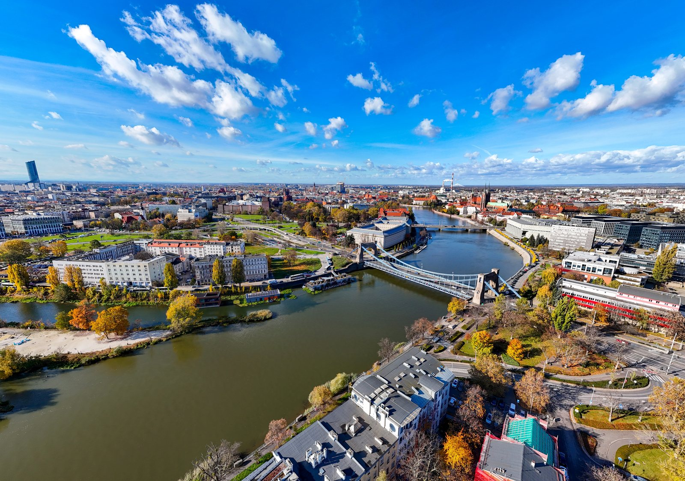
- [Ź] Na pierwszym planie Odra z łachą i zadrzewionym brzegiem (lewy dół) oraz zabudowa prawego brzegu (prawy dół). Pośrodku Most Grunwaldzki z dwoma pylonami. Za mostem lewy brzeg: Dolnośląski Urząd Wojewódzki (monumentalny gmach z niebieskim dachem), zieleń pl. Społecznego. W tle panorama centrum: Ostrów Tumski z katedrą (wieże po prawej), Sky Tower (lewa krawędź), kominy elektrociepłowni.
- Teren inwestycji leży na lewo od mostu, między szczytem WS 5 (siatka reklamowa „Strauss”) a łukiem Wybrzeża. Jest mały w kadrze – ok. 9% szerokości (`zdjecia_F17_metadane.md` § 5.1).
- **Wniosek:** dominanta będzie się rysować na tle DUW i zieleni pl. Społecznego, poniżej horyzontu. Wraz z pylonami mostu tworzy parę „brama – wieża” na zakręcie Odry. Elewacja wschodnia jest widoczna z całego prawego brzegu.

### 1.2 0013 – widok od pd.-wsch., znad Odry (powyżej ujścia Oławy) w kierunku pn.-zach. – 11:41
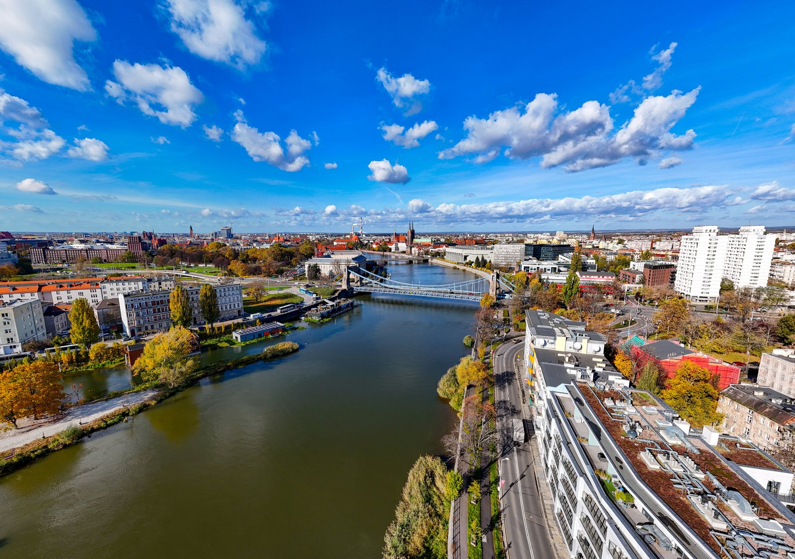
- [Ź] Szeroki nurt Odry prowadzi wzrokiem do Mostu Grunwaldzkiego. Za nim Ostrów Tumski z katedrą i kościołami. Po lewej (lewy brzeg) pierzeja kamienic Wybrzeża Słowackiego z widocznym szczytem WS 5 przy moście. Po prawej (prawy brzeg) nowa zabudowa mieszkaniowa i wieżowce z wielkiej płyty przy pl. Grunwaldzkim.
- **Wniosek:** z kierunku pd.-wsch. nowa bryła zamyka perspektywę lewego brzegu tuż przed mostem. Sylweta mostu i wież katedry wyznacza skalę: dominanta 45 m pozostaje znacznie niższa od wież katedry (dominanty historycznej), ale wyższa od pylonów mostu – nawet po odtworzeniu hełmów (ok. 25 m; `historia.md`).

### 1.3 0015 – widok z pn.-wsch. (nad prawym brzegiem przy moście) w kierunku pd.-zach. – 11:44
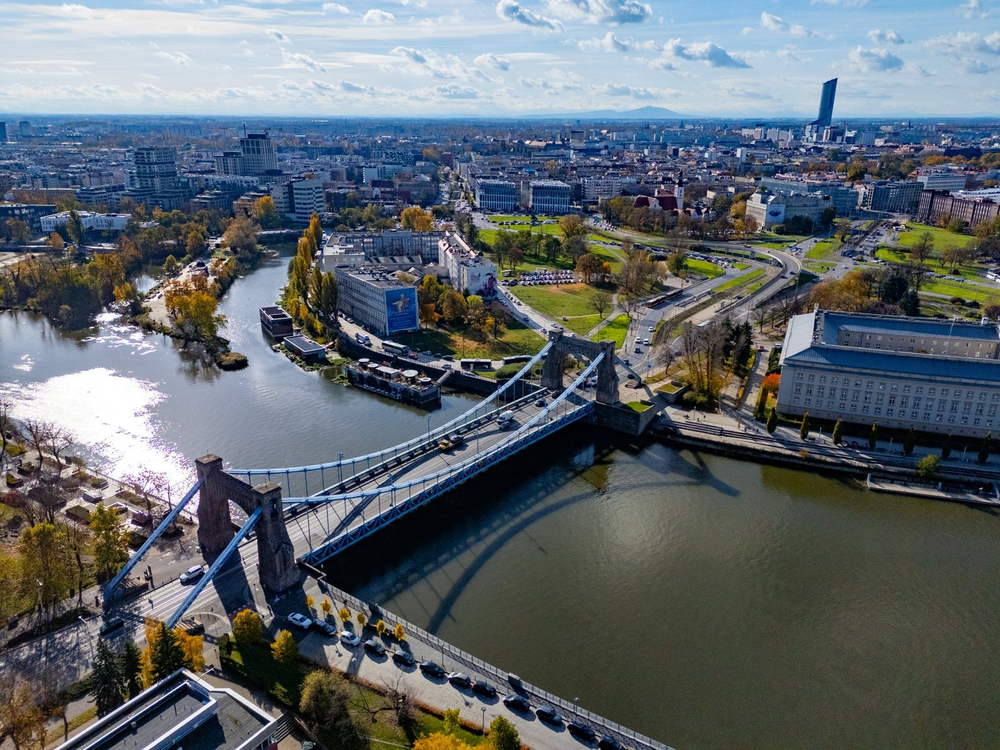
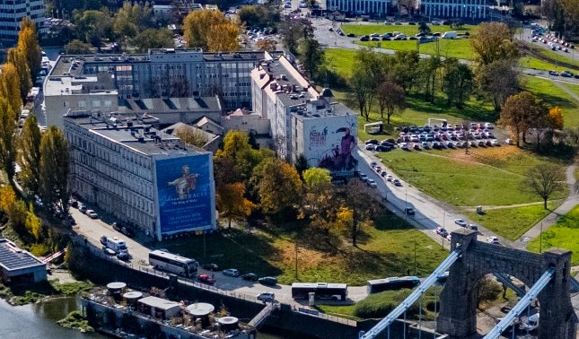
- [Ź] Most Grunwaldzki na pierwszym planie (pylony, niebieskie cięgna). Za przyczółkiem jest teren inwestycji – trawnik z drzewami w barwach jesieni. Po lewej szczyt WS 5 z siatką reklamową, po prawej w głębi szczyt Maz. 19 z kolorowym muralem (Przegląd Piosenki Aktorskiej). Między nimi ogródki z zadrzewieniem. Pod nabrzeżem barka-restauracja i domy na wodzie. Po prawej DUW, w tle pl. Społeczny, estakady, centrum, Sky Tower, góra Ślęża na horyzoncie.
- **Wniosek:** kluczowy widok „od mostu”. Narożnik przy przyczółku i elewacja pn.-wsch. będą najczęściej oglądane z jezdni i chodników mostu (dojazd od pl. Grunwaldzkiego). Obecnie są to dwie ślepe ściany szczytowe z reklamami, którym nowa pierzeja przywraca ciągłość.

### 1.4 0025 – widok od zachodu, znad zieleńca po zach. stronie Mazowieckiej (= podkład F.17.B) – 11:57
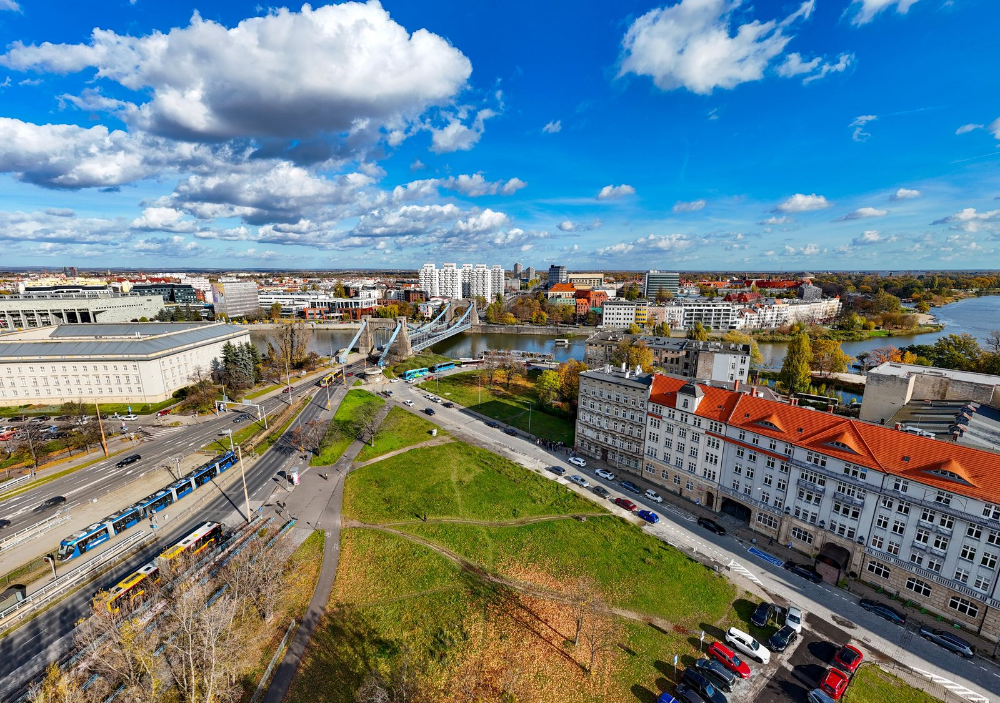
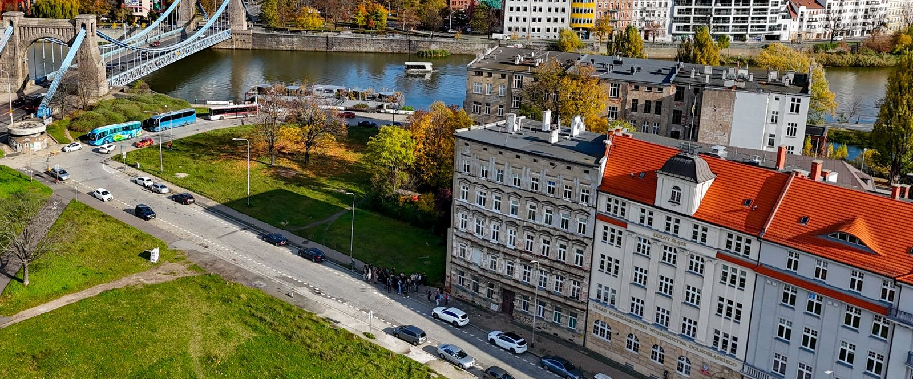
- [Ź] Na pierwszym planie zieleniec z przedeptami (poza obszarem inwestycji, w granicy opracowania studialnego). Po lewej torowiska i jezdnie pl. Społecznego z tramwajami. Po prawej pierzeja: **Mazowiecka 17 – obecna siedziba UMWD** (biała elewacja z napisem „Urząd Marszałkowski Województwa Dolnośląskiego”, „Dolny Śląsk”, czerwony dach z wieżyczką) i **Mazowiecka 19** (szara, bogato zdobiona, 8 osi). Za nimi teren inwestycji – trawnik z drzewami – sięga do łuku Wybrzeża przy moście. W tle Odra, most i prawy brzeg.
- **Wniosek:** z zachodu nowa pierzeja Mazowieckiej przedłuża linię Maz. 17–19 na północ, aż do narożnika przy moście. Zieleniec po zach. stronie ulicy zostaje otwartym przedpolem, więc **elewacja zachodnia skrzydła i narożnik pn.-zach. będą widoczne w całości z pl. Społecznego** – to drugi reprezentacyjny front.

### 1.5 0027 – widok od południa (znad kwartału przy Wybrzeżu, w kierunku północnym) – 11:59
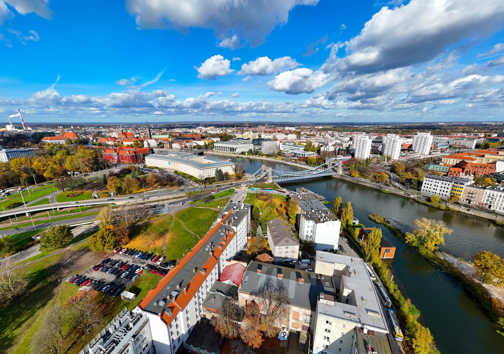
- [Ź] Na pierwszym planie zabudowa kwartału od południa: dachy kamienic Wybrzeża (WS 6–9), budynki biurowe i podwórza, po lewej parking. W środku trawnik terenu inwestycji z kępą drzew ogródków, w głębi most i DUW. Po prawej Oława z wyspą i ujście do Odry. W tle Ostrów Tumski z katedrą (wieże) i kościołem NMP na Piasku, komin EC, zabudowa prawego brzegu i wieżowce pl. Grunwaldzkiego.
- **Wniosek:** z południa widać, że teren to luka w kwartale. Ogród we wnętrzu (ogródki z drzewami) styka się z podwórzami istniejących kamienic. Nowa zabudowa powinna domknąć kwartał od północy i zachodu, pozostawiając zielone wnętrze w ciągłości z podwórzami (`dendrologia.md`).

### 1.6 0029 – widok z poziomu wody (Odra, ok. ujścia Oławy) na zachód – 12:05
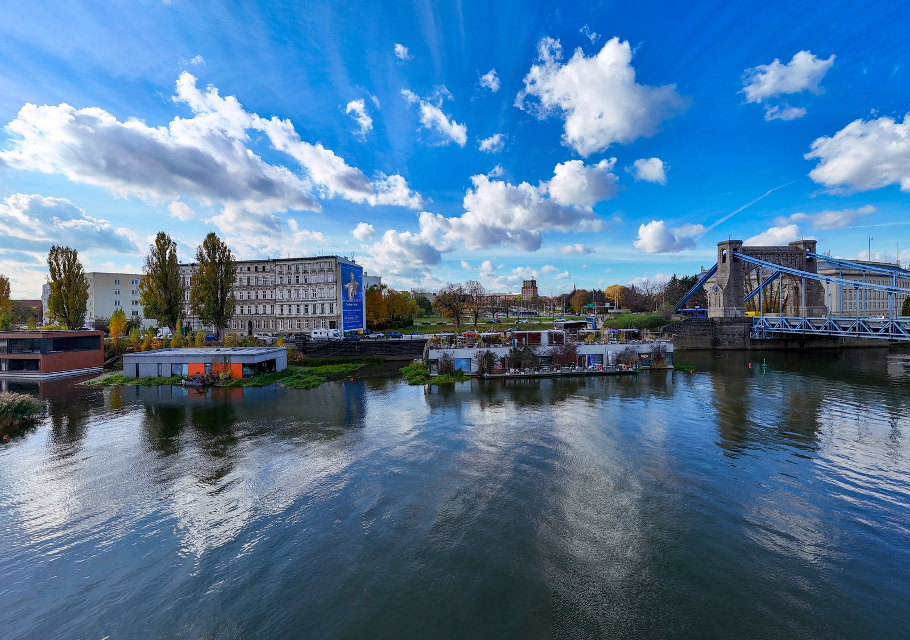
- [Ź] Nabrzeże z murami oporowymi, pawilon i domy na wodzie, barka-restauracja. Za nimi pierzeja kamienic WS 5 i WS 6 z siatką reklamową na szczycie WS 5. Topole na nabrzeżu. Po prawej pylon zach. Mostu Grunwaldzkiego i DUW. W głębi ceglany wieżowiec Poczty Głównej (pl. Społeczny).
- **Wniosek:** to widok „z poziomu człowieka” od strony rzeki, z bulwarów prawego brzegu i z tramwaju wodnego. Nowa elewacja nad Oławą będzie widoczna nad dachem barki, na przedłużeniu linii gzymsów WS 5–6. Dowiązanie wysokości gzymsu (~21 m) jest tu szczególnie czytelne (`sasiedzi.md` rozdz. 4).

### 1.7 0032 – widok od wschodu znad Odry, wzdłuż mostu – 12:09
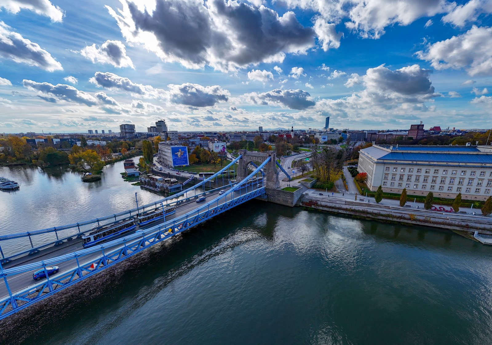
- [Ź] Na pierwszym planie przęsło mostu z tramwajami. Za pylonem zach. widać teren inwestycji (trawnik z drzewami) i szczyty WS 5 („Strauss”) oraz Maz. 19 (mural). Po prawej DUW z nabrzeżem, w tle pl. Społeczny i Sky Tower.
- **Wniosek:** z mostu narożnik przy przyczółku stanie na osi jazdy. Pylony obramowują go jak brama. Dominanta w obszarze A, zwłaszcza przy narożniku pn.-wsch., będzie zamknięciem widokowym osi mostu dla jadących na zachód.

### 1.8 0033 – widok znad przyczółka mostu w kierunku pd.-zach., z góry – 12:10
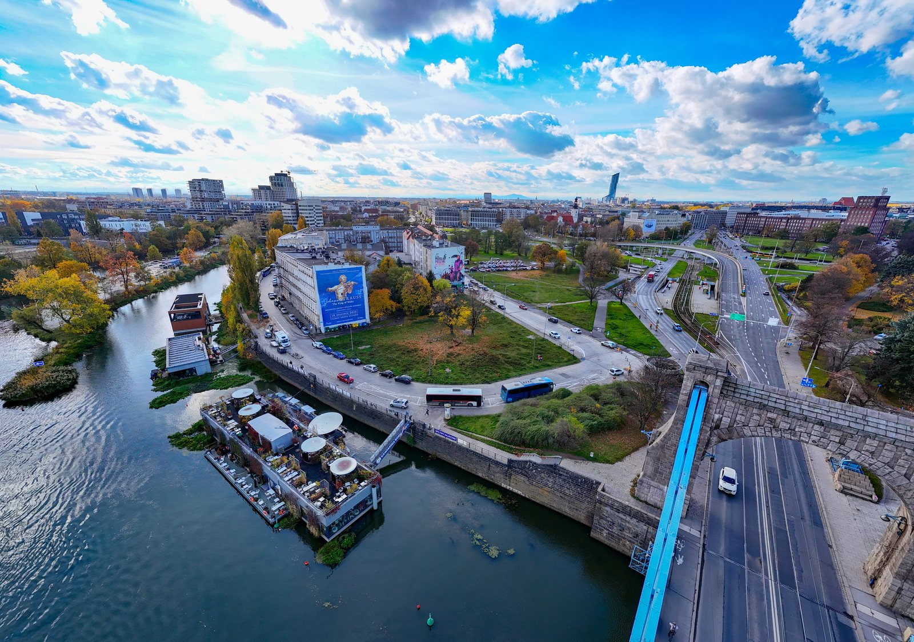
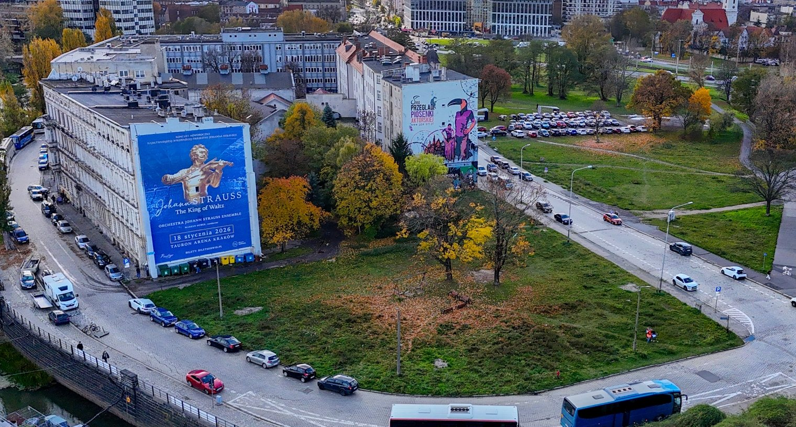
- [Ź] Najlepszy widok samego terenu:
  - trawnik z dwoma dużymi klonami (nr 1 i 2 wg M.06) i jesiennymi drzewami w ogródkach;
  - łuk Wybrzeża Słowackiego z autobusami i parkowaniem;
  - po lewej szczyt WS 5 z siatką i kontenery na odpady przy dz. 10/2;
  - w środku szczyt Maz. 19 z muralem, za nim biurowce;
  - po prawej ul. Mazowiecka, parking i zieleń pl. Społecznego.

  Nabrzeże z barką-restauracją (lewy dół), kiosk-rotunda przy przyczółku i kamienne mury przyczółka.
- **Wniosek:** teren jest dziś pustą, nieurządzoną przestrzenią, ale bardzo eksponowaną. Widok potwierdza położenie drzew względem pierzei: północna część jest prawie wolna (tylko klony 1–2), wnętrze zadrzewione.

### 1.9 0036 – widok niski (ok. 15–20 m), znad zieleńca na zach. od Mazowieckiej w kierunku pn.-wsch. – 12:12
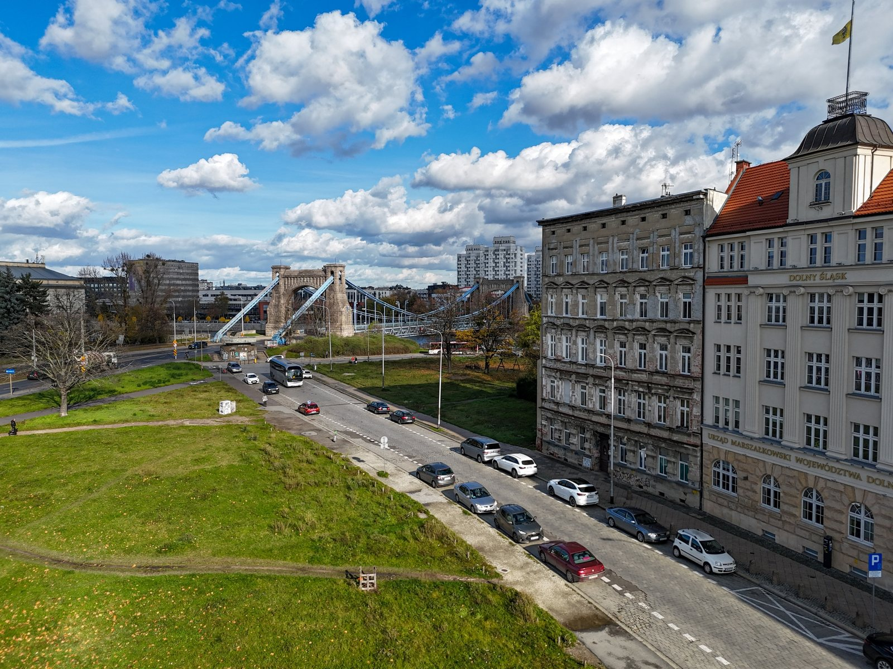
- [Ź] Ul. Mazowiecka z parkowaniem po obu stronach. Po prawej Maz. 19 (szara, 8 osi, bogate obramienia okien) i Maz. 17 (siedziba UMWD z flagą na wieżyczce). Na wprost, za trawnikiem terenu inwestycji, Most Grunwaldzki z pylonami. Po lewej zieleniec i wieżowiec mieszkalny na prawym brzegu.
- **Wniosek:** widok z poziomu pieszego zbliżony do wymaganej wizualizacji „powiązanie z budynkiem Mazowiecka 19” (Rejestr R-110, wiz. nr 5). **Kadr kandydat do photomatchingu** (wysokość i perspektywa zbliżone do widoku z poziomu człowieka). Pokazuje też, że front Maz. 19 jest w złym stanie technicznym, a styk ze zdobioną elewacją wymaga starannego detalu.

---

## 2. Panoramy 360° (M.09) – widoki z poziomu 30 / 40 / 45 m nad terenem

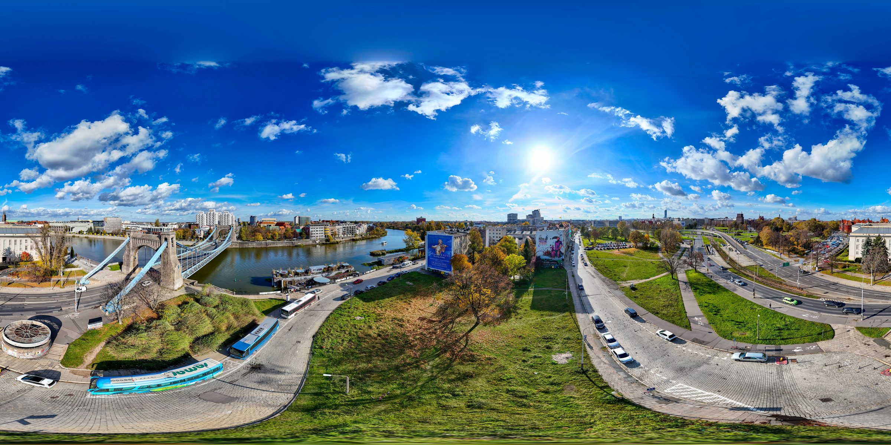
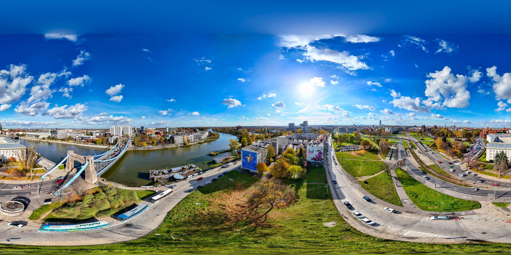
Panorama 40 m: `img/kontekst_M09_360_40m.jpg`.

| Azymut (wniosek ±5°) | Co widać [Ź] | Znaczenie dla projektu (wniosek) |
|---|---|---|
| **≈ 10–30° (pn.-pn.-wsch.)** | Most Grunwaldzki – pylon zach. tuż pod kamerą, przęsło nad Odrą; za nim prawy brzeg | najbliższy, „własny” widok – most jako element wnętrza urbanistycznego; z sali Sejmiku most widoczny w dole |
| **≈ 40–70° (pn.-wsch.)** | szeroki nurt Odry, prawy brzeg – zespół przy pl. Grunwaldzkim (wieżowce), Politechnika, nowa zabudowa nad rzeką | **główny widok dalekosiężny** z kondygnacji Sejmiku; rzeka na pierwszym planie; oś z esplanady przy pl. Grunwaldzkim (wizja lokalna, Rejestr R-224) „patrzy” w stronę narożnika |
| ≈ 90–130° (wsch.–pd.-wsch.) | zakole Odry i ujście Oławy, bulwary, zieleń nadrzeczna | widok na wodę i zieleń – walor biur we wsch. skrzydle |
| **≈ 140° (pd.-wsch.)** | szczyt WS 5 z siatką reklamową, pierzeja Wybrzeża, barka | bliski styk – § 13 (`sasiedzi.md`) |
| **≈ 185–200° (pd.)** | szczyt Maz. 19 z muralem; ul. Mazowiecka w głąb Przedmieścia Oławskiego; dachy kwartału | bliski styk – przyleganie; panorama dachów Przedmieścia |
| ≈ 230–240° (pd.-zach.) | Sky Tower na horyzoncie; centrum | dalekie tło – sylweta współczesnego Wrocławia |
| **≈ 245–300° (zach.)** | pl. Społeczny: estakady (do rozbiórki), torowiska, zieleńce, parkingi; Poczta Główna (ceglany wieżowiec) | przedpole zachodniej elewacji; po rozbiórce estakad – plac miejski |
| **≈ 315–340° (pn.-zach.)** | DUW (monumentalny gmach z niebieskim dachem); nad nim **wieże katedry na Ostrowie Tumskim** (≈ 327°), komin EC | **oś widokowa na katedrę** – ze strony pn.-zach. dominanty / z sali Sejmiku; wartość symboliczna dla siedziby Sejmiku |

**Obserwacja ogólna (wniosek):** na wysokości 30–45 m nad terenem nie ma przesłon w promieniu kilkuset metrów – poza DUW i wieżowcami prawego brzegu. Teren jest „na widoku” z całego zakola Odry. Najwyższe kondygnacje (Sejmik) mają panoramę 360°, a najcenniejsze kierunki to **pn.-wsch. (Odra, most)** i **pn.-zach. (Ostrów Tumski)**. Wniosek dla planu: salę Sejmiku i jej hol orientować na pn. (między mostem a katedrą). Od południa (słońce) potrzebna osłona przed przegrzewaniem.

---

## 3. Synteza – kluczowe widoki na teren i pierzeje (wniosek)

| Nr | Punkt widokowy | Kierunek patrzenia | Co jest „frontem” | Uwagi do wizualizacji |
|---|---|---|---|---|
| W1 | prawy brzeg Odry / F.17.A (0009) | → zach. | elewacja wsch. i pn.-wsch., dominanta na tle DUW | wizualizacja nr 1 (obowiązkowa, na zdjęciu F.17.A) |
| W2 | zieleniec zach. od Mazowieckiej / F.17.B (0025) | → pn.-wsch. | pierzeja Mazowieckiej przedłużająca Maz. 17–19, narożnik pn.-zach. | wizualizacja nr 2 (obowiązkowa, na zdjęciu F.17.B) |
| W3 | most – jezdnia/chodnik od wschodu (0032, 0015) | → zach. / pd.-zach. | narożnik przy przyczółku, wejście główne? | widok wjazdowy; pylony jako rama |
| W4 | ul. Mazowiecka, poziom pieszego (0036) | → pn. | styk z Maz. 19 | wizualizacja nr 5 (powiązanie z Maz. 19) |
| W5 | Wybrzeże Słowackiego / dz. 10/2 przy WS 5 (0033, 0029) | → pn.-zach. / zach. | styk z WS 5 nad Oławą, brama/łącznik nad dz. 10/2 | wizualizacja nr 4 (powiązanie z WS 5) |
| W6 | bulwar prawego brzegu / tramwaj wodny (0029) | → zach. | pierzeja nad Oławą, linia gzymsów | widok z poziomu wody – rekomendowany jako dodatkowy |
| W7 | pl. Społeczny (360°, 0025) | → wsch. | elewacja zach. i dominanta | stan obecny poza granicą studialną – nie retuszować (Wyj. 9 odp. 61) |

**Pierzeje (stan):**
- **Mazowiecka (wsch. strona):** zwarta, 5–6 kondygnacji, gzymsy ~21 m. Urywa się na ślepym szczycie Maz. 19.
- **Wybrzeże Słowackiego nad Oławą:** zwarta pierzeja eklektycznych kamienic ~20–21 m. Urywa się na ślepym szczycie WS 5, przed dz. 10/2.
- **Pierzeja przy przyczółku mostu:** nie istnieje. Historycznie był tu zaokrąglony narożnik (`historia.md`).

**Sylweta mostu:** pylony kamienne, obecnie ścięte – po planowanej odbudowie hełmów ok. 25 m nad chodnikiem (`historia.md`). Cięgna i kratownice niebieskie. Przyczółek z pylonem zach. leży ok. 60 m na pn. od pn. krawędzi obszaru inwestycji (przecięcie osi mostu z linią brzegu wg `model/site.json`, geometria orientacyjna); pomiędzy nimi łuk Wybrzeża, przystanek i skwer na dz. 9/2. Dominanta 35–45 m przewyższy pylony, więc powinna nawiązać z nimi dialog skalą i materiałem (kamień, `konserwator.md`), a nie konkurować detalem.

**Pora i światło zdjęć:** 29.10.2025, 11:38–12:12 CET, słońce na pd. (az ok. 181–186°, wysokość ok. 25°), niebo z cumulusami, jesienna kolorystyka drzew. Dla spójności wizualizacji nr 1–2 z podkładami F.17 – `zdjecia_F17_metadane.md`.

---

## 4. Niejasności

| Nr | Opis |
|---|---|
| K-01 | Pliki M.10 nie mają GPS ani kierunku kamery (EXIF okrojony) – kierunki i położenia kamer to wnioski z treści obrazu (±10–20°). Pełne metadane mają tylko F.17.A/B. |
| K-02 | Panoramy M.09 nie mają metadanych orientacji. Azymuty wyznaczono z położenia Słońca i obiektów kontrolnych (±5°). Dokładne położenie drona nad terenem nie jest znane (wniosek: nad trawnikiem pn., w rejonie obszaru A). |
| K-03 | Szczyt WS 5 był zasłonięty siatką reklamową (koncert 18.01.2026), więc stan okien szczytowych jest na zdjęciach niewidoczny. Budynki WS 5 i Maz. 19 leżą **poza** granicą opracowania studialnego (sprawdzenie na poligonie M.04 w `model/site.json`: 0% obrysu w granicy). Wyj. 9 odp. 61 wymaga na perspektywach lotniczych stanu obecnego zgodnego z F.17 poza tą granicą. Wniosek ostrożnościowy: na wizualizacjach nr 1–2 pozostawić szczyty jak na zdjęciach (z reklamami, o ile nie zostaną zasłonięte nową bryłą). Na wizualizacjach z poziomu człowieka (nr 4, 5) ewentualne pominięcie reklam opisać w legendzie jako „stan bez tymczasowych reklam”. |
