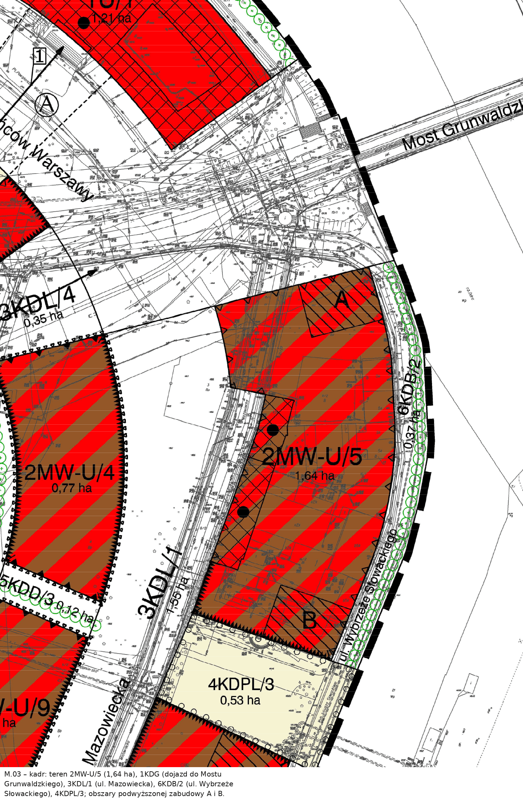
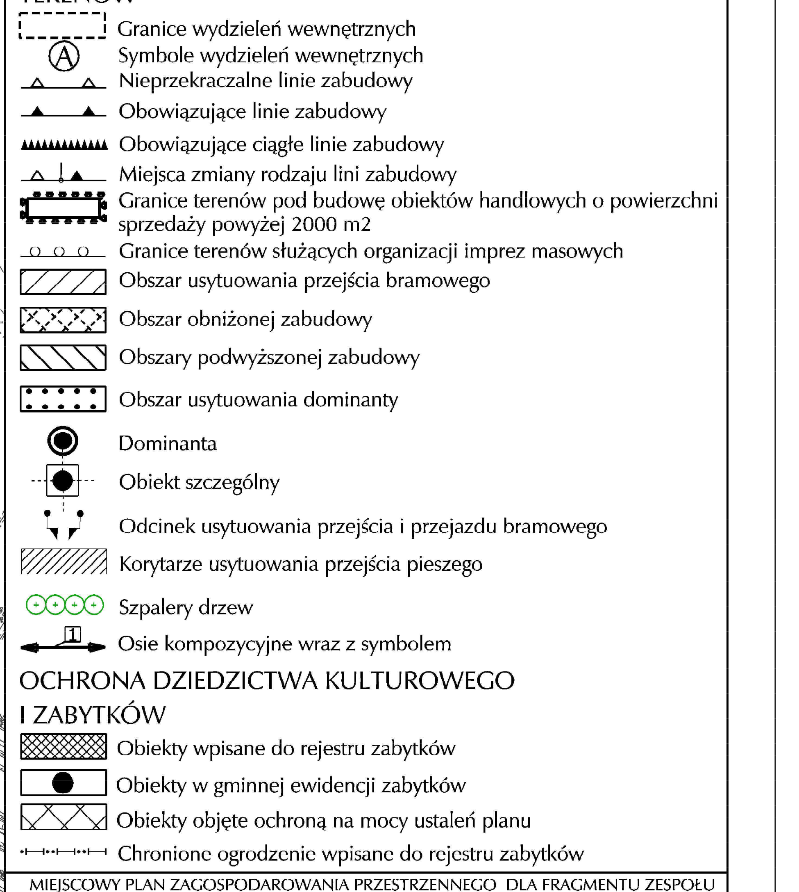
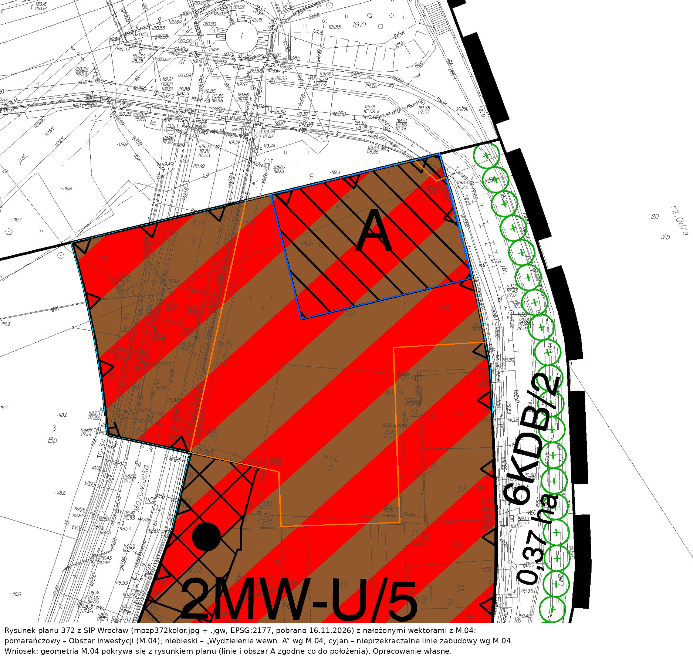
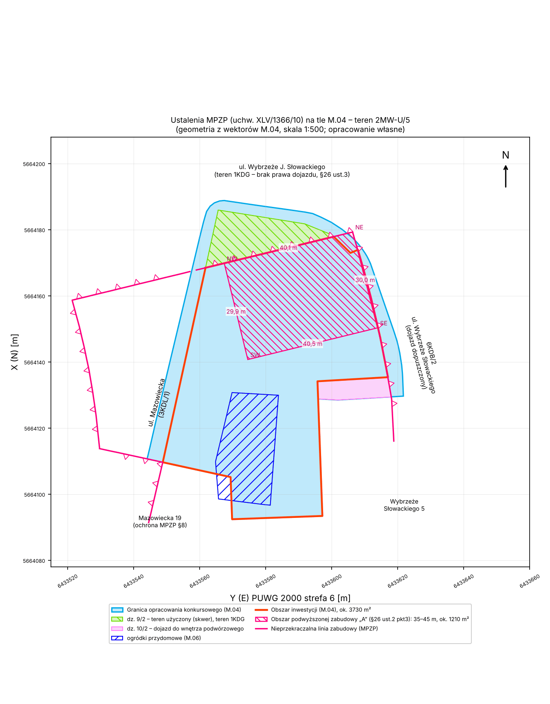
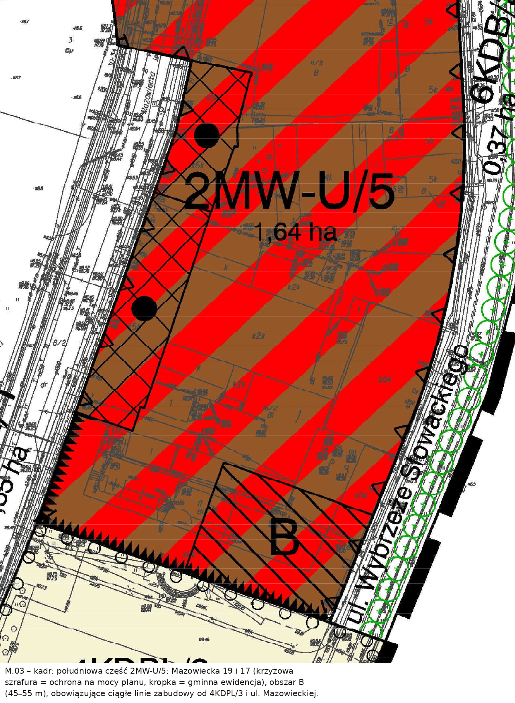

# MPZP – uchwała nr XLV/1366/10 RMW z 21.01.2010 („Centrum w rejonie Placu Społecznego”) – ustalenia dla terenu inwestycji UMWD

**Stan:** 2026-11-16 · **Zakres:** pełna lektura tekstu uchwały (46 s.) i rysunku planu, porównanie z mapą M.04 i z oficjalnym, georeferencjonowanym rysunkiem planu z SIP Wrocław · **Zasada wyłączenia:** dokument nie korzysta z żadnych informacji o pracach zgłoszonych/nagrodzonych w konkursie SARP nr 1089 (takich źródeł nie wyszukiwano i nie napotkano).

---

## 0. Źródła, metoda, konwencje

| Skrót | Źródło | Uwagi |
|---|---|---|
| **M.03 s. N** | `00_materialy/_rozpak/5_Zalaczniki_Merytoryczne_M.01-M.14_pop.13.02.2026/M.03. MPZP/M.03. MPZP/M.03. plan miejscowy.pdf` – N = numer strony PDF (s. 1 – okładka Organizatora; s. 2–41 – uchwała; s. 42 – rysunek; s. 43–46 – zał. 2–4) | Plik `00_materialy/tekst/M.03._plan_miejscowy.txt` jest **nieczytelny** (niestandardowe kodowanie fontów). Tekst odczytano OCR (tesseract 5, `pol`, 300 dpi); kluczowe liczby zweryfikowano wizualnie na renderach stron 12, 15, 24–25. Transkrypcja: `docs/30_lokalizacja/mpzp_uchwala_XLV-1366-10_OCR.txt`. |
| **M.03-rys** | `…/M.03. MPZP/M.03. MPZP/M.03. plan miejscowy - załącznik graficzny.pdf` (raster ok. 1350 ppi, strona obrócona o 90°) | Rendery 120–1350 dpi, kadry w `img/mpzp_01…06`. |
| **M.04** | `…/M.04. MAPA SCHEMATYCZNA/M.04. MAPA SCHEMATYCZNA/Mapa schematyczna WRO UMWD - M.04.pdf` – plik wektorowy (AutoCAD), skala 1:500, układ „2000/6”, wysokości „PL-EVRF2007-NH”, mapa z 01.10.2025 | Ramka 801,1 × 1040,9 pt = 141,30 × 183,60 m (dokładnie 1:500). Narożniki: X 5664248,09 / Y 6433651,96 (pn.-wsch.) i X 5664064,48 / Y 6433510,66 (pd.-zach.). Wektory (linie zabudowy, obszar A, obszar inwestycji) wyekstrahowano (PyMuPDF) i przeliczono na współrzędne PUWG 2000/6. |
| **SIP** | System Informacji Przestrzennej Wrocławia: https://geoportal.wroclaw.pl/mpzp/?plan=372 ; GML: https://geoportal.wroclaw.pl/www/mpzp/iip/gml/mpzp372.gml (wersja 20260413T065533); rysunek georeferencjonowany: `https://geoportal.wroclaw.pl/mpzp-pliki/mpzp372kolor.jpg` + `.jgw` (EPSG:2177) – dostęp 2026-11-16 | Źródło oficjalne, użyte do weryfikacji statusu planu i geometrii. |
| **Reg.** | `00_materialy/tekst/1089_Regulamin_Konkursu_tekst_jednolity_13.02.2026-sig.txt`, s. = strona druku | |
| **Wyj. N odp. K** | `00_materialy/tekst/1089_Wyjasnienia_tresci_Regulaminu_nr_NN-sig.txt` | wyjaśnienia Organizatora (wiążące) |
| **M.01** | `00_materialy/tekst/Program_użytkowy_budynku_administracyjnego_UWMD_zatwierdzony_11_2025.txt`, s. = strona druku | |

Oznaczenia: **„wniosek”** – interpretacja własna (nie jest treścią źródła); **[K-nn]** – konflikt / niejasność (rozdz. 6); **[W-nn]** – wniosek projektowy (rozdz. 5).

---

## 1. Status prawny planu

| Element | Ustalenie | Źródło |
|---|---|---|
| Akt | Uchwała nr XLV/1366/10 Rady Miejskiej Wrocławia z 21.01.2010 w sprawie uchwalenia mpzp dla fragmentu zespołu urbanistycznego Centrum w rejonie Placu Społecznego we Wrocławiu; rysunek w skali 1:1000 (zał. nr 1) | M.03 s. 2 (§1 ust. 1) |
| Publikacja / moc prawna | Dz. Urz. Woj. Dolnośląskiego 2010/928; „nabrała mocy prawnej 3 maja 2010” (plan nr 372 w SIP); wejście w życie 30 dni od ogłoszenia | SIP; M.03 s. 41 (§53) |
| Status 2026 | **Obowiązujący**, „uchylony w części” przez: uchwałę XLV/1370/10 (MPZP 300 – Stare Miasto, ul. Kazimierza Wielkiego/Podwale) oraz uchwałę LXII/1453/18 (MPZP 566 – „pomiędzy al. J. Słowackiego a bulwarem X. Dunikowskiego”, w mocy od 10.10.2018) | SIP (plan 372, 566, 300), dostęp 2026-11-16 |
| Czy uchylenia dotyczą terenu inwestycji? | **Nie.** Wniosek z analizy GML: obszar inwestycji z M.04 (3 727,9 m²) leży w całości w aktualnej (po uchyleniach) granicy planu 372 (przecięcie = 3 727,9 m²); granica planu 566 nie przecina obszaru inwestycji ani zakresu konkursu. | GML 372 i 566 (EPSG:2177), obliczenia własne |
| Plany uchylone przez XLV/1366/10 | uchwała XIV/337/07 (rejon ul. gen. R. Traugutta) oraz L/1757/02 (rejon ul. Walońskiej) – w granicach planu | M.03 s. 40–41 (§51) |
| Zgodność ze Studium | stwierdzona (Studium 2006, uchwała LIV/3249/06) | M.03 s. 43 (zał. 2) |

Wniosek: plan 2010 r. (uchwalony na podstawie ustawy z 27.03.2003) pozostaje podstawą do oceny zgodności projektu z prawem miejscowym; nowy plan ogólny gminy nie uchyla istniejących planów miejscowych – szczegóły w opracowaniu prawa budowlanego/planistycznego (poza zakresem tego dokumentu).

---

## 2. Identyfikacja terenów elementarnych (działki inwestycji, skwer, dojazd)

| Obiekt (wg Reg. s. 17 i M.04) | Teren w MPZP | Dowód | Uwagi |
|---|---|---|---|
| **Działki inwestycji 10/3, 11/6, 19/11, 9/1** („Obszar inwestycji” M.04, 3 727,9 m² wg wektorów; M.01 s. 2 podaje 3 729 m²) | **2MW-U/5** – „tereny zabudowy mieszkaniowej wielorodzinnej i usługowej”, pow. terenu 1,64 ha; w pn.-wsch. części – **obszar podwyższonej zabudowy oznaczony symbolem A** | M.03-rys (`img/mpzp_02`, `mpzp_03`); M.04; nakładka SIP (`img/mpzp_07`): 3 727,5 m² z 3 727,9 m² w granicach terenu | Ustalenia: §26 (M.03 s. 24–25) + ustalenia ogólne §2–§16. |
| **Dz. 9/2** – skwer (teren użyczony Województwu) | **1KDG** – teren ulicy głównej (dojazd do Mostu Grunwaldzkiego) | Działka leży w całości na północ od linii rozgraniczającej 2MW-U/5/1KDG (= nieprzekraczalna linia zabudowy); obliczenie: ok. 355 m² obrysu M.04 w 1KDG, 0,3 m² w 2MW-U/5 (błąd numeryczny) | §34 (M.03 s. 30–31): przeznaczenie m.in. **skwery**; teren celu publicznego (§15). Wniosek: dz. 9/2 powstała przez podział dz. 9 wzdłuż linii rozgraniczającej planu. |
| **Dz. 10/2** – dojazd do wnętrza podwórzowego od ul. Wybrzeże Słowackiego | **2MW-U/5** (wylot styka się z linią rozgraniczającą **6KDB/2**) | Obrys „Dojazd do wnętrza podwórzowego” z M.04: 128,4 z 128,9 m² w 2MW-U/5 | Dojazd do terenu 2MW-U/5 dopuszczony m.in. od 6KDB/2 (§26 ust. 3). |
| Ulica Mazowiecka (zach. granica inwestycji) | **3KDL/1** (1,55 ha) | M.03-rys | §37 (M.03 s. 31–32). Uwaga: w obszarze inwestycji dzisiejsza jezdnia Mazowieckiej przy moście leży częściowo w **terenie 2MW-U/5** (patrz [K-01]). |
| Ul. Wybrzeże J. Słowackiego – odcinek północny (przyczółek Mostu Grunwaldzkiego) | **1KDG** | M.03-rys (biały teren 1KDG sięga do linii rozgraniczającej z 2MW-U/5) | **Brak prawa dojazdu** z 1KDG do 2MW-U/5 (§26 ust. 3). |
| Ul. Wybrzeże J. Słowackiego – odcinek wzdłuż Oławy (wsch. granica inwestycji) | **6KDB/2** (0,37 ha; na rysunku planu opis „ul. Wybrzeże Słowackiego”) | M.03-rys | §46 (M.03 s. 37–38). |
| Plac na pd. od kwartału | **4KDPL/3** (0,53 ha) | M.03-rys | §43 (M.03 s. 35–36). Nie przylega do obszaru inwestycji. |
| Zakres opracowania konkursowego (M.04, ok. 4 871 m²) | ok. 4 140 m² w 2MW-U/5, ok. 557 m² w 1KDG (głównie dz. 9/2), ok. 173 m² w 6KDB/2/1KDG (pas przy wsch. granicy) | obliczenia własne na wektorach M.04 | Wniosek: poza 2MW-U/5 możliwe wyłącznie zagospodarowanie zgodne z przeznaczeniem terenów drogowych (skwer, ciągi piesze, zieleń, mała architektura) – nie zabudowa kubaturowa. |

**Terminologia (ważne):** Regulamin, M.04 i wyjaśnienia używają określeń „wydzielenie wewnętrzne A” (Reg. s. 18; M.04 – legenda; Wyj. 8 odp. 40) oraz „dominanta A/B” (M.01 s. 2–3; Wyj. 8 odp. 57, 60). W planie jest to **„obszar podwyższonej zabudowy oznaczony symbolem A”** (§26 ust. 2 pkt 3, M.03 s. 24). Na rysunku: szrafura ukośna „obszary podwyższonej zabudowy” + litera „A” **bez okręgu i bez przerywanej granicy** (legenda rozróżnia osobno „granice/symbole wydzieleń wewnętrznych”, `img/mpzp_06`). „Dominanta” i „obszar usytuowania dominanty” to w planie odrębne pojęcia, zastosowane wyłącznie w terenie 2MW-U/3 (§24 ust. 2 pkt 4–6, M.03 s. 23). [K-06]

---

## 3. Tabela parametrów – teren 2MW-U/5 (obszar inwestycji) i ustalenia ogólne

| # | Parametr | Ustalenie planu (dosłownie lub wiernie) | § / strona | Interpretacja / wniosek dla projektu |
|---|---|---|---|---|
| 1 | **Przeznaczenie 2MW-U/5** | 1) mieszkalnictwo; 2) usługi; 3) kultura i nauka; 4) zdrowie i opieka społeczna; 5) handel detaliczny małopowierzchniowy B; 6) edukacja; 7) kryte urządzenia sportowe; 8) skwery; 9) place zabaw; 10) urządzenia infrastruktury technicznej; 11) telekomunikacja; 12) infrastruktura drogowa | §26 ust. 1, s. 24 | „Przeznaczenie terenu – obiekty, które jako jedyne są dopuszczone” (§2 pkt 15, s. 4). Urząd = kategoria **biura** (definicja obejmuje m.in. „administrację”, „archiwizowanie” – §4 ust. 1 pkt 17, s. 7) w grupie **usługi** (§4 ust. 2 pkt 2, s. 10). Sala Sejmiku/sale konferencyjne – biura lub „obiekty kongresowe i konferencyjne” (grupa kultura i nauka, §4 ust. 1 pkt 18, ust. 2 pkt 3). Bistro – gastronomia (usługi). Garaż – „obiekty do parkowania” (infrastruktura drogowa). Trafostacja – urządzenia infrastruktury technicznej. Ekspozycje – „wystawy i ekspozycje” (kultura i nauka). **Wszystkie funkcje M.01 mieszczą się w przeznaczeniu.** Handel wielkopowierzchniowy – niedopuszczony w 2MW-U/5. |
| 2 | Zastrzeżenia do kategorii (ogólne) | usługi drobne bez pogrzebowych i stolarskich; poradnie bez stacji dializ i krwiodawstwa; edukacja – wyłącznie przedszkola i obiekty podobne (o ile ustalenia dla terenu nie stanowią inaczej); produkcja drobna – wyłącznie piekarnie, lodziarnie, cukiernie, ≤150 m² PU; usługi drobne i kryte urządzenia sportowe – wyłącznie jako towarzyszące; na 1. kondygnacji naziemnej przy liniach zabudowy działalność doradcza/finansowa/ubezpieczeniowa ≤20% długości tych linii | §5 ust. 1–4, s. 11 | Wniosek: ewentualny żłobek/przedszkole dla pracowników – dopuszczalne; oddział banku/doradztwo w parterze – limit 20% długości frontu. |
| 3 | Zastrzeżenia szczegółowe 2MW-U/5 | mieszkalnictwo wyłącznie powyżej 1. kondygnacji naziemnej; doradztwo/finanse/ubezpieczenia niedopuszczalne na 1. kondygnacji od strony 4KDPL/3 | §26 ust. 2 pkt 1–2, s. 24 | Bez znaczenia dla programu UMWD. |
| 4 | **Linie zabudowy – obszar inwestycji** | **Nieprzekraczalne linie zabudowy** wzdłuż całego obwodu pn. części 2MW-U/5: od **1KDG** (pn.), od **6KDB/2** (wsch.) oraz wzdłuż zachodniej krawędzi „wypustki” terenu (za obecną jezdnią Mazowieckiej) i frontu kamienic Mazowiecka 19/17 | M.03-rys (legenda: trójkąty otwarte = nieprzekraczalna; pełne = obowiązująca; gęste pełne = obowiązująca ciągła – `img/mpzp_06`); M.04 („Nieprzekraczalna linia zabudowy wg MPZP”) | Wniosek (pomiar wektorów M.04 + nakładka SIP): pn. granica inwestycji pokrywa się z linią zabudowy (odchyłka ≤0,01 m), wsch. granica – również (≤0,05 m) z wyjątkiem wcięcia w narożu pn.-wsch. (do 2,4 m od linii). **Wzdłuż zach. granicy inwestycji (obecna Mazowiecka) linii zabudowy nie ma** – teren 2MW-U/5 sięga dalej na zachód [K-01]; zabudowę od Mazowieckiej ogranicza granica działki (obszar inwestycji M.04; Reg. s. 17). Linia przy froncie Maz. 19 jest praktycznie współliniowa z zach. granicą inwestycji (odchyłka ok. 0,07 m) → kontynuacja pierzei. |
| 5 | Linie zabudowy – reszta kwartału (poza inwestycją) | **obowiązujące ciągłe** linie zabudowy od 4KDPL/3 i od ul. Mazowieckiej na pd. od Maz. 17 | M.03-rys (`img/mpzp_04`) | Nie dotyczą obszaru inwestycji. |
| 6 | Definicja i wyłączenia nieprzekraczalnej linii | linia ograniczająca fragment terenu, na którym wyłącznie dopuszcza się wznoszenie budynków; **nie dotyczy**: podziemnych części, balkonów, wykuszy, loggii, gzymsów, okapów, zadaszeń nad wejściami, elementów odwodnienia, elementów wystroju elewacji, schodów, pochylni dla niepełnosprawnych i podobnych | §2 pkt 4, s. 3 | Wniosek: wysunięcia są dopuszczalne przez plan, ale tu linia = granica działki = teren drogi publicznej (1KDG, 6KDB/2) → każdy wysięg poza granicę wymaga zgody zarządcy drogi/właściciela (przepisy odrębne) [K-15]. |
| 7 | Cofnięcie od linii | cofnięcie ściany do 2,5 m od linii **obowiązującej** i obowiązującej ciągłej | §6 pkt 9, s. 12 | Nie dotyczy linii nieprzekraczalnych (od nich można odsunąć się dowolnie). |
| 8 | Ściana w granicy z sąsiednią działką | dopuszcza się budynek ścianą bez otworów w stronę granicy: a) bezpośrednio przy granicy – dla budynku w odległości ≤6 m od obowiązującej linii zabudowy; b) bezpośrednio przy granicy lub 1,5 m od niej – dla budynku w odległości ≥6 m od obowiązującej linii | §6 pkt 2, s. 12 | Organizator potwierdził możliwość lokalizacji kubatury w ostrej granicy dz. 10/2 na tej podstawie (Wyj. 4 odp. 22). Wniosek: w pn. części kwartału brak linii obowiązujących (najbliższe ≥6 m) → stosuje się wariant b). |
| 9 | **Wysokość – zasada ogólna (poza A i B)** | „wymiar pionowy budynku, mierzony od poziomu terenu do: a) najwyższego punktu pokrycia dachu, nie może być większy niż **25 m**, b) najniższego punktu pokrycia dachu, nie może być mniejszy niż **18 m**, o ile ustalenia planu dla terenów nie stanowią inaczej” | §6 pkt 3, s. 12 | Obowiązuje w 2MW-U/5 poza obszarami A i B (§26 nie stanowi inaczej). **Dwustronne ograniczenie: każdy dach (także tarasy, łączniki, niższe skrzydła) poza A musi mieć najniższy punkt pokrycia ≥18 m i najwyższy ≤25 m.** M.01 (s. 2): skrzydła 5-kondygnacyjne do 22 m – zgodne. [K-03] |
| 10 | **Wysokość – obszar podwyższonej zabudowy A** | „na obszarze podwyższonej zabudowy oznaczonym symbolem A, wymiar pionowy budynku, mierzony od poziomu terenu do: a) najwyższego punktu pokrycia dachu, nie może być większy niż **45 m**, b) najniższego punktu pokrycia dachu, nie może być mniejszy niż **35 m**” | §26 ust. 2 pkt 3, s. 24 | Plan nie nakłada obowiązku zabudowy A (dopuszcza; por. Wyj. 8 odp. 57: „dominanta może znaleźć się we wskazanym obszarze”). Część budynku wyższa niż 25 m może powstać **wyłącznie w A**. Wniosek ostrożny: wewnątrz A nie lokalizować dachów/tarasów/zadaszeń poniżej 35 m [K-04]. |
| 11 | Wysokość – obszar podwyższonej zabudowy B | 45–55 m (najwyższy ≤55 m, najniższy ≥45 m) | §26 ust. 2 pkt 4, s. 25 | Poza obszarem inwestycji (pd.-wsch. narożnik kwartału przy 4KDPL/3/6KDB/2). Przyszłej zabudowy B nie uwzględnia się w konkursie (Wyj. 8 odp. 60). |
| 12 | **Geometria obszaru A** (pomiar własny na wektorach M.04, zweryfikowany nakładką na georeferencjonowany rysunek planu z SIP) | czworobok ok. **40,1 m (krawędź pn., wzdłuż linii zabudowy od 1KDG) × 30,0 m (krawędź wsch., wzdłuż linii od 6KDB/2)**; krawędzie pd. 40,5 m, zach. 29,9 m; **pole ok. 1 206 m², w tym ok. 1 182 m² w obszarze inwestycji** (ok. 24,5 m² w wycięciu narożnika pn.-wsch. poza inwestycją – zgodnie z Wyj. 8 odp. 57); azymut krawędzi pn. ok. 76° | M.04; SIP; obliczenia własne (`img/mpzp_07`, `mpzp_08`) | Narożniki (PUWG 2000/6, Y/X): NW 6433567,49/5664169,81; NE 6433606,42/5664179,32; SE 6433613,91/5664150,30; SW 6433574,61/5664140,72 (dokładność ok. ±0,3 m – rysunek planu 1:1000). **A nie obejmuje narożnika Mazowiecka/Wybrzeże**: krawędź zach. A leży 5,8 m (przy linii pn.) do 18,5 m (na pd.) od granicy przy ul. Mazowieckiej; do pd. krawędzi A od granicy dz. 10/2 – ok. 15 m. Udział A w obszarze inwestycji ≈ 32%. Proporcje zgodne z rysunkiem planu (stosunek krawędzi pn./wsch. 1,34 w M.04 vs 1,33 zmierzone na rastrze planu). [K-19] |
| 13 | Sposób pomiaru wysokości | „wymiar pionowy … mierzony od poziomu terenu” do najwyższego/najniższego punktu **pokrycia dachu** | §6 pkt 3; §26 ust. 2 pkt 3 | Plan nie definiuje „poziomu terenu” ani nie odnosi wysokości do kondygnacji. Rzędne terenu (pikiety M.04, PL-EVRF2007-NH): obszar inwestycji ok. 118,5–119,4 m n.p.m., w obszarze A ok. 118,9–119,4 m. Wniosek – przyjęcie bezpieczne (najniższy teren dla max., najwyższy dla min.): w A najniższy punkt pokrycia ≥ ok. 154,4 m n.p.m., najwyższy ≤ ok. 163,9 m; poza A: najniższy ≥ ok. 137,4 m, najwyższy ≤ ok. 143,5 m (do weryfikacji na mapie M.02 i projekcie terenu). Attyki ponad pokryciem – ryzyko interpretacyjne [K-14]. |
| 14 | Kondygnacje | plan nie ustala liczby kondygnacji (poza: handel >400 m² ≥3 kondygnacje na ≥80% obszaru zabudowanego A); definicja kondygnacji naziemnej: ≥½ wysokości w świetle co najmniej z jednej strony ponad terenem + każda nad nią | §6 pkt 17, s. 13; §2 pkt 3, s. 3 | Wniosek: przy 35–45 m w A ok. 9–11 kondygnacji naziemnych; poza A przy 18–25 m ok. 5–6 kondygnacji (zależnie od wysokości kondygnacji). |
| 15 | Intensywność zabudowy | **brak ustaleń** (plan nie określa min./maks. intensywności) | – | Ograniczeniem są linie zabudowy, wysokości i warunki przesłaniania/nasłonecznienia. |
| 16 | Powierzchnia zabudowy | „udział obszaru zabudowanego A w powierzchni działki budowlanej może być równy lub mniejszy niż 100%”; „obszar zabudowany A” = rzut wszystkich kondygnacji naziemnych w zewnętrznym obrysie ścian | §6 pkt 5, s. 12; §2 pkt 11, s. 3–4 | Do 100% pokrycia działki. **Uwaga terminologiczna:** „obszar zabudowany A” (wskaźnik) ≠ „obszar podwyższonej zabudowy A” [K-17]. |
| 17 | Powierzchnia biologicznie czynna | min. 20% – **wyłącznie dla zabudowy mieszkaniowej wielorodzinnej** | §6 pkt 15, s. 13 | Dla budynku biurowego **brak minimum** w planie. Obowiązuje natomiast „urządzenie zieleni” na powierzchniach niezabudowanych i nieutwardzonych (§7 pkt 1). Bilans PBC wymagany przez F.15.C. |
| 18 | Geometria dachów | **brak ustaleń** co do kształtu/spadków | – | Pośrednio: przedziały wysokości (pkt 9–10) dla najniższego i najwyższego punktu pokrycia ograniczają rozpiętość wysokości dachu (poza A: 18–25 m; w A: 35–45 m). |
| 19 | Urządzenia na dachach i elewacjach | „zakazuje się sytuowania urządzeń technicznych i budowlanych, z wyjątkiem [anten – pkt 11], na: a) dachach obiektów budowlanych, b) elewacjach obiektów budowlanych od strony terenów przeznaczonych na place, bulwary i ulice” | §6 pkt 13, s. 13 | Obszar inwestycji ma elewacje od 1KDG (ulica), 3KDL/1 (ulica) i 6KDB/2 (bulwar) → urządzenia dopuszczalne praktycznie tylko od dziedzińca lub wewnątrz bryły (piętro techniczne – M.01 s. 13). **Kolizja z M.01 (urządzenia na dachu „których nie można umieścić na piętrze technicznym”) i z PV/zeroemisyjnością (M.01, M.12)** [K-05]. |
| 20 | Telekomunikacja | zakaz wolno stojących obiektów nadawczo-odbiorczych; na dachu/elewacji wymiar pionowy anteny z konstrukcją ≤1/3 wymiaru pionowego budynku i ≤8 m | §6 pkt 10–12, s. 12–13 | Antena 8 m na dachu 45 m → >50 m → obowiązek zgłoszenia jako przeszkody lotniczej (§6 pkt 4) [K-16]. |
| 21 | Kolorystyka / materiały | **„obowiązują szczególne wymagania architektoniczne”** = „wymóg wysokiego poziomu estetycznego obiektu, ukształtowania jego formy oraz zastosowanie w elewacjach wysokiej jakości materiałów budowlanych” | §6 pkt 18, s. 13; §2 pkt 18, s. 4 | Plan nie narzuca kolorów ani konkretnych materiałów. Wniosek: uzasadnić w opisie dobór trwałych, szlachetnych materiałów (np. ceramika, kamień, metal szlachetny) – kryterium jakościowe planu i konserwatora (M.14). |
| 22 | Strefy wejściowe | **„obowiązuje szczególne zagospodarowanie stref wejściowych”** = reprezentacyjne zagospodarowanie przestrzeni przed głównym wejściem: posadzka, zieleń towarzysząca, mała architektura, oświetlenie | §6 pkt 19, s. 13; §2 pkt 17, s. 4 | Obowiązek dla wejścia głównego (i reprezentacyjnego – Sejmik). Pokazać na planszy zagospodarowania. |
| 23 | **Wyeksponowanie** | „obowiązuje wyeksponowanie zabudowy od strony terenów 1KDG, 3KDL/1, 4KDPL/3 i 6KDB/2”; definicja: usytuowanie, aby najbardziej reprezentacyjne części były dobrze widoczne z miejsca określonego w planie | §26 ust. 2 pkt 5, s. 25; §2 pkt 23, s. 4 | Wniosek: reprezentacyjne elewacje od przyczółka Mostu Grunwaldzkiego (1KDG), od Mazowieckiej (3KDL/1) i od bulwaru nad Oławą (6KDB/2). Od 4KDPL/3 inwestycja jest przesłonięta istniejącą zabudową – realizowalne jedynie przez sylwetę części wysokiej w A. Zbieżne z osią widokową z pl. Grunwaldzkiego wskazaną na wizji lokalnej (Notatka z wizji, pkt 6). |
| 24 | **Ochrona konserwatorska – strefy** | strefa ochrony konserwatorskiej Przedmieścia Oławskiego **na całym obszarze planu**; przedmiot ochrony m.in. uliczno-kwartałowy układ urbanistyczny wpisany do rejestru pod nr 538/A/05; strefa ochrony konserwatorskiej zabytków archeologicznych **na całym obszarze**; przy pracach ziemnych – badania archeologiczno-architektoniczne za pozwoleniem służb ochrony zabytków | §8 ust. 3–7, s. 14; §3 ust. 2 pkt 1, s. 4–5 | Wniosek: plan chroni układ kwartałowy – zbieżne z wymogiem Reg. s. 18 („odtworzyć … układ kwartałowy”). Badania archeologiczne – element harmonogramu i kosztów (garaż 2-kondygnacyjny). |
| 25 | Ochrona konserwatorska – obiekty sąsiednie | kamienice **ul. Mazowiecka 17, 19** objęte ochroną na mocy planu; przedmiot ochrony: gabaryty, forma i pokrycie dachu, elewacje oraz detale architektoniczne | §8 ust. 1 pkt 3, ust. 2 pkt 1, s. 14; M.03-rys (szrafura krzyżowa + kropka „gminna ewidencja zabytków”) | Styk z Maz. 19 (zabudowa przylegająca – Reg. s. 18) nie może naruszać gabarytu, dachu ani elewacji Maz. 19 (np. przez nadwieszenie nad jej dachem). Likwidacja okien w ścianie szczytowej Maz. 19 – zakładana przez Zamawiającego (Wyj. 3 odp. 13). |
| 26 | Obszar przekształceń i rehabilitacji | granice tożsame z granicą planu | §9, s. 14–15 | Informacyjnie. |
| 27 | Reklamy | nośniki reklamowe wyłącznie: wolno stojące informacyjne (historia, turystyka, kultura) ≤4,5 m wys.; na elewacjach – tablica ≤4,5 m²; w wyposażeniu przystanków | §6 pkt 6–8, s. 12 | Wniosek: szyld/nazwa urzędu integrowana z architekturą (litery, grawer), pojedyncza tablica ≤4,5 m². Plan nie reguluje oznaczeń urzędowych odrębnie. |
| 28 | Ogrodzenia | **brak ustaleń** | – | Swoboda; w praktyce ograniczają ją wymogi dostępności i konserwatorskie (M.13, M.14). |
| 29 | Zieleń | na każdym terenie dopuszcza się zieleń i małą architekturę; obowiązuje urządzenie zieleni na powierzchniach niezabudowanych i nieutwardzonych; na 6KDB/2 – **szpalery drzew co najmniej w liczbie jak na rysunku** (ciągły szpaler wzdłuż wsch. granicy kwartału) | §4 ust. 3, s. 11; §7 pkt 1, s. 13; §46 ust. 4 pkt 5, s. 38 | Szpaler można przerwać na skrzyżowaniach i w miejscach dojazdu do terenu (§2 pkt 19, s. 4) → zjazd od 6KDB/2 dopuszczalny (szpaler przerwany w miejscu zjazdu; liczba drzew „co najmniej jak na rysunku” – do bilansu nasadzeń). Ochrona istniejących drzew w ogródkach – wymóg Reg. s. 18 (nie planu). |
| 30 | Zabudowa gospodarcza | zakaz wolno stojących budynków gospodarczych | §6 pkt 14, s. 13 | Śmietnik/wiata rowerowa – w bryle lub jako urządzenie budowlane (nie budynek). |
| 31 | **Parkowanie – wskaźniki** | miejsca postojowe dla samochodów osobowych „co najmniej” wg wskaźników: **biura oraz obiekty kongresowe i konferencyjne – 12 m.p./1000 m² powierzchni użytkowej**; gastronomia i rozrywka – 6/1000 m² PU; obiekty upowszechniania kultury, wystawy i ekspozycje, kształcenie dodatkowe – 5/1000 m² PU; (inne: mieszkania 1,2/1 mieszk.; handel A i B 8/1000 m² pow. sprzedaży; edukacja 1/oddział itd.) | §13 pkt 1 lit. a–n, s. 15–16 | **Wartości minimalne, brak maksimum.** Wniosek (przykład): PU 12 000 m² → ≥144 m.p.; 14 000 m² → ≥168; 16 000 m² → ≥192 (+ bistro 6/1000 m² PU). Plan nie definiuje „powierzchni użytkowej” – przyjąć definicję zgodną z F.15/PN-ISO 9836 i podać obliczenie w bilansie. Organizator: liczba miejsc „musi być zgodna” z MPZP (Wyj. 21 odp. 83). |
| 32 | Parkowanie – lokalizacja | miejsca należy usytuować **na terenie, na którym usytuowany jest obiekt** (2MW-U/5); parkingi samodzielne jednopoziomowe – wyłącznie podziemne | §13 pkt 2–3, s. 16 | Miejsca na dz. 9/2 (1KDG) ani na 6KDB/2 (tam wyłącznie parkingi rowerowe, §46 ust. 2) nie liczą się do bilansu. M.01 (s. 3, 12) przypisuje planowi wymóg parkingu podziemnego – plan wprost go nie formułuje dla 2MW-U/5 (nieścisłość M.01, bez skutków – garaż podziemny jest zgodny). |
| 33 | Rowery / OzN | **brak wskaźników** w planie (plan ustala jedynie trasy rowerowe w ulicach) | §34–§46 | Wymagania: M.01 (50 stanowisk rowerowych w parterze, s. 12), M.13 i przepisy odrębne – poza zakresem. |
| 34 | **Obsługa komunikacyjna** | „Dojazd do terenu 2MW-U/5 dopuszcza się **wyłącznie** od terenów **3KDL/1, 4KDPL/3 i 6KDB/2**” | §26 ust. 3, s. 25 | **Zakaz zjazdu z 1KDG** (pn. odcinek Wybrzeża Słowackiego/przyczółek mostu). Zjazd(y) do garażu (Reg. s. 17): od Mazowieckiej (3KDL/1) lub od Wybrzeża Słowackiego wzdłuż Oławy (6KDB/2), w tym przez dz. 10/2. Dojazd do garażu pod 4KDPL/3 od 2MW-U/5 – wyłącznie podziemny (§43 ust. 3, s. 36). [K-02] |
| 35 | Infrastruktura techniczna | dopuszcza się sieci; woda wyłącznie z sieci wodociągowej; ścieki komunalne wyłącznie siecią kanalizacyjną; sieci wyłącznie podziemne lub w konstrukcjach obiektów inżynierskich; urządzenia infrastruktury technicznej zwolnione z ustaleń wysokościowych | §14, s. 16; §6 pkt 16, s. 13 | Stacja transformatorowa w bryle lub w terenie 2MW-U/5 – zgodna (przeznaczenie pkt 10). Na 6KDB/2 zakaz stacji transformatorowych i gazowych (§46 ust. 3). |
| 36 | Wody opadowe | **brak ustaleń** (plan nie reguluje retencji ani odprowadzania deszczówki) | – | Swoboda rozwiązań (retencja, zielone dachy, wykorzystanie wody – M.01 s. 3); obowiązki wynikają z przepisów odrębnych. |
| 37 | Ochrona środowiska / akustyka | 2MW-U/5 należy do terenów „w strefie śródmiejskiej miast powyżej 100 tysięcy mieszkańców” w rozumieniu przepisów o ochronie przed hałasem; **zakaz ekranów** akustycznych między jezdniami a elewacjami | §7 pkt 2–3, s. 13 | Ochrona akustyczna wyłącznie środkami budowlanymi (izolacyjność przegród, układ funkcji) – istotne przy planowanym torowisku na 1KDG i 3KDL/1. |
| 38 | Zabudowa śródmiejska | „obszar objęty planem stanowi obszar zabudowy śródmiejskiej, zgodnie z przepisami w sprawie warunków technicznych” | §6 pkt 1, s. 11–12 | Wniosek: uruchamia złagodzenia WT dla zabudowy śródmiejskiej (m.in. dot. nasłonecznienia i usytuowania/przesłaniania) – zakres do weryfikacji w opracowaniu WT. |
| 39 | Dominanty / osie / widoki | dominanta i obszar jej usytuowania – wyłącznie 2MW-U/3 (36–39 m, oś kompozycyjna 2); osie kompozycyjne 1–3 poza 2MW-U/5; brak stref ochrony widoków | §24 ust. 2 pkt 3–6, s. 23; §18, §32, §34, §42 | W 2MW-U/5 brak obowiązku „dominanty”; rolę akcentu pełni obszar podwyższonej zabudowy A (35–45 m) przy przyczółku mostu. |
| 40 | Obiekty ≥50 m | podlegają zgłoszeniu organom nadzoru nad lotnictwem wojskowym i oznakowaniu jako przeszkody | §6 pkt 4, s. 12 | Budynek ≤45 m – nie dotyczy; uwaga na anteny i żurawie [K-16]. |
| 41 | Podziały nieruchomości | dopuszcza się podziały i scalenia; min. pow. działki budowlanej 2 m² | §12, s. 15 | Wniosek: możliwe np. wydzielenie działki pod stację trafo. |
| 42 | Cele publiczne | m.in. 1KDG, 3KDL/1, 6KDB/2 (i inne tereny drogowe) – obszary przeznaczone na cele publiczne | §15, s. 16 | Dz. 9/2 (1KDG) – teren celu publicznego: skwer o charakterze publicznym, dostępny. |
| 43 | Stawka renty planistycznej | 2MW-U – 3% | §16 pkt 2, s. 16 | Informacyjnie. |
| 44 | Imprezy masowe / handel >2000 m² | granice wg rysunku – nie dotyczą 2MW-U/5 (dotyczą m.in. 4KDPL/3) | §10–§11, s. 15 | Informacyjnie. |

---

## 4. Ustalenia dla terenów drogowych przyległych (linie rozgraniczające, przeznaczenie, wyposażenie)

| Teren | Przeznaczenie | Ustalenia zagospodarowania | § / s. | Znaczenie dla projektu |
|---|---|---|---|---|
| **1KDG** (ulica główna: pl. Powstańców Warszawy – przyczółek Mostu Grunwaldzkiego – pn. odcinek Wybrzeża Słowackiego; obejmuje dz. 9/2) | 1) ulica; 2) skwery; 3) stacje gazowe; 4) drobne obiekty telekomunikacyjne; 5) obiekty do parkowania | ulica klasy głównej; **torowisko tramwajowe co najmniej od mostu Grunwaldzkiego do terenu 3KDL/1** i od mostu Pokoju do 3KDL/3; chodniki co najmniej wzdłuż 1U/1 i 1U/2; **trasa rowerowa** łącząca trasę na moście Grunwaldzkim z ul. Purkyniego oraz z trasą na 3KDL/4; w wydzieleniu wewnętrznym (A) terenu 1KDG – ciąg pieszy/pieszo-rowerowy w formie **kładki** podkreślającej oś kompozycyjną 1 (rejon pl. Powstańców Warszawy, poza obszarem konkursu); parkingi wyłącznie podziemne lub terenowe otwarte | §34, s. 30–31 | Linia rozgraniczająca 1KDG/2MW-U/5 = pn. nieprzekraczalna linia zabudowy = pn. granica dz. 9/1. Skwer na dz. 9/2 zgodny z przeznaczeniem („skwery”) – bez kubatury. **Brak prawa dojazdu do 2MW-U/5 z 1KDG** (§26 ust. 3). Plan przewiduje tramwaj skręcający z mostu w Mazowiecką przy pn.-zach. narożniku inwestycji. |
| **3KDL/1** (ul. Mazowiecka) | 1) ulica; 2) drobne obiekty telekomunikacyjne | ulica klasy lokalnej; **ulica klasy głównej – wyłącznie jako podziemna, z wyjątkiem ramp** zjazdowych i wyjazdowych; chodniki; powiązanie piesze 5KDD/3–4KDPL/3; **zieleń przyuliczna**; **torowisko tramwajowe** | §37, s. 31–32 | Plan przewiduje pod Mazowiecką podziemną ulicę główną (ciąg: ul. Pułaskiego – 8KDS – 2KDZ/2 – 3KDL/1, §50 ust. 2 pkt 3–4, s. 40; §36 ust. 2 pkt 2–3, s. 31) oraz tramwaj. Dojazd do 2MW-U/5 dopuszczony. [K-01], [K-02] |
| **6KDB/2** (ul. Wybrzeże Słowackiego wzdłuż Oławy; teren bulwaru) | 1) ulica; 2) ciągi piesze; 3) ciągi pieszo-rowerowe; 4) skwery; 5) place zabaw; 6) przystanie; 7) obiekty do parkowania – **wyłącznie parkingi dla rowerów**; 8) wody powierzchniowe; 9) budowle przeciwpowodziowe; 10) urządzenia infrastruktury technicznej – bez stacji transformatorowych i gazowych | ulice dopuszczalne (6KDB/2 i 6KDB/3); powiązanie ciągów pieszo-rowerowych z 4KDPL/3; **szpalery drzew co najmniej jak na rysunku** | §46, s. 37–38 | Dojazd do 2MW-U/5 dopuszczony (zjazd do garażu, dostawy – M.01: strefa dostaw od Wybrzeża Słowackiego). Stojaki rowerowe dla gości mogą stać na 6KDB/2. Szpaler można przerwać w miejscu zjazdu. |
| **4KDPL/3** (plac przy Oławie, pd. sąsiedztwo kwartału) | place, imprezy plenerowe, gastronomia/wystawy/handel A (tymczasowe), sport terenowy (tymczasowy), skwery, obiekty do parkowania (podziemne), ciągi piesze i pieszo-rowerowe, drogi wewnętrzne, przystanie, wody, budowle przeciwpowodziowe | jednolita forma obiektów tymczasowych; szczególne wymagania dla zieleni i małej architektury; powiązanie z bulwarem nad Odrą w kierunku Wieży Ciśnień kładką; ulice wyłącznie dojazdowe; parkingi wyłącznie podziemne, dojazd do nich od 2MW-U/5 wyłącznie podziemny | §43, s. 35–36 | Kontekst; nie przylega do obszaru inwestycji. |

**Linie rozgraniczające:** odczytano z rysunku (skala 1:1000) i potwierdzono nakładką wektorów M.04 na georeferencjonowany rysunek z SIP (`img/mpzp_07`). Szerokości pasów drogowych nie są w planie zwymiarowane – wynikają wyłącznie z rysunku.

---

## 5. Wnioski projektowe (interpretacja – „wniosek”)

- **[W-01] Strefowanie wysokości jest twarde i geometryczne.** Część wysoka (Sejmik na najwyższych kondygnacjach – Reg. s. 18; M.01 s. 5) może powstać wyłącznie w czworoboku A ≈ 40 × 30 m (≈1 180 m² w obszarze inwestycji) w pn.-wsch. narożniku, przy przyczółku Mostu Grunwaldzkiego i zakręcie Wybrzeża ku Oławie. Wysokość: najniższy punkt pokrycia ≥35 m, najwyższy ≤45 m. Reszta budynku: 18–25 m (oba warunki).
- **[W-02] Narożnik Mazowiecka/Wybrzeże leży poza A.** Pas szerokości 5,8–18,5 m przy Mazowieckiej (od pn.-zach. narożnika) ma limit 25 m. M.01 (s. 2–3) mówi o „centralnej dominancie przy zbiegu tych ulic” – w rzeczywistości część wysoka może jedynie zbliżyć się do narożnika (odsunięcie ≥5,8 m wzdłuż linii pn.).
- **[W-03] Brak niższych brył.** Przy literalnym brzmieniu §6 pkt 3 lit. b i §26 ust. 2 pkt 3 lit. b każdy dach budynku poza A musi być ≥18 m, a w A ≥35 m. Pawilony parterowe, niskie łączniki, zadaszenia dziedzińca na niskim poziomie czy tarasy poniżej 18 m (poza A) / 35 m (w A) są ryzykowne. Przekrycie dziedzińca jest możliwe na wysokości 18–25 m (por. dopuszczenie przekryć w 1U/1, §17 ust. 3 pkt 2 – dla 2MW-U/5 brak zakazu).
- **[W-04] Elewacje „techniczne” tylko od dziedzińca.** Zakaz urządzeń na dachach i na elewacjach od ulic/bulwarów (§6 pkt 13) przy obwodzie zamkniętym ulicami 1KDG, 3KDL/1 i 6KDB/2 → instalacje w piętrze technicznym w obrysie bryły (czerpnie/wyrzutnie zintegrowane z architekturą elewacji dziedzińcowych), PV jako materiał pokrycia/okładziny (BIPV), a nie urządzenie nadstawione [K-05].
- **[W-05] Zjazd do garażu od 6KDB/2 lub od Mazowieckiej w części południowej.** Zakaz dojazdu z 1KDG. Przy pn.-zach. narożniku plan przewiduje tramwaj z mostu w Mazowiecką i rampy podziemnej ulicy głównej → zjazd najkorzystniej od Wybrzeża Słowackiego (6KDB/2, ewentualnie łącznie z dz. 10/2) albo od Mazowieckiej przy granicy z Maz. 19, z dala od skrzyżowania.
- **[W-06] Pierzeje.** Linie zabudowy na granicy inwestycji (pn., wsch.) są nieprzekraczalne – plan nie wymusza pierzei, ale je umożliwia; Regulamin i konserwator (układ 538/A/05, §8 ust. 4 pkt 1) jej oczekują. Front od Mazowieckiej w linii frontu Maz. 19 (współliniowy z granicą inwestycji).
- **[W-07] Miejsca postojowe** = 12/1000 m² PU (biura, sale konferencyjne) + 6/1000 m² PU (bistro), wszystkie na terenie 2MW-U/5 (garaż). Parametr do bilansu F.15.C.
- **[W-08] Skwer na dz. 9/2 (1KDG)** – zagospodarowanie publiczne (ciąg pieszy, zieleń, mała architektura, ewentualnie stojaki rowerowe), bez kubatury i bez miejsc postojowych liczonych do bilansu; plan dopuszcza skwery w 1KDG.
- **[W-09] Jakość architektury jest wymogiem prawa miejscowego** (§6 pkt 18–19): materiały wysokiej jakości, reprezentacyjne strefy wejściowe, wyeksponowanie od trzech ulic – warto to wprost wykazać w opisie pracy (zgodność z MPZP jako argument dla Sądu).

---

## 6. Konflikty, sprzeczności i niejasności

| ID | Opis | Źródła | Ocena / rekomendacja |
|---|---|---|---|
| **K-01** | **Teren 2MW-U/5 wychodzi poza obecny przebieg ul. Mazowieckiej.** Pn. część terenu tworzy „wypustkę” na zachód, obejmującą jezdnię dzisiejszej Mazowieckiej (dz. 8/7 „dr”) i działki po jej zach. stronie (ok. 15–19 m na zachód od granicy inwestycji); dalej na zachód – teren 3KDL/1 z podziemną ulicą główną. Plan z 2010 r. zakładał więc przebudowę przyczółka mostu i przesunięcie Mazowieckiej. Regulamin: „Z uwagi na brak docelowych rozwiązań układu komunikacyjnego w obszarze Mostu Grunwaldzkiego, rozbudowa zostanie zrealizowana zgodnie z obecnym przebiegiem ulicy Mazowieckiej”. | M.03-rys (`img/mpzp_03`, `mpzp_07`); M.04 (linia zabudowy przecina jezdnię Mazowieckiej); Reg. s. 17 | Brak sprzeczności prawnej (budynek na granicy obecnej działki leży wewnątrz terenu 2MW-U/5, za linią zabudowy). Projektować wg obecnego przebiegu ulicy (wymóg Organizatora); w opisie zaznaczyć świadomość docelowego układu planu. |
| **K-02** | **Przyczółek Mostu Grunwaldzkiego – przyszła przebudowa.** Plan przewiduje: tramwaj z mostu do 3KDL/1, trasy rowerowe z mostu (1KDG), podziemną ulicę główną pod Mazowiecką z rampami w 3KDL/1 i tramwaj w Mazowieckiej (§34, §37). Organizator nie wskazuje docelowego rozwiązania (Reg. s. 17). | M.03 s. 30–32, 40; Reg. s. 17 | Ryzyko dla: zjazdu do garażu od Mazowieckiej przy narożniku, ścian szczelinowych i głębokości garażu przy zach. granicy (przyszły tunel), akustyki/wibracji elewacji pn. i zach., trwałości skweru na dz. 9/2 (teren drogi publicznej). Rekomendacja: [W-05]; skwer projektować jako elastyczny; garaż w granicy obszaru inwestycji. |
| **K-03** | **Minimalna wysokość 18 m (poza A) a obniżenie skrzydeł przy kamienicach.** Wyj. 3 odp. 10 dopuszcza „rozwiązania indywidualne styku z zabudową sąsiednią … w zakresie wysokości, jak i ilości kondygnacji skrzydeł”, M.01 wskazuje 22 m; plan wymaga najniższego punktu pokrycia dachu ≥18 m. Ponadto Wyj. 3 odp. 10 przywołuje z planu tylko 25 m („wysokość zabudowy … wynosi 25 m”), pomijając minimum 18 m. | §6 pkt 3 (s. 12); Wyj. 3 odp. 10; M.01 s. 2 | Wyjaśnienia nie zmieniają prawa miejscowego (zgodność z MPZP jest warunkiem pozwolenia na budowę). Rekomendacja: każdy dach poza A w przedziale 18–25 m; dostosowanie do Maz. 19 / Wybrzeża Słowackiego 5 przez geometrię rzutu (odsunięcia, wcięcia), a nie przez dachy niższe niż 18 m. |
| **K-04** | **Niższe części budynku wewnątrz A.** Uczestnik pytał, czy w A mogą być niższe części budynku – odpowiedź Organizatora nie rozstrzyga („obowiązują zapisy mpzp, regulaminu … oraz wyjaśnienia”). Przy literalnym brzmieniu §26 ust. 2 pkt 3 lit. b najniższy punkt pokrycia dachu w A ≥35 m. | §26 ust. 2 pkt 3 (s. 24); Wyj. 8 odp. 40, 57 | Rekomendacja bezpieczna: w granicach A tylko część wysoka (35–45 m) albo teren niezabudowany (bez dachów w A poniżej 35 m, poza ewentualnym zadaszeniem wejścia – i to jako ryzyko). Część wysoka może być mniejsza niż A (Wyj. 8 odp. 57). |
| **K-05** | **Zakaz urządzeń technicznych na dachach i elewacjach od ulic vs program i zeroemisyjność.** M.01: „Na dachu dopuszcza się jedynie instalację tych urządzeń, których ze względu na technologię nie można umieścić na piętrze technicznym”, system PV; M.12 – standard zeroemisyjności. Plan: zakaz urządzeń technicznych i budowlanych na dachach (wyjątek – anteny) oraz na elewacjach od placów, bulwarów i ulic. | §6 pkt 13 (s. 13); M.01 s. 3, 13; M.12 | Kolizja realna. Rekomendacja: piętro techniczne w bryle; PV jako pokrycie dachu/element elewacji (BIPV) – interpretacja „materiał pokrycia”, nie „urządzenie”; wyrzutnie/czerpnie od dziedzińca; zielony dach. Opisać w pracy jako świadome rozwiązanie zgodne z MPZP. |
| **K-06** | **Terminologia: „wydzielenie wewnętrzne A”, „dominanta A/B”** (Reg., M.04, M.01, wyjaśnienia) vs plan: „obszar podwyższonej zabudowy oznaczony symbolem A” (§26) – a „dominanta” to w planie odrębne pojęcie (tylko 2MW-U/3). | Reg. s. 18; M.04; M.01 s. 2–5; Wyj. 8 odp. 40, 57, 60; §2 pkt 2, 22; §24, §26 | Bez skutków prawnych dla projektu; w opisie używać terminologii planu. Geometria „wydzielenia A” na M.04 jest zgodna z planem (zweryfikowano nakładką SIP). |
| **K-07** | **Parkowanie – źródło normy.** M.01 (s. 12) wywodzi liczbę miejsc z WT; WT odsyła do planu/decyzji. Plan ustala minimum 12/1000 m² PU dla biur (Organizator: zgodnie z MPZP – Wyj. 21 odp. 83). Plan nie definiuje PU. | §13; M.01 s. 12; Wyj. 21 odp. 83 | Liczyć wg §13; podać PU i obliczenie w F.15.C; zapewnić min. (bez maksimum). |
| **K-08** | **„Parking podziemny wymagany przez MPZP”** (M.01 s. 3, 12) – plan wprost tego nie wymaga dla 2MW-U/5 (dotyczy jedynie parkingów samodzielnych jednopoziomowych – §13 pkt 3 – oraz wybranych terenów placów/dróg wewnętrznych). | M.01; §13 pkt 3; §41–§49 | Nieścisłość bez skutków (garaż podziemny jest zgodny i wymagany programem). |
| **K-09** | **Brak minimum PBC i ustaleń dla wód opadowych / ogrodzeń** w planie. | §6 pkt 15; §14 | Swoboda; kryteria jakościowe Regulaminu (zieleń, ogródki, retencja – M.01 s. 3). |
| **K-10** | **„Poziom terenu”** – niezdefiniowany; teren w obszarze inwestycji ok. 118,5–119,4 m n.p.m. (M.04). | §6 pkt 3; M.04 | Przyjąć konserwatywnie (pkt 13 tabeli) i podać w pracy rzędne „±0,00” oraz rzędne najwyższego/najniższego punktu pokrycia dachu względem terenu. |
| **K-11** | **Garaż podziemny poza obrysem nadziemia a „najniższy punkt pokrycia dachu”.** Strop garażu pod dziedzińcem formalnie jest dachem części podziemnej budynku. | §6 pkt 3 lit. b | Ryzyko interpretacyjne niskie (wymiar pionowy odnosi się do części nadziemnej), ale bezpieczniej: garaż w obrysie budynku (zgodnie z M.01 s. 12: „bezpośrednio pod budynkiem”) lub strop pod dziedzińcem jako teren biologicznie czynny z nasypem. |
| **K-12** | **§6 pkt 2 (ściana w granicy) odnosi się do odległości od linii obowiązującej**, której w pn. części kwartału nie ma; Organizator interpretuje przepis permisywnie (Wyj. 4 odp. 22). | §6 pkt 2; Wyj. 4 odp. 22 | Przyjąć wariant b) (≥6 m od linii obowiązującej): ściana bez otworów w granicy dz. 10/2 lub 1,5 m od niej; uwzględnić okna w szczycie Wybrzeża Słowackiego 5 (nie wolno ich zamurować – Wyj. 3 odp. 13). |
| **K-13** | **Wyeksponowanie od 4KDPL/3** – obszar inwestycji nie przylega do 4KDPL/3 (dzielą je kamienice). | §26 ust. 2 pkt 5 | Spełnialne tylko przez sylwetę części wysokiej; obowiązek odnosi się do całego terenu 2MW-U/5. |
| **K-14** | **Attyki, balustrady, maszynownie** ponad „najwyższym punktem pokrycia dachu” – plan mierzy wysokość do pokrycia dachu, nie do najwyższego punktu budynku. | §6 pkt 3; §26 ust. 2 pkt 3 | Bezpiecznie: wszystkie elementy (z attykami) ≤45 m (w A) / ≤25 m (poza A); urządzeń na dachu i tak nie wolno sytuować. |
| **K-15** | **Wysięgi poza linię zabudowy** (wykusze, balkony, gzymsy, zadaszenia wejść) – plan je dopuszcza, ale linia = granica z terenem drogowym (1KDG, 6KDB/2). | §2 pkt 4 | Wysięgi nad dz. 9/2 i pasem drogowym tylko za zgodą zarządcy/właściciela; w koncepcji ograniczyć do elementów nad własnym terenem lub wykazać jako do uzgodnienia. |
| **K-16** | **Antena na dachu 45 m** (do 8 m, ≤1/3 wys.) → obiekt ≥50 m → zgłoszenie jako przeszkody lotniczej. | §6 pkt 4, 11–12 | Unikać masztów; ewentualne anteny ukryć w bryle. |
| **K-17** | **Dwa różne „A”**: „obszar zabudowany A” (wskaźnik pokrycia, §2 pkt 11, §6 pkt 5) i „obszar podwyższonej zabudowy A” (§26). | §2 pkt 11; §6 pkt 5; §26 | Uwaga redakcyjna przy bilansach. |
| **K-18** | **Data wejścia w życie**: §53 – 30 dni od ogłoszenia; SIP – „moc prawna od 3 maja 2010”. Informacje spójne. Plan „uchylony w części” – nie dotyczy terenu inwestycji (rozdz. 1). | §53; SIP | Bez wpływu. |
| **K-19** | **Lokalizacja części wysokiej**: M.01 – „dominanta przy zbiegu ulic [Mazowieckiej i Wybrzeża]”; plan – A w narożniku pn.-wsch. (przyczółek mostu/zakręt nad Oławą), z odsunięciem 5,8–18,5 m od Mazowieckiej. | M.01 s. 2–3; §26; pomiar (pkt 12 tabeli) | Rozstrzyga plan: część wysoka w A; narożnik przy Mazowieckiej ≤25 m. |

---

## 7. Kadry rysunku planu i materiały graficzne (`docs/30_lokalizacja/img/`)

| Plik | Zawartość |
|---|---|
| `img/mpzp_01_rysunek_calosc.png` | Cały rysunek planu (M.03-rys), obrócony do czytelnej orientacji. |
| `img/mpzp_02_kadr_2MW-U5_otoczenie.png` | Teren 2MW-U/5 z otoczeniem: 1KDG z przyczółkiem Mostu Grunwaldzkiego, 3KDL/1, 6KDB/2, 4KDPL/3, 1U/1; obszary A i B. |
| `img/mpzp_03_kadr_obszar_A.png` | Powiększenie (ok. 1350 dpi) pn. części 2MW-U/5: obszar A, nieprzekraczalne linie zabudowy, „wypustka” terenu za Mazowiecką, Maz. 19. |
| `img/mpzp_04_kadr_Mazowiecka17-19_obszar_B.png` | Pd. część kwartału: Maz. 17 i 19 (ochrona na mocy planu, gminna ewidencja), obszar B, obowiązujące ciągłe linie zabudowy. |
| `img/mpzp_05_legenda_przeznaczenie.png` | Legenda – oznaczenia ogólne i przeznaczenie terenów. |
| `img/mpzp_06_legenda_ksztaltowanie_ochrona.png` | Legenda – kształtowanie zabudowy, ochrona dziedzictwa. |
| `img/mpzp_07_SIP_nakladka_M04.png` | Oficjalny georeferencjonowany rysunek planu z SIP + wektory M.04 (obszar inwestycji, A, linie zabudowy) – weryfikacja zgodności M.04 z planem. |
| `img/mpzp_08_schemat_ustalen_M04.png` | Schemat ustaleń w układzie PUWG 2000/6 z wymiarami obszaru A (opracowanie własne). |
| `img/mpzp_09_M04_kadr_A_linie.png` | Kadr M.04 (pn. część obszaru inwestycji) z legendą kolorów. |

