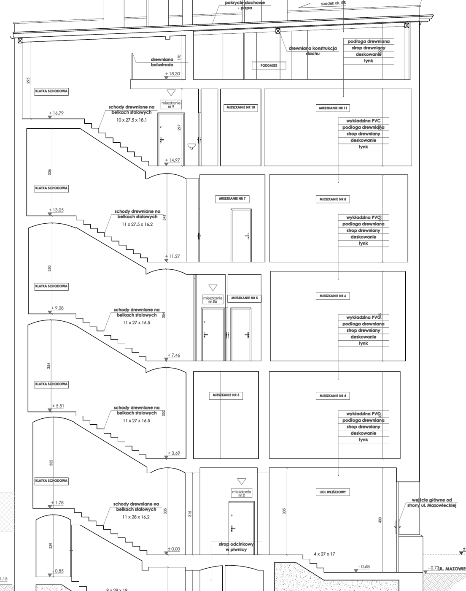
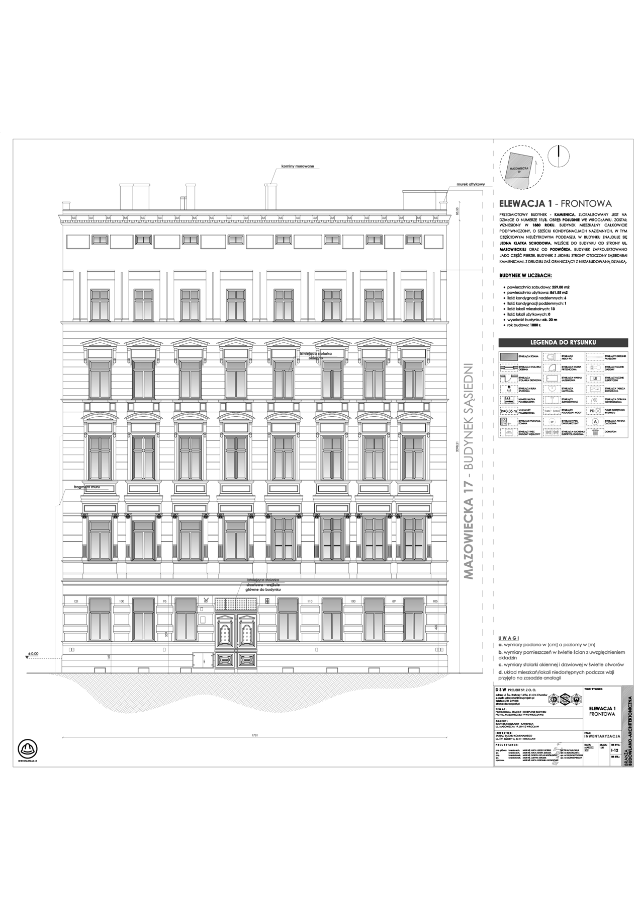
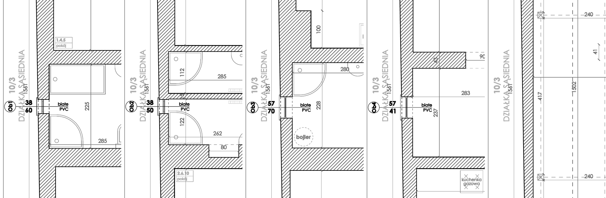
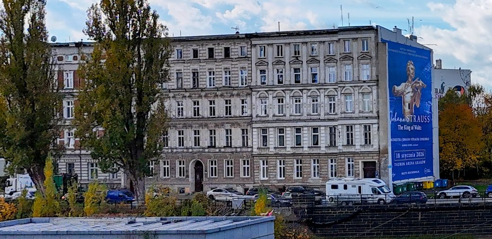
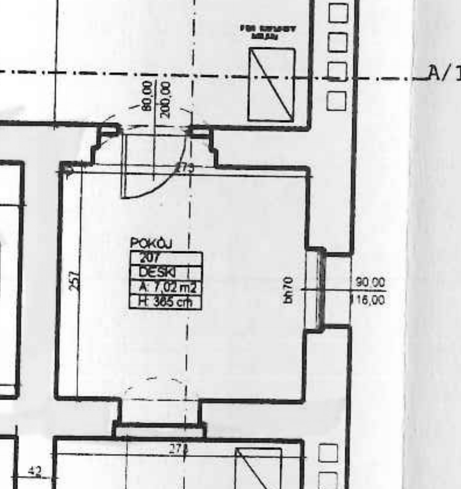
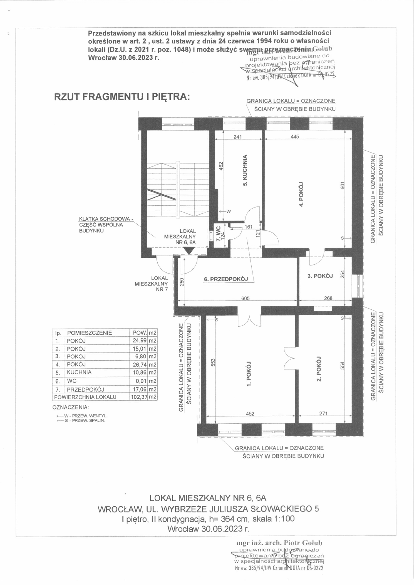
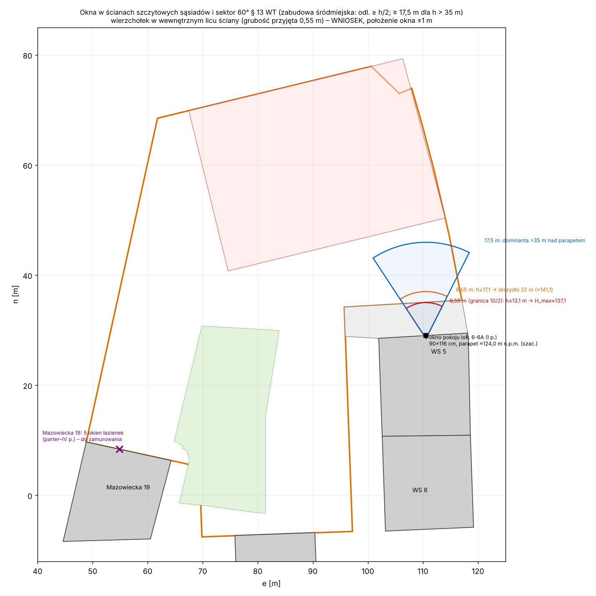

# Budynki sąsiednie – Mazowiecka 19 i Wybrzeże J. Słowackiego 5: geometria, okna szczytowe, wnioski dla § 12, § 13, § 60 WT i dowiązania pierzei

**Stan:** 2026-11-16 · **Zakres:** pełna lektura M.07 (14 s., wektorowy PDF – render 90–600 dpi, analiza wektorów wymiarów) i M.08 (8 s. skanu – render 90–600 dpi) oraz inwentaryzacji lokalu 6-6A (2023); kontrola na zdjęciach M.10/M.09 i obrysach EGiB (`model/site.json`) · **Zasada wyłączenia:** nie korzystano z informacji o pracach konkursowych.
**Dane liczbowe dla modelu 3D:** `model/sasiedzi.json` (układ lokalny e/n jak `site.json`; rzędne PL-EVRF2007-NH).

Oznaczenia: **[Ź]** – odczyt ze źródła; **wniosek** – interpretacja/oszacowanie własne; **[K-nn]** – sprzeczność/niejasność.

## 0. Źródła

| Skrót | Plik | Zawartość |
|---|---|---|
| **M.07 s. N** | `00_materialy/_rozpak/5_Zalaczniki_Merytoryczne_M.01-M.14_pop.13.02.2026/M.07. INWENTARYZACJA MAZOWIECKA/M.07. INWENTARYZACJA MAZOWIECKA 19/M.07. INWENTARYZACJA MAZOWIECKA 19.pdf` | s. 1 – strona informacyjna Organizatora; s. 2 – piwnica; s. 3 – parter; s. 4–7 – I–IV p.; s. 8 – poddasze; s. 9 – rzut dachu z opisem „Budynek w liczbach” (DSW Projekt sp. z o.o., temat „Przebudowa, remont i ocieplenie budynku przy ul. Mazowieckiej 19”, inwestor ZZK, 03.2021, rys. I-09, 1:50); s. 10 – przekrój A-A; s. 11 – przekrój B-B; s. 12 – elewacja frontowa; s. 13–14 – elewacje/legenda |
| **M.08 s. N** | `…/M.08. INWENTARYZACJA SŁOWACKIEGO/M.08. INWENTARYZACJA SŁOWACKIEGO/M.08. INWENTARYZACJA WYBRZEŻE SŁOWACKIEGO 5.pdf` | s. 1 – strona informacyjna („Inwentaryzacja 2001”); s. 2 – mapa sytuacyjna; s. 3 – piwnica; s. 4 – parter; s. 5 – I p.; s. 6 – II p.; s. 7 – III p.; s. 8 – poddasze (strych + mieszkanie nr 12). **Brak przekrojów i elewacji.** |
| **L6-6A** | `00_materialy/_raw/Inwentaryzacja_Slowackiego_5_lok.6-6A.pdf` | rzut fragmentu I piętra, lokal 6-6A, mgr inż. arch. P. Gołub, 30.06.2023, 1:100 |
| Reg. / Wyj. | `00_materialy/tekst/1089_Regulamin_Konkursu_tekst_jednolity_13.02.2026-sig.txt` R.III ust.1 pkt 7 (s. 19–20); Wyj. 3 odp. 13; Wyj. 6 odp. 27; Wyj. 8 odp. 37, 38, 41 (streszczenie: `docs/10_regulamin/wyjasnienia_streszczenie.md`) | okna w szczytach, lokal 6-6A, połączenie z Maz. 19, schemat zacieniania |
| WT | `docs/40_prawo/wt_kluczowe.md` (§ 12, § 13, § 57, § 60; zabudowa śródmiejska – MPZP § 6 pkt 1) | – |
| site.json | `model/site.json` (obrysy EGiB, NMT, granice M.04) | – |

---

## 1. Mazowiecka 19

### 1.1 Dane ogólne [Ź: M.07 s. 9]

„Przedmiotowy budynek – kamienica, zlokalizowany jest na działce o numerze 11/3, obręb Południe (…) wzniesiony w 1880 roku. Budynek mieszkalny całkowicie podpiwniczony, o sześciu kondygnacjach naziemnych, w tym częściowym nieużytkowym poddaszu (…) jedna klatka schodowa. Wejście do budynku od strony ul. Mazowieckiej oraz od podwórza (…) zaprojektowany jako część pierzei.”

| Parametr | Wartość | Źródło |
|---|---|---|
| Pow. zabudowy / użytkowa | 259,00 m² (EGiB geom.: 258,4 m²) / 861,55 m² | M.07 s. 9; site.json |
| Kondygnacje | 6 nadziemnych (parter + I–IV + poddasze), 1 podziemna; EGiB: 5 | M.07 s. 9; e-mapa |
| Lokale | 13 mieszkalnych, 0 użytkowych | M.07 s. 9 |
| Wysokość | „ok. 20 m” (opis); wymiar elewacji frontowej **2098,21 cm** | M.07 s. 9, s. 12 |
| Dach | konstrukcja drewniana, papa, dach pulpitowy ok. 5% (spływ do rynny od podwórza), murki attykowe z obróbką, mur ogniowy na styku z Mazowiecką 17, kominy murowane | M.07 s. 9 |
| Ochrona | MPZP § 8 ust. 1 pkt 3 i ust. 2 – gabaryty, forma i pokrycie dachu, elewacje i detale; obszar 538/A/05 | `konserwator.md` |

### 1.2 Rzędne (przekrój A-A) [Ź: M.07 s. 10]

| Poziom | Rzędna wzgl. ±0,00 [m] | Rzędna bezwzgl. [m n.p.m.] (wniosek: ±0,00 = 119,24) |
|---|---|---|
| ul. Mazowiecka (chodnik) | −0,73 | 118,51 (NMT: 118,51–118,52) |
| wejście zewn. / podwórze | −0,68 / −1,15 | 118,56 / 118,09 |
| posadzka piwnicy (wniosek: bieg 9×29×19 cm od spocznika −0,85) | ≈ −2,56 | ≈ 116,68 |
| **parter** (hol – wys. w świetle 4,03 m; lokale 3,15–3,35 m) | **±0,00** | 119,24 |
| **I p.** | **+3,69** | 122,93 |
| **II p.** | **+7,46** | 126,70 |
| **III p.** | **+11,27** | 130,51 |
| **IV p.** (wys. w świetle 3,36–3,41 m) | **+14,97** | 134,21 |
| poddasze (wys. 1,70–2,95 m, balustrada drewniana) | +18,30 | 137,54 |
| spoczniki klatki | −0,85; +1,78; +5,51; +9,28; +13,05; +16,79 | – |
| **góra attyki** – z wymiaru elewacji 20,98 m (wniosek: podstawa wymiaru = teren przy fasadzie) | ≈ +20,25 | **≈ 139,5** |
| góra attyki – odczyt graficzny z przekroju (`geometria.md`) | ≈ +21,0 | ≈ 140,25 |
| **do modelu 3D (wniosek)** | – | **139,9 ± 0,4**; kominy ok. +0,9 m |

Wysokości kondygnacji (rzędne posadzek): 3,69 / 3,77 / 3,81 / 3,70 / 3,33 m.

### 1.3 Elewacja frontowa (ul. Mazowiecka, zachód) [Ź: M.07 s. 3–7, 9, 12; zdjęcia M.10 0025, 0036]

- Długość frontu wymaga weryfikacji – trzy źródła się różnią [K-02]: 17,15 m wzdłuż linii fasady na rzucie dachu (odczyt „1714,85”), ok. 17,8 m z przeskalowania rysunku elewacji, 18,54 m z obrysu EGiB.
- **8 osi okiennych.** Okna od ulicy 102 × 200 cm (w świetle, oś O6), filarki 100–121 cm. Pionowa proporcja okna ok. 1 : 2.
- **Podziały poziome** – wniosek z linii wektorowych elewacji, przeskalowanych wymiarem 2098,21 cm (±0,3 m) [Ź: M.07 s. 12]. Wysokości nad terenem:

  | Element | Wysokość [m] |
  |---|---|
  | cokół | 0,3–1,5 |
  | pas nad parterem | 3,6–4,25 |
  | pas międzykondygnacyjny | 7,3–8,9 |
  | pas międzykondygnacyjny | 11,6–12,7 |
  | pas międzykondygnacyjny | 15,1–16,3 |
  | gzyms pod attyką | 18,2–18,7 |
  | attyka | 20,8–21,5 |

  Trójdzielny układ: cokół i parter / trzon I–IV p. / zwieńczenie z attyką.
- Materiał: tynk z bogatym detalem eklektycznym (obramienia, naczółki nad oknami I p., gzymsy), kolorystyka szara. Stan techniczny wizualnie słaby – zabrudzenia, ubytki (zdjęcie M.10 0036; wniosek).

### 1.4 Ściana szczytowa północna (od terenu inwestycji)

| Parametr | Wartość | Źródło |
|---|---|---|
| Przebieg (e, n) | (48,84; 9,68) → (64,26; 6,32); dł. 15,78 m (EGiB), w świetle 15,61 m | site.json; M.07 s. 3 |
| Sąsiednia działka | **10/3** (opis rzutów M.07; potwierdzone przecięciem z poligonem dz. 10/3 w site.json). [K-03] W `geometria.md` (tab. 4.3) podano omyłkowo dz. 11/6. | M.07 s. 3–8 |
| Położenie | na granicy obszaru inwestycji (odl. 0,05 m) – ściana do przylegania (§ 12 ust. 3) | site.json |
| Wygląd | tynk; mural reklamowy (Przegląd Piosenki Aktorskiej) | M.10 0015, 0033 |

**Okna w ścianie szczytowej** [Ź: M.07 s. 3–7] – wszystkie w jednej osi pionowej ok. 6,2 m od narożnika frontowego (e ≈ 54,9; n ≈ 8,4 – wniosek ±0,5 m):

| Kondygnacja | Pomieszczenie | Okno (szer. × wys. w świetle) | Stolarka |
|---|---|---|---|
| parter | 0.1.2 łazienka | 38 × 60 cm | drewniana biała |
| I p. | łazienka (wanna + kabina) | 38 × 60 cm | PVC biała |
| II p. | dwa pomieszczenia sanitarne (łazienka/WC) | 38 × 50 cm | PVC biała |
| III p. | łazienka (kabina, bojler) | 57 × 70 cm | PVC biała |
| IV p. | pomieszczenie sanitarne przy kuchni (funkcja do weryfikacji) | 57 × 41 cm | PVC biała |
| poddasze | brak okna | – | – |

Rzędnych parapetów okien szczytowych inwentaryzacja nie podaje. Okna „przeznaczone są do zamurowania w ramach inwestycji towarzyszącej” [Ź: M.07 s. 1; Wyj. 3 odp. 13; Reg. s. 20].

### 1.5 Elewacja podwórzowa (wschód)
Przebiega od (60,50; −7,93) do (64,09; 5,70). Odległość do granicy obszaru inwestycji (krawędź przy ogródkach) wynosi **5,95–8,5 m**. Okna mieszkań mają 98 × 205 cm (oś O4) [Ź: M.07 s. 3–7; site.json].

---

## 2. Wybrzeże J. Słowackiego 5

### 2.1 Dane ogólne

| Parametr | Wartość | Źródło |
|---|---|---|
| Działka / funkcja | dz. 12 (EGiB) / mieszkalny wielorodzinny; EGiB „m5” | site.json; e-mapa |
| Obrys | front (wschód, Wybrzeże) 18,55 m; szczyt pn. 16,26 m; pow. zabudowy 293,6 m² | site.json |
| Przejazd bramowy | wzdłuż pn. ściany na parterze, ul. → podwórze (EGiB); w M.08 „komunikacja 104”; od podwórza garaż 118 (H 210 cm) | site.json; M.08 s. 4 |
| Kondygnacje | piwnica (H 190 cm, kom. lokatorskie 006–013) + **parter + I–III p. + poddasze/strych z mieszkaniem nr 12** = 5 nadziemnych | M.08 s. 3–8 |
| Wysokości pomieszczeń (w świetle) | parter: pokój 103 – 280 cm; I p. – 385 cm (lokal 6-6A w 2023: 364 cm); II p. – 360–380 cm; III p. – 340 cm; poddasze – 250 cm | M.08 s. 4–8; L6-6A |
| **Wysokość budynku (wniosek)** | **ok. 20,5 m nad terenem (zakres 19,8–23,0)**, góra ≈ 139,5 m n.p.m. (± 1 m). Metoda: suma kondygnacji z M.08 + cokół 0,75 m + stropy 0,35 m + dach ok. 1,2 m; kontrolnie proporcja na zdjęciu M.10 0029 (≈ 22,9 m ± 1,5). **Brak przekroju w M.08** [K-04]. | wniosek |
| Poziomy (wniosek ±0,5 m) | parter ≈ 119,75; I p. ≈ 123,5; II p. ≈ 127,7; III p. ≈ 131,75; poddasze ≈ 135,5 m n.p.m. | wniosek |
| Elewacja frontowa | ok. 7 osi; tynk jasny (beż, szarość), detal eklektyczny (naczółki I–II p.), parter ciemniejszy/boniowany; najwyższa kondygnacja z rzędem mniejszych okien poddasza (fryz) | M.10 0029 (wniosek z fotografii) |
| Szczyt pn. – wygląd | tynk; w dniu zdjęć (29.10.2025) zasłonięty wielkoformatową siatką reklamową (koncert J. Straussa) – zasłania także okna | M.10 0015, 0029, 0033 |

### 2.2 Ściana szczytowa północna i jej okna

- Przebieg (e, n): (101,93; 28,52) → (118,16; 29,46); normalna zewn. 356,7° (siatka).
- Przed szczytem leży **dz. 10/2** – dojazd do wnętrza podwórzowego. Lico szczytu jest ok. **6,0 m** od granicy obszaru inwestycji [site.json].
- Okna są w jednej osi pionowej w ok. 0,53 długości szczytu od narożnika podwórzowego: **e ≈ 110,5; n ≈ 29,0** (wniosek ±1 m) [Ź: M.08 s. 5–8].

| Kondygnacja | Pomieszczenie (M.08) | Okno [cm] | Parapet nad podłogą | Parapet [m n.p.m.] (wniosek ±0,5) | Ochrona § 13 |
|---|---|---|---|---|---|
| **I p.** (kondygnacja 2) – **lokal 6-6A** | **pokój 207**: 7,02 m², H 385, deski (2001); w inw. 2023: „3. pokój” **6,80 m²**, 2,68 × 2,54 m | **90 × 116** | **0,70 m** („bh70”) | **≈ 124,0** | **TAK** – pokój (pomieszczenie na pobyt ludzi); **zamurowanie niedopuszczalne** (Wyj. 3 odp. 13; M.08 s. 1) |
| II p. | łazienka 306: 7,05 m², H 360, pł. ceramiczne | 60 × 85 | 0,70 m | ≈ 128,4 | nie (pomieszczenie sanitarne – § 5 WT, wg `wt_kluczowe.md`) |
| III p. | łazienka 407: 7,99 m², H 340, posadzka betonowa | 80 × 80 | 1,50 m | ≈ 133,25 | nie |
| poddasze | kuchnia z aneksem kuchennym 505 (mieszkanie nr 12): 12,20 m², H 250 | „45,00/10,00” – odczyt niepewny; odręczna adnotacja o wentylacji kuchni → prawdopodobnie otwór wentylacyjny | 1,00 m („bh1,00”) | ≈ 136,5 | sporne (kuchnia – pomieszczenie pomocnicze; otwór nie jest oknem w typowym sensie) [K-05] |
| parter | przejazd bramowy (komunikacja 104) | brak okien w szczycie | – | – | – |

Regulamin opisuje to zgodnie: „okna do pokoju (1 p.), łazienek (2 i 3 p.), kuchni” (Reg. s. 19–20; Rejestr R-034).

### 2.3 Lokal 6-6A [Ź: L6-6A; Wyj. 6 odp. 27]

Lokal 6-6A należy traktować jako **jeden lokal dwustronny**, zbyty przez Gminę 15.07.2024 (Wyj. 6). Dane z inwentaryzacji 2023: I piętro (II kondygnacja), h = 364 cm, pow. 102,37 m².

| Pomieszczenie | Pow. [m²] | Strona | Odpowiednik w M.08 (2001) |
|---|---|---|---|
| 1. pokój | 24,99 | wschód (Wybrzeże/Odra) | – |
| 2. pokój | 15,01 | wschód, przy szczycie | 208 (15,50) |
| 3. pokój | 6,80 | **północ – okno w szczycie** | 207 (7,02) |
| 4. pokój | 26,74 | zachód (podwórze), przy szczycie | 202 (26,93) |
| 5. kuchnia | 10,86 | zachód | – |
| WC | 0,91 | – | – |
| przedpokój | 17,06 | – | – |

[K-06] W tabeli 2023 numeracja „6. WC / 7. przedpokój” jest zamieniona względem opisów na rzucie.

---

## 3. Wnioski dla § 12, § 13 i § 60 WT (wniosek)

Podstawa: MPZP § 6 pkt 1 – obszar zabudowy śródmiejskiej, więc obowiązuje § 13 ust. 4 WT (odległości ½) i § 60 ust. 3 (1,5 h). Brzmienia przepisów i metoda: `docs/40_prawo/wt_kluczowe.md` rozdz. 4–5.

### 3.1 § 12 – usytuowanie przy granicy
- **Mazowiecka 19:** nowa ściana przy granicy, **przylegająca całą długością (15,78 m)** do ściany szczytowej (§ 12 ust. 3). Ściana pełna, bez otworów, o odporności ogniowej ściany oddzielenia – szczegóły w `ppoz.md`. Zamurowanie 5 okien łazienek Maz. 19 przewiduje Zamawiający. W harmonogramie trzeba je zgrać z budową nowej ściany: wentylacja tych łazienek po zamurowaniu leży poza zakresem konkursu, ale warto ją zasygnalizować.
- **Wybrzeże Słowackiego 5:** granica z dz. 10/2 (nie jest działką drogową). Ściana z oknami musi stać ≥ 4 m od granicy. Ściana bez otworów: ≥ 3 m albo przy granicy, jeśli MPZP dopuszcza – MPZP § 6 pkt 2; Wyj. 4 odp. 22 (Rejestr R-205).

### 3.2 § 13 – przesłanianie okna pokoju w lokalu 6-6A (decydujące ograniczenie bryły przy WS 5)

- **Sektor 60°** (±30° od normalnej 356,7°). Wierzchołek leży w wewnętrznym licu ściany na osi okna (grubość szczytu przyjęta 0,55 m): **e ≈ 110,56; n ≈ 28,47**. Najbliższy punkt obszaru inwestycji w sektorze jest **6,55 m** od wierzchołka.
- Wysokość przesłaniania liczy się od parapetu ≈ **124,0 m n.p.m.** (§ 13 ust. 2). Warunek dla zabudowy śródmiejskiej:
  - przeszkoda o wysokości h ≤ 35 m musi stać w odległości ≥ h/2;
  - przeszkoda wyższa niż 35 m – w odległości ≥ 17,5 m.

| Odległość od wierzchołka (w sektorze) | Maks. wysokość przesłaniania h | Maks. rzędna przeszkody | Interpretacja |
|---|---|---|---|
| 6,55 m (granica z dz. 10/2) | 13,1 m | ≈ 137,1 m n.p.m. (ok. 18 m nad terenem) | przy granicy, w pasie szer. ok. ±3,8 m od osi okna, bryła nie wyższa niż ~18 m |
| 8,55 m (≈ 2 m od granicy) | 17,1 m | ≈ 141,1 (≈ 22 m nad terenem) | **skrzydło 22 m (M.01) musi w sektorze odsunąć się ok. 2,0 m od granicy** albo obniżyć się lokalnie (uskok, taras) |
| ≥ 17,5 m | bez ograniczenia | – | **wydzielenie A jest w sektorze ≥ 20,4 m od wierzchołka** → dominanta 35–45 m w obszarze A nie narusza § 13 względem tego okna |

  Szerokość sektora rośnie z odległością: ±0,577 × d (przy 6,55 m ok. ±3,8 m; przy 17,5 m ok. ±10,1 m).
- Wrażliwość (wniosek): błąd parapetu ±0,5 m zmienia rzędną graniczną o ±0,5 m. Błąd położenia okna ±1 m przesuwa sektor w osi e.
  - Projekt nowych WT (wierzchołek w licu zewnętrznym, kryterium 12°, wysokość nie niżej niż 0,85 m nad podłogą) może zmienić wynik o kilkadziesiąt cm.
  - **Zalecenie: zachować zapas ≥ 1 m** i pokazać analizę na rzucie charakterystycznym (Rejestr R-210).
- Łazienki II i III p. nie są chronione przez § 13 (§ 5 WT). Otwór kuchni na poddaszu ma parapet wyżej (≈ 136,5). Gdyby uznać go za chroniony, dopuszczalna rzędna przy granicy wyniesie ≈ 149,6 m n.p.m., czyli mniej restrykcyjnie niż dla pokoju na I p.

**Wniosek projektowy:** przy WS 5 nie stawiać ściany o pełnej wysokości 22 m na granicy z dz. 10/2. Proponowane rozwiązania:
- (a) obniżony łącznik lub brama nad dz. 10/2 do wysokości ok. 17–18 m (≈ rzędna 136–137) albo
- (b) uskok elewacji ≥ 2,5 m od granicy w pasie ±5 m od osi okna, albo
- (c) dziedziniec doświetlający przed szczytem.

Rozwiązanie (a) „zszywa” pierzeję nad Oławą, o co prosi konserwator (`konserwator.md`), i jednocześnie spełnia § 13. Wymaga jednak sprawdzenia § 12 i statusu dz. 10/2 jako dojazdu – przejazd o wysokości ≥ 4,2 m dla dostaw (Rejestr R-214).

### 3.3 § 60 – nasłonecznienie
- **Lokal 6-6A:** pokoje 1 i 2 (wschód) wychodzą na Wybrzeże i Odrę, a po stronie wschodniej nie ma przesłon. W dniach równonocy, w godz. 7–17, azymut Słońca mieści się w przybliżeniu w zakresie **102°–258°** (szacunek własny dla φ = 51,11°). Nowa bryła leży na północ od WS 5, więc nie może przesłonić porannego słońca w pokojach wschodnich. **Wymóg 1,5 h dla „przynajmniej jednego pokoju” (§ 60 ust. 2–3) jest spełniony niezależnie od projektu.**
- Pokój 3 (okno na północ, normalna 356,7°) nie otrzymuje bezpośredniego słońca w dniach równonocy w ogóle – zarówno obecnie, jak i po realizacji. Dla tego pokoju decyduje więc § 13, nie § 60.
- **Okna zachodnie WS 5 i WS 6** (od podwórza, ok. 6 m od granicy ogródków) dostają słońce popołudniowe z kierunków ok. 200–258°. Zabudowa w ogródkach (na zach. od WS 5/6) przesłoniłaby je. Pozostawienie ogródków jako ogrodu chroni te okna. Południowy koniec skrzydła przy Mazowieckiej leży w azymucie ok. 259–270° od tych okien – to granica zakresu. **Trzeba to sprawdzić w modelu 3D.** Schemat zacieniania jest obowiązkowy (Wyj. 8 odp. 41; Rejestr R-209).
- **Mazowiecka 19:** nowa zabudowa leży na północ od kamienicy (pierzeja Mazowieckiej), więc nie zacienia jej w ciągu dnia. Ewentualna zabudowa na wschód od Maz. 19 (ogródki) ograniczałaby poranne nasłonecznienie i przesłanianie okien podwórzowych – odległość 5,95–8,5 m. To kolejny argument za ogrodem bez kubatury.

---

## 4. Dowiązanie nowej pierzei (wniosek)

| Element | Mazowiecka 19 | Wybrzeże Słowackiego 5 | Rekomendacja dla nowej zabudowy |
|---|---|---|---|
| Linia zabudowy | front w linii (44,64; −8,38) → (48,84; 9,68), azymut ok. 13° – kontynuowana przez zach. granicę obszaru inwestycji (az. 12,4°) | front wzdłuż łuku Wybrzeża (az. ok. 358,5°); przerwa – dz. 10/2 (ok. 6 m) | pierzeja Mazowieckiej w linii frontu Maz. 19 (linie MPZP – `mpzp.md`); nad Oławą kontynuacja łuku z „zszyciem” przerwy dz. 10/2 (patrz 3.2) |
| Gzyms / attyka | gzyms 18,2–18,7 m; attyka ≈ 20,25–21,0 m nad ±0,00 (≈ 139,5–140,25 m n.p.m.) | góra ok. 20,5 m nad terenem (≈ 139,5 ± 1,0) | **gzyms/krawędź korpusu na ≈ 139,5–140,3 m n.p.m. (≈ 21 m)**; wyższe kondygnacje skrzydeł (do 22 m) cofnięte; spójne z DWKZ (18–22 m) i M.01 (≤ 22 m) |
| Kondygnacje | posadzki: ±0,00 / +3,69 / +7,46 / +11,27 / +14,97 / +18,30 (±0,00 = 119,24) | posadzki ≈ 119,75 / 123,5 / 127,7 / 131,75 / 135,5 (szac.) | **±0,00 nowego budynku = 119,24 i moduł kondygnacji 3,75 m** dają posadzki +3,75 / +7,50 / +11,25 / +15,00. Różnice względem Maz. 19 wynoszą +6 / +4 / −2 / +3 cm, więc przyszłe połączenie funkcjonalne (zalecenie Wyj. 3 odp. 13, Wyj. 8 odp. 37) jest możliwe bez schodów, z ewentualnym pochyleniem ≤ 2% |
| Rytm i proporcje | 8 osi na ok. 17–18,5 m (oś ~2,1–2,3 m); okna 102 × 200; filarki 1,0–1,2 m; trójdzielność | ~7 osi na 18,55 m; fryz okien poddasza | podział elewacji na segmenty szerokości historycznych posesji (`konserwator.md`); pionowe otwory; oś ok. 2,2–2,7 m lub jej wielokrotność; wyraźny cokół do ok. 4 m |
| Cokół / parter | parter +0,73 nad chodnikiem; hol 4,03 m | parter ok. +0,75 nad terenem (szac.) | parter dostępny bez schodów od ulicy (M.13) – wyrównanie przez lekkie podniesienie chodnika/placu; wysokość cokołu wizualnie dowiązana do pasa nad parterem Maz. 19 (3,6–4,25 m) |
| Materiał / kolor | tynk szary, detal eklektyczny | tynk jasny beż/szary, detal eklektyczny | materiały mineralne w jasnej, ciepłej gamie; przy styku z Maz. 19 zachować czytelną fugę (nisza/uskok) chroniącą krawędź zabytkowej elewacji |

---

## 5. Sprzeczności i niejasności

| Nr | Opis | Źródła |
|---|---|---|
| K-01 | Wysokość Maz. 19: „ok. 20 m” (opis), elewacja 20,98 m, przekrój: attyka ≈ +21,0 nad ±0,00 (= 21,7 m nad chodnikiem). Rozrzut ok. 0,75 m | M.07 s. 9, 10, 12; `geometria.md` |
| K-02 | Długość frontu Maz. 19: 17,15 m (rzut dachu) / ≈ 17,8 m (skala elewacji) / 18,54 m (EGiB) | M.07 s. 9, 12; site.json |
| K-03 | Sąsiednia działka szczytu Maz. 19: **10/3** (M.07, EGiB) – w `geometria.md` tab. 4.3 omyłkowo „11/6” | M.07 s. 3–8; site.json |
| K-04 | M.08 (2001) nie ma przekroju ani elewacji – wysokość WS 5 i rzędne parapetów to oszacowania (±0,5–1,5 m) | M.08 |
| K-05 | Otwór w szczycie kuchni na poddaszu („45,00/10,00”, bh 1,00) – odczyt niepewny; adnotacja odręczna o wentylacji; Regulamin mówi ogólnie o „kuchni” | M.08 s. 8; Reg. s. 20 |
| K-06 | Lokal 6-6A: wysokość 364 cm (2023) vs 385 cm (2001); pokój 6,80 vs 7,02 m²; zamieniona numeracja WC/przedpokój w tabeli 2023 | L6-6A; M.08 s. 5 |
| K-07 | M.07: EGiB podaje 5 kondygnacji, inwentaryzacja – 6 (z poddaszem) | e-mapa; M.07 s. 9 |
| K-08 | Szczyt WS 5 był w dniu zdjęć zasłonięty siatką reklamową – stan okien niewidoczny na zdjęciach; przed PB wskazana inwentaryzacja aktualna (wizja) | M.10 |
