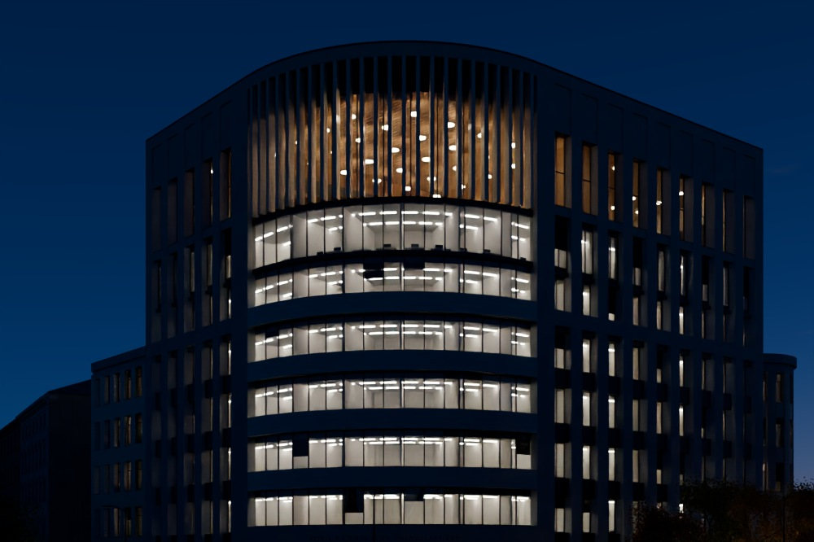
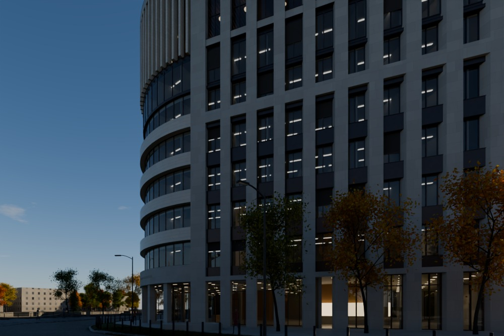
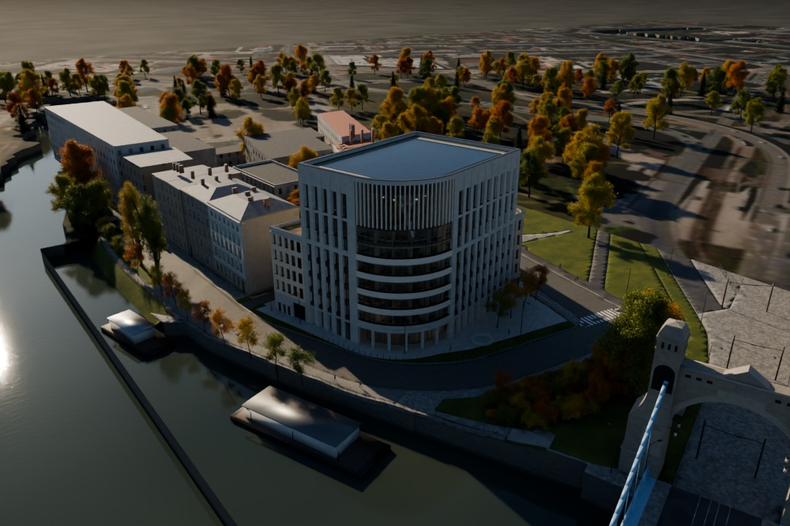

# Model 3D budynku UMWD/Sejmiku – Blender (Cycles)

**Stan:** 2026-11-17 · **Moduły:** `src/umwd/render/budynek3d.py` (bryły, elewacje, wnętrza, dachy, materiały, światło)
i `src/umwd/render/budynek3d_otoczenie.py` (zagospodarowanie bliskie, drzewa, pnącza, ludzie) ·
**Rendery testowe:** `render/testy_budynek.py` → `docs/60_wizualizacje/img/budynek_test_*.jpg` ·
**Silnik:** Blender `bpy` 5.2 LTS, Cycles CPU + OIDN, AgX (Medium High Contrast).

Moduł buduje projektowany budynek „BRAMA I LATARNIA” (wieża Sejmiku z łukiem R 14, Skrzydło Mazowieckie,
Segment Wybrzeża) w układzie współrzędnych kontekstu (`context.py`). Wszystkie wymiary brył i elewacji są czytane
**w czasie działania** z `model/koncepcja.json`. Wartości, których w JSON nie ma, są zebrane w słowniku
`ZALOZENIA` (z odwołaniem do `koncepcja_wybrana.md` §8, do rysunków `tools/elewacje.py` albo z dopiskiem
„dobór”). Można je nadpisać opcją `zalozenia`.






## 1. API

```python
import sys; sys.path.insert(0, '/home/user/aihouse/umwd/src')
from umwd.render import blib, context, budynek3d

sc = blib.reset()
kon = context.build_context(sc, {'pora_roku': 'jesien', 'obszar_inwestycji': 'pusty'})
bud = budynek3d.build_building(sc, {'kontekst': kon})      # → {'kolekcje', 'info', 'budynek'}
sw = budynek3d.swiatlo_dzienne(sc, '2026-10-23 09:40 CEST')  # niebo + słońce wg daty, ekspozycja
cam = blib.camera(sc, (125.0, 60.5, 1.69 + bud['budynek'].DZ), (102.7, 80.6, 10.0), lens_mm=24, shift_y=0.25)
context.ustaw_kamere_trawy(kon, cam)
```

| Funkcja | Opis |
|---|---|
| `build_building(scene, opts)` | buduje kolekcję `BUDYNEK` z podkolekcjami `wieza`, `skrzydlo`, `segment`, `dachy`, `wnetrza`, `zagospodarowanie_bliskie`. Zwraca `kolekcje`, `info` (czasy etapów, liczby obiektów, pola posadzek, drzewa, liczba ludzi) i obiekt `budynek` (`Budynek`: `spec`, `poly`, `foot`, `DZ`, biegi elewacji) |
| `swiatlo_dzienne(sc, czas, ekspozycja=None, …)` | świat Multiple Scattering (`sun_rotation` = azymut kompasowy w siatce, +0,738°), lampa Sun wg kalibracji z metodyki §5.2 (25° → 117 W/m², barwa (1; 0,80; 0,55)), chmury `context.dodaj_chmury`, ekspozycja domyślna −4,3 EV w dzień, jaśniej o zmierzchu. Zwraca `az`, `el`, `ekspozycja` |
| `Spec(path)` | parser `koncepcja.json`: układy (u, v) wieży i (s, d) skrzydła (z wzorów tekstowych w `meta`), kondygnacje dla bryły (oba formaty JSON: `zakres` tekst/lista, `strop_nad.spod_*` lub `strop_wierzch_wzgl`), linie skrzydła, kordon wieży, łuk, lamele, cofnięcia, barwy NCS → sRGB |
| `ncs_srgb('S 1505-Y20R')` | przybliżona konwersja NCS → sRGB (algorytm w3color.js, ±5 jednostek) |
| `biegi_obrysu(obrys, luki_json)` | podział obrysu na biegi elewacji (proste / łuki – dopasowanie okręgu albo łuk z JSON i teselacja co 0,5°) z wektorami ukośnymi w narożach |

Opcje `opts` (domyślne w `DOMYSLNE`): `kontekst` (wynik `build_context` – potrzebny do posadzek, trawnika, drzew),
`wnetrza`, `dachy`, `zagospodarowanie`, `ludzie` (bool), `ludzie_liczba` (34), `rolety` (0,25 – udział opuszczonych
rolet ZIP), `lampy` (mnożnik opraw), `albedo` / `albedo_granit` / `albedo_bruk` (skale albedo barw NCS: 0,84 / 0,70 /
0,52), `zalozenia` (nadpisanie `ZALOZENIA`), `seed`.

Uruchomienie testów (każdy obraz zapisywany od razu po renderze):

```
/home/user/aihouse/.venv-render/bin/python -I umwd/render/testy_budynek.py [--kamery W3 W4 W5 W9 plac_mostowy lot_ptaka]
      [--probki 24] [--szer 1000] [--bez-ludzi] [--tylko-kontrola] [--blend scena.blend]
```

Raport (czasy, kontrola kamer, położenie słońca) – `build/budynek_test_raport.json`.

## 2. Układ, rzędne, źródła

* X = e, Y = n (lokalny `site.json`), **Z = H − 119,25** (jak w kontekście). ±0,00 budynku = 119,30 m n.p.m., więc
  geometria jest liczona w rzędnych względnych i przesuwana o **DZ = +0,05 m** przy tworzeniu siatek.
* Obrysy brył z `bryly[].obrys_ccw` po oczyszczeniu (duplikaty, „kolec” w obrysie skrzydła (68,372; 63,74),
  wierzchołki współliniowe). Łuk wieży z `bryly[W].luk` (środek, R 14), teselacja co 0,5°.
* Kondygnacje: posadzki i spody stropów z `kondygnacje` (P 4,37/4,25; 1–6; S z rusztem +34,15), dachy z
  `bryly[].dach` (wieża: pokrycie 36,20, attyka 37,20; skrzydło 20,20/20,85; segment: taras 19,80, attyka 20,85).
* Cofnięcia: podcień Brama Mostowa (wielokąt z JSON, szklenie R 11 i v = 26,70), brama ogrodowa (wielokąt;
  posadzka −0,60…−0,40, wys. 4,80), wnęki 1,5 m (z opisów: Wejście Obywatelskie – elewacja wsch. wieży
  v 1,40–6,80; wejście ogrodowe – pd., u 8,6–11,4; konferencyjne – dziób NW skrzydła).
* Zasłonięcie elewacji (styk brył i z Mazowiecką 19 z `sasiedzi.json`) liczone automatycznie: elementy elewacji
  są przycinane do wysokości dachu bryły przylegającej.

## 3. Elewacje (co i skąd)

**Wieża – wielki porządek** (JSON `elewacje.wieza`, rysunki `tools/elewacje.py`):
* filary granitowe 1,05 m co 2,70 m, licowane z narożnikiem odniesienia (wsch. od v = 0, pn. i pd. od u = 0,
  zach. od v = 29,70); filary masywne przy łuku: wsch. v 13,5–15,7 (2,2 m), pn. u 24,3–26,0 (1,7 m); narożnik
  pd.-wsch. u 37,8–40,0 (2,2 m);
* parter: pas granitowy +4,37–4,80, nad nim filary ciągłe do +36,20, attyka granitowa +36,20–37,05 z obróbką
  z metalu 0,15 m; witryny parteru (szkło 0,35 m za licem, naświetle +3,47 = 122,77);
* kond. 1–5: okna 1,65 × 2,45 m (parapet 0,90, słupek w osi), ościeże 0,60 m, płyciny z metalu 0,25 m za
  licem, parapety Al z kapinosem; **kordon** granitowy +19,80–20,85 między filarami (kond. 5 – okno nad kordonem);
  żaluzje czerpni zamiast okien kond. 1 na elewacji pd. (u 2–12);
* **kond. 6 – pas cienia**: szkło i metal 0,40 m za licem (+23,55–27,30, szkło +23,85–26,95), ciągły także na łuku;
* **korona S**: wypełnienie granitowe, okna hali 1,65 × 5,0 m (pn., wsch.), komisji 1,65 × 4,20 m (zach., pd.),
  od pd. pas lameli ceramicznych 0,25 m co 0,42 m (+32,9–35,8) maskujący wyrzutnie;
* **łuk R 14**: podcień 3,0 m (kolumny 0,60 m co 15° na R 13,5, szklenie R 11, drzwi główne w osi przekątnej,
  podsufitka drewniana z oprawami), pas granitowy nad podcieniem +4,37–6,10 z napisem
  „SEJMIK WOJEWÓDZTWA DOLNOŚLĄSKIEGO” (litery z brązu, 0,40 m), kond. 1–5: pasmo ceramiczne 1,30 m
  (F…F+1,30) + okno wstęgowe do posadzki wyżej (słupki co 1,35 m, za szkłem ciemna strefa stropu), kond. 6 –
  pas cienia, korona – **lamele ceramiczne 0,25 × 0,60 m co ~0,92 m (24 szt.) na R 13,4–14,0**, szkło za nimi
  (R 13,37), ciemna płyta w strefie rusztu dachu, attyka granitowa.

**Skrzydło i segment – porządek kamieniczny** (JSON `elewacje.skrzydlo`, rewizja koordynatora z 17.11):
* oś 2,025 m, filar 0,825, okno 1,20 × 2,40 (parapet 0,90, ościeże 0,35, rygiel), cokół z filarami granitowymi
  co 4,05 m, witryny z naświetlem +3,47, kordon granitowy 0,35 m pod +4,80 (124,10);
* **elewacje < 0,30 m od granicy** (zach. skrzydła przy Mazowieckiej, wsch. segmentu przy Wybrzeżu): gzyms-attyka
  **bez wysięgu** – granit w licu +19,45–19,80, **fryz cofnięty 0,15 m** +19,80–20,15, gzyms +20,15–20,85;
  relief posesji przez **cofnięcie płycin** (M1 0 / M2 0,08 / M3 0,15 / M4 0,08 m); od dziedzińca wysięg
  gzymsu 0,30 m, dziób pn. 0,25 m;
* posesje M1–M4 (12,15 / 16,20 / 16,20 / 12,15 m od styku z Maz. 19) – odcienie NCS z JSON, faktury: gładka /
  ryflowana co 0,135 m / glazura cieniowana / ryflowana; szczeliny 0,20 m z ciemnego metalu cofnięte 0,15 m
  (także na granicy M4/naroże); M1 – pierwsza oś cofnięta 0,30 m; elewacja dziedzińcowa jednolicie M3;
* brama ogrodowa 4,05 m z nadprożem granitowym; wnęka wejścia konferencyjnego w dziobie NW;
* segment: osie 2,025 m wycentrowane (5 od Wybrzeża, 3 od ogrodu); elewacja wsch. – parter pełny z granitu,
  **brama garażu 4,0 m przy ścianie pn. (v −0,4…−4,4, próg 119,10)**, drzwi trafo / rozdzielni / odpadów
  w części pd.; ściana pd. pełna z reliefem (pilastry 0,12 m, fugi z metalu) i **winobluszczem na linkach**
  (7 młodych pnączy, jesienią czerwone).

**Materiały** (proceduralne, współrzędne tekstur `fu`/`fv` liczone wzdłuż biegu elewacji – spoiny płynnie
na łuku):
* granit strzegomski jasny płomieniowany (NCS S 1502-Y): płyty 1,20 × 0,75 m, spoiny 5 mm, zmienność płyt
  ±6 %, ziarno kwarcu/skalenia i biotytu, makro-„chmury”, lekkie zabrudzenie strefy do +0,7 m;
* ceramika glazurowana półmatowa: profile 1,20 × 0,30 m (na łuku 0,325 m – 4 rzędy w paśmie 1,30), spoiny 6 mm,
  zmienność płytek (ton, lekko barwa), cienka warstwa „glazury” (coat), faktury jw.;
* aluminium anodowane RAL 8019 (grafitowy brąz) – metal satynowy;
* szkło nisko-refleksyjne: pojedyncza tafla Transparent/Glossy wg Schlicka (R0 ≈ 0,09 dla pakietu), Tvis z JSON
  (biura 0,62, korona 0,48, parter 0,74), promienie cienia przechodzą (słońce we wnętrzach), lekkie falowanie
  odbić;
* posadzki: granit płomieniowany w płytach 0,60 × 1,20 m w osiach wieży, z opadłymi liśćmi; ścieżki ogrodu –
  cegła z wykopu.

## 4. Wnętrza, dachy, otoczenie bliskie

* **Biura** (wszystkie kondygnacje 1–6 widoczne z zewnątrz): stropy (sufit jasny, posadzka), tylna ściana na
  głębokości 6,1 m za szkłem, ścianki co 4,05 m, dwa rzędy lamp liniowych (emisja 4000 K), biurka z monitorami
  i krzesłami, ~25 % rolet ZIP opuszczonych losowo; parapety i nadproża wewnętrzne domykają widok między
  szkłem a krawędzią stropu.
* **Hol parteru wieży**: posadzka z jasnego kamienia, trzony A i B obłożone drewnem, słupy w siatce, oprawy
  ciepłe co 2,7 m, niska lada informacji, lapidarium (podświetlone gabloty przy trzonie A).
* **Korona Sejmiku**: sala obrad – ściany pd. i zach. z drewna, sufit z bafli drewnianych, oprawy wiszące
  ciepłe, trzy łukowe rzędy stanowisk (ognisko u 30,0; v 13,4; R 4,8/6,9/9,0 na +0,15/0,30/0,45), galeria na
  +30,90 z balustradą; hol i kuluar z ciepłymi oprawami; stoły w salach komisji.
* **Dachy** (bez urządzeń): BIPV – moduły 1,70 × 1,00 m w osiach bryły na pokryciu, pas zieleni ekstensywnej
  1,2 m przy attyce i pas żwiru; taras segmentu – deski, donice z zielenią, balustrada szklana cofnięta 1,5 m.
* **Zagospodarowanie bliskie**: posadzka granitowa Placu Mostowego (skwer 9/2), podcienia, wnęk, opasek i
  chodników przy elewacjach (bez pasów trawy przed fasadami), dowiązana do ±0,00 przy wejściach i do −0,40
  przy bramie ogrodowej; nawierzchnie kontekstu (trawniki z trawą 3D, chodniki) przebudowane bez obszarów
  posadzek, krawężniki wewnątrz posadzek usunięte; ścieżki ogrodu; drzewa zachowane w obszarze inwestycji
  (38, bez 6 usuwanych wg JSON; korony przy elewacjach zmniejszone – w rzeczywistości cięcia pielęgnacyjne)
  i nowe (4 lipy na placu, drzewo w pasie od bulwaru, drzewa ogrodu); ława okrągła na placu, ławy w pasie od
  bulwaru; **sylwetki ludzi** (34, z metaballi: płaszcz/kurtka, nogi, ręce, głowa z włosami; barwy okryć
  jesiennych losowe) na chodnikach i posadzkach – czytelne w średnim planie, z bliska wyglądają jak makieta.

## 5. Kamery testowe i ich kontrola

Skrypt przed renderem sprawdza położenie kamery (w obrysie budynku? przy pniu / w koronie drzewa?) i rzuca
6 promieni (oś, narożniki, dół kadru), raportując pierwszy trafiony obiekt i odległość.

| Kamera | Źródło | Pora (słońce) | Uwagi z kontroli i korekty |
|---|---|---|---|
| W3 Brama Mostowa | JSON, **korekta osi** | 23.10 09:40 CEST (az 135°, el 17°) | w JSON oś na az 324° stawia łuk na krawędzi kadru; ta sama pozycja, oś az 312°, shift 0,25 – łuk z podcieniem i napisem po lewej, pylon z hełmem po prawej. **Korony (+27 m) z odległości ~18 m nie da się objąć obiektywem ≥ 24 mm** |
| W4 Wybrzeże Słowackiego 5 | JSON | 23.10 11:15 CEST (158°/25°) | bez uwag; ściana pd. segmentu z reliefem i pnączami w słońcu, WS 5 w cieniu. Okien szczytu WS 5 z tej pozycji nie widać (kamera na pd. od szczytu) |
| W5 Mazowiecka 19 | JSON | 22.10 15:30 CEST (225°/17°) | bez uwag; gzyms i kordon w liniach nr 19, M1, brama ogrodowa |
| W9 Latarnia z mostu | JSON, **korekta pozycji** | 29.10 17:05 CET (el −5,8°, błękitna godzina) | punkt z JSON leży na jezdni mostu i patrzy przez kratownicę (krzyżulce w kadrze). Pozycja na chodniku pd.-wsch. dobrana przeszukaniem promieni; shift 0,385 – korona w kadrze (por. §7) |
| plac_mostowy | dodatkowa | 23.10 14:30 CEST | elewacja pn. w cieniu, łuk, lipy |
| lot_ptaka | dodatkowa (kontrola) | 29.10.2025 11:40 CET | bryła, dachy BIPV, relacja z mostem |
| W10 Ogród | JSON – **odrzucona w testach** | – | punkt (78; 17) stoi w ogródkach pod koronami zachowanych drzew – kadr zasłonięty w ~90 %; wariant z pasa od bulwaru był ciasny i zdominowany przez ścianę z pnączami. Do ponownego wyboru kadru |

## 6. Czasy (CPU 4 rdzenie, 1000 × 667 px, 24 próbki adaptacyjnie, OIDN)

| Etap | Czas |
|---|---|
| budowa kontekstu | ok. 10 s |
| budowa budynku (z wnętrzami, dachami, otoczeniem, ludźmi) | ok. 5 s |
| render ujęcia dziennego z poziomu człowieka | 31–42 s |
| render W9 (zmierzch, emisja wnętrz) | ok. 53 s |
| render z lotu ptaka | ok. 36 s |

Scena: ok. 1,0 mln ścian geometrii budynku (elewacje ~0,6 mln, wnętrza ~0,35 mln) + kontekst.
Szacunek finalny (metodyka §11.3): 3150 px / 256 próbek ≈ 25–45 min na ujęcie dzienne.

## 7. Czego brakuje / do poprawy

1. **Kadry W3, W9, W10 wymagają decyzji**: W3 z pozycji z JSON nie obejmie korony (potrzebne odsunięcie
   kamery na bulwar ≥ 30 m od lica łuku albo kadr pionowy); W9 – kamera przy kratownicy mostu (tylko
   wąskie „okna” między krzyżulcami); W10 – nowy punkt widoku ogrodu.
2. **Szkło z daleka/ukośnie wciąż ciemne** (W5): wnętrza widać wyraźnie tylko w ujęciach bliskich i na zmierzchu.
   Do zrobienia: odbicia z panoram M.09 (tylko promienie glossy), rozjaśnienie wnętrz od strony słońca.
3. **Ludzie** – sylwetki „makietowe”: dobre w średnim planie, na pierwszym planie do zastąpienia modelami
   (MPFB/MakeHuman CC0) lub postprodukcją; brak osoby na wózku (wymóg wiz. 3).
4. Napis w nadprożu jest wypukłymi literami z brązu (nie wykuty); detal ościeży wieży (wyprawa granitowa
   nadproża/parapetu) uproszczony do obróbek z metalu.
5. Rzuty pomieszczeń we wnętrzach są umowne (pierścień biur, ścianki co 4,05 m); hol i sala Sejmiku –
   uproszczone (brak godła, ekranów, mównicy, tłumacza PJM). Do wiz. 6–8 potrzebne osobne modele wnętrz.
6. Zagospodarowanie: brak śladu pierzei z 1934 r. w posadzce (brak geometrii w JSON), ogrodu deszczowego,
   stojaków rowerowych, ogrodzeń ogródków; trawa 3D w ogrodzie z kontekstu (jesienna).
7. W JSON (synteza 1.0) brama garażu ma jeszcze 6,0 m – model stosuje rewizję 4,0 m z `ZALOZENIA`
   (`brama_garazu_v`); po aktualizacji JSON do v1.1 wpis usunąć. Obrys skrzydła w JSON ma zaokrąglony także
   narożnik NE dziobu (wnęka R ≈ 3,5 m przy narożniku NW wieży) – inaczej niż opis tekstowy (lico pn. w linii
   wieży); model trzyma się JSON.
8. Barwy NCS przeliczone przybliżonym algorytmem; przed finałem sprawdzić na wydruku próbnym i wzornikach.
9. Brak fotomatchingu (F.17.A/B) i scen wnętrz; brak postprodukcji (grading, ziarno, winieta wg metodyki §10).

## 8. Pliki

| Plik | Zawartość |
|---|---|
| `src/umwd/render/budynek3d.py` | `Spec` (parser JSON), biegi elewacji, akumulator geometrii `Geo`, materiały, elewacje wieży/łuku i porządek kamieniczny, wnętrza, dachy, `swiatlo_dzienne`, `build_building` |
| `src/umwd/render/budynek3d_otoczenie.py` | posadzki i przebudowa nawierzchni kontekstu, drzewa, pnącza, ławy, sylwetki ludzi |
| `render/testy_budynek.py` | rendery testowe z kontrolą kamer, korekty kadrów (`KOREKTY`) z uzasadnieniem |
| `docs/60_wizualizacje/img/budynek_test_*.jpg` | obrazy testowe (≤ 1 MB) |
| `build/budynek_test_raport.json` | raport ostatniego przebiegu (czasy, kontrola kamer, słońce) |
