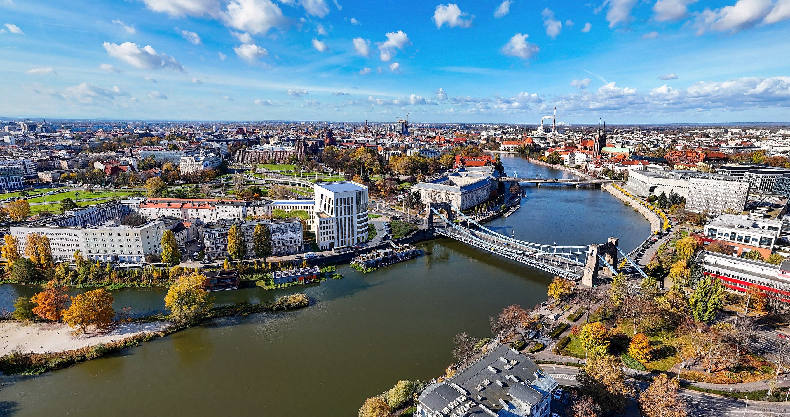
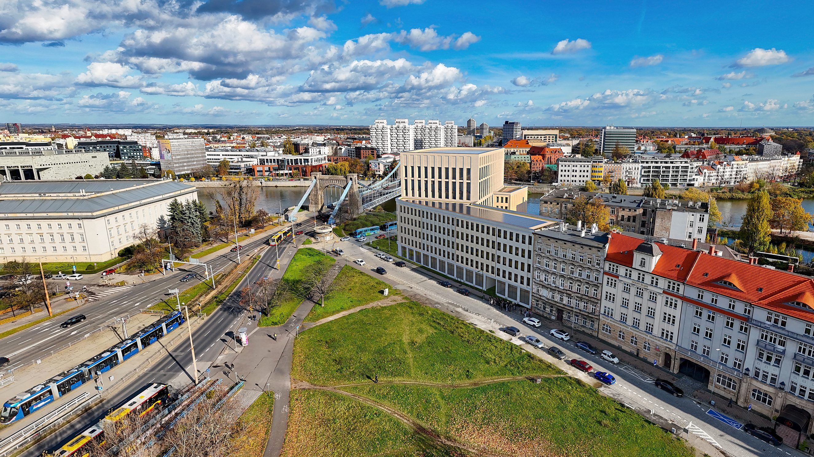
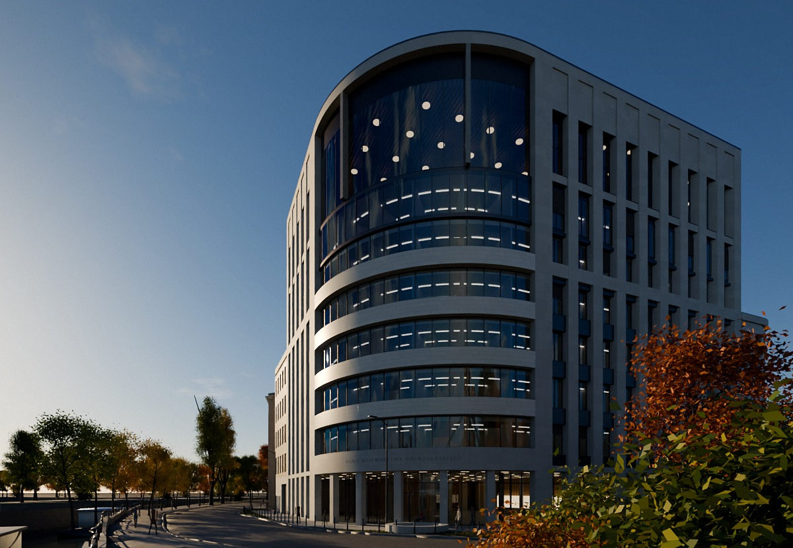
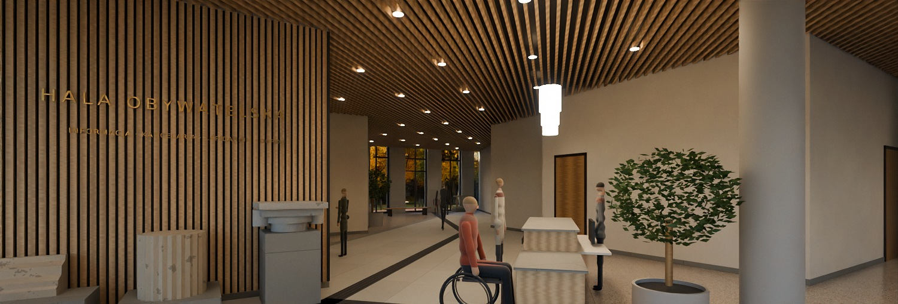
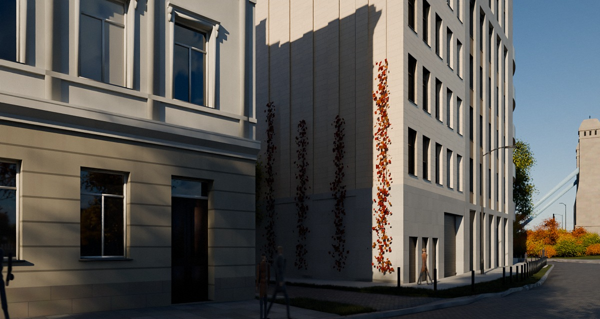
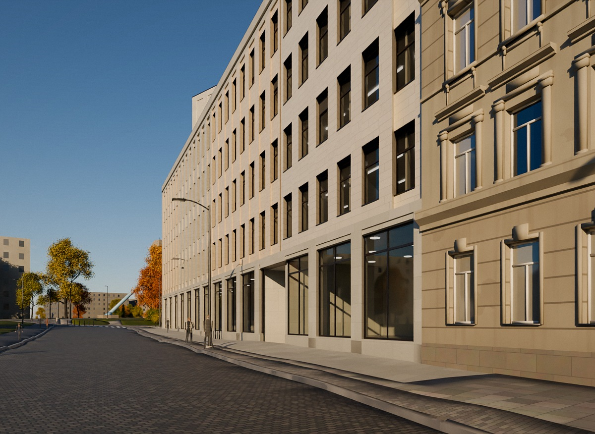
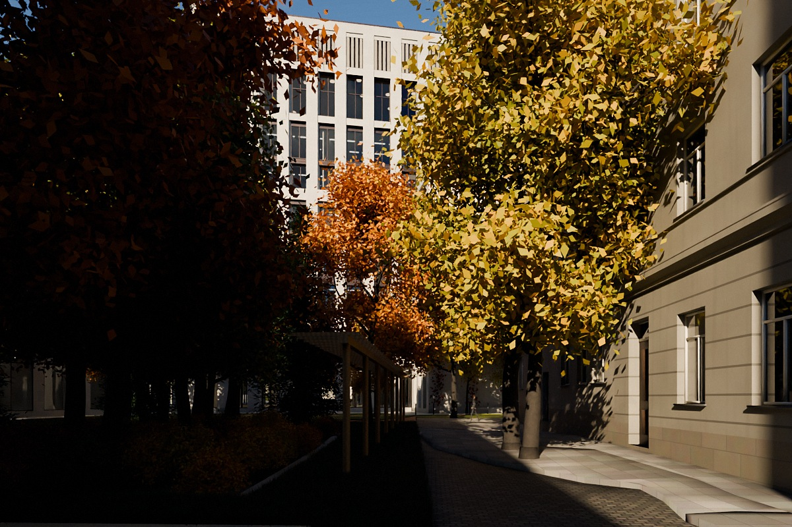
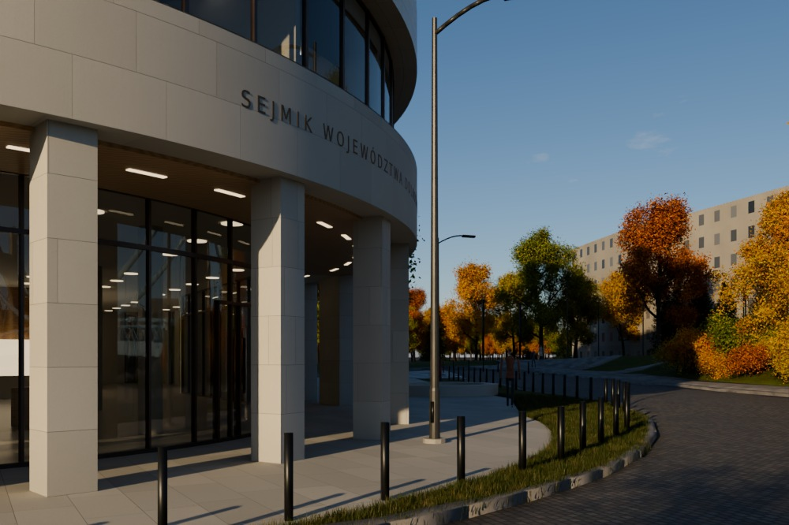

# Model 3D budynku UMWD/Sejmiku – Blender (Cycles)

**Stan:** 2026-11-17 (etap 2: fotomatch, wnętrze hali, kadry) · **Moduły:** `src/umwd/render/budynek3d.py` (bryły,
elewacje, wnętrza, dachy, materiały, światło), `src/umwd/render/budynek3d_otoczenie.py` (zagospodarowanie bliskie,
drzewa, pnącza, ludzie, osoba na wózku), `src/umwd/render/budynek3d_hala.py` (Hala Obywatelska – W6) ·
**Rendery testowe:** `render/testy_budynek.py` → `docs/60_wizualizacje/img/budynek_test_*.jpg`, `W6_hol_test.jpg`;
`render/fotomatch_F17.py` → `W1_F17A_test.jpg`, `W2_F17B_test.jpg` ·
**Silnik:** Blender `bpy` 5.2 LTS, Cycles CPU + OIDN, AgX (Medium High Contrast); ostatni krok każdego obrazu –
`tools/postprodukcja.py` (preset `dzien` / `zmierzch` / `lot` / `wnetrze`).

Moduł buduje projektowany budynek „BRAMA I LATARNIA” (wieża Sejmiku z łukiem R 14, Skrzydło Mazowieckie,
Segment Wybrzeża) w układzie współrzędnych kontekstu (`context.py`). Wszystkie wymiary brył i elewacji są czytane
**w czasie działania** z `model/koncepcja.json` (wnętrze hali – z `model/budynek.json`). Wartości, których w JSON nie
ma, są zebrane w słowniku `ZALOZENIA` (z odwołaniem do `koncepcja_wybrana.md` §8, do rysunków `tools/elewacje.py`,
uzgodnień koordynatora albo z dopiskiem „dobór”). Można je nadpisać opcją `zalozenia`.













## 1. API

```python
import sys; sys.path.insert(0, '/home/user/aihouse/umwd/src')
from umwd.render import blib, context, budynek3d

sc = blib.reset()
kon = context.build_context(sc, {'pora_roku': 'jesien', 'obszar_inwestycji': 'pusty'})
bud = budynek3d.build_building(sc, {'kontekst': kon})      # → {'kolekcje', 'info', 'budynek'}
sw = budynek3d.swiatlo_dzienne(sc, '2026-10-23 09:40 CEST')  # niebo + słońce wg daty, ekspozycja
cam = blib.camera(sc, (125.0, 60.5, 1.69 + bud['budynek'].DZ), (102.7, 80.6, 10.0), lens_mm=24, shift_y=0.25)
context.ustaw_kamere_trawy(kon, cam)
```

| Funkcja | Opis |
|---|---|
| `build_building(scene, opts)` | buduje kolekcję `BUDYNEK` z podkolekcjami `wieza`, `skrzydlo`, `segment`, `dachy`, `wnetrza`, `zagospodarowanie_bliskie`. Zwraca `kolekcje`, `info` (czasy etapów, liczby obiektów, pola posadzek, drzewa, liczba ludzi) i obiekt `budynek` (`Budynek`: `spec`, `poly`, `foot`, `DZ`, biegi elewacji) |
| `swiatlo_dzienne(sc, czas, ekspozycja=None, sila_slonca=1, sila_nieba=1, aerozole=1.6, chmury=0.35, wb=None, odbicia=None, odbicia_sila=12)` | świat Multiple Scattering (`sun_rotation` = azymut kompasowy w siatce, +0,738°), lampa Sun wg kalibracji z metodyki §5.2 (25° → 117 W/m², barwa (1; 0,80; 0,55)), chmury `context.dodaj_chmury`, ekspozycja domyślna −4,3 EV w dzień, jaśniej o zmierzchu (wartość bezwzględna, gdy podana); przy słońcu < 3° zapala tylko ok. 35 % opraw biurowych (węzeł `udzial` materiału `B_wn_lampa`). **`odbicia`** = `'m09_30'`/`'m09_40'`/`'m09_45'` – panorama M.09 jako środowisko **tylko dla promieni glossy** (Light Path → Is Glossy Ray), zmieszana z niebem fizycznym; obrót panoramy z kolumny słońca na zdjęciu (az 183,9° + 0,738°); siła 12 (9 – niewidoczne, 22 – korona jak lustro); o zmierzchu skalowana. Zwraca `az`, `el`, `ekspozycja` |
| `dodaj_odbicia_panoramy(sc, klucz, sila)` | sama warstwa odbić M.09 (wywoływana przez `swiatlo_dzienne`) |
| `budynek3d_hala.Hala(B)` | Hala Obywatelska z `budynek.json` (wywoływana w `wnetrza()` przy `hala_szczegolowa=True`) |
| `budynek3d_otoczenie.wozek(B, coll, zf, poz=None, kier=None, nazwa='')` | osoba na wózku aktywnym (koła Ø 0,60, obręcze, kółka, rama; sylwetka siedząca, dłonie na obręczach); domyślnie w podcieniu Bramy Mostowej (kąt łuku `wozek_kat_luku` = 52°, jazda ku drzwiom w osi 45°) |
| `Spec(path)` | parser `koncepcja.json`: układy (u, v) wieży i (s, d) skrzydła (z wzorów tekstowych w `meta`), kondygnacje dla bryły (oba formaty JSON: `zakres` tekst/lista, `strop_nad.spod_*` lub `strop_wierzch_wzgl`), linie skrzydła, kordon wieży, łuk, lamele, cofnięcia, barwy NCS → sRGB |
| `ncs_srgb('S 1505-Y20R')` | przybliżona konwersja NCS → sRGB (algorytm w3color.js, ±5 jednostek) |
| `biegi_obrysu(obrys, luki_json)` | podział obrysu na biegi elewacji (proste / łuki – dopasowanie okręgu albo łuk z JSON i teselacja co 0,5°) z wektorami ukośnymi w narożach |

Opcje `opts` (domyślne w `DOMYSLNE`): `kontekst` (wynik `build_context` – potrzebny do posadzek, trawnika, drzew),
`wnetrza`, `dachy`, `zagospodarowanie`, `ludzie` (bool), `ludzie_liczba` (34), `rolety` (0,25 – udział opuszczonych
rolet ZIP), `lampy` (mnożnik opraw), `albedo` / `albedo_granit` / `albedo_bruk` (skale albedo barw NCS: 0,84 / 0,70 /
0,52), `zalozenia` (nadpisanie `ZALOZENIA`), `seed`. Nowe w etapie 2 (wszystkie opcjonalne – stare wywołania działają
bez zmian): `hala_szczegolowa` (False – szczegółowa Hala Obywatelska zamiast schematycznego holu parteru),
`hala_moc_lampy` (55 W na downlight), `ruch_ludzi` (True – subtelne rozmycie ruchu idących), `ruch_ludzi_m` (0,07 m
na migawkę ≈ 1/20 s), `wozek_kat_luku` (52°).

Uruchomienie testów (każdy obraz zapisywany od razu po renderze):

```
nice -n 5 /home/user/aihouse/.venv-render/bin/python -I umwd/render/testy_budynek.py [--kamery W3 W4 W5 W6 W9 W10 …]
      [--probki 32] [--szer 1200] [--bez-ludzi] [--tylko-kontrola] [--blend scena.blend] [--odbicia m09_30|brak]
      [--wycinek X0 X1 Y0 Y1] [--bez-postprodukcji] [--prefix …] [--out katalog]
# kamery: W3, W4, W5, W6, W9, W10 (z JSON, z korektami w KOREKTY), plac_mostowy, detal_podcien, lot_ptaka (dodatkowe)
# --wycinek: render tylko fragmentu kadru (ułamki, y od dołu) w docelowej szerokości – kontrola detalu bez pełnej klatki
nice -n 5 /home/user/aihouse/.venv-render/bin/python -I umwd/render/fotomatch_F17.py --zdjecie A|B [--skala 0.333]
      [--probki 64] [--final] [--bez-kadrowania] [--bez-postprodukcji]
```

Proporcje kadrów = proporcje pól na planszach (`tools/plansze_etap2.py`): W1 578 × 340 mm (1,70), W2 366 × 206
(1,78), W3 578 × 400 (1,445), **W6 578 × 196 (2,95 – panorama)**, W4 480 × 256 (1,875), W5 464 × 339 (1,37);
pozostałe 3 : 2 (`PROPORCJE_PLANSZ` w `testy_budynek.py`, `PROPORCJE_POLA` w `fotomatch_F17.py`). Fotomatch jest
przycinany do pola (środek na budynku, w granicach zdjęcia), rendery kamer mają tę proporcję od razu.

Raport (czasy, kontrola kamer, położenie słońca) – `build/budynek_test_raport.json`.

## 2. Układ, rzędne, źródła

* X = e, Y = n (lokalny `site.json`), **Z = H − 119,25** (jak w kontekście). ±0,00 budynku = 119,30 m n.p.m., więc
  geometria jest liczona w rzędnych względnych i przesuwana o **DZ = +0,05 m** przy tworzeniu siatek.
* Obrysy brył z `bryly[].obrys_ccw` po oczyszczeniu (duplikaty, „kolec” w obrysie skrzydła (68,372; 63,74),
  wierzchołki współliniowe). Łuk wieży z `bryly[W].luk` (środek, R 14), teselacja co 0,5°.
* Kondygnacje: posadzki i spody stropów z `kondygnacje` (P 4,37/4,25; 1–6; S z rusztem +34,15), dachy z
  `bryly[].dach` (wieża: pokrycie 36,20, attyka 37,20; skrzydło 20,20/20,85; segment: taras 19,80, attyka 20,85).
* Cofnięcia: podcień Brama Mostowa (wielokąt z JSON, szklenie R 11 i v = 26,70), brama ogrodowa (wielokąt;
  posadzka −0,60…−0,40, wys. 4,80), wnęki 1,5 m (z opisów: Wejście Obywatelskie – elewacja wsch. wieży
  v 1,40–6,80; wejście ogrodowe – pd., u 8,6–11,4; konferencyjne – dziób NW skrzydła).
* Zasłonięcie elewacji (styk brył i z Mazowiecką 19 z `sasiedzi.json`) liczone automatycznie: elementy elewacji
  są przycinane do wysokości dachu bryły przylegającej.

## 3. Elewacje (co i skąd)

**Wieża – wielki porządek** (JSON `elewacje.wieza`, rysunki `tools/elewacje.py`):
* filary granitowe 1,05 m co 2,70 m, licowane z narożnikiem odniesienia (wsch. od v = 0, pn. i pd. od u = 0,
  zach. od v = 29,70); filary masywne przy łuku: wsch. v 13,5–15,7 (2,2 m), pn. u 24,3–26,0 (1,7 m); narożnik
  pd.-wsch. u 37,8–40,0 (2,2 m);
* parter: pas granitowy +4,37–4,80, nad nim filary ciągłe do +36,20, attyka granitowa +36,20–37,05 z obróbką
  z metalu 0,15 m; witryny parteru (szkło 0,35 m za licem, naświetle +3,47 = 122,77);
* kond. 1–5: okna 1,65 × 2,45 m (parapet 0,90, słupek w osi), ościeże 0,60 m, płyciny z metalu 0,25 m za
  licem, parapety Al z kapinosem; **kordon** granitowy +19,80–20,85 między filarami (kond. 5 – okno nad kordonem);
  żaluzje czerpni zamiast okien kond. 1 na elewacji pd. (u 2–12);
* **kond. 6 – pas cienia**: szkło i metal 0,40 m za licem (+23,55–27,30, szkło +23,85–26,95), ciągły także na łuku;
* **korona S**: wypełnienie granitowe, okna hali 1,65 × 5,0 m (pn., wsch.), komisji 1,65 × 4,20 m (zach., pd.),
  od pd. pas lameli ceramicznych 0,25 m co 0,42 m (+32,9–35,8) maskujący wyrzutnie;
* **łuk R 14**: podcień 3,0 m (kolumny 0,60 m co 15° na R 13,5, szklenie R 11, drzwi główne w osi przekątnej,
  podsufitka drewniana z oprawami), pas granitowy nad podcieniem +4,37–6,10 z napisem
  „SEJMIK WOJEWÓDZTWA DOLNOŚLĄSKIEGO” – **litery wykute (wgłębne) 0,40 m, głęb. 25 mm** (uzgodnienie 17.11): lico
  pasa = prostokąt minus kontury liter z fontu (triangulacja z ograniczeniami w układzie (s, z) łuku, komórki
  0,3 m), dna liter z granitu ciemniejszego, ścianki boczne; warstwa płyt 0,75 m wyśrodkowana na napisie (spoiny
  poziome nie przecinają liter); kond. 1–5: pasmo ceramiczne 1,30 m
  (F…F+1,30) + okno wstęgowe do posadzki wyżej (słupki co 1,35 m, za szkłem ciemna strefa stropu), kond. 6 –
  pas cienia, korona – **lamele ceramiczne 0,25 × 0,60 m co ~0,92 m (24 szt.) na R 13,4–14,0**, szkło za nimi
  (R 13,37), ciemna płyta w strefie rusztu dachu, attyka granitowa.

**Skrzydło i segment – porządek kamieniczny** (JSON `elewacje.skrzydlo`, rewizja koordynatora z 17.11):
* oś 2,025 m, filar 0,825, okno 1,20 × 2,40 (parapet 0,90, ościeże 0,35, rygiel), cokół z filarami granitowymi
  co 4,05 m, witryny z naświetlem +3,47, kordon granitowy 0,35 m pod +4,80 (124,10);
* **elewacje < 0,30 m od granicy** (zach. skrzydła przy Mazowieckiej, wsch. segmentu przy Wybrzeżu): gzyms-attyka
  **bez wysięgu** – granit w licu +19,45–19,80, **fryz cofnięty 0,15 m** +19,80–20,15, gzyms +20,15–20,85;
  relief posesji przez **cofnięcie płycin** (M1 0 / M2 0,08 / M3 0,15 / M4 0,08 m); od dziedzińca wysięg
  gzymsu 0,30 m, dziób pn. 0,25 m;
* posesje M1–M4 (12,15 / 16,20 / 16,20 / 12,15 m od styku z Maz. 19) – odcienie NCS z JSON, faktury: gładka /
  ryflowana co 0,135 m / glazura cieniowana / ryflowana; szczeliny 0,20 m z ciemnego metalu cofnięte 0,15 m
  (także na granicy M4/naroże); M1 – pierwsza oś cofnięta 0,30 m; elewacja dziedzińcowa jednolicie M3;
* brama ogrodowa 4,05 m z nadprożem granitowym; wnęka wejścia konferencyjnego w dziobie NW;
* segment: osie 2,025 m wycentrowane (5 od Wybrzeża, 3 od ogrodu); elewacja wsch. – parter pełny z granitu,
  **brama garażu 4,0 m przy ścianie pn. (v −0,4…−4,4, próg 119,10)**, drzwi trafo / rozdzielni / odpadów
  w części pd.; ściana pd. pełna z reliefem (pilastry 0,12 m, fugi z metalu) i **winobluszczem na linkach**
  (7 młodych pnączy, jesienią czerwone).

**Materiały** (proceduralne, współrzędne tekstur `fu`/`fv` liczone wzdłuż biegu elewacji – spoiny płynnie
na łuku):
* granit strzegomski jasny płomieniowany (NCS S 1502-Y): płyty 1,20 × 0,75 m, spoiny 5 mm, zmienność płyt
  ±6 %, ziarno kwarcu/skalenia i biotytu, makro-„chmury”, lekkie zabrudzenie strefy do +0,7 m;
* ceramika glazurowana półmatowa: profile 1,20 × 0,30 m (na łuku 0,325 m – 4 rzędy w paśmie 1,30), spoiny 6 mm,
  zmienność płytek (ton, lekko barwa), cienka warstwa „glazury” (coat), faktury jw.;
* aluminium anodowane RAL 8019 (grafitowy brąz) – metal satynowy;
* szkło nisko-refleksyjne: pojedyncza tafla Transparent/Glossy wg Schlicka (R0 ≈ 0,09 dla pakietu), Tvis z JSON
  (biura 0,62, korona 0,48, parter 0,74), promienie cienia przechodzą (słońce we wnętrzach), lekkie falowanie
  odbić;
* posadzki: granit płomieniowany w płytach 0,60 × 1,20 m w osiach wieży, z opadłymi liśćmi; ścieżki ogrodu –
  cegła z wykopu.

## 4. Wnętrza, dachy, otoczenie bliskie

* **Biura** (wszystkie kondygnacje 1–6 widoczne z zewnątrz): stropy (sufit jasny, posadzka), tylna ściana na
  głębokości 6,1 m za szkłem, ścianki co 4,05 m, dwa rzędy lamp liniowych (emisja 4000 K), biurka z monitorami
  i krzesłami, ~25 % rolet ZIP opuszczonych losowo; parapety i nadproża wewnętrzne domykają widok między
  szkłem a krawędzią stropu.
* **Hol parteru wieży** (domyślnie, widok z zewnątrz): posadzka z jasnego kamienia, trzony A i B obłożone
  drewnem, słupy w siatce, oprawy ciepłe co 2,7 m, niska lada informacji, lapidarium (podświetlone gabloty).
* **Hala Obywatelska – W6** (`hala_szczegolowa=True`, `budynek3d_hala.py`): wielokąt SW.01c (366 m²), ściany
  wewnętrzne i trzony, drzwi i 7 słupów z `budynek.json`; oś przekątna z `koncepcja.json` (`parter.wieza[0].os`).
  Posadzka: pas osi 6,3 m z granitu płomieniowanego w układzie osi z obramowaniem 0,30 m z granitu ciemnego,
  reszta – **lastryko z kruszywa z gruzu rozbiórkowego** (cegła, granit, beton w trzech frakcjach; pola 1,20 m
  z listwami mosiężnymi); **ścieżka dotykowa** (pasy 0,30 m z ryflami, kontrast) od drzwi Bramy Mostowej osią do
  drzwi ogrodowych, odgałęzienia do informacji i **tyflomapy** (pulpit z brązu nachylony 30°). Ściany – **tynk
  wapienny** zacierany (plamistość, faktura), trzony – dąb, cokół granitowy; ściana bloku kancelarii od wejścia –
  **listwy dębowe** (ciągłość z sufitem) z **literami z mosiądzu** „HALA OBYWATELSKA” i kierunkami. Sufit:
  lamele dębowe 0,05 × 0,12 co 0,15 m wzdłuż osi na ciemnym tle akustycznym, 57 downlightów 3000 K (lampy punktowe
  Cycles 55 W – rzeczywiste światło wnętrza) + dzienne przez szklenie podcienia i ogrodowe. **Informacja** 8 m²:
  niska lada 0,76 m (dostępność) i wyższa 1,05 m, dąb + granit, lampy wiszące; **lapidarium**: gzyms, bęben
  kolumny z kanelurami, kapitel, tralki balustrady (fragmenty kamieniarki kwartału) na cokołach z granitu
  ciemnego, spoty akcentowe 45 W; poczekalnia – ławy dębowe przy przeszkleniu ogrodowym; fikusy w donicach
  (proceduralne, liście półprzeświecające); 7 osób + osoba na wózku przy niskiej ladzie. Drzwi ogrodowe hali –
  w przęśle elewacji pd. u 15,9–18,3 (`ZALOZENIA['wejscie_ogrodowe_hali_S']`).
* **Korona Sejmiku**: sala obrad – ściany pd. i zach. z drewna, sufit z bafli drewnianych, oprawy wiszące
  ciepłe, trzy łukowe rzędy stanowisk (ognisko u 30,0; v 13,4; R 4,8/6,9/9,0 na +0,15/0,30/0,45), galeria na
  +30,90 z balustradą; hol i kuluar z ciepłymi oprawami; stoły w salach komisji.
* **Dachy** (bez urządzeń): BIPV – moduły 1,70 × 1,00 m w osiach bryły na pokryciu, pas zieleni ekstensywnej
  1,2 m przy attyce i pas żwiru; taras segmentu – deski, donice z zielenią, balustrada szklana cofnięta 1,5 m.
* **Zagospodarowanie bliskie**: posadzka granitowa Placu Mostowego (skwer 9/2), podcienia, wnęk, opasek i
  chodników przy elewacjach (bez pasów trawy przed fasadami), dowiązana do ±0,00 przy wejściach i do −0,40
  przy bramie ogrodowej; nawierzchnie kontekstu (trawniki z trawą 3D, chodniki) przebudowane bez obszarów
  posadzek, krawężniki wewnątrz posadzek usunięte; ścieżki ogrodu; drzewa zachowane w obszarze inwestycji
  (38, bez 6 usuwanych wg JSON; korony przy elewacjach zmniejszone – w rzeczywistości cięcia pielęgnacyjne)
  i nowe (wg `PLAN` z `tools/zagospodarowanie.py`: 4 lipy przy śladzie pierzei, 2 drzewa w pasie od bulwaru,
  6 drzew ogrodu, 6 drzew na chodniku od rzeki); **ława okrągła** R 2,2 m w punkcie (105,54; 75,73) – R 16,5 m od
  środka łuku, poza podcieniem (korekta 17.11), ławy w pasie od bulwaru; **ślad pierzei z 1934 r.** w posadzce
  placu (pas granitu ciemnego 0,60 m + listwa z brązu 0,06 m + tablica); **ogród deszczowy** (obniżenie −0,22 m,
  obrzeże żwirowe, krzewy), **plac zabaw** (piasek, rama drewniana), pergola przy murze kamienic; **10 stojaków
  rowerowych** U przy Wejściu Obywatelskim; ścieżki ogrodu z `PLAN` (szer. 2,2 m).
* **Ludzie** (34 + osoby „scenariuszowe” przy Bramie Mostowej: piesi z mostu ku wejściu): metaballe w kanonie
  7,5 głowy, okrycia w stonowanych barwach (czerń, granat, grafit, wielbłądzi, oliwka, bordo, złamana biel, rdza),
  szal u części osób, dłonie w kolorze skóry (atrybut `sk`), szum tkaniny; pozy: ręce wzdłuż tułowia, dłoń
  w kieszeni, telefon w dłoni; idący z **subtelnym rozmyciem ruchu** (7 cm na migawkę, klatki 0–2). **Osoba na
  wózku** wjeżdża samodzielnie podcieniem ku drzwiom w osi (W3, rdzawa kurtka – kontrast ze szkleniem) i stoi przy
  niskiej ladzie informacji (W6). Z bliska (< 5 m) sylwetki nadal są uproszczone – w kadrach trzymane w planie
  średnim i dalszym.

## 5. Kamery testowe i ich kontrola

Skrypt przed renderem sprawdza położenie kamery (w obrysie budynku? przy pniu / w koronie drzewa?) i rzuca
6 promieni (oś, narożniki, dół kadru), raportując pierwszy trafiony obiekt i odległość.

| Kamera | Źródło | Pora (słońce) | Uwagi z kontroli i korekty |
|---|---|---|---|
| W3 Brama Mostowa | JSON, **nowe stanowisko** (decyzja 17.11) | 23.10 09:40 CEST (az 135°, el 17°) | wymóg: poziom człowieka, ≥ 30 m od lica, Brama z napisem i cała korona. Przy 24 mm rozpiętość posadzka podcienia → attyka (+37,2) mieści się dopiero z ≥ 38 m, a tam oś przecinają istniejące krzewy przyczółka (krzew_61/62, poza granicą). Przeszukanie promieni (drzwi, kolumny, napis w 9 kierunkach łuku + attyka; `szukaj_w3d/e`): czyste stanowisko (109,0; 107,5; oko +2,67) na skraju chodnika przy schodach przyczółka, **33,1 m od lica**; kadr 1,445 : 1, **20 mm, shift 0,276** (piony zachowane). Osoba na wózku w podcieniu między kolumnami 45°/60°, z profilu. Wariant 24 mm z 37 m (107,5; 112,3) – krzewy zasłaniają prawą część podcienia |
| W6 Hala Obywatelska | JSON, **korekta** | 23.10 11:00 CEST (154°/24°), ekspozycja −0,35 | oś 211,7° z JSON nie jest drożna w `budynek.json` (narożnik SW.02 0,45 m od osi przy a ≈ 8,7 m; przejście SW.06/trzony 3,9 m; narożnik PHS.04 na osi przy a = 25,5 m; koniec osi w PHS.04). Stanowisko 3 m w prawo od osi, 3 m od drzwi Bramy Mostowej (97,73; 70,59; 1,60), kadr na drzwi ogrodowe: panorama 2,95 : 1, **16 mm**, shift 0,04 – lapidarium i ściana z listew z napisem po lewej, informacja z osobą na wózku w środku, przejście z drzewami ogrodu na końcu |
| W4 Wybrzeże Słowackiego 5 | JSON | 23.10 11:15 CEST (158°/25°) | bez uwag; ściana pd. segmentu z reliefem i pnączami w słońcu, WS 5 w cieniu. Okien szczytu WS 5 z tej pozycji nie widać (kamera na pd. od szczytu) |
| W5 Mazowiecka 19 | JSON | 22.10 15:30 CEST (225°/17°) | bez uwag; gzyms i kordon w liniach nr 19, M1, brama ogrodowa |
| W9 Latarnia z mostu | JSON, **korekta pozycji** | 29.10 17:05 CET (el −5,8°, błękitna godzina, ekspozycja +0,6 EV) | punkt z JSON (126; 152) leży na jezdni mostu, 3,8 m od osi; z chodnika widok przecinają krzyżulce kratownicy (płaszczyzny ±9,6 m). Pozycja (132,82; 140,57; +4,05) – 38 m od portalu pd., 0,3 m od kratownicy – dobrana przeszukaniem 117 promieni kadru na drzewie BVH mostu (oś przez górny trójkąt krzyżulców); kamera pozioma, shift 0,351 – korona w środku kadru. Biura: zapalone ~35 % opraw („reszta budynku milknie”), korona i hol w pełni |
| plac_mostowy | dodatkowa | 23.10 14:30 CEST | elewacja pn. w cieniu (światło rozproszone), łuk, młode lipy |
| detal_podcien | dodatkowa (kontrola materiałów) | 23.10 09:40 CEST | podcień z napisem, kolumny, okładziny granitowe i ceramiczne z bliska (35 mm) |
| lot_ptaka | dodatkowa (kontrola) | 29.10.2025 11:40 CET | bryła, dachy BIPV, relacja z mostem |
| W10 Ogród | JSON – **nowe stanowisko** (decyzja 17.11) | 22.10 13:30 CEST (195°/27°), ekspozycja −3,6 | punkt z JSON stoi pod koronami. Wymóg: ścieżka przy placu zabaw, widok na pn. na elewację pd. wieży, bez drzewa przed obiektywem. Przeszukanie promieni z całego ogrodu (85 punktów lica pd.; mapa widoczności) – zachowane drzewa ogrodu (D776, D777, D778, D774/775, D708…) zasłaniają 75–85 % lica z każdego punktu na pd. od y ≈ 25; jedyny punkt bez roślinności w pierwszych metrach: (97,0; −6,0) przy wsch. krawędzi placu zabaw – wieża w prześwicie koron. Ogród jest w cieniu koron i kamienic przez większość dnia (22.10: ≤ 19 % placu zabaw w słońcu) – ujęcie słabe; do decyzji (inny punkt, np. pn. część ogrodu y ≈ 30 z widokiem z dołu, albo rezygnacja) |

## 5a. Fotomatch W1/W2 na zdjęciach F.17.A/B (`render/fotomatch_F17.py`)

* Kamera z `model/kamery_F17.json` (parametry Blendera: pozycja, yaw/pitch/roll, ogniskowa, shift); słońce i niebo
  dla czasu zdjęcia (A 29.10.2025 11:38, B 11:57:36 CET), bez chmur; widok Standard (bez AgX) – dopasowanie
  liniowe do zdjęcia.
* Scena: budynek bez zagospodarowania i ludzi (poza obrysem – stan istniejący ze zdjęcia); kontekst
  `obszar_inwestycji='istniejacy'` jako **Shadow Catcher** (teren, woda, budynki, most przyjmują cień/AO i zasłaniają
  budynek, gdy stoją przed nim); drzewa kontekstu niewidoczne dla kamery i bez cienia (ich cienie są już na
  zdjęciu). Ramka renderu (border) liczona z rzutu budynku i jego cienia.
* Rendery: główny (EXR: kolor + pass shadow catcher, kompozytor CPU), maski emisyjne 2 spp (sylwetka budynku,
  sylwetka zasłonięta przez drzewa-zastępniki → obszar, w którym drzewa stoją przed budynkiem); przesłonięcia
  pierwszego planu brane ze zdjęcia (maska barwna roślinności).
* Kompozycja: `wynik = CG·α + zdjęcie_lin·cień·(1−α)`; cień przemapowany (pełny cień 0,42 jasności słońca –
  zdjęcia mają Shadows +50; 35 % barwy chłodnej passu). **Kalibracja tonalna** na elewacji sąsiada o tej samej
  orientacji (p70 luminancji: B – front Mazowieckiej 19 ↔ front skrzydła; A – front WS 5 ↔ elewacja wsch.
  segmentu), kompresja Reinharda y = t/(1+k·t) z dwóch punktów (cień → sąsiad, słońce: lico pd. wieży → 0,84),
  balans bieli z sąsiada ograniczony do 0,92–1,08; grading (nasycenie 1,10, mgiełka 0,025–0,03, wyostrzenie,
  ziarno 0,012); na koniec `postprodukcja` preset `lot`.
* Wynik przycinany do proporcji pola planszy; `--final` – pełna rozdzielczość pliku zdjęcia (8470 × 4475 /
  7962 × 4505), plik `W1_F17A_final.jpg` / `W2_F17B_final.jpg` bez limitu wielkości.

## 5b. Odbicia w szkle (M.09)

Panoramy 360° M.09 (30 / 40 / 45 m) jako środowisko widoczne **tylko w promieniach glossy** (rzeczywiste otoczenie
w odbiciach, oświetlenie nadal z nieba fizycznego i słońca). Obrót panoramy wyznaczony z kolumny słońca na
zdjęciu. Siła 12: odbicia czytelne w koronie i oknach wstęgowych łuku, szkło nie staje się lustrem (22 – korona
jak lustro, 9 – efekt niewidoczny). Domyślnie `m09_30` w `testy_budynek.py` (`--odbicia brak` wyłącza).

## 6. Czasy testów (CPU 4 rdzenie współdzielone, obciążenie innymi procesami 4–6, `nice -n 5`, adaptacyjnie, OIDN)

| Etap / obraz | Rozdzielczość | Próbki | Czas |
|---|---|---|---|
| budowa kontekstu | – | – | 9–10 s |
| budowa budynku (z napisem wykutym, otoczeniem, 34 sylwetkami) | – | – | 12–13 s (wieża 5 s – triangulacja lica z literami) |
| W3 Brama Mostowa | 1200 × 830 | 32 | 131 s |
| W4 WS 5 | 1200 × 640 | 32 | 107 s |
| W5 Maz. 19 | 1200 × 876 | 32 | 125 s |
| W10 ogród | 1200 × 800 | 32 | 217 s |
| W6 Hala Obywatelska (wnętrze, 63 lampy) | 1500 × 508 | 48 | 163 s |
| W1 fotomatch F.17.A (1/3, ramka 8 % klatki) | 2821 × 1490 | 64 | 66 s + maski 6 s |
| W2 fotomatch F.17.B (1/3, ramka 18 % klatki) | 2651 × 1500 | 64 | 157 s + maski 6 s |

Każdy obraz to osobny proces; raport kumuluje się w `build/budynek_test_raport.json` (fotomatch:
`build/fotomatch/F17?_raport.json`). Pamięć procesu testowego ok. 1,5–2 GB.

## 7. Czego brakuje / do poprawy

1. **W6 – oś przekątna vs `budynek.json`** (do decyzji koordynatora): oś 211,7° z `koncepcja.json` (szer. ≥ 6,3 m)
   w rzucie z `budynek.json` ma prześwit 4,6 m przy narożniku SW.02 (oś 0,45 m od narożnika), 3,9 m między SW.06
   a trzonami, narożnik PHS.04 leży na osi (a = 25,5 m), a koniec osi (84,32; 43,12) – w PHS.04. Ściana ogrodowa
   holu to odcinek x 87,3–94,9 (drzwi ogrodowe hali przyjęte w jego środku, u 15,9–18,3). Kadr W6 ustawiono 3 m
   w prawo od osi; po korekcie rzutu (przesunięcie PHS.04 / SW.02) stanowisko można wrócić na oś.
2. **W10 (ogród)**: zachowane drzewa ogrodu zasłaniają 75–85 % elewacji pd. wieży z każdego punktu na pd. od
   y ≈ 25, a plac zabaw jest w cieniu przez większość dnia – obecny kadr (97; −6) jest słaby. Do decyzji.
3. **Korona** – lamele 0,25 × 0,60 co ~0,92 m czekają na przeprojektowanie (mora z mostu, spec v1.1); kształt nosa
   skrzydła wg v1.1; po zmianach w JSON model przeliczy się sam (geometria z JSON), kamery bez zmian.
4. **Ludzie z bliska** – sylwetki z metaballi poprawione (proporcje, barwy, dłonie, pozy, szal), ale < 5 m nadal
   uproszczone; w kadrach trzymane w planie średnim. Pełne modele (MPFB/MakeHuman CC0) – poza zakresem offline.
5. **Liście drzew kontekstu z bliska** (W3 – drzewko male_31 ~11 m przed obiektywem): karty liści duże; w W3 tylko
   prawy dolny róg kadru.
6. Wnętrza W7–W8 czekają na S-2 (sala Sejmiku); hol parteru poza SW.01c – schematyczny.
7. W JSON (synteza 1.0) brama garażu ma jeszcze 6,0 m – model stosuje rewizję 4,0 m z `ZALOZENIA`
   (`brama_garazu_v`); po aktualizacji JSON do v1.1 wpis usunąć.
8. Barwy NCS przeliczone przybliżonym algorytmem; przed finałem sprawdzić na wydruku próbnym i wzornikach.
9. W1 (F.17.A): budynek nieco jaśniejszy od kamienic w tym samym świetle – kalibracja na froncie WS 5 z
   współczynnikiem 0,92; ewentualna korekta po wydruku próbnym (`KALIBRACJA['A']['wspolczynnik']`).

## 7a. Rendery finalne – rozdzielczości i czasy (szacunek; NIE uruchomione)

Pola na planszach 100 × 70 cm eksportowanych w 300 dpi (`tools/eksport.py`); szerokości minimalne wg koordynatora.
Próbkowanie adaptacyjne (próg 0,02) + OIDN w pełnej rozdzielczości, `nice -n 5`; czasy przy obecnym obciążeniu
(4 rdzenie współdzielone, średnie obciążenie ~4), z pomiarów testów przeskalowanych liniowo (piksele × próbki).

| Ujęcie | Pole [mm] | Proporcja | Rozdzielczość finalna | Próbki | Czas (szac.) |
|---|---|---|---|---|---|
| W1 F.17.A (fotomatch) | 578 × 340 | 1,70 | 7608 × 4475 (zdjęcie 8470 × 4475, przycięte) | 96 | 15–25 min (render tylko ramki budynku ~8 % klatki + maski) |
| W2 F.17.B (fotomatch) | 366 × 206 | 1,78 | 7962 × 4481 | 96 | 35–45 min (ramka ~18 % klatki) |
| W3 Brama Mostowa | 578 × 400 | 1,445 | 5800 × 4014 | 64 | 80–110 min |
| W6 Hala Obywatelska | 578 × 196 | 2,95 | 5000 × 1695 | 96 | 55–75 min |
| W4 WS 5 | 480 × 256 | 1,875 | 4000 × 2133 | 64 | 35–45 min |
| W5 Maz. 19 | 464 × 339 | 1,37 | 4000 × 2920 | 64 | 40–50 min |

Razem ok. 4,5–6 h (sekwencyjnie, jedna klatka naraz; przy wolnym CPU o ~30 % krócej). Budowa sceny 20–25 s na
klatkę; pamięć renderów kamer 2–3 GB. **Fotomatch w pełnej rozdzielczości**: EXR ~600 MB na pass (4 passy) + tablice
numpy kompozycji – szczyt ok. 7–9 GB RAM (maszyna 15 GB, bez swap) – uruchamiać, gdy inne procesy nie zajmują
pamięci, albo po jednym zdjęciu.

## 8. Pliki

| Plik | Zawartość |
|---|---|
| `src/umwd/render/budynek3d.py` | `Spec` (parser JSON), biegi elewacji, akumulator geometrii `Geo`, materiały, elewacje wieży/łuku i porządek kamieniczny, wnętrza, dachy, `swiatlo_dzienne`, `build_building` |
| `src/umwd/render/budynek3d_otoczenie.py` | posadzki i przebudowa nawierzchni kontekstu, drzewa, pnącza, ławy, sylwetki ludzi |
| `src/umwd/render/budynek3d_hala.py` | Hala Obywatelska (W6) z `budynek.json`: posadzki, ścieżka dotykowa, ściany, sufit lamelowy, oświetlenie, informacja, lapidarium, rośliny, ludzie |
| `render/testy_budynek.py` | rendery testowe z kontrolą kamer, korekty kadrów (`KOREKTY`) z uzasadnieniem, proporcje pól plansz, postprodukcja, `--wycinek` |
| `render/fotomatch_F17.py` | W1/W2 na zdjęciach F.17.A/B: shadow catcher, maski przesłonięć, kalibracja tonalna, kadrowanie do pola, `--final` |
| `docs/60_wizualizacje/img/budynek_test_*.jpg`, `W6_hol_test.jpg`, `W1_F17A_test.jpg`, `W2_F17B_test.jpg` | obrazy testowe (≤ 1 / 1,5 MB) |
| `build/fotomatch/` | EXR i maski fotomatchu, kompozycja PNG, wycinek kontrolny, raport |
| `build/budynek_test_raport.json` | raport ostatniego przebiegu (czasy, kontrola kamer, słońce) |
