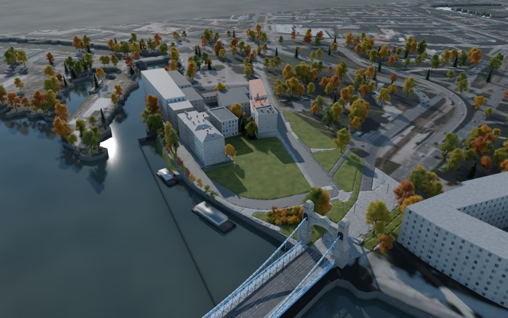
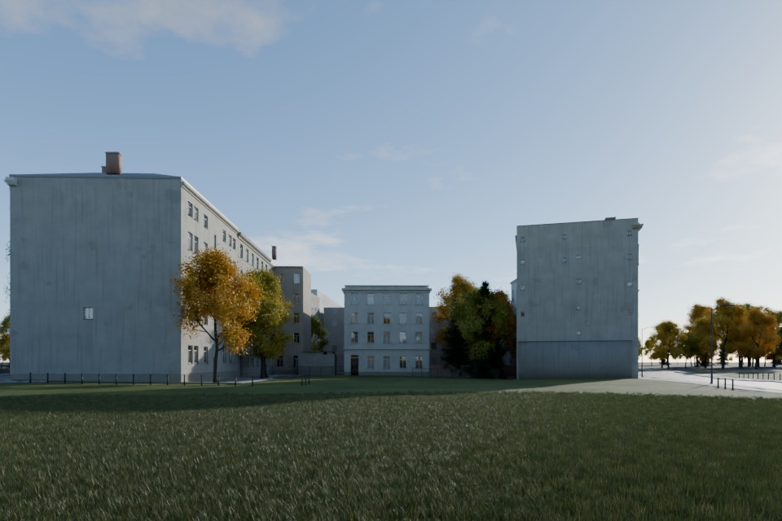
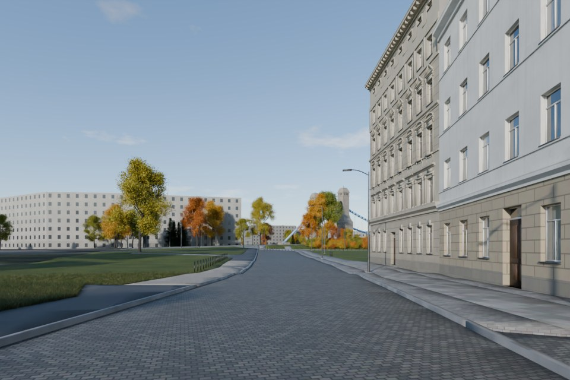

# Kontekst 3D do wizualizacji – scena Blender (Cycles)

**Stan:** 2026-11-17 · **Moduł:** `src/umwd/render/context.py` (+ `drzewa.py`, `trawa.py`, dodatki w `blib.py`) ·
**Silnik:** Blender `bpy` 5.2 LTS, Cycles CPU + OIDN, AgX · **Podgląd:** `docs/60_wizualizacje/img/context_test_*.jpg`

Moduł buduje **otoczenie** projektowanego budynku UMWD (róg Mazowieckiej i Wybrzeża J. Słowackiego, przy Moście
Grunwaldzkim). Sam budynek dokłada inny moduł – wstawia się go jako osobną kolekcję w tym samym układzie
współrzędnych. Domyślnie obszar inwestycji jest pusty (trawnik bez drzew i ogródków), żeby nowa bryła nie kolidowała
z istniejącą zielenią.





## 1. API

```python
import sys; sys.path.insert(0, '/home/user/aihouse/umwd/src')
from umwd.render import blib, context

sc = blib.reset()
wynik = context.build_context(sc, {'pora_roku': 'jesien'})   # → {'kolekcje': {...}, 'info': {...}, 'ctx': Kontekst}
# … dołożenie budynku projektowanego, własne kamery …
cam = blib.camera(sc, (80.5, 74.5, 1.65 + 0.15), (82, 10, 8), lens_mm=22, level=True, shift_y=0.13)
context.ustaw_kamere_trawy(wynik, cam)       # trawa 3D gęstnieje wokół tej kamery (wymagane dla własnych kamer)
```

Uruchamianie (venv z bpy; `-I` – moduł sam dopisuje `src` do `sys.path`):

```
/home/user/aihouse/.venv-render/bin/python -I umwd/src/umwd/render/context.py --podglad [--probki 28]
      [--kamery skwer_pd ...] [--pora lato] [--obszar istniejacy] [--bez-dalszych] [--blend plik.blend] [--out katalog]
```

| Funkcja | Opis |
|---|---|
| `build_context(scene, opts=None)` | buduje kolekcję `KONTEKST` z podkolekcjami (niżej); zwraca słownik `kolekcje`, `info` (czasy etapów, pola nawierzchni, liczby obiektów, rzędne), `ctx` (obiekt `Kontekst`: m.in. `ctx.teren.z(e, n)` – rzędna terenu Z w dowolnym punkcie) |
| `export_preview(out_dir=None, opts=None, kamery=None, samples=28, prefix='context_test_', chmury=True)` | buduje scenę i renderuje kamery z `KAMERY` do JPG ≤ 1 MB; Słońce wg algorytmu NOAA (`umwd.sun`) dla daty z kamery, azymut przeliczony na siatkę (+0,738°) |
| `ustaw_kamere(ctx, scene, nazwa)` | ustawia jedną z kamer `KAMERY` (i strefę trawy 3D) |
| `ustaw_kamere_trawy(wynik, kamera)` | przenosi strefę gęstej trawy 3D do dowolnej kamery |
| `dodaj_chmury(scene, pokrycie=0.42)` | proceduralne cumulusy na niebie fizycznym (spójne z ekspozycją) |
| `klasyfikacja_nawierzchni(ctx)` | pola nawierzchni jako geometrie shapely `{klasa: (Multi)Polygon}` – do ponownego użycia (np. w rysunkach) |

Opcje `opts` (domyślne w `DOMYSLNE`):

| Klucz | Domyślnie | Znaczenie |
|---|---|---|
| `pora_roku` | `'jesien'` | `'jesien'` (barwy liści i trawy jak na zdjęciach z 29.10.2025, opadłe liście na nawierzchniach) lub `'lato'` |
| `obszar_inwestycji` | `'pusty'` | `'pusty'` – w obszarze inwestycji trawnik bez drzew, ogrodzeń i ścieżek; `'istniejacy'` – stan z mapy |
| `helmy` | `True` | pylony mostu z odtworzonymi hełmami (M.11.F); `False` – stan obecny (obniżone pylony) |
| `okna_szczytu_maz19` | `True` | okna w pn. ścianie szczytowej Mazowieckiej 19 (wg M.07 do zamurowania w inwestycji towarzyszącej) |
| `H_woda` | `115.5` | zwierciadło Odry/Oławy [m n.p.m.] |
| `teren, woda, sasiedzi, budynki, most, zielen, ulica, dalsze` | `True` | włączanie składników |
| `ortofoto, dalsze_bryly, dalsze_drzewa` | `True` | składniki dalszego otoczenia |
| `trawa_3d`, `trawa_gestosc`, `trawa_r0`, `trawa_r1` | `True`, 420, 9, 32 | trawa 3D: kępek/m², strefa pełnej gęstości i zanik [m od kamery] |
| `gestosc_lisci`, `seed` | 1.0, 7 | gęstość liści w koronach, ziarno losowania |

Kolekcje: `K_teren`, `K_woda`, `K_sasiedzi`, `K_budynki`, `K_most`, `K_zielen`, `K_ulica`, `K_dalsze`.
Prototypy drzew i kępek trawy są niepodpiętymi kolekcjami/obiektami (instancjonowane).

## 2. Układ współrzędnych i poziomy

* X = e (wschód), Y = n (północ) – układ lokalny `model/site.json`: e = Y₂₀₀₀ − 6 433 500, n = X₂₀₀₀ − 5 664 100 [m].
  Oś n jest obrócona względem północy geograficznej o zbieżność południków γ = −0,738° (`geometria.md` § 2.2) –
  azymut Słońca w scenie = azymut geograficzny + 0,738°.
* **Z = H − 119,25** (H w PL-EVRF2007-NH). Chodnik przed Mazowiecką 19 (118,51) ma Z = −0,74.
* **Zwierciadło wody 115,50 m n.p.m. (Z = −3,75) – założenie.** W danych brak stanu Odry; podstawy: zwierciadło wód
  gruntowych w otworach M.05 (09.2025) 115,07–115,95 m n.p.m. (hydraulicznie związane z rzeką), punkt wysokościowy
  e-mapy przy podnóżu nabrzeża 115,7 (e 109,1; n 109,6), korona nabrzeża ok. 119,3. Wartość do zmiany opcją `H_woda`.

## 3. Teren i nawierzchnie (`K_teren`)

* **NMT:** TIN (interpolacja liniowa) z 791 pikiet terenowych M.02 (bez 9 pikiet wykluczonych w `geometria.md` § 6)
  + punkty wysokościowe e-mapy (bez punktów < 117,5 m – podnóże nabrzeża). Poza zasięgiem TIN: IDW z 6 najbliższych
  punktów, wygaszane do 119,3 m w skali ok. 45 m. Dokładność w ramce ≈ ±0,05–0,1 m (wymagane 0,1 m).
* **Podział nawierzchni:** poligonizacja wszystkich krawędzi e-mapy (BDOT500: krawężniki, krawędzie jezdni
  i chodników, trawniki, schody, mury; pomiar NMT: krawężniki, jezdnie, chodniki, obszary utwardzone) z automatycznym
  domknięciem wiszących końców linii (przedłużenie do najbliższego przecięcia ≤ 4 m, przy ramce ≤ 12 m). Pola
  sklasyfikowano wg opisów nawierzchni e-mapy (`j.kb.` → kostka granitowa, `j.mb.` → asfalt, `ch.bt.` → płyty
  betonowe 50×50, `ch.kb.` → kostka betonowa, `ch.mb.` → asfalt, `ch.zw.` → żwir), obrysów trawników, schodów
  i placu zabaw; pola bez opisu: wąskie pasy → chodnik, pozostałe → teren trawiasty; kilka korekt ręcznych
  (`_KOREKTY`, weryfikacja na ortofotomapie M.11.A 03). Pola nawierzchni [m²] zapisuje `info['nawierzchnie_m2']`.
  Uwaga: jezdnie Mazowieckiej i Wybrzeża Słowackiego to wg e-mapy **kostka** (`j.kb.`), co potwierdzają zdjęcia.
* Każda klasa to siatka drapowana na NMT (triangulacja z ograniczeniami, komórki 1,5 m) z przesunięciem: jezdnia
  −0,05 m, chodniki +0,06 m, trawniki +0,03 m, schody +0,10 m, oraz „fartuchem” 0,25 m w dół (bez szczelin).
* **Krawężniki granitowe:** bufor 0,15 m wzdłuż linii krawężników (BDOT500 + pomiar), wyciągnięty do Z terenu
  + 0,085 m ⇒ **odkrycie 13,5 cm nad jezdnią**, 2,5 cm nad chodnikiem.
* **Trawa 3D** (`trawa.py`): modyfikator Geometry Nodes na siatkach trawników – kępki po 12–14 zakrzywionych źdźbeł
  (trawnik strzyżony 6–12 cm, teren otwarty 10–28 cm), gęstość 420 kępek/m² do 9 m od kamery, liniowo do zera
  w 32 m; dalej tekstura proceduralna (3 skale zmienności barwy, prześwity ziemi, jesienią opadłe liście).
* Mur ceglany między podwórzem Mazowieckiej 19 a działką (GSSDSO, wys. ok. 2 m wg pikiet koron muru).

## 4. Woda i nabrzeże (`K_woda`)

* Płaszczyzna wody (2,3 × 1,8 km) na Z = −3,75: materiał z dwuskalowym szumem fal (wydłużonych wzdłuż nurtu),
  niska szorstkość (odbicia nieba, mostu i nabrzeży), barwa mętnej Odry ze zdjęć; perspektywa powietrzna z odległością.
* Linia brzegu: GSSWWP (nabrzeże Odry, potem Oławy) + linia wody u podnóża skarpy nad Oławą (GSSZSN, odsunięta o ok.
  3 m – założenie). Mur nabrzeża z kamienia łamanego (od dna do korony = teren), z pasem zawilgocenia przy wodzie;
  parapet kamienny 0,62 m (obrys GSSDSO) z balustradą stalową (słupki co 2 m, pochwyt, przeciąg). Skarpa nad Oławą
  jako siatka pochyła od górnej krawędzi do wody.
* Dwie barki przy nabrzeżu (restauracja ok. e 131, n 81; pawilon z PV ok. e 145, n 27) – uproszczone, położenie
  z ortofotomapy M.11.A.

## 5. Budynki sąsiednie

### 5.1 Mazowiecka 19 – LOD3 (`kamienica_maz19`)

Źródło: inwentaryzacja M.07 (03.2021), rysunki odczytane z renderu PDF 200 dpi (pomiar pikselowy, skala wg długości
elewacji z obrysu EGiB 18,54 m):

* **elewacja frontowa (s. 12):** 8 osi okien pięter (osie u = 1,71; 3,74; 5,92; 8,05; 10,26; 12,51; 14,47; 16,31 m
  od narożnika pn., skalowane do obrysu), parter: 7 okien + drzwi wejściowe 1,42 × 3,12 m w osi 8,15 m; okna
  [m nad chodnikiem]: parter 1,48–3,57 (szer. 1,02), I p. 5,20–7,05 (1,06), II p. 8,80–10,85 (1,08),
  III p. 12,47–14,22 (1,04), IV p. 15,94–17,43 (0,94), okienka fryzu attykowego 19,50–19,92 (0,76);
* **dekoracja** (wg rysunku s. 12, `docs/30_lokalizacja/img/mazowiecka19_elewacja_fragment.jpg`): parter boniowany
  pasowo z opaskami i zwornikami, gzyms nad parterem (wysięg 0,28 m), I p. – okna między pilastrami z bazą
  i kapitelem, architraw, płycina fryzu, gzyms nadokienny, tralki pod oknami; II p. – opaski, parapety na konsolkach,
  **naczółki odcinkowe** (gzyms na konsolkach, listwa łukowa, tympanon); III p. – **naczółki trójkątne**; boniowanie
  pasowe II–III p.; IV p. – opaski i lizeny; belkowanie, fryz attykowy z płycinami i okienkami, **gzyms koronujący
  na konsolkach** (co 0,62 m), murek attykowy z obróbką blacharską;
* **rzędne:** ±0,00 parteru = chodnik + 0,73 (przekrój A-A s. 10); chodnik 118,51 (pikiety); **korona attyki
  140,25 m n.p.m.** (site.json; odczyt graficzny ±0,3 m); dach płaski (papa) za murkiem, 5 kominów murowanych;
* **ściana szczytowa pn. (s. 13):** okna 0,55 × 0,64 m w 3 pionach (4 + 2 + 4) + okienka klatki schodowej –
  wg M.07 przeznaczone do zamurowania (opcja `okna_szczytu_maz19`); pozostałość muru dawnej zabudowy do 5,3 m;
  tynk z łatami napraw;
* **elewacja tylna (s. 14):** 4 piony okien + pion klatki schodowej z drzwiami na podwórze;
* barwa tynku szarobeżowa, zabrudzona (zdjęcie F.17.B): `#b1a998`; cokół kamienny.

### 5.2 Wybrzeże J. Słowackiego 5 – LOD3 (`kamienica_ws5`)

Źródło: M.08 (2001) – rzuty 1:100 (skany; parter, I p.), strona tytułowa; zdjęcie F.17.A (wycinek z pliku
organizatora w pełnej rozdzielczości):

* front (wsch.) – **7 osi** (rozstaw ok. 2,4 m), wejście w osi pn. (zdjęcie), parter boniowany (`#aaa595`), piętra
  jasnoszare (`#cfcfc9`), pilastry między osiami, opaski, nadokienniki: I p. gzyms prosty, II p. naczółki odcinkowe,
  III p. trójkątne (zdjęcie), gzyms koronujący, dach dwuspadowy/kopertowy kryty blachą (zdjęcie);
* wysokości kondygnacji z rzutów: parter H 3,75 m, I p. H 3,85 m (wysokości w świetle); piętra wyższe przyjęte
  3,5 m; gzyms ok. 19,3 m nad chodnikiem – **szacunek** (brak przekroju w M.08);
* tył (zach.) – 6 osi okien + okna klatki schodowej w połowie kondygnacji (rzut I p.);
* **ściana szczytowa pn.:** okno lokalu na I p. 0,90 × 1,14 m (M.08: nie do zamurowania – należy je uwzględnić),
  położenie w osi pokoju wg rzutu (±0,3 m); tynk z łatami.

### 5.3 Pozostałe budynki w ramce mapy – LOD2+ (`budynek_lod2`)

Bryła z obrysu EGiB (uproszczenie 0,35 m), siatka okien wciętych z ramą i szybą (ściany frontowe ulic – rozstaw
2,75 m, pozostałe 3,0 m), gzyms pod dachem, gzymsy międzykondygnacyjne na frontach, brama/wejście, ściany wspólne
i przecięte ramką – bez okien. Parametry (`_LOD2`): Wybrzeże Słowackiego 6, 7, 8 – 5 kond., gzyms 19,6 m, dach
kopertowy blaszany; nr 9 (b4) – 4 kond., gzyms 15,0 m, dach płaski; **Mazowiecka 17** (szkoła, k5) – gzyms 16,8 m,
wysoki dach z dachówki z lukarnami, boniowany cokół z piaskowca do 4,6 m (zdjęcie F.17.B); budynki i1/t1 –
parterowe. Wysokości – szacunek z liczby kondygnacji i zdjęć (do weryfikacji).

### 5.4 Dalsze otoczenie (`K_dalsze`)

* **Ortofotomapa M.11.A (01 B, 2405 × 1679 px) jako teren** w promieniu ok. 1 km: georeferencja automatyczna –
  dopasowanie (skala, obrót, przesunięcie) linii działek GESDZI z `site.json` do niebieskich linii ewidencyjnych
  na obrazie (minimalizacja odległości w transformacie odległości): **0,847 m/px, obrót −0,78°, mediana odchyłki
  0,0 px, p90 0,1 px**. Linie ewidencyjne usunięte z tekstury (wypełnienie sąsiednimi pikselami); jesienią korekta
  barwy. Wynik w `build/kontekst_cache/` (generowany przy pierwszym uruchomieniu).
* Maska wody (ciemne, mało nasycone duże obszary) → linia brzegu Odry i Oławy poza ramką, z murem/skarpą do wody.
* Maska koron drzew (indeks zieleni + tekstura) → ok. 700 instancji drzew poza ramką (co ok. 7,5 m, r ≤ 430 m).
* 31 prostych brył (`BRYLY_DALSZE`): obrysy digitalizowane z georeferencjonowanej ortofotomapy (±2–3 m),
  wysokości z liczby kondygnacji na zdjęciach F.17/M.09/M.10 i modelu SIP M.11.C – m.in. **gmach DUW** (pierzeja
  łukowa nad Odrą, 24 m), Muzeum Narodowe, kwartał na pd. od działki (Mazowiecka 17 cd., Wybrzeże Słowackiego 10–14),
  zabudowa pn. i wsch. brzegu (pl. Grunwaldzki, Wybrzeże Wyspiańskiego). Materiał: tynk + proceduralna siatka okien
  z ciemniejszym parterem; perspektywa powietrzna.
* Poza ortofotomapą – płaski teren do horyzontu z mgłą.

## 6. Most Grunwaldzki (`K_most`)

* **Położenie:** oś mostu – azymut siatki 70,4° (kierunek osi torów tramwajowych GSLTTK, `site.json`); środek
  między wewnętrznymi licami pylonów portalu pd. w (93,90; 136,58) – środek symetrii bloków kotwiących GSSIPD
  e-mapy; rozstaw osi pylonów 126,6 m (literatura, `historia.md`). Kontrola: ortofotomapa M.11.A 03 (pylony i cień
  portalu), zdjęcia M.09 (360°), F.17.A.
* **Pylony wg przekroju D-D M.11.F** (skala z szerokości 16,50 m między licami pylonów = 2,20 + 12,10 + 2,20 m;
  ok. 28,3 px/m), wysokości nad chodnikiem mostu (Z = 2,50 ≈ 121,75 m n.p.m., pkt e-mapy 121,66–121,77):
  cokół 5,72 × 5,2 m do 3,6 m; trzon 5,5 m do 9,8 m; wklęsłe przejście do 3,57 m szer. na 14,2 m; wieża do 21,3 m;
  gzyms, latarnia z prześwitami 21,6–22,9 m, gzyms 23,5 m; **hełm** – ostrosłup ścięty w 3 uskokach do 25,2 m,
  daszek do 25,55 m, iglica do ok. 26,2 m (zgodne z pierwotną wysokością 25,54 m). Nisza z siodłem łańcucha
  (łuk, 14,9–19,3 m), płycina płaskorzeźby (orzeł) 4,2–8,6 m, latarnie na wysięgnikach (8,9 m).
* **Portal:** łuk odcinkowy (wezgłowia 8,9 m, klucz 15,9 m), archiwolta, belka do 19,5 m z gzymsem, tablica
  z napisem (16,0–17,5 m), naczółek do 21,3 m z cokołem rzeźby; okładzina granitowa w kwadrach 1,05 × 0,52 m
  (barwa beżowoszara ze zdjęć).
* **Pomost** (uproszczenie): jezdnia z torowiskiem 12,10 m (asfalt + 4 szyny), chodniki 2 × 2,20 m, wsporniki,
  dźwigary blachownicowe; kratownice usztywniające (pas górny +2,3 m, krzyżulce co 4,85 m); **łańcuchy** (siodło
  19,6 m, parabola do 0,55 m nad pasem górnym w połowie przęsła), wieszaki, odciągi do bloków kotwiących
  (19 m za osią pylonu); kolor jasnoniebieski (zdjęcia). Portal pn. – kopia portalu pd. obrócona o 180°.

## 7. Zieleń (`K_zielen`, `drzewa.py`)

* **Drzewa istniejące:** 52 numerowane drzewa z pomiaru M.02 (numery z dwoma punktami – jedno drzewo w środku)
  + 21 drzew z e-mapy (E01–E21). W trybie `obszar_inwestycji='pusty'` pomija się 46 drzew w obszarze inwestycji.
  Typ: iglaste → świerk (ok. 14 m); liściaste → duże (19 m) / średnie (13 m) deterministycznie wg numeru (crc32),
  E07, E12 → topole włoskie (24 m, jak przy Wybrzeżu na zdjęciach). Gatunki i wymiary koron z operatu M.06
  **nie zostały sparowane** (inna numeracja) – wysokości typowe.
* **Generator drzew:** pień z odziomkiem, konary rozmieszczone spiralnie (kąt złoty) i ograniczone obwiednią korony
  (owal / kolumna / jajo / stożek / półkula), 2 rzędy odgałęzień, liście – 9–52 tys. czworokątów na drzewo
  w skupieniach przy końcach gałązek; materiał liści z translucencją, losowość barwy na liść i na drzewo;
  jesień – zielonożółte → żółte → pomarańczowe → rdzawe; lato – odcienie zieleni.
* **Szpaler** młodych drzew (7 m) wzdłuż bulwaru Wybrzeża Słowackiego od strony rzeki, co 8 m (założenie wg zdjęć
  F.17.A i ortofotomapy).
* **Krzewy** w obrysach zakrzewień z pomiaru (co ok. 2,2 m, 22% luk, pojedyncze młode drzewa).

## 8. Ulica (`K_ulica`)

* **Latarnie** w punktach GUPELA (e-mapa) i z pomiaru NMT (bez duplikatów, bez punktów w jezdni i przy pylonach):
  słup stalowy stożkowy 8 m na fundamencie, cokół z drzwiczkami, wysięgnik łukowy 1,5 m ku jezdni, płaska oprawa;
  typ oprawy – założenie (typowy wrocławski).
* **Słupki** stalowe co 1,4 m wzdłuż linii słupków z pomiaru; **ogrodzenia** (siatka na słupkach 1,5 m) wg pomiaru.
* **Tory tramwajowe:** szyny (rozstaw 1435 mm) wzdłuż osi GSLTTK, przewód jezdny 5,6 m, słupy trakcyjne
  z wysięgnikami co ok. 32 m (rozmieszczenie słupów – założenie).
* **Oznakowanie poziome:** przejście dla pieszych przez Mazowiecką przy skwerze (położenie ze zdjęcia M.09 360°).

## 9. Kamery testowe i czasy renderu

| Kamera | Położenie (e, n, h) | Cel | Ogniskowa | Godzina (29.10) | Czas renderu* |
|---|---|---|---|---|---|
| `lot_ptaka_pnwsch` | (185, 245, Z 135) | (82, 35, 0) | 26 mm | 11:40 (jak F.17.A) | CZAS_PTAK |
| `skwer_pd` | (80,5; 74,5; 1,65 m nad terenem) | ku pd. (82, 10) | 22 mm, poziomowana | 14:00 | CZAS_SKWER |
| `mazowiecka_pn` | (27,5; −31; 1,65 m) | ku pn. wzdłuż pierzei | 24 mm, poziomowana | 14:00 | CZAS_MAZ |

\* CPU 4 rdzenie, 1000 × 625 / 960 × 640 px, 28 próbek (adaptacyjnie), OIDN; budowa sceny CZAS_BUDOWA s
(pierwsze uruchomienie dodatkowo ok. 15 s – przygotowanie ortofotomapy do cache). Pliki JPG ≤ 1 MB.
Kamery „poziomowane” zachowują piony (perspektywa dwupunktowa, kadrowanie przesunięciem obiektywu).

## 10. Ograniczenia i braki

1. **Brak samochodów, ludzi, tramwajów, znaków pionowych, koszy, wiat** – do dodania w postprodukcji lub osobnym
   modułem (na zdjęciach Wybrzeże Słowackiego i Mazowiecka są gęsto zaparkowane).
2. **Murale/reklamy** na ścianach szczytowych Mazowieckiej 19 i Wybrzeża Słowackiego 5 (widoczne na zdjęciach
   360° M.09) nie są modelowane – są zmienne; ściany szczytowe mają tynk z łatami.
3. Wybrzeże Słowackiego 5: wysokości pięter powyżej I p. i gzymsu – szacunek (M.08 nie zawiera elewacji ani
   przekroju); detal nadokienny wg zdjęcia lotniczego (rozdzielczość ok. 2–3 cm/px). Mazowiecka 19: brak balkonów,
   rynien, anten, krat; okna bez podziału na skrzydła szczegółowego.
4. Pozostałe budynki w ramce – LOD2+ z wysokościami szacunkowymi; dalsze otoczenie – bryły proste
   (±2–3 m w planie, wysokości szacunkowe), bez dachów spadzistych.
5. Most: brak ornamentów (płaskorzeźby orła, napisu, rzeźb na naczółku, balustrad z detalem), latarń mostowych,
   konstrukcji pomostu w szczegółach; pomost bez niwelety projektowej (łuk 1 m – założenie).
6. Zwierciadło wody 115,5 m n.p.m. – założenie (rozdz. 2); linia wody przy skarpie Oławy – przybliżenie.
7. Drzewa – typowe sylwetki, bez gatunków i wymiarów z operatu M.06; ortofotomapa ma barwy letnie (korekta barwy
   jesienią jest przybliżona).
8. Trawa 3D zależy od kamery – dla własnych kamer trzeba wywołać `ustaw_kamere_trawy()`; w widokach z lotu ptaka
   jest wyłączana automatycznie (odległość > 32 m).
9. Materiały proceduralne (bez tekstur zdjęciowych); tynk ze zabrudzeniami, ale bez lokalnych zacieków pod
   detalami. Cień nabrzeża na wodzie (ostra krawędź przy Słońcu z pd.) jest fizycznie poprawny.
10. Położenie słupów trakcyjnych, latarń (typ), szpaleru i barek – przybliżone/założone.

## 11. Pliki

| Plik | Zawartość |
|---|---|
| `src/umwd/render/context.py` | budowa kontekstu, materiały, kamery, eksport podglądu, CLI |
| `src/umwd/render/drzewa.py` | generator drzew (prototypy do instancjonowania), materiały kory i liści |
| `src/umwd/render/trawa.py` | kępki trawy i drzewo Geometry Nodes (gęstość zależna od kamery) |
| `src/umwd/render/blib.py` | dodane: `mesh_from_arrays` (szybkie siatki z tablic, atrybuty), `NodeBuilder` (budowa węzłów) – istniejące funkcje bez zmian |
| `build/kontekst_cache/` | ortofotomapa bez linii ewidencyjnych, maski wody i drzew (generowane) |
| `docs/60_wizualizacje/img/context_test_*.jpg` | rendery testowe |
