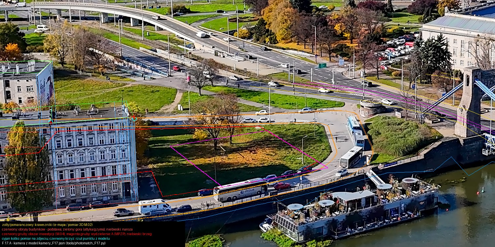
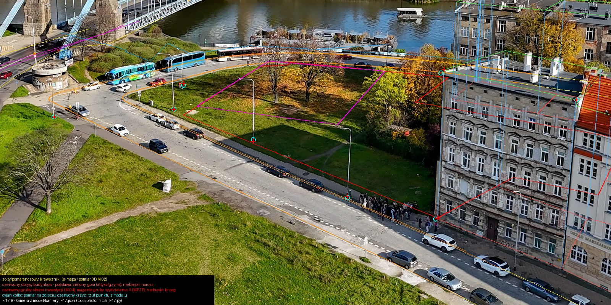
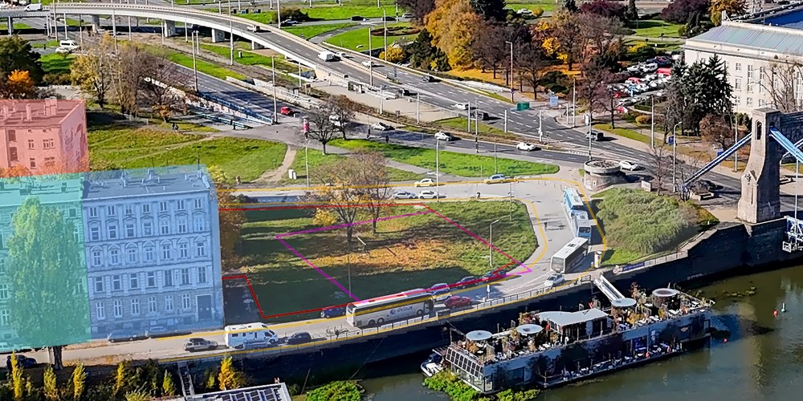
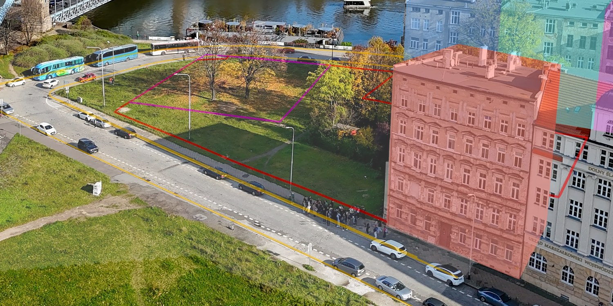

# Photomatch zdjęć F.17.A i F.17.B – kamery do wizualizacji z lotu ptaka

**Stan:** 2026-11-16 · **Generator:** `tools/photomatch_F17.py` (Python z bpy 5.2: `/home/user/aihouse/.venv-render/bin/python -I`) · **Wynik:** `model/kamery_F17.json` + obrazy kontrolne w `docs/60_wizualizacje/img/photomatch_F17*.jpg`
**Dane wyjściowe metadanych:** `photomatch_F17_metadane.md`, `../10_regulamin/zdjecia_F17_metadane.md`.

## 1. Wynik w skrócie

| | **F.17.A** (od wschodu) | **F.17.B** (od zachodu) |
|---|---|---|
| Plik organizatora | 8470 × 4475 px | 7962 × 4505 px |
| Kadr z panoramy | F = 2,49999·M + (−660,02; −1380,05) | F = 2,50016·M + (−570,00; −1455,29) |
| Położenie kamery e; n [m] (lokalny) | 356,82; 20,46 (±4,4; ±0,8) | −42,84; −26,44 (±1,1; ±1,0) |
| PL-2000/6 Y; X | 6 433 856,82; 5 664 120,46 | 6 433 457,16; 5 664 073,57 |
| Wysokość H [m n.p.m., PL-EVRF2007-NH] | **203,92** (±0,8) | **166,19** (±0,4) |
| z w Blenderze (H − 119,25) | 84,672 | 46,943 |
| yaw (azymut siatki osi) / pitch / roll | 287,808° / −12,053° / −0,652° | 56,523° / −12,103° / −0,026° |
| Ogniskowa | 1623,3 px M.10 = **4058,1 px F.17** (±1,5 %) | 1550,2 px M.10 = **3875,8 px F.17** (±1,4 %) |
| Punkt główny w pliku F.17 | (4339,96; 2139,94) | (4430,32; 2064,94) |
| HFOV pliku F.17 / całej panoramy | 92,4° / 101,9° | 91,5° / 104,4° |
| **Blender**: lens (sensor 36 mm, HORIZONTAL) | **17,2482 mm** | **17,5241 mm** |
| **Blender**: shift_x / shift_y | **−0,012392 / −0,011519** | **−0,056433 / −0,023557** |
| **Blender**: rotation_euler XYZ | (77,9461°; −0,6381°; 72,3282°) | (77,8969°; −0,0250°; −56,5178°) |
| **Blender**: location (z = H − 119,25) | (356,815; 20,455; 84,672) | (−42,839; −26,435; 46,943) |
| RMS punkty ręczne / linie | 6,3 px / 3,3 px | 7,4 px / 6,8 px |
| RMS punkty wiążące (57 szt.) | 2,7 px | – |
| Walidacja krzyżowa (leave-one-out, punkty ręczne) | 7,5 px | 9,9 px |
| Próg zadania (0,3 % szerokości kadru) | 25,4 px | 23,9 px |
| Blender `world_to_camera_view` vs model | maks. 0,006 px | maks. 0,016 px |

Pełne parametry (macierze obrotu, odchylenia standardowe, lista obserwacji z residuami) zapisano w `model/kamery_F17.json`.

**Kontrola niezależna od obserwacji obrazowych.** Różnica wysokości kamer A − B wynosi 37,73 m. Według EXIF (RelativeAltitude 87,8 i 50,7 m) różnica to 37,1 m. Daje to wysokość startu drona 116,1 m (A) i 115,5 m (B) n.p.m., czyli poziom bulwaru nad Odrą. Wartość „absolutna” DJI (GpsFusionAlt) jest w obu zdjęciach zawyżona o tyle samo: 15,8 i 16,5 m. Położenie poziome różni się od GPS z EXIF o (0,4; −3,7) m (A) i (1,7; 0,6) m (B). Kierunek osi (azymut geograficzny = azymut siatki + zbieżność −0,74°) to 287,1° (A) i 55,8° (B). Jest zgodny z FlightYaw z XMP (286,0° i 54,4°, różnica ok. 1–1,4°), a nie z GimbalYaw (różnica ok. 16°). Potwierdza to ustalenie z `zdjecia_F17_metadane.md` §4.

## 2. Relacja F.17 ↔ M.10 i model kamery

**Pliki źródłowe:**
- F.17.A ← `M.10/DJI_20251029113800_0009_D.jpg`;
- F.17.B ← `M.10/DJI_20251029115736_0025_D.jpg`, znalezione po EXIF DateTimeOriginal 2025:10:29 11:57:36.

Obie klatki M.10 mają 4000 × 2816 px. Nie są to pojedyncze klatki sensora (Air 3: 8064 × 6048, 4:3). Są to panoramy szerokokątne zszyte w dronie (8000 × 5632 px), zmniejszone ×0,5. Inne klatki M.10 mają format sensora 2016 × 1512 (4:3), np. DJI_…121250_0036.

**Transformacja kadru.** Wyznaczono ją korelacją fazową 77 łatek 160 × 160 px rozłożonych na całym kadrze F.17 (siatka 11 × 7). Najpierw wykonano zgrubne dopasowanie całego obrazu zmniejszonego ÷2,5, potem 4 iteracje subpikselowe. Wyniki:

| | A | B |
|---|---|---|
| Skala | 2,49999 | 2,50016 |
| Obrót | 0,0002° | 0,0000° |
| Przesunięcie (współrzędne ciągłe) | (−660,02; −1380,05) | (−570,00; −1455,29) |
| RMS | 0,04 px F (73 łatki) | 0,06 px F (77 łatek) |
| Model afiniczny | anizotropii brak | sx = 2,50019, sy = 2,50008, czyli < 0,5 px na szerokość kadru |

Wnioski:
- F.17 to czysty kadr panoramy powiększonej ×1,25. Nie ma warpu ani korekcji perspektywy. Potwierdza to ustalenia innego agenta, a przesunięcia są teraz dokładniejsze (±0,05 px).
- Okno F.17 w panoramie 8000 × 5632: A x 528–7304, y 1104–4684; B x 456–6825, y 1164–4768.

**Model.** Przyjęto kamerę otworkową (prostoliniową) z punktem głównym w środku panoramy, czyli (2000; 1408) px M.10. W pliku F.17 punkt główny leży poza środkiem kadru. Stąd shift_x i shift_y w Blenderze.

**Niewiadome:** położenie (e, n, H), yaw, pitch, roll i ogniskowa f. Ogniskowej z EXIF (24 mm ekw., czyli ≈ 2470 px dla pojedynczej klatki 4000 px) nie da się użyć, bo obraz jest panoramą. Wyznaczona ogniskowa odpowiada ekwiwalentowi ok. 14–14,6 mm na szerokość panoramy.

**Sprawdzone warianty modelu (test na B):**
- Dystorsja radialna k1 dała 0,04 ± 0,02. Nieistotna, pogarszała walidację, więc k1 = 0.
- Wolny punkt główny dał (2066 ± 37; 1369 ± 50). Nieistotnie różny od środka, więc pozostawiono środek.

**Ogniskowe A i B.** Różnią się o 4,7 % (1623 ± 24 i 1550 ± 22 px M.10), czyli o ok. 2σ. Dopuszczono różne f, bo panoramy mogą mieć różny zasięg kątowy. Wspólna f pogarsza dopasowanie obu zdjęć.

## 3. Obserwacje

**Rodzaje obserwacji:**
- **pt:** punkt 3D ↔ piksel F.17;
- **line:** linia 3D (krawędź pionowa budynku lub krawężnik pomiarowy 3D z M.02) ↔ punkty leżące na jej obrazie. Residuum to odległość prostopadła, więc nie trzeba znać miejsca na linii;
- **hor:** dalekie linie horyzontu (las/teren w odległości 10–30 km), elewacja pozorna −0,17° (B) i −0,30° (A). Wiążą pitch i roll na całej szerokości kadru;
- **wiązania GPS:** słabe wiązanie położenia poziomego do GPS z EXIF, σ = 10 m.

Wyrównanie: `scipy.optimize.least_squares` z funkcją straty soft_l1. Obserwacje z |r|/σ > 3,5 są odrzucane automatycznie, a dwie niepewne oznaczono ręcznie jako kontrolne.

**Źródła 3D:**
- położenia: mapa M.02 (`model/site.json`): latarnie z pomiaru NMT i GESUT, narożniki obrysów EGiB, krawężniki pomiarowe 3D (`krawezniki_pomiar_NMT`), granice M.04;
- wysokości: NMT z pikiet M.02 (siatka 1 m);
- dane spoza M.02 (krawędzie dachów WS5/WS6, teren poza zasięgiem NMT, maski zasłonięć): NMPT GUGiK 0,5 m (PL-EVRF2007-NH, usługa WCS Geoportalu, dane publiczne). Kontrola: NMPT − pikiety M.02 = +0,10 m (mediana).

**Punkty wiążące A (57 szt.).** Na F.17.A jest mało ostrych, jednoznacznych szczegółów naziemnych: odległość 240–330 m, latarnie zasłonięte drzewami. Dlatego dodano punkty z korelacji ortofotoplanów. Procedura:
1. Oba zdjęcia zrzutowano na NMT jako ortofotoplany 0,1 m (e 25–136, n −12–110), A z kamery wstępnej, B z kamery wyrównanej.
2. Zasłonięcia (budynki, drzewa) i obiekty nad terenem zamaskowano na podstawie NMPT.
3. Łatki 6,1 × 6,1 m obrazu po filtrze górnoprzepustowym dopasowano korelacją NCC (krok 2 m, zakres ±2,5 m). Przyjęto NCC ≥ 0,45 i przewagę ≥ 0,08 nad drugim maksimum.
4. Każdy punkt wiąże teren widziany w B (3D na NMT) z pikselem A.
5. Wykonano dwie iteracje. Druga dała 57 dopasowań: ul. Mazowiecka, skwer i trawnik terenu inwestycji.

Punkty wiążące przenoszą do A błąd kamery B (w terenie inwestycji ok. 0,2–0,4 m). Użyto σ = 8 px. Opcja `--wiazace` skryptu odtwarza procedurę (pobiera NMPT).

Kontrola powtarzalności: przeliczenie od zera (`--wiazace`, z kamery startowej A) dało znowu 57 punktów i kamerę A różną od zapisanej o 1,9 m wzdłuż osi widzenia (e) i 0,6 m w wysokości. Te różnice kompensują się wzajemnie. Rzuty punktów w obszarze inwestycji (od terenu do +26 m) różnią się o 2,6 px (mediana), a najwyżej o 6,4 px.

### 3.1. Punkty i linie ręczne (residua po wyrównaniu, px pliku F.17)

#### F.17.A

| id | typ | 3D (e; n; H) | pomiar na F.17 [px] | σ [px] | residuum [px] | użyty | źródło |
|---|---|---|---|---|---|---|---|
| WS5_naroze_NE_dach | pt | (118,60; 29,40; 140,20) | (3243, 2380) | 6 | 8,0 (dx −3,8; dy −7,1) | tak | narożnik krawędzi dachu Wybrzeże Słowackiego 5; e, n, H z NMPT (krawędź gzymsu) |
| WS5_naroze_NE_pion | line | (118,20; 29,30; 119,2) → (…; 140,0) | (3243, 2450); (3245, 2650) | 4 | RMS 4,0 | tak | krawędź pionowa narożnika NE (obrys EGiB) |
| WS5_naroze_SE_dach | pt | (118,90; 10,90; 140,20) | (2905, 2393) | 8 | 4,0 (dx −0,1; dy 4,0) | tak | styk dachów WS5/WS6 nad elewacją; NMPT |
| kraweznik_Mazowiecka_wsch | line | krawężnik pomiarowy 3D nr 1 | (3750, 2402); (3950, 2400) | 4 | RMS 2,2 | tak | krawężnik wsch. ul. Mazowieckiej (granica trawnika), M.02 model terenu |
| horyzont | hor | – | M.10: (400, 1061); (1500, 1066); (2500, 1078); (3600, 1076) | 15 | RMS 14,7 | tak | daleki horyzont, elewacja −0,30° |
| 57 punktów wiążących | pt | ul. Mazowiecka i skwer, e 30–87, n 38–101 | – | 8 | RMS 2,7 | tak | korelacja ortofotoplanów A/B (lista: `TIES_A` w skrypcie, residua w JSON) |

#### F.17.B

| id | typ | 3D (e; n; H) | pomiar na F.17 [px] | σ [px] | residuum [px] | użyty | źródło |
|---|---|---|---|---|---|---|---|
| latarnia_63.3_72.5 | pt | (63,30; 72,55; 119,36) | (3810, 2472) | 4 | 1,8 | tak | podstawa słupa; M.02 latarnie (pomiar), H z NMT |
| latarnia_58.2_48.8 | pt | (58,15; 48,77; 119,04) | (4226, 2632) | 4 | 9,1 | tak | jw. |
| latarnia_48.2_23.8 | pt | (48,18; 23,84; 118,60) | (4721, 2936) | 6 | 8,1 | tak | jw., podstawa częściowo zasłonięta |
| latarnia_78.6_83.5 | pt | (78,59; 83,52; 119,34) | (3860, 2347) | 5 | 9,0 | tak | e-mapa GUPELA (GESUT), H z NMT |
| latarnia_46.0_87.7 | pt | (45,98; 87,68; 119,79) | (3183, 2512) | 5 | 1,8 | tak | jw. |
| latarnia_27.1_87.1 | pt | (27,08; 87,13; 120,02) | (2733, 2657) | 5 | 7,6 | tak | jw. |
| latarnia_61.8_135.0 | pt | (61,80; 134,97; 121,22) | (2791, 2222) | 6 | 8,4 | tak | GUPELA, H z NMPT (poza NMT) |
| Maz19_naroze_NW_pion | line | (48,84; 9,68; 118,66) → (…; 140,0) | (5198, 2650); (5183, 2950) | 5 | RMS 10,6 | tak | krawędź pionowa narożnika obrysu EGiB |
| Maz19_naroze_SW_pion | line | (44,64; −8,38; 118,48) → (…; 140,0) | (5880, 2900); (5850, 3280) | 5 | RMS 4,4 | tak | styk z Mazowiecką 17, obrys EGiB |
| Maz19_attyka_SW | pt | (44,64; −8,38; 140,25) | (5920, 2422) | 6 | 3,2 | tak | narożnik attyki, H = 140,25 (M.07) |
| Maz19_podstawa_NW | pt | (48,84; 9,68; 118,66) | (5181, 3048) | 5 | 10,9 | tak | styk narożnika z chodnikiem, H z NMT |
| Maz17_UMWD_lico_podstawa | line | (44,64; −8,38; 118,48) → (38,82; −24,36; 118,45) | (6050, 3405); (6590, 3663) | 6 | RMS 5,7 | tak | styk elewacji Mazowiecka 17 z chodnikiem |
| kraweznik_wewn_Mazowiecka | line | krawężnik pomiarowy 3D nr 1 | (4100, 2684); (4700, 2950) | 5 | RMS 4,7 | tak | krawężnik wsch. ul. Mazowieckiej, M.02 |
| horyzont | hor | – | M.10: (400, 1068); (1500, 1072); (2500, 1080); (3600, 1081) | 15 | RMS 15,1 | tak | daleki horyzont, elewacja −0,17° |
| Maz19_attyka_NW | pt | (48,84; 9,68; 140,25) | (5208, 2283) | 6 | 24,3 | **nie** (kontrola) | identyfikacja niejednoznaczna: czapa muru szczytowego i drzewa |
| UW_naroze_E_gzyms | pt | (48,8; 178,8; 136,8) | (1950, 1866) | 15 | 47,2 | **nie** (kontrola) | Urząd Wojewódzki, narożnik gzymsu wg NMPT, współrzędne niepewne |

Leave-one-out (punkt usunięty z wyrównania i przewidziany przez pozostałe), px:
- **B:** 2,4–15,1, RMS 9,9;
- **A:** 2,5–12,2, RMS 7,5.

Największe błędy mają obiekty o niepewnej geometrii względem obrysu EGiB: narożnik NW Maz19 (pilaster lub gzyms) i lico Maz17. Punkty naziemne (latarnie, krawężniki) mieszczą się w 2–12 px.

## 4. Kamera w Blenderze (bpy 5.2)

Scena w układzie lokalnym: X = e, Y = n, Z = H − 119,25, czyli ±0,00 = 119,25 m n.p.m. Wariant z Z = H bezwzględnym (`location_H_bezwzgl`) różni się tylko location.z.

```python
import bpy, math
cam = bpy.data.objects['Camera']; cd = cam.data           # F.17.A (dla B wartości z tabeli §1)
cd.type = 'PERSP'; cd.sensor_fit = 'HORIZONTAL'; cd.sensor_width = 36.0
cd.lens = 17.2482; cd.shift_x = -0.012392; cd.shift_y = -0.011519
cd.clip_start = 1.0; cd.clip_end = 5000.0
cam.location = (356.815, 20.455, 84.672)
cam.rotation_mode = 'XYZ'; cam.rotation_euler = (1.360416, -0.011136, 1.262366)   # rad
sc = bpy.context.scene
sc.render.resolution_x, sc.render.resolution_y = 8470, 4475   # B: 7962 x 4505
sc.render.pixel_aspect_x = sc.render.pixel_aspect_y = 1.0
sc.render.resolution_percentage = 100   # 50 / 25 do próbnych - lens i shift bez zmian
```

**Kamera B:**
- rotation_euler (rad): (1,359558; −0,000436; −0,986422);
- location: (−42,839; −26,435; 46,943);
- lens: 17,5241;
- shift: (−0,056433; −0,023557).

**Słońce w scenie:**
- A: azymut 180,7°, wysokość 25,3°;
- B: azymut 185,9°, wysokość 25,1°.

W układzie siatki azymut = azymut geograficzny + 0,74° (zob. `photomatch_F17_metadane.md`).

**Kamera bez dystorsji.** Render nakłada się na plik F.17 1:1, bez kadrowania i przeskalowania. Wystarczy render z przezroczystym tłem (film_transparent) o rozdzielczości pliku.

## 5. Weryfikacja

### 5.1. Nakładki rzutów (model otworkowy, Python)

Każda nakładka pokazuje te same warstwy:
- krawężniki: e-mapa (żółte) i pomiar 3D (pomarańczowe);
- obrysy budynków: podstawa (czerwone), góra (zielone), narożniki (niebieskie);
- obszar inwestycji (czerwony gruby) i wydzielenie A (magenta);
- linię brzegu i tory;
- punkty pomierzone (koła cyjan) i ich rzuty (krzyże czerwone).

Pliki:
- `img/photomatch_F17A_nakladka.jpg` – F.17.A, cały kadr, 2400 px;
- `img/photomatch_F17A_teren.jpg` – F.17.A, wycinek terenu inwestycji, skala 0,75 pliku;
- `img/photomatch_F17B_nakladka.jpg` – F.17.B, cały kadr, 2400 px;
- `img/photomatch_F17B_teren.jpg` – F.17.B, wycinek terenu inwestycji, skala 0,5 pliku.




### 5.2. Render testowy w Blenderze

Render wykonano w bpy 5.2, Cycles CPU, 8 próbek, materiały emisyjne. Workbench i EEVEE wymagają OpenGL/EGL, którego w kontenerze nie ma. Rozdzielczość: 50 % pliku F.17.

**Zawartość sceny:**
- prostopadłościany obrysów EGiB:
  - Mazowiecka 19 do attyki 140,25;
  - Wybrzeże Słowackiego 5–8 do 140,05–140,10 (górna krawędź wg NMPT, percentyl 90 dachu);
- siatka NMT (jasny welon);
- krawężniki pomiarowe 3D (pomarańczowe rury Ø 0,24 m);
- granica obszaru inwestycji i wydzielenia A.

Render nałożono na zdjęcie z kryciem 55 %.

**Kontrola numeryczna:** dla wszystkich punktów kontrolnych i narożników brył porównano `world_to_camera_view` Blendera z modelem otworkowym. Maksymalna różnica wynosi 0,006 px (A) i 0,016 px (B). Parametry Blendera odtwarzają więc wyrównaną kamerę dokładnie.

Pliki:
- `img/photomatch_F17A_render_test.jpg` i `img/photomatch_F17A_render_test_teren.jpg` – wycinek 1:2;
- `img/photomatch_F17B_render_test.jpg` i `img/photomatch_F17B_render_test_teren.jpg`.




**Ocena wizualna (wniosek własny):**
- Krawędzie brył Mazowieckiej 19 i Wybrzeża Słowackiego 5 pokrywają się z budynkami na zdjęciach z dokładnością rzędu kilku pikseli, a w miejscach najgorszych ok. 10–15 px. Mieści się to w progu 0,3 % szerokości kadru (24–25 px).
- Krawężniki ul. Mazowieckiej, Wybrzeża Słowackiego i łuku przy przyczółku mostu leżą na krawędziach jezdni.
- Górne krawędzie brył WS5–8 leżą nieco wewnątrz linii gzymsów, bo obrys EGiB to lico muru, a gzyms wysuwa się o ok. 0,5–1 m (wg NMPT). Jest to cecha modelu brył, a nie błąd kamery.

## 6. Ograniczenia i zalecenia

1. **Zakres ważności.** Obserwacje skupiają się w środkowej części kadrów:
   - A: x ≈ 2900–4200 px, teren od WS5 po ul. Mazowiecką;
   - B: x ≈ 2700–6600 px.

   Tam leży teren inwestycji, a dokładność jest najlepsza (błąd przewidywania ≈ 5–15 px). Ku brzegom kadru błąd rośnie przez niepewność ogniskowej (±1,4–1,5 %, czyli błąd rosnący proporcjonalnie do odległości od punktu głównego) i nieznaną dystorsję panoramy. Wstępna kontrola na bryle Budynku Wysokiego UWr (pl. Grunwaldzki) przy lewej krawędzi B i prawej krawędzi A dała rozbieżności do kilkudziesięciu px przy jednym z narożników. Identyfikacja była jednak niepewna, więc nie użyto jej w wyrównaniu. **Do wizualizacji projektu (teren inwestycji) kamery są wystarczające. Do wklejania obiektów przy brzegach kadru nie są zweryfikowane.**
2. **Kamera A** zależy od kamery B przez punkty wiążące. Ręcznych obserwacji A jest niewiele: narożnik WS5, krawężnik, horyzont. Kamera B ma niezależne obserwacje. Zgodność wysokości kamer z EXIF (ΔH 37,7 wobec 37,1 m) jest niezależnym potwierdzeniem obu rozwiązań.
3. **Odchylenie e kamery A** jest duże (±4,4 m), bo e leży wzdłuż osi widzenia. Jest skorelowane z f, więc kombinacja (e, f) jest dobrze wyznaczona dla obiektów w obszarze punktów. Nie należy zmieniać jednej z tych wartości bez drugiej.
4. **Wysokości budynków sąsiednich** w `site.json` są szacunkowe. Do kontroli użyto NMPT (górne krawędzie 140,05–140,10). Wysokość Mazowieckiej 19 (140,25) przyjęto wg M.07.
5. **NMPT GUGiK i OSM to dane zewnętrzne** (publiczne), nie załączniki organizatora. NMPT posłużył do kalibracji (wysokości krawędzi dachów, teren poza NMT, maski zasłonięć). Do projektu z niego nie korzystano.
6. **Wklejanie renderu.** Fotografie są mocno obrobione (Dehaze, Shadows +50, Saturation +17…24). Render trzeba dopasować tonalnie (zob. `zdjecia_F17_metadane.md` §1). Elementy pierwszego planu (drzewa przy Mazowieckiej, ludzie, samochody) wymagają masek.
7. **Ponowne pomiary.** Przy dokładaniu nowych obserwacji należy dopisać je do list `OBS` w skrypcie i uruchomić go ponownie. Współrzędne pikseli są w układzie ciągłym pliku F.17: (0,0) to lewy górny róg, środek piksela i leży w i + 0,5.

## 7. Odtworzenie

```bash
cd /home/user/aihouse/umwd
/home/user/aihouse/.venv-render/bin/python -I tools/photomatch_F17.py            # wyrównanie + nakładki + JSON (ok. 5 s)
/home/user/aihouse/.venv-render/bin/python -I tools/photomatch_F17.py --render   # + render testowy w Blenderze (ok. 1 min)
/home/user/aihouse/.venv-render/bin/python -I tools/photomatch_F17.py --kadr     # + ponowna korelacja kadru M.10 -> F.17
/home/user/aihouse/.venv-render/bin/python -I tools/photomatch_F17.py --wiazace  # + ponowne punkty wiążące A/B (pobiera NMPT)
```
